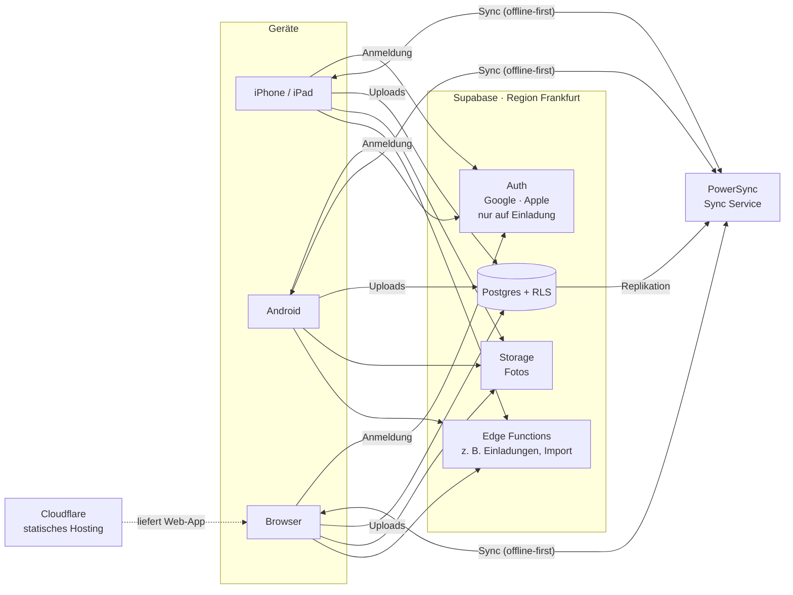
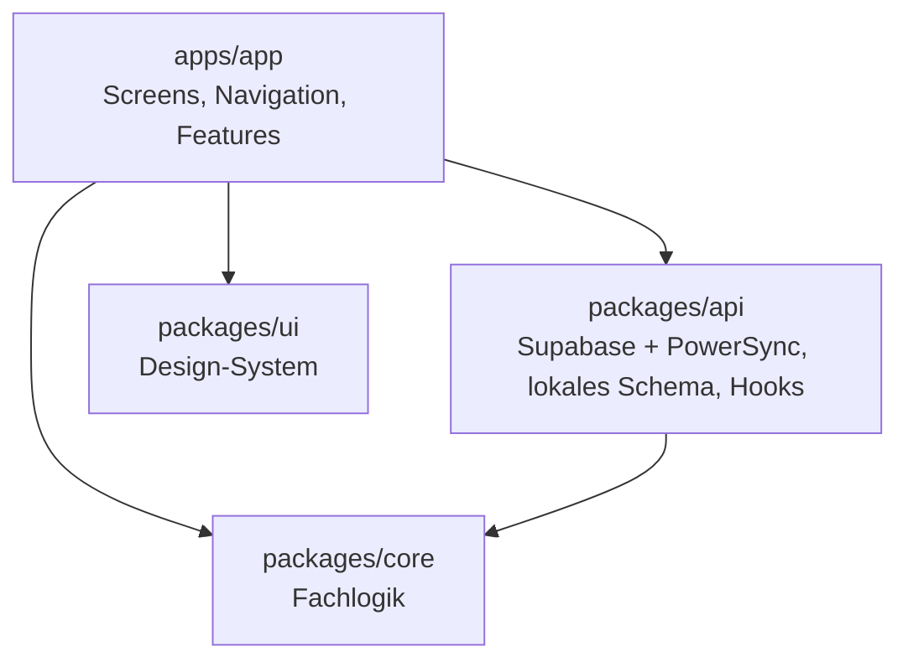

# Architektur-Überblick

## System

| Baustein                             | Technik                                           | Entscheidung                                                                               |
| ------------------------------------ | ------------------------------------------------- | ------------------------------------------------------------------------------------------ |
| App für iOS, iPadOS, Android und Web | Expo (React Native) mit Expo Router               | [ADR-0001](../adr/0001-plattform-und-app-technologie.md)                                   |
| Lokale Daten und Sync                | PowerSync (SQLite auf dem Gerät)                  | [ADR-0002](../adr/0002-offline-faehigkeit-und-synchronisation.md), [Sync-Konzept](sync.md) |
| Backend                              | Supabase: Postgres, Auth, Storage, Edge Functions | [ADR-0002](../adr/0002-offline-faehigkeit-und-synchronisation.md)                          |
| Anmeldung                            | Google und Apple über Supabase Auth, Allowlist    | [ADR-0003](../adr/0003-anmeldung-und-zugang.md)                                            |
| Mandanten                            | Haushalte, durchgesetzt per Row Level Security    | [ADR-0004](../adr/0004-mandantenfaehigkeit-ueber-haushalte.md)                             |
| Repository                           | pnpm-Workspaces + Turborepo                       | [ADR-0005](../adr/0005-monorepo-struktur.md)                                               |
| Arbeitsweise mit KI                  | Specs, Superpowers, kuratierte Skills             | [ADR-0006](../adr/0006-ki-gestuetzte-arbeitsweise.md)                                      |
| Hosting und Kosten                   | Free-Tiers, klarer Skalierungspfad                | [ADR-0007](../adr/0007-hosting-und-kosten.md)                                              |

## Pakete

- **`packages/core`**: reine Fachlogik ohne React, Datenbank oder Plattform-APIs, z. B.
  Einkaufsposten zusammenführen, Mengen umrechnen, nach Laufweg sortieren, Portionen skalieren.
  Hier liegen die meisten Tests.
- **`packages/api`**: entsteht mit der ersten Daten-Spec. Enthält den Supabase- und
  PowerSync-Client, das lokale Schema, den Upload-Connector und die Daten-Hooks.
- **`packages/ui`**: entsteht mit der Design-Spec. Enthält Tokens und Komponenten.
- **`apps/app`**: setzt alles zusammen. Routen in `src/app/`, Features in `src/features/<feature>/`.
