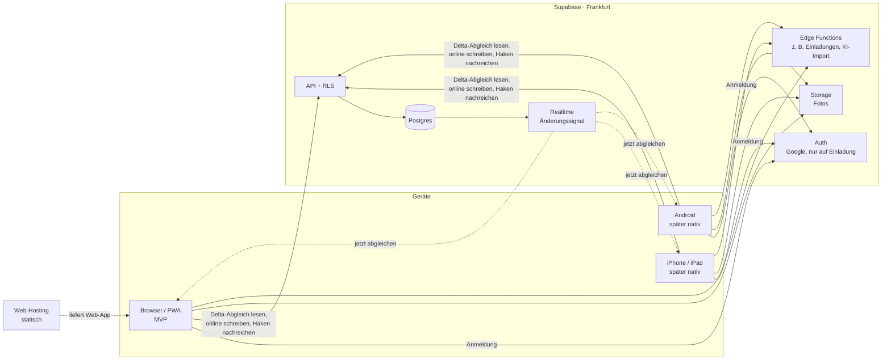
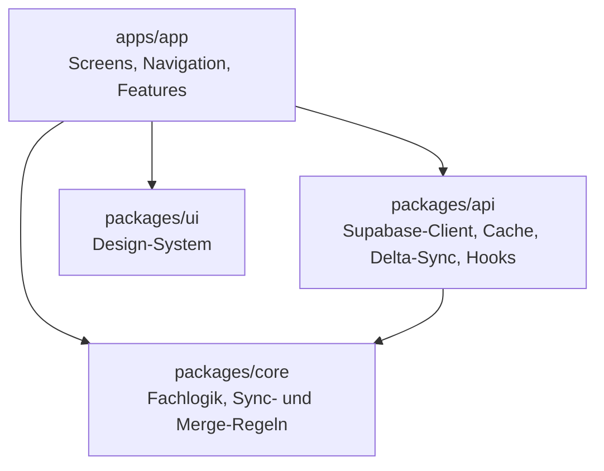

# Architektur-Überblick

## System

Jedes Gerät hält einen lokalen Lese-Cache und liest nur daraus. Geschrieben wird online, nur das
Abhaken geht auch offline ([Sync-Konzept](sync.md)).

| Baustein                                       | Technik                                                          | Entscheidung                                                                             |
| ---------------------------------------------- | ---------------------------------------------------------------- | ---------------------------------------------------------------------------------------- |
| App für Web (MVP), später iOS, iPadOS, Android | Expo (React Native) mit Expo Router                              | [ADR-0001](../adr/0001-plattform-und-app-technologie.md)                                 |
| Offline lesen und Sync                         | eigener Lese-Cache mit Delta-Abgleich                            | [ADR-0008](../adr/0008-offline-lesen-mit-eigenem-delta-sync.md), [Sync-Konzept](sync.md) |
| Backend                                        | Supabase: Postgres, Auth, Realtime, Storage, Edge Functions      | [ADR-0008](../adr/0008-offline-lesen-mit-eigenem-delta-sync.md)                          |
| Anmeldung                                      | Google über Supabase Auth, Allowlist                             | [ADR-0003](../adr/0003-anmeldung-und-zugang.md)                                          |
| Mandanten                                      | Haushalte, durchgesetzt per Row Level Security                   | [ADR-0004](../adr/0004-mandantenfaehigkeit-ueber-haushalte.md)                           |
| Repository                                     | pnpm-Workspaces + Turborepo                                      | [ADR-0005](../adr/0005-monorepo-struktur.md)                                             |
| Arbeitsweise mit KI                            | Specs, Superpowers, kuratierte Skills                            | [ADR-0006](../adr/0006-ki-gestuetzte-arbeitsweise.md)                                    |
| Hosting und Kosten                             | gemanagte Dienste, Free-Tiers                                    | [ADR-0007](../adr/0007-hosting-und-kosten.md)                                            |
| KI (LLM, Speech-to-Text)                       | Microsoft Foundry, OpenAI-kompatible API, nur aus Edge Functions | [ADR-0009](../adr/0009-ki-dienst.md)                                                     |

## Pakete

- **`packages/core`**: reine Fachlogik ohne React, Netzwerk oder Plattform-APIs, z. B.
  Einkaufsposten zusammenführen, nach Laufweg sortieren, Portionen skalieren, Delta anwenden, Haken
  zusammenfassen. Hier liegen die meisten Tests.
- **`packages/api`**: entsteht mit der ersten Daten-Spec. Enthält den Supabase-Client, den
  Cache-Speicher, den Delta-Abgleich, die Abhak-Warteschlange und die Daten-Hooks.
- **`packages/ui`**: entsteht mit der Design-Spec. Enthält Tokens und Komponenten.
- **`apps/app`**: setzt alles zusammen. Routen in `src/app/`, Features in `src/features/<feature>/`.

## Lokale Entwicklung

Lokal läuft Supabase komplett in Docker (Docker Desktop). Für die tägliche Entwicklung braucht es
keine Cloud.

| Teil                                                          | Wie                                                                                                                                                                          |
| ------------------------------------------------------------- | ---------------------------------------------------------------------------------------------------------------------------------------------------------------------------- |
| Supabase (Postgres, Auth, Realtime, Storage, Studio, Mailpit) | `pnpm exec supabase start`. Die Supabase CLI startet und verwaltet die Container selbst; ein eigenes Compose-File würde Migrationen, `test db` und Typ-Generierung aushebeln |
| App                                                           | `pnpm web` (MVP) bzw. `pnpm dev`                                                                                                                                             |

Google-Login funktioniert auch lokal. Die Zugangsdaten liegen in der lokalen `.env`, die nicht ins
Repo geht; `supabase/config.toml` liest sie per `env(...)`.
