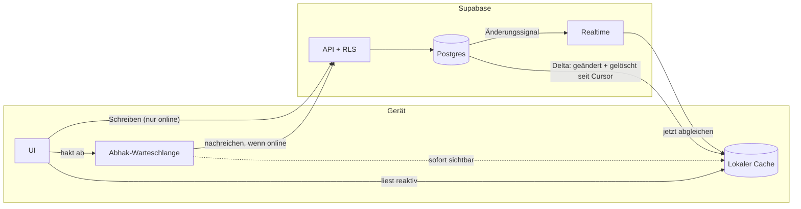

# Sync-Konzept: offline lesen, online schreiben

> Entscheidung: [ADR-0008](../adr/0008-offline-lesen-mit-eigenem-delta-sync.md) (löst ADR-0002
> ab). Dieses Dokument beschreibt, **wie** Cache, Abgleich und Abhaken funktionieren, und gilt für
> jede Spec. Details einzelner Tabellen legt die jeweilige Spec fest.

## Ziel

| Ohne Netz möglich                                                                                     | Braucht Netz                              |
| ----------------------------------------------------------------------------------------------------- | ----------------------------------------- |
| Alles **lesen**: Rezepte, Wochenplan, Einkaufslisten, Märkte und Bereiche                             | Anlegen, bearbeiten, löschen              |
| Im Laden: **abhaken**, „nicht da“, Posten **hinzufügen**, Bereich **zuordnen** (Nachtrag zu ADR-0008) | Einkaufsliste aus dem Wochenplan erzeugen |
| Einkaufsmodus mit Laufreihenfolge                                                                     | Anmelden, Haushalt anlegen, einladen      |

Ohne Netz sind Bearbeiten-Aktionen sichtbar deaktiviert, mit dem Hinweis „Offline – zum Bearbeiten
brauchst du Netz“. Das ist ein normaler Zustand, kein Fehler.

## Bausteine

- **Lokaler Cache:** eine Kopie aller Daten der eigenen Haushalte, gespeichert auf dem Gerät (im
  Browser IndexedDB/OPFS). Die UI liest **nur** daraus.
- **Supabase** ist die Quelle der Wahrheit. Gelesen und geschrieben wird über die normale API.
  **RLS gilt damit überall**, eine zweite Berechtigungsregel gibt es nicht.
- **Realtime** dient nur als Signal („es hat sich etwas geändert“). Daraufhin läuft der normale
  Delta-Abgleich. So gibt es genau einen Weg, auf dem Daten in den Cache kommen.

## Lesen: Delta-Abgleich

**Voraussetzungen je synchronisierter Tabelle:**

- `updated_at` wird **vom Server** per Trigger gesetzt, nie vom Client.
- Ein Lösch-Trigger schreibt jede gelöschte Zeile ins **Löschprotokoll** `deleted_records`
  (Tabelle, ID, Haushalt, Zeitpunkt). Es ist per RLS ebenfalls auf den eigenen Haushalt beschränkt.

**Ablauf:**

1. Das Gerät merkt sich je Tabelle einen **Cursor**: das höchste gesehene `updated_at`.
2. Es holt alle Zeilen mit `updated_at > Cursor − Sicherheitsfenster` und schreibt sie per
   Upsert in den Cache. Das **Sicherheitsfenster** (Startwert 2 Minuten) fängt Transaktionen ab,
   die später committen als ihr Zeitstempel. Doppelt geladene Zeilen schaden nicht.
3. Es holt das Löschprotokoll seit dem Cursor und entfernt diese Zeilen aus dem Cache.
4. Es schreibt den Cursor fort, erst wenn Schritt 2 und 3 vollständig geklappt haben.

**Voll-Load** beim ersten Start, nach dem Abmelden und Wiederanmelden, nach einem Wechsel der
Cache-Version und wenn der Cursor älter ist als die Aufbewahrungsfrist des Löschprotokolls
(Startwert 30 Tage, aufgeräumt per `pg_cron`).

**Auslöser:** App-Start, App kommt in den Vordergrund, Netz ist wieder da, direkt nach eigenem
Schreiben, Realtime-Signal, und als Rückfallebene alle paar Minuten, solange die App offen ist.

**Verlust der Mitgliedschaft:** Taucht ein Haushalt nicht mehr in den eigenen Mitgliedschaften auf,
löscht das Gerät dessen Daten aus dem Cache.

## Schreiben: online

- Schreibaktionen gehen direkt an Supabase (API oder RPC). RLS und Constraints prüfen sie.
- Nach Erfolg läuft sofort ein Delta-Abgleich, und der Cache ist aktuell. Wo es sich lohnt, zeigt
  die UI das Ergebnis schon vorher an und korrigiert sich im Fehlerfall.
- **Mehrteilige Aktionen** (z. B. Liste aus dem Wochenplan erzeugen) laufen als eine RPC in einer
  Transaktion. Halbe Zustände gibt es nicht.
- Ändern zwei Personen gleichzeitig online dasselbe, gilt: Was zuletzt ankommt, gewinnt, je Feld.
  Gesendet werden nur geänderte Felder.

## Abhaken: offline

Abhaken und Haken zurücknehmen wirken **sofort lokal** und landen in einer gespeicherten
**Abhak-Warteschlange**. Mit Netz werden sie der Reihe nach per RPC nachgereicht, z. B.
`set_shopping_item_checked(item_id, checked, seen_checked_at)`. Die Regel setzt der Server in
einer Transaktion durch:

| Stand auf dem Server                         | Auf dem Gerät getan  | Ergebnis                                                   |
| -------------------------------------------- | -------------------- | ---------------------------------------------------------- |
| nicht abgehakt                               | abgehakt             | **abgehakt**                                               |
| abgehakt                                     | nichts               | **bleibt abgehakt**, unberührte Posten werden nie gesendet |
| abgehakt, seit dem Gerät bekannt unverändert | Haken zurückgenommen | **nicht abgehakt**                                         |
| inzwischen von jemand anderem abgehakt       | Haken zurückgenommen | **bleibt abgehakt** („Abhaken gewinnt“)                    |
| Posten inzwischen gelöscht                   | beliebig             | verworfen, kein Fehler                                     |

- Mehrfaches Hin- und Hertippen wird zusammengefasst: Gesendet wird nur der Endzustand je Posten.
  Gleicht er dem Ausgangszustand, wird nichts gesendet.
- Die Warteschlange blockiert nie. Vorübergehende Fehler (offline, 5xx, Timeout) werden später
  wiederholt. Dauerhafte Fehler (4xx) werden verworfen und protokolliert.

## Anmeldung offline

- Die Sitzung wird lokal gespeichert. Die App startet offline mit der letzten Sitzung und dem Cache.
- Tokens werden beim nächsten Netz erneuert. Bis dahin liest die App aus dem Cache und sammelt
  Haken.
- **Abmelden löscht Cache und Warteschlange** auf diesem Gerät.

## Web und PWA

Das MVP läuft als Web-App und wird auf dem Handy als PWA vom Home-Bildschirm genutzt (siehe
Vision). Damit sie im Laden ohne Netz überhaupt startet:

- **App-Hülle:** Ein Service Worker cached HTML, JavaScript und Assets.
- **Daten:** Der Cache liegt im Browser-Speicher.
- **iOS Safari:** Nicht installierte Websites können ihren Speicher nach längerer Nichtnutzung
  verlieren. Als PWA zum Home-Bildschirm hinzugefügt ist das deutlich robuster. Die App weist beim
  ersten Start darauf hin.

Der Code bleibt plattformneutral: Datenzugriff nur über `packages/api`, und der Cache-Speicher
steckt hinter einer Schnittstelle. Die nativen Apps bekommen später einen anderen Speicher, aber
denselben Abgleich.

## Schema-Entwicklung

- Der Cache ist **wegwerfbar**. Ändert sich seine Struktur, erhöht die App die Cache-Version und
  lädt einmal voll neu. Eine Client-Migration gibt es nicht.
- Auf dem Server gilt weiter **expand → migrate → contract**, weil ältere App-Versionen dieselbe
  API nutzen.

## Fotos

Fotos lädt das Gerät bei Netz und hält sie im Cache vor. Hochladen geht nur online. Das Detail
regelt die erste Spec mit Fotos.

## Testen

- **Reine Funktionen in `packages/core`:** Delta anwenden (Upsert, Löschungen, Cursor,
  Sicherheitsfenster) und Haken zusammenfassen. Hier liegen die meisten Tests.
- **pgTAP:** RLS je Tabelle, Lösch-Trigger, die Regeln der Abhak-RPC (alle Zeilen der Tabelle oben).
- **Ende-zu-Ende:** zwei Browser, einer offline beim Abhaken, beide wieder online. Kommt mit der
  ersten Daten-Spec.

## Bewusst nicht gewählt

- **Offline-Bearbeiten für alles:** Jede Tabelle bräuchte Konfliktregeln. Erweiterbar je Feature,
  wenn es gebraucht wird. Erster Kandidat: Posten im Laden hinzufügen.
- **PowerSync oder ein anderer Sync-Dienst:** ein Dienst mehr (ADR-0008).

## Nachtrag Spec 0003 — Umsetzung

- **Schreibweg:** Befehle wirken sofort lokal und gehen als genau eine RPC an den Server
  ([ADR-0011](../adr/0011-schreibweg-mit-lokaler-ueberlagerung.md)). Sichtbar ist
  `Serverzeilen ⊕ Laden-Warteschlange ⊕ ausstehende Änderungssätze`. Ein Satz fällt heraus, wenn
  er bestätigt ist und danach ein Pull angewendet wurde; lehnt der Server ab, fällt er und jeder
  spätere Online-Satz heraus, und die App zeigt „Hat nicht geklappt – bitte noch einmal versuchen“.
- **Cursor je Haushalt und Tabelle.** Ein neuer Haushalt lädt voll, ohne die anderen zu stören.
  Profile, Haushalte, Mitgliedschaften und Einladungen kommen bei jedem Pull vollständig, weil
  sich ihre Sichtbarkeit ohne `updated_at` ändert.
- **Grabstein und Zeile mit derselben ID:** Das spätere Ereignis gewinnt (`updated_at` gegen
  `deleted_at`). So erscheint eine per „Rückgängig“ wieder eingefügte Zeile auf allen Geräten.
- **Zeit:** Die 30-Tage-Grenze misst sich an `server_time` aus dem Pull, nie an der Uhr des
  Geräts. `statement_timeout` für `authenticated` bleibt bei 8 s; das deckt das
  Sicherheitsfenster von 2 Minuten.
- **Abhaken:** Statt eines Zeitstempel-Vergleichs zählt der Server `check_seq` bei jedem Wechsel
  von `checked` hoch. Die RPC heißt `set_shopping_item_checked(item_id, checked, seen_check_seq)`;
  Zurücknehmen greift nur, wenn `check_seq` noch dem gesehenen Wert entspricht.
- **Posten hinzufügen:** `add_shopping_contributions` löst den Namen über `name_key` bzw.
  `synonym_keys` auf, die der Client mit `normalizeText` berechnet; so gibt es die Normalisierung
  nur einmal.
- **Realtime:** Statement-Trigger senden `{table}` an das private Topic `household:<id>`; die
  Nachricht enthält keine Zeilendaten.
- **Vertrauensmodell der Grenzen:** `apply_changes` nimmt höchstens 200 Operationen und
  20 Löschungen je Aufruf an; jede ID in einer `remove_contributions`-Operation zählt als Löschung
  und als Operation. Die Grenzen fangen Fehler im Client ab (etwa einen Diff, der versehentlich
  ganze Tabellen löscht), keine böswilligen Mitglieder: Ein Mitglied darf Zeilen seines Haushalts
  ohnehin direkt über die API löschen. Schutz gegen Fremde geben RLS und die Spaltenrechte.
- **Einladungen** werden immer selbst angenommen (`accept_invitation`) oder abgelehnt
  (`decline_invitation`), auch beim ersten Anmelden; das neue Konto bekommt nur sein Profil.

## Nachtrag Spec 0006 — eine Einkaufsliste ohne eigene Tabelle

- **Eine Liste je Haushalt, keine Tabelle:** Die Einkaufsliste ist die Menge der `shopping_items`
  eines Haushalts (ADR-0012). Es gibt weder `shopping_lists` noch `households.default_list_id` noch
  `shopping_items.list_id`. Je Haushalt und Artikel gibt es höchstens einen offenen Posten
  (`shopping_items_open_article_idx (household_id, article_id) where not checked`).
- **Listen-Aktionen nehmen die Haushalts-Kennung:** `add_shopping_contributions`,
  `clear_checked_items`, `clear_shopping_list` und `restore_cleared_items` bekommen
  `p_household_id`; in `apply_changes` landet `add_contributions` im Haushalt des Aufrufs. Ein
  Haushalt, in dem der Aufrufer nicht Mitglied ist, ergibt `not_member` (42501) — auch in den
  security-invoker-Funktionen, damit eine fremde Kennung nicht still ein leeres Ergebnis liefert.
- **Sperre je Haushalt und Artikel:** Hinzufügen, Zurücknehmen eines Hakens und Wiederherstellen
  serialisieren über `private.lock_household_article(household, article)`.
- **Neue RPCs:** `clear_shopping_list` („Liste leeren …“, alle Posten samt Erledigtem, Rückgabe für
  „Rückgängig“) und `adjust_item_count` (+ und −, ein Aufruf je Tipp, atomar unter der Zeilensperre
  des Postens).
- **Laden-Warteschlange:** Ein „Hinzufügen“ trägt die Haushalts-Kennung. Fehler, die unsere
  Funktionen absichtlich werfen (SQLSTATE P0001/P0002, PostgREST antwortet darauf mit 500), sind
  endgültig: Der Eintrag wird verworfen und blockiert die Warteschlange nicht.
- **Speicher-Version 3:** Der Cache wird einmal neu geladen; Warteschlange, gewählter Haushalt und
  gewählter Markt des Geräts bleiben dabei erhalten.

## Nachtrag Spec 0011 — Erledigungen mit Bedingung, Bewertungen in halben Schritten

- **Erledigungen nur über Domänen-Operationen:** Mitglieder haben auf `chore_events` nur noch
  `select` und `update (chore_id, done_by)`; `insert` und `delete` sind entzogen, und die
  Allowlist von `apply_changes` erlaubt für `chore_events` weder `insert` noch `delete`. Gebucht
  wird mit der Operation `complete_chore` (`{"kind": "complete_chore", "completion": {…}}`),
  entfernt mit `remove_chore_event` (`{"kind": "remove_chore_event", "id": …}`). Beide laufen in
  derselben Transaktion wie der Rest des Aufrufs; eine neue Aufgabe aus „Was anderes erledigt?“
  geht als `insert` auf `chores` plus `complete_chore` in einen Aufruf.
- **Bedingung statt „letzte Änderung gewinnt“:** `complete_chore` sperrt die Aufgabe und bucht nur,
  wenn `next_due_on`, `last_done_on` und `next_assignee_id` noch dem gesehenen Stand (`seen`)
  entsprechen. Sonst schreibt der Server nichts und antwortet `already_done` (P0001, `detail` mit
  `done_by` und `done_at`), wenn es am selben Tag schon eine Erledigung gibt, sonst
  `chore_changed` (P0001). Nächster Termin und nächste Person rechnet weiter `core`; der Server
  prüft nur die Grenzen (Tag heute − 3 bis heute + 1 nach Server-Datum, Termin nach dem Tag, kein
  Termin bei „bei Bedarf“).
- **Der Stand davor liegt an der Erledigung:** `prev_next_due_on`, `prev_last_done_on`,
  `prev_next_assignee_id` und `prev_recorded` setzt nur `complete_chore`, aus der gesperrten
  Zeile. Sie kommen wie jede Spalte über den Delta-Abgleich auf die Geräte, werden aber nie
  zurückgeschrieben. `remove_chore_event` stellt sie wieder her, wenn der Eintrag der zuletzt
  gebuchte seiner noch vorhandenen Aufgabe ist (`created_at`, dann `id`). Entfernen gewinnt gegen
  ein gleichzeitiges Ändern: Die spätere Änderung trifft keine Zeile mehr (`row_not_found`).
- **Grenzen:** `remove_chore_event` zählt als eine Operation und eine Löschung.
- **Bewertungen:** `stars` ist `numeric(2,1)` (0,5 bis 5 in halben Schritten). Die
  `set_*_rating`-RPCs prüfen den ungerundeten Wert und schreiben immer, auch denselben Wert noch
  einmal; `updated_at` der Bewertungszeile sagt damit, wann die Person zuletzt bewertet hat.
- **Auf dem Gerät:** `ChoreEvent.previous` (aus `prev_*`, nur bei `prev_recorded`),
  `ChoreEvent.createdAt` und `ratedAt` (aus `updated_at` der eigenen Bewertungszeile) kommen nur
  vom Server; ein Diff schickt sie nie. Die Überlagerung zeigt eine neue Bewertung sofort mit
  `ratedAt`. Jeder Befehl ist genau ein `apply_changes`-Aufruf: Abhaken, Überspringen und
  Nachtragen schicken `complete_chore` mit dem gesehenen Stand, „Was anderes erledigt?“ ohne
  Treffer zusätzlich das `insert` der neuen Aufgabe davor; „Rückgängig“ schickt
  `remove_chore_event`. Die Cache-Version ist 5.
