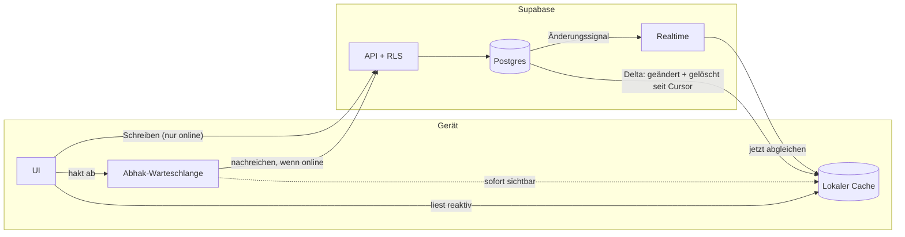

# Sync-Konzept: offline lesen, online schreiben

> Entscheidung: [ADR-0008](../adr/0008-offline-lesen-mit-eigenem-delta-sync.md) (löst ADR-0002
> ab). Dieses Dokument beschreibt, **wie** Cache, Abgleich und Abhaken funktionieren, und gilt für
> jede Spec. Details einzelner Tabellen legt die jeweilige Spec fest.

## Ziel

| Ohne Netz möglich                                                                                     | Braucht Netz                                               |
| ----------------------------------------------------------------------------------------------------- | ---------------------------------------------------------- |
| Alles **lesen**: Rezepte, Wochenplan, Einkaufslisten, Märkte und Bereiche                             | Anlegen, bearbeiten, löschen                               |
| Im Laden: **abhaken**, „nicht da“, Posten **hinzufügen**, Bereich **zuordnen** (Nachtrag zu ADR-0008) | Einkaufsliste aus dem Wochenplan erzeugen                  |
| Einkaufsmodus mit Laufreihenfolge                                                                     | Anmelden, Haushalt anlegen, einladen                       |
| **Packen**, „Alles einpacken“, „Für die Rückreise zurücksetzen“ (ADR-0013)                            | Packstücke und Taschen ergänzen, entfernen                 |
| Benachrichtigungen **empfangen** (der Server stellt zu, ADR-0014)                                     | Benachrichtigungen einstellen, Geräte anmelden und ansehen |

Ohne Netz sind Bearbeiten-Aktionen sichtbar deaktiviert, mit dem Hinweis „Offline – zum Bearbeiten
brauchst du Netz“. Das ist ein normaler Zustand, kein Fehler.

## Bausteine

- **Lokaler Cache:** eine Kopie aller Daten der eigenen Haushalte, gespeichert auf dem Gerät (im
  Browser IndexedDB/OPFS). Die UI liest **nur** daraus.
- **Supabase** ist die Quelle der Wahrheit. Gelesen und geschrieben wird über die normale API.
  **RLS gilt damit überall**, eine zweite Berechtigungsregel gibt es nicht.
- **Realtime** dient nur als Signal („es hat sich etwas geändert“). Daraufhin läuft der normale
  Delta-Abgleich. So gibt es genau einen Weg, auf dem Daten in den Cache kommen.

## Lesen: Delta-Abgleich

**Voraussetzungen je synchronisierter Tabelle:**

- `updated_at` wird **vom Server** per Trigger gesetzt, nie vom Client.
- Ein Lösch-Trigger schreibt jede gelöschte Zeile ins **Löschprotokoll** `deleted_records`
  (Tabelle, ID, Haushalt, Zeitpunkt). Es ist per RLS ebenfalls auf den eigenen Haushalt beschränkt.

**Ablauf:**

1. Das Gerät merkt sich je Tabelle einen **Cursor**: das höchste gesehene `updated_at`.
2. Es holt alle Zeilen mit `updated_at > Cursor − Sicherheitsfenster` und schreibt sie per
   Upsert in den Cache. Das **Sicherheitsfenster** (Startwert 2 Minuten) fängt Transaktionen ab,
   die später committen als ihr Zeitstempel. Doppelt geladene Zeilen schaden nicht.
3. Es holt das Löschprotokoll seit dem Cursor und entfernt diese Zeilen aus dem Cache.
4. Es schreibt den Cursor fort, erst wenn Schritt 2 und 3 vollständig geklappt haben.

**Voll-Load** beim ersten Start, nach dem Abmelden und Wiederanmelden, nach einem Wechsel der
Cache-Version und wenn der Cursor älter ist als die Aufbewahrungsfrist des Löschprotokolls
(Startwert 30 Tage, aufgeräumt per `pg_cron`).

**Auslöser:** App-Start, App kommt in den Vordergrund, Netz ist wieder da, direkt nach eigenem
Schreiben, Realtime-Signal, und als Rückfallebene alle paar Minuten, solange die App offen ist.

**Verlust der Mitgliedschaft:** Taucht ein Haushalt nicht mehr in den eigenen Mitgliedschaften auf,
löscht das Gerät dessen Daten aus dem Cache.

## Schreiben: online

- Schreibaktionen gehen direkt an Supabase (API oder RPC). RLS und Constraints prüfen sie.
- Nach Erfolg läuft sofort ein Delta-Abgleich, und der Cache ist aktuell. Wo es sich lohnt, zeigt
  die UI das Ergebnis schon vorher an und korrigiert sich im Fehlerfall.
- **Mehrteilige Aktionen** (z. B. Liste aus dem Wochenplan erzeugen) laufen als eine RPC in einer
  Transaktion. Halbe Zustände gibt es nicht.
- Ändern zwei Personen gleichzeitig online dasselbe, gilt: Was zuletzt ankommt, gewinnt, je Feld.
  Gesendet werden nur geänderte Felder.

## Abhaken: offline

Abhaken und Haken zurücknehmen wirken **sofort lokal** und landen in einer gespeicherten
**Abhak-Warteschlange**. Mit Netz werden sie der Reihe nach per RPC nachgereicht, z. B.
`set_shopping_item_checked(item_id, checked, seen_checked_at)`. Die Regel setzt der Server in
einer Transaktion durch:

| Stand auf dem Server                         | Auf dem Gerät getan  | Ergebnis                                                   |
| -------------------------------------------- | -------------------- | ---------------------------------------------------------- |
| nicht abgehakt                               | abgehakt             | **abgehakt**                                               |
| abgehakt                                     | nichts               | **bleibt abgehakt**, unberührte Posten werden nie gesendet |
| abgehakt, seit dem Gerät bekannt unverändert | Haken zurückgenommen | **nicht abgehakt**                                         |
| inzwischen von jemand anderem abgehakt       | Haken zurückgenommen | **bleibt abgehakt** („Abhaken gewinnt“)                    |
| Posten inzwischen gelöscht                   | beliebig             | verworfen, kein Fehler                                     |

- Mehrfaches Hin- und Hertippen wird zusammengefasst: Gesendet wird nur der Endzustand je Posten.
  Gleicht er dem Ausgangszustand, wird nichts gesendet.
- Die Warteschlange blockiert nie. Vorübergehende Fehler (offline, 5xx, Timeout) werden später
  wiederholt. Dauerhafte Fehler (4xx) werden verworfen und protokolliert.

## Anmeldung offline

- Die Sitzung wird lokal gespeichert. Die App startet offline mit der letzten Sitzung und dem Cache.
- Tokens werden beim nächsten Netz erneuert. Bis dahin liest die App aus dem Cache und sammelt
  Haken.
- **Abmelden löscht Cache und Warteschlange** auf diesem Gerät.

## Web und PWA

Das MVP läuft als Web-App und wird auf dem Handy als PWA vom Home-Bildschirm genutzt (siehe
Vision). Damit sie im Laden ohne Netz überhaupt startet:

- **App-Hülle:** Ein Service Worker cached HTML, JavaScript und Assets.
- **Daten:** Der Cache liegt im Browser-Speicher.
- **iOS Safari:** Nicht installierte Websites können ihren Speicher nach längerer Nichtnutzung
  verlieren. Als PWA zum Home-Bildschirm hinzugefügt ist das deutlich robuster. Die App weist beim
  ersten Start darauf hin.

Der Code bleibt plattformneutral: Datenzugriff nur über `packages/api`, und der Cache-Speicher
steckt hinter einer Schnittstelle. Die nativen Apps bekommen später einen anderen Speicher, aber
denselben Abgleich.

## Schema-Entwicklung

- Der Cache ist **wegwerfbar**. Ändert sich seine Struktur, erhöht die App die Cache-Version und
  lädt einmal voll neu. Eine Client-Migration gibt es nicht.
- Auf dem Server gilt weiter **expand → migrate → contract**, weil ältere App-Versionen dieselbe
  API nutzen.

## Fotos

Fotos lädt das Gerät bei Netz und hält sie im Cache vor. Hochladen geht nur online. Das Detail
regelt die erste Spec mit Fotos.

## Testen

- **Reine Funktionen in `packages/core`:** Delta anwenden (Upsert, Löschungen, Cursor,
  Sicherheitsfenster) und Haken zusammenfassen. Hier liegen die meisten Tests.
- **pgTAP:** RLS je Tabelle, Lösch-Trigger, die Regeln der Abhak-RPC (alle Zeilen der Tabelle oben).
- **Ende-zu-Ende:** zwei Browser, einer offline beim Abhaken, beide wieder online. Kommt mit der
  ersten Daten-Spec.

## Bewusst nicht gewählt

- **Offline-Bearbeiten für alles:** Jede Tabelle bräuchte Konfliktregeln. Erweiterbar je Feature,
  wenn es gebraucht wird. Erster Kandidat: Posten im Laden hinzufügen.
- **PowerSync oder ein anderer Sync-Dienst:** ein Dienst mehr (ADR-0008).

## Nachtrag Spec 0003 — Umsetzung

- **Schreibweg:** Befehle wirken sofort lokal und gehen als genau eine RPC an den Server
  ([ADR-0011](../adr/0011-schreibweg-mit-lokaler-ueberlagerung.md)). Sichtbar ist
  `Serverzeilen ⊕ Laden-Warteschlange ⊕ ausstehende Änderungssätze`. Ein Satz fällt heraus, wenn
  er bestätigt ist und danach ein Pull angewendet wurde; lehnt der Server ab, fällt er und jeder
  spätere Online-Satz heraus, und die App zeigt „Hat nicht geklappt – bitte noch einmal versuchen“.
- **Cursor je Haushalt und Tabelle.** Ein neuer Haushalt lädt voll, ohne die anderen zu stören.
  Profile, Haushalte, Mitgliedschaften und Einladungen kommen bei jedem Pull vollständig, weil
  sich ihre Sichtbarkeit ohne `updated_at` ändert.
- **Grabstein und Zeile mit derselben ID:** Das spätere Ereignis gewinnt (`updated_at` gegen
  `deleted_at`). So erscheint eine per „Rückgängig“ wieder eingefügte Zeile auf allen Geräten.
- **Zeit:** Die 30-Tage-Grenze misst sich an `server_time` aus dem Pull, nie an der Uhr des
  Geräts. `statement_timeout` für `authenticated` bleibt bei 8 s; das deckt das
  Sicherheitsfenster von 2 Minuten.
- **Abhaken:** Statt eines Zeitstempel-Vergleichs zählt der Server `check_seq` bei jedem Wechsel
  von `checked` hoch. Die RPC heißt `set_shopping_item_checked(item_id, checked, seen_check_seq)`;
  Zurücknehmen greift nur, wenn `check_seq` noch dem gesehenen Wert entspricht.
- **Posten hinzufügen:** `add_shopping_contributions` löst den Namen über `name_key` bzw.
  `synonym_keys` auf, die der Client mit `normalizeText` berechnet; so gibt es die Normalisierung
  nur einmal.
- **Realtime:** Statement-Trigger senden `{table}` an das private Topic `household:<id>`; die
  Nachricht enthält keine Zeilendaten.
- **Vertrauensmodell der Grenzen:** `apply_changes` nimmt höchstens 200 Operationen und
  20 Löschungen je Aufruf an; jede ID in einer `remove_contributions`-Operation zählt als Löschung
  und als Operation. Die Grenzen fangen Fehler im Client ab (etwa einen Diff, der versehentlich
  ganze Tabellen löscht), keine böswilligen Mitglieder: Ein Mitglied darf Zeilen seines Haushalts
  ohnehin direkt über die API löschen. Schutz gegen Fremde geben RLS und die Spaltenrechte.
- **Einladungen** werden immer selbst angenommen (`accept_invitation`) oder abgelehnt
  (`decline_invitation`), auch beim ersten Anmelden; das neue Konto bekommt nur sein Profil.

## Nachtrag Spec 0006 — eine Einkaufsliste ohne eigene Tabelle

- **Eine Liste je Haushalt, keine Tabelle:** Die Einkaufsliste ist die Menge der `shopping_items`
  eines Haushalts (ADR-0012). Es gibt weder `shopping_lists` noch `households.default_list_id` noch
  `shopping_items.list_id`. Je Haushalt und Artikel gibt es höchstens einen offenen Posten
  (`shopping_items_open_article_idx (household_id, article_id) where not checked`).
- **Listen-Aktionen nehmen die Haushalts-Kennung:** `add_shopping_contributions`,
  `clear_checked_items`, `clear_shopping_list` und `restore_cleared_items` bekommen
  `p_household_id`; in `apply_changes` landet `add_contributions` im Haushalt des Aufrufs. Ein
  Haushalt, in dem der Aufrufer nicht Mitglied ist, ergibt `not_member` (42501) — auch in den
  security-invoker-Funktionen, damit eine fremde Kennung nicht still ein leeres Ergebnis liefert.
- **Sperre je Haushalt und Artikel:** Hinzufügen, Zurücknehmen eines Hakens und Wiederherstellen
  serialisieren über `private.lock_household_article(household, article)`.
- **Neue RPCs:** `clear_shopping_list` („Liste leeren …“, alle Posten samt Erledigtem, Rückgabe für
  „Rückgängig“) und `adjust_item_count` (+ und −, ein Aufruf je Tipp, atomar unter der Zeilensperre
  des Postens).
- **Laden-Warteschlange:** Ein „Hinzufügen“ trägt die Haushalts-Kennung. Fehler, die unsere
  Funktionen absichtlich werfen (SQLSTATE P0001/P0002, PostgREST antwortet darauf mit 500), sind
  endgültig: Der Eintrag wird verworfen und blockiert die Warteschlange nicht.
- **Speicher-Version 3:** Der Cache wird einmal neu geladen; Warteschlange, gewählter Haushalt und
  gewählter Markt des Geräts bleiben dabei erhalten.

## Nachtrag Spec 0007 — Artikel-Katalog, Märkte und Bereiche

- **Artikel werden nie direkt gelöscht:** `authenticated` hat kein `delete`-Recht auf `articles`,
  und die Allowlist von `apply_changes` steht für `articles` auf `"delete": false`; ein Diff
  schickt nie das Löschen eines Artikels. Gelöscht wird nur über zwei RPCs:
  - `delete_article` sperrt die Zeile `for update` und prüft erst danach „unbenutzt“ (in keinem
    Rezept, in keinem Posten, offen oder erledigt; sonst `article_in_use`). Es gibt die gelöschte
    Zeile zurück; „Rückgängig“ fügt sie über `apply_changes` wieder ein.
  - `merge_articles` führt die Quelle in einer Transaktion ins Ziel: Zutaten in
    `recipes.ingredients` umschreiben (zwei Zeilen im selben Rezept bleiben zwei), stehen beide
    offen auf der Liste, die Beiträge in den Posten des Ziels ziehen und den Quellposten löschen,
    übrige Posten der Quelle aufs Ziel, leere Angaben des Ziels füllen, die Quelle löschen, Name
    und Synonyme der Quelle als Synonyme ans Ziel. Mehr als 30 Synonyme oder mehr als 2000 Zeichen
    in allen Synonymen oder ihren Schlüsseln ergeben `too_many_synonyms`, und nichts ändert sich.
- **Bereiche:** `merge_areas` („Zusammenlegen“) ist eine RPC: Sie zieht die Artikel um, nimmt die
  Quelle aus `area_order` und `hidden_area_ids` jedes Markts und löscht sie. Einen Bereich löschen
  schickt `apply_changes` mit dem Löschen des Bereichs und dem Patch der Laufreihenfolge jedes
  betroffenen Markts im selben Änderungssatz; die Artikel verlieren den Bereich über den
  Fremdschlüssel (`on delete set null`, mit neuem `updated_at`).
- **Weiterleitung nach dem Zusammenführen:** Der Grabstein eines beim Zusammenführen gelöschten
  Postens trägt `deleted_records.replaced_by` (die ID des Postens des Ziels). Mitglieder können die
  Spalte nicht schreiben. `set_shopping_item_checked` und `set_shopping_item_not_available` folgen
  dem Verweis, wenn der Posten selbst fehlt: höchstens 5 Schritte, nur im Haushalt des Grabsteins
  und nur, wenn der Aufrufer dort Mitglied ist, sonst `null` wie bisher. Ein offline gemachter
  Haken auf die Quelle trifft so den Posten des Ziels (AC-040). Ein Zurücknehmen auf einen
  ersetzten Posten bleibt wirkungslos, weil der gesehene `check_seq` zum alten Posten gehört. Die
  30-Tage-Aufbewahrung der Grabsteine gilt auch für die Verweise.
- **Bereich zuordnen aus der Warteschlange:** `assign_article_area` gibt `null` zurück, wenn der
  Artikel fehlt (gelöscht oder zusammengeführt) oder der Bereich fehlt oder zu einem anderen
  Haushalt gehört; der Eintrag wird ohne Fehler verworfen. Für Bereichszuordnungen gibt es keine
  Weiterleitung.
- **Zutaten zeigen immer auf einen Artikel:** Der Trigger `recipes_check_ingredients` (vor
  Einfügen und vor Ändern von `ingredients`) verlangt je Zutat eine `articleId` eines Artikels des
  eigenen Haushalts und einen `prepNote` von höchstens 200 Zeichen, sonst
  `ingredient_article_invalid` (23503). Er liest die Artikel `for key share`, damit
  `delete_article` und `merge_articles` keinen davon entfernen, während das Rezept gespeichert
  wird.
- **Sperr-Reihenfolge:** `merge_articles` sperrt zuerst je Haushalt und Artikel
  (`lock_household_article`, wie die Laden-RPCs), dann die betroffenen Rezepte `for update`, dann
  die beiden Artikel `for update`. Ein gleichzeitiges Ändern von Zutaten sperrt erst die
  Rezeptzeile und liest dann die Artikel; weil beide die Rezepte vor den Artikeln sperren, können
  sie sich nicht gegenseitig blockieren. Bricht Postgres einen Aufruf trotzdem wegen Deadlock oder
  Serialisierung ab (40P01, 40001), wurde nichts geschrieben; der Transport versucht ihn genau
  einmal neu.
- **Eindeutigkeit:** Name und Synonyme eines Artikels kollidieren mit keinem Namen oder Synonym
  eines anderen Artikels desselben Haushalts (Trigger unter Haushalts-Sperre, `name_taken`);
  Bereichsnamen sind je Haushalt eindeutig über `lower(name)`. `name_key` und `synonym_keys`
  berechnet das Gerät (`normalizeText`); die Datenbank verlässt sich darauf, dass Mitglieder sie
  ehrlich schicken — ein falscher Schlüssel wirkt nur im eigenen Haushalt.
- **Speicher-Version 4:** neue Felder an Artikeln (`defaultShoppingRule`, `needsReview`) und
  Zutaten (`prepNote`, kein `name` mehr). Der Cache wird einmal neu geladen; Warteschlange,
  gewählter Haushalt und gewählter Markt bleiben erhalten.

## Nachtrag Spec 0008 — Rezept löschen mit „Rückgängig“

- **Rezepte werden nur per RPC gelöscht:** `authenticated` hat kein `delete`-Recht auf `recipes`,
  und die Allowlist von `apply_changes` steht für `recipes` auf `"delete": false`. Gelöscht wird
  nur über `delete_recipe(recipe_id, today)`; nur so lässt sich jedes Löschen rückgängig machen,
  und der Kalender bleibt stimmig. Einen Haushalt zu löschen, kaskadiert weiter ohne Grant. Löscht
  jemand ein eingeplantes Rezept an der RPC vorbei (Superuser), verhindert `on delete restrict`
  der Planeinträge das mit 23503.
- **Folgen für den Kalender:** Einträge des Rezepts mit Tag bis einschließlich `today` werden
  Freitext mit dem Titel (Reste: „Reste von <Titel>“); Esser, Portionen, Koch und „nicht gekocht“
  bleiben. Spätere und vorgemerkte Einträge werden gelöscht, und mit ihnen Reste ohne eigenes
  Rezept, die auf einen gelöschten Eintrag zeigen (auch Reste davon). `today` ist das Datum des
  Geräts; der Server nimmt nur `current_date` ± 1 Tag an (`invalid_value`). Beiträge auf der
  Einkaufsliste bleiben unverändert. Das Gerät rechnet dieselbe Wirkung vorab
  (`core.recipeDeletionEffect`) und zeigt sie sofort; die Geräte der anderen erfahren das Löschen
  über die Grabsteine von `recipes`, `recipe_ratings`, `recipe_favorites` und
  `meal_plan_entries` sowie das neue `updated_at` der umgeschriebenen Einträge.
- **Sperren:** `delete_recipe` sperrt die Rezeptzeile, dann seine Planeinträge und dann die
  mitgehenden Reste ohne Rezept `for update`, bevor es den Schnappschuss liest. Ein gleichzeitiges
  „Einplanen“ wartet auf die Sperre und scheitert danach am Fremdschlüssel (23503); das Gerät nimmt
  es zurück und zeigt „Das Rezept gibt es nicht mehr“. Artikel sperrt `delete_recipe` nicht.
- **`private.recipe_deletions` — bewusste Ausnahme von Regel 5:** Der Schnappschuss für
  „Rückgängig“ (Rezeptzeile, Bewertungen, Favoriten, alte Werte der Freitext-Einträge, gelöschte
  Einträge vollständig) liegt im Schema `private`, mit RLS ohne Policies, ohne Grants und ohne
  Sync. Kein Gerät liest ihn, damit niemand die Bewertungen anderer fälschen kann; deshalb hat
  die Tabelle weder `updated_at`-Abgleich noch Grabstein. Sie ist an den Haushalt gebunden
  (Fremdschlüssel mit Kaskade), ein Schnappschuss je Rezept. Aufgeräumt wird bei jedem
  `delete_recipe` des Haushalts und stündlich per `pg_cron` (`purge-recipe-deletions`, Minute 20).
- **Bedingungen für `restore_recipe(recipe_id)`:** nur die Person, die gelöscht hat, solange sie
  Mitglied des Haushalts ist, und nur innerhalb von 1 Stunde; sonst `recipe_not_restorable`
  (P0002). Das Gerät schickt nur die ID. Zurück kommen das Rezept mit derselben ID, `photo_path`
  und dem ursprünglichen `created_at` (Trigger `recipes_stamp_restored`), Bewertungen und Favoriten
  heutiger Mitglieder, die gelöschten Einträge (Esser nur heutige Mitglieder, Koch leer, wenn er
  fehlt) und die Freitext-Einträge, solange sie unverändert sind. Das Rezept bekommt ein neues
  `updated_at` und gewinnt so gegen seinen Grabstein. Steht die ID im selben Haushalt schon wieder,
  antwortet der Server `false` und ändert nichts; das Gerät behandelt das als Ablehnung mit dem
  allgemeinen Hinweis. Ist die ID inzwischen in einem anderen Haushalt vergeben, heißt es
  `recipe_not_restorable`. Fehlt ein Artikel oder eine Tageszeit, scheitert der ganze Aufruf.
- **Foto:** Die Datenbank löscht keine Storage-Objekte. Die App löscht das eigene Foto erst, wenn
  der Hinweis „… gelöscht · Rückgängig“ ohne „Rückgängig“ ausläuft. Bricht die App vorher ab oder
  scheitert „Rückgängig“, bleibt das Objekt im Ordner des Haushalts liegen (hingenommen).
- **Kein neuer Cache:** keine neue synchronisierte Tabelle, keine neue Spalte; die
  Cache-Version bleibt.

## Nachtrag Spec 0009 — Sammlungen

- **Eine Sammlung ist ein Rezept mit anderer Art:** `recipes.kind` (`'recipe'` oder
  `'collection'`, Standard `'recipe'`). Die Art steht im `insert`-Grant und in der
  `insert`-Allowlist von `apply_changes`, aber weder im `update`-Grant noch in `patch`; direkt
  ergibt eine Änderung 42501, über `apply_changes` `invalid_change`. Für Wege mit `security
definer` wirft der Trigger `recipes_kind_immutable` `kind_immutable` (22023) für jede Rolle.
  Eine Sammlung hat keine Gerichtart, Zeit, Küche, Schlagworte, Varianten, Schritte und keinen
  Vorlauf, und keine ihrer eigenen Zutaten hat eine Variante (Check `recipes_kind_fields`, 23514);
  dafür ist `recipes.course` nullbar und bei Rezepten Pflicht. Bewertung, Favorit, Foto, Suche,
  Einplanen und „Wie war's?“ laufen unverändert über die Wege der Rezepte.
- **Neue Tabelle `collection_recipes`** (Glossar „Enthaltenes Rezept“), synchronisiert wie jede
  Haushaltstabelle (RLS über `attach_household_policies`, `updated_at` und Grabstein über
  `attach_sync_triggers`, `sync_pull` direkt nach `recipe_ratings`). Spalten: Sammlung, Rezept,
  eigene Portionen (leer = wie die Sammlung), Variante (leer = Standardvariante), `sort`.
  Zusammengesetzte Fremdschlüssel `(household_id, collection_id)` und `(household_id, recipe_id)`
  auf `recipes` mit Kaskade halten beide Seiten im selben Haushalt (23503). Ein Rezept steht
  höchstens einmal in einer Sammlung (`collection_recipes_recipe_once`, 23505). Änderbar sind nur
  `servings`, `variant_id` und `sort`; Sammlung, Rezept und Haushalt einer Zeile nie. Der Trigger
  `collection_recipes_check` (vor `insert`, security invoker) lässt nur Rezepte in Sammlungen zu
  (`collection_recipe_kind_invalid`, 23514) und höchstens 50 je Sammlung
  (`too_many_collection_recipes`, 23514; unter gleichzeitigen Aufrufen nicht hart, hingenommen).
- **Löschen und „Rückgängig“ nehmen die Inhalte mit:** `delete_recipe` sperrt zusätzlich alle
  Zeilen von `collection_recipes` der Sammlung bzw. des Rezepts (nach den Planeinträgen, vor den
  Resten), legt sie vollständig in den Schnappschuss (`collection_recipes`) und meldet in
  `collections`, aus wie vielen Sammlungen ein Rezept entfernt wurde. Die Kaskade löscht die
  Zeilen mit Grabsteinen; die enthaltenen Rezepte einer gelöschten Sammlung bleiben unverändert.
  `restore_recipe` setzt `kind` aus dem Schnappschuss und fügt die Zeilen mit ihren Kennungen,
  Portionen, Varianten und `sort` wieder ein, aber nur, wo die andere Seite im Haushalt noch
  existiert. Ist das Rezept dort inzwischen wieder enthalten, bleibt die vorhandene Zeile
  (`on conflict (household_id, collection_id, recipe_id) do nothing`). Ist eine Zeilen-Kennung
  inzwischen in einem anderen Haushalt vergeben, scheitert „Rückgängig“ laut mit 23505, ebenso an
  einer inzwischen vollen Sammlung; dann kommt nichts zurück.
- **„Gekocht“ aus dem Kalender, ohne Spalte:** `core.cookingHistory` zählt jeden Planeintrag mit
  Tag bis einschließlich heute ohne „nicht gekocht“ für sein Rezept und bei einer Sammlung für
  jedes Rezept, das sie heute enthält. `withCookingHistory` verbindet das mit den gespeicherten
  Werten (`last_cooked_on` = Maximum, `cooked_count` = Summe). Gerechnet wird auf dem Gerät, auch
  offline; es gibt keinen Trigger und keinen Schreibweg.
- **Auf dem Gerät:** `HouseholdData.collectionRecipes`; `changes.ts` schickt eine neue Sammlung
  vor ihren Zeilen (`TABLE_ORDER`). Jede Aktion ist ein Aufruf (Plan E12): „n Rezepte übernehmen“,
  „+ Neue Sammlung“ samt Zeile und „Enthält“ → „Fertig“ (Patches und Löschungen, höchstens 20)
  je ein `apply_changes`. Kommt die Entfernung eines Rezepts per Sync an, bevor das andere Gerät
  bei „Enthält“ „Fertig“ wählt, schickt das Gerät nichts, zeigt „Hat nicht geklappt – bitte noch
  einmal versuchen“ und öffnet den Abschnitt mit dem aktuellen Stand (`core.contentsRowsGone`).
  Die Cache-Version ist 7.

## Nachtrag Spec 0011 — Erledigungen mit Bedingung, Bewertungen in halben Schritten

- **Erledigungen nur über Domänen-Operationen:** Mitglieder haben auf `chore_events` nur noch
  `select` und `update (chore_id, done_by)`; `insert` und `delete` sind entzogen, und die
  Allowlist von `apply_changes` erlaubt für `chore_events` weder `insert` noch `delete`. Gebucht
  wird mit der Operation `complete_chore` (`{"kind": "complete_chore", "completion": {…}}`),
  entfernt mit `remove_chore_event` (`{"kind": "remove_chore_event", "id": …}`). Beide laufen in
  derselben Transaktion wie der Rest des Aufrufs; eine neue Aufgabe aus „Was anderes erledigt?“
  geht als `insert` auf `chores` plus `complete_chore` in einen Aufruf.
- **Bedingung statt „letzte Änderung gewinnt“:** `complete_chore` sperrt die Aufgabe und bucht nur,
  wenn `next_due_on`, `last_done_on`, `next_assignee_id` und die zuletzt gebuchte Erledigung
  (`latest_event_id`, nach `created_at` auf die Mikrosekunde, dann `id`; `null` ohne Erledigung)
  noch dem gesehenen Stand (`seen`) entsprechen. Die Erledigung braucht es, weil eine zweite
  Buchung einer flexiblen Aufgabe für „egal wer“ am selben Tag die drei Spalten unverändert lässt.
  Sonst schreibt der Server nichts und antwortet `already_done` (P0001, `detail` mit
  `done_by` und `done_at`), wenn es am selben Tag schon eine Erledigung gibt, sonst
  `chore_changed` (P0001). Nächster Termin und nächste Person rechnet weiter `core`; der Server
  prüft nur die Grenzen (Tag heute − 3 bis heute + 1 nach Server-Datum, Termin nach dem Tag, kein
  Termin bei „bei Bedarf“).
- **Der Stand davor liegt an der Erledigung:** `prev_next_due_on`, `prev_last_done_on`,
  `prev_next_assignee_id` und `prev_recorded` setzt nur `complete_chore`, aus der gesperrten
  Zeile. Sie kommen wie jede Spalte über den Delta-Abgleich auf die Geräte, werden aber nie
  zurückgeschrieben. `remove_chore_event` stellt sie wieder her, wenn der Eintrag der zuletzt
  gebuchte seiner noch vorhandenen Aufgabe ist (`created_at`, dann `id`). Entfernen gewinnt gegen
  ein gleichzeitiges Ändern: Die spätere Änderung trifft keine Zeile mehr (`row_not_found`).
- **Zeitpunkt des Eintrags:** `created_at` einer Erledigung aus `complete_chore` ist
  `clock_timestamp()` (Trigger `chore_events_stamp_booking`), nicht der Beginn der Transaktion.
  Zwei Erledigungen derselben Aufgabe in einem Aufruf behalten so ihre Reihenfolge, und eine
  Erledigung, die auf die Sperre gewartet hat, liegt hinter der, auf die sie gewartet hat.
  `updated_at` bleibt `now()`; der Delta-Abgleich liest nur `updated_at`.
- **Die Verknüpfung bleibt:** `chore_id` einer Erledigung wechselt nur von leer auf eine Aufgabe
  („Rückgängig“ nach dem Löschen) und wird nur durch das Löschen der Aufgabe leer. Jede andere
  Änderung lehnt der Trigger `chore_events_keep_chore` mit `invalid_change` (22023) ab. Sonst
  stellte `remove_chore_event` den Stand davor an der falschen Aufgabe her.
- **Grenzen:** `complete_chore` und `remove_chore_event` zählen je als eine Operation und eine
  Löschung. Ob `complete_chore` eine einmalige Aufgabe löscht, steht erst unter der Sperre fest;
  darum zählt jede Buchung.
- **Bewertungen:** `stars` ist `numeric(2,1)` (0,5 bis 5 in halben Schritten). Die
  `set_*_rating`-RPCs prüfen den ungerundeten Wert und schreiben immer, auch denselben Wert noch
  einmal; `updated_at` der Bewertungszeile sagt damit, wann die Person zuletzt bewertet hat.
- **Auf dem Gerät:** `ChoreEvent.previous` (aus `prev_*`, nur bei `prev_recorded`),
  `ChoreEvent.createdAt` und `ratedAt` (aus `updated_at` der eigenen Bewertungszeile) kommen nur
  vom Server; ein Diff schickt sie nie. Die Überlagerung zeigt eine neue Bewertung sofort mit
  `ratedAt`. Jeder Befehl ist genau ein `apply_changes`-Aufruf: Abhaken, Überspringen und
  Nachtragen schicken `complete_chore` mit dem gesehenen Stand, „Was anderes erledigt?“ ohne
  Treffer zusätzlich das `insert` der neuen Aufgabe davor; „Rückgängig“ schickt
  `remove_chore_event`. Die Cache-Version ist 5.

## Nachtrag Spec 0012 — Packen ohne Netz

Entscheidung: [ADR-0013](../adr/0013-packen-ohne-netz.md). Die Datenbank- und App-Teile ergänzen
die Tasks 2 und 5 von Spec 0012.

- **Packen ohne Netz.** „Gepackt / nicht gepackt“ ist eine weitere Aktion der
  Laden-Warteschlange mit der Regel „Abhaken gewinnt“ über den Zähler `pack_seq`: Packen gewinnt
  immer, Zurücknehmen greift nur, wenn `pack_seq` noch dem gesehenen Wert entspricht.
- **Sammel-Aktionen.** „Alles einpacken“ und „Für die Rückreise zurücksetzen“ legen je Packstück
  einen Eintrag an. Hin- und Hertippen fasst die Warteschlange wie beim Einkaufsposten je
  Packstück zum Endzustand zusammen; „Rückgängig“ nach „Alles einpacken“ nimmt so genau die eben
  gepackten Stücke zurück, auch ohne Netz.
- **Ein Aufruf je Folge.** Eine zusammenhängende Folge von Pack-Einträgen eines Haushalts geht als
  ein Aufruf `set_packing_items_packed(household_id, changes)` in einer Transaktion an den Server,
  höchstens 200 Änderungen je Aufruf. Die Folge endet am ersten Eintrag eines anderen Haushalts
  oder einer anderen Art.
- **Fehlende Packstücke** (Packstück, Tasche oder Abwesenheit inzwischen gelöscht, oder fremder
  Haushalt) überspringt der Server ohne Fehler; der Eintrag gilt als bestätigt und blockiert die
  Warteschlange nie.
- **Online bleiben** Hinzufügen und Entfernen von Packstücken und Taschen. Die Gepackt-Spalten
  (`packed`, `packed_at`, `packed_by`, `pack_seq`) schreibt nur der Server.

**Datenbank (Spec 0012, Task 1 und 2):**

- **Vier Tabellen**, alle mandantengebunden, mit RLS, Grants, Grabstein und Sync:
  `packing_bags` (Reisetaschen, Name eindeutig über `lower(name)` je Haushalt, optional „für“ ein
  Mitglied), `packing_bag_items` (Packstücke der Reisetasche, feste Anzahl 1–99 oder „je Tag“),
  `packing_list_bags` (Tasche der Packliste: Abwesenheit, Herkunftstasche, Name und Mitglied als
  Kopie, Reihenfolge; dieselbe Reisetasche höchstens einmal je Abwesenheit) und `packing_items`
  (Packstücke der Packliste). `sync_pull` liefert alle vier.
- **„Je Tag“ rechnet der Server.** Ein Trigger vor dem Einfügen setzt bei `per_day` die Anzahl auf
  `least(per_day × Tage, 9999)` (Tage = `to_on − from_on + 1`), egal was das Gerät schickt.
  Gerechnet wird in `bigint`, damit auch eine absurd lange Abwesenheit nicht überläuft
  (Security-Check, Task 12). Ändern
  sich Von oder Bis einer Abwesenheit oder zieht eine Tasche der Packliste zu einer anderen
  Abwesenheit, rechnet ein Trigger die **offenen** „je Tag“-Packstücke dieser Abwesenheit neu;
  gepackte behalten ihre Anzahl. Nur geänderte Zeilen werden geschrieben und bekommen ein neues
  `updated_at`.
- **Gepackt-Spalten schreibt nur der Server:** `packed`, `packed_at`, `packed_by`, `pack_seq`
  haben kein Grant und stehen nicht in der Allowlist; `packing_items` hat gar kein `update`-Grant
  und in `apply_changes` kein `patch`. Ein Einfügen durch `authenticated` startet immer offen.
- **`set_packing_items_packed(p_household_id, p_changes)`:** 1 bis 200 Änderungen
  `{item_id, packed, seen_pack_seq}` (genau diese Schlüssel, keine Kennung doppelt), sonst
  `invalid_change` bzw. `too_many_changes` (22023); kein Mitglied → `not_member` (42501). Die
  gefundenen Packstücke werden nach `id` sortiert gesperrt, je Packstück gilt die Regeltabelle aus
  ADR-0013. Fehlende oder fremde Kennungen werden übersprungen. Antwort: `[{item_id, packed,
pack_seq}]` der gefundenen Packstücke.
- **Rückgängig nach dem Entfernen:** Domänen-Operation
  `{"kind": "restore_packing_items", "items": [...]}` in `apply_changes`, zählt als ihre Elemente.
  Elemente mit `id`, `list_bag_id`, `name` (Pflicht) und `quantity`, `per_day`, `sort`, `packed`,
  `packed_at`, `packed_by`, `pack_seq`; einfaches Einfügen (vorhandene Kennung → 23505, fremde
  Tasche oder fremde Person → 23503), `packed_at` höchstens `now()`, `pack_seq` 0 bis 999000.
  Ein Mitglied kann darüber `packed_by` und `packed_at` innerhalb des eigenen Haushalts frei
  setzen: „gepackt von“ ist deshalb keine verlässliche Aussage, nur ein Hinweis (bewusst
  hingenommen, Security-Check Task 12).
- **Kaskaden:** Abwesenheit löschen löscht ihre Taschen der Packliste und deren Packstücke;
  Reisetasche löschen löscht ihre Packstücke und leert `packing_list_bags.bag_id`; Tasche der
  Packliste löschen löscht ihre Packstücke. Jede mitgelöschte Zeile bekommt ihren Grabstein, das
  Gerät schickt also nur die Löschung der Eltern-Zeile. Verlässt jemand den Haushalt, werden
  „für“ und „gepackt von“ leer; die eigenen Abwesenheiten gehen samt Packliste mit.

**Gerät (Spec 0012, Task 5 und 6):**

- **Bündeln beim Senden.** Die Warteschlange schickt die zusammenhängende Folge von
  Pack-Einträgen am Anfang (`core.packBatch`: ein Haushalt, höchstens 200, bis zum ersten Eintrag
  anderer Art, jedes Packstück höchstens einmal) als einen Aufruf `set_packing_items_packed`. Eine Folge überholt nie eine Änderung,
  die nach ihrem ersten Eintrag entstand. Einträge, die im selben Schritt entstehen („Alles
  einpacken“), gehen gemeinsam los: Das Senden startet erst nach dem laufenden Schritt.
- **Zähler.** Den gesehenen `pack_seq` füllt die Engine aus der Zeile im Cache oder aus der
  letzten eigenen Antwort (der größere Wert). Die Antwort schreibt die neuen Zähler sofort in die
  noch wartenden Einträge desselben Packstücks; die gesendete Folge zählt bis zur Antwort zum
  erwarteten Stand, damit ein „Rückgängig“ während des Sendens nicht als „keine Änderung“
  wegfällt. Fehlt ein Packstück in der Antwort, ist es inzwischen weg: Der Eintrag ist erledigt,
  ohne Hinweis. Ein vorübergehender Fehler lässt die ganze Folge stehen; ein dauerhafter verwirft
  sie und protokolliert nur den Fehlercode.
- **Nach einem vorübergehenden Fehler** kommen die gesendeten Einträge wieder an den Anfang und
  werden dabei wie neu eingereiht mit dem zusammengefasst, was inzwischen dazukam
  (`core.requeue`): Ein Gegen-Eintrag (zweiter Tipp, „Rückgängig“) während des Sendens hebt den
  gesendeten Eintrag auf. Sonst stünde dasselbe Packstück zweimal in der nächsten Folge, der
  Server lehnte den ganzen Aufruf als `invalid_change` ab, und alle Haken der Folge gingen still
  verloren. Zusätzlich hält `packBatch` vor einer Wiederholung desselben Packstücks an. Für Haken
  des Einkaufspostens gilt dasselbe Zusammenfassen (Security-Check, Task 12).
- **Kaskaden im Diff.** Löscht ein Befehl eine Eltern-Zeile (Abwesenheit, Reisetasche, Tasche der
  Packliste), zeigt das Gerät ihre Kinder sofort als gelöscht, schickt aber nur die Löschung der
  Eltern-Zeile (`CASCADE_CHILDREN` in `db/tables.ts`); ebenso wird das Leeren eines Verweises auf
  sie (`SET_NULL_CHILDREN`: `packing_list_bags.bag_id`) nicht geschickt. Die Kind-Zeilen zählen
  nicht gegen die 20 Löschungen je Aufruf, auch nicht beim „Rückgängig“ einer neuen Packliste.
- **Vom Server gerechnet.** Eine neu gerechnete „je Tag“-Anzahl (`DERIVED_COLUMNS`:
  `packing_items.quantity`) zeigt das Gerät sofort, schickt sie aber nie; `packing_items` hat
  keinen Patch, `packing_list_bags` nur `absence_id`, `bag_id`, `sort` (`PATCH_COLUMNS`). Die
  Gepackt-Spalten stehen in `NEVER_SENT_COLUMNS`.
- **„Rückgängig“ nach dem Entfernen** eines Packstücks oder einer Tasche der Packliste schickt
  die Tasche (falls nötig) und `restore_packing_items` mit dem gepackten Stand in einem Aufruf.
- **Cache-Version 6.** Die vier Tabellen ändern die Form des Caches; Warteschlange, Haushalts- und
  Marktwahl bleiben beim Wechsel erhalten.

## Nachtrag Spec 0013 — Benachrichtigungen

Entschieden in ADR-0014: Web Push mit VAPID; die Datenbank plant, die Edge Function `push-send`
stellt nur zu. Ohne Netz kommen Nachrichten trotzdem an (der Server stellt zu); einstellen,
Geräte anmelden und „Deine Geräte“ ansehen brauchen Netz.

**Datenbank (Spec 0013, Task 1 und 2):**

- **Neue Spalten:** `households.timezone` (Standard „Europe/Berlin“, kein Grant zum Schreiben,
  nicht in der Allowlist), `chores.due_time` und `meal_plan_entries.reserved_at` (Uhrzeit in
  5-Minuten-Schritten, `private.is_five_minute_time`), `meal_plan_entries.remind_minutes_before`
  (30, 60, 120, 180 oder 240, Standard 120). `reserved_at` gibt es nur bei Restaurant-Einträgen
  (Check, 23514). Alle drei schreibbaren Spalten stehen in `apply_changes` bei `insert` und
  `patch`.
- **`notification_settings`** ist eine normale synchronisierte Haushaltstabelle (Grabstein,
  `updated_at`, Realtime-Signal, `sync_pull`), aber RLS liefert jedem Mitglied nur **die eigene
  Zeile**. Der Server legt sie beim Eintritt in den Haushalt an (Trigger an
  `household_members`, Standardwerte nur in den Spaltendefaults); das Mitglied ändert nur die
  sieben Einstellungs-Spalten (`apply_changes`: kein `insert`, kein `delete`, Patch der eigenen
  Zeile; eine fremde Zeile ergibt `row_not_found`). Wer den Haushalt verlässt, verliert die Zeile
  per Fremdschlüssel; der Grabstein enthält nur die Kennung.
- **Nicht synchronisiert, im Schema `private`** (RLS an, keine Policies, keine Grants):
  `push_subscriptions` (gehört einer Person; Push-Adresse und Schlüssel verlassen die Datenbank
  nur Richtung `push-send`) und `notification_deliveries` (Zustell-Protokoll des Servers, ohne
  Inhalt, 30 Tage). Erreichbar nur über die RPCs `register_push_subscription`,
  `set_push_subscription_enabled`, `unregister_push_subscription`, `remove_push_subscription`,
  `list_push_subscriptions` (einziges Lesen ohne Cache: nur die eigenen Geräte, nie Adresse oder
  Schlüssel), `send_test_push` und über den Zeitplaner.
- **Takt:** `pg_cron` ruft alle 5 Minuten `private.run_notification_tick()`. Er wertet zuerst die
  Antworten des letzten Takts aus, liest Adresse und Geheimnis aus dem Vault (`push_send_url`,
  `push_send_secret`; fehlen sie: Warnung `push_not_configured`, kein Protokoll, kein Aufruf),
  sucht die fälligen Nachrichten in der Ortszeit des Haushalts
  (`private.notification_candidates(p_now)`), schreibt sie je aktivem Gerät mit eindeutigem
  Schlüssel ins Protokoll (`on conflict do nothing`) und gibt nur die neu geschriebenen in
  Bündeln von höchstens 50 Nachrichten und 100 KB per `net.http_post` an `push-send`. Eine
  Transaktions-Sperre schließt überlappende Takte aus.
- **Übergabe signiert (Nachtrag ADR-0014):** Das Geheimnis verlässt die Datenbank nie. Jede
  Anfrage trägt `x-push-timestamp` (Unix-Sekunden) und `x-push-signature` (HMAC-SHA256 über
  `<timestamp>.<body>` mit `push_send_secret`); `push-send` prüft zeitkonstant und lehnt
  Zeitstempel ab, die älter als 5 Minuten oder mehr als 1 Minute voraus sind. Grund: die
  Warteschlange von `pg_net` ist für alle Datenbank-Rollen lesbar, bis die Anfrage raus ist.
- **Fenster und Schlüssel:** gesendet wird, was seit höchstens 30 Minuten fällig ist (genau 30
  Minuten zu spät kommt noch); was später käme, entfällt. Schlüssel: `daily:<haushalt>:<person>:<tag>`, `eve:<haushalt>:<person>:<tag>`,
  `chore:<aufgabe>:<tag>`, `reservation:<eintrag>:<tag>:<HH:MM>`, `test:<uuid>`. Die Uhrzeit der
  Einstellung steht nicht im Schlüssel (neue Uhrzeit, kein zweiter Überblick), die der
  Reservierung schon (verlegt → neue Erinnerung). Höchstens einmal: ein Fehler wird vermerkt,
  nicht wiederholt.
- **Stumm:** wer am Sendetag oder am Tag, um den es geht, abwesend ist (oder der ganze Haushalt),
  bekommt nichts; Empfänger sind immer aktuelle Mitglieder.
- **Antworten:** `push-send` antwortet `{results: [{id, status}]}`. 2xx → `sent`; 404/410 →
  `gone`, das Abo gilt als „nicht erreichbar“ und bekommt nichts mehr; sonst `failed`. Antwortet
  `push-send` selbst mit einem Fehler oder gar nicht binnen einer Stunde, sind alle Nachrichten
  des Bündels `failed`.
- **Grenzen:** höchstens 10 Geräte je Person (`too_many_devices`), 3 Proben in 10 Minuten je
  Person (`rate_limited`; die Protokoll-Zeilen bleiben ohne Gerät stehen, wenn es entfernt wird,
  sodass Abmelden und neu Anmelden die Grenze nicht zurücksetzt), Push-Adresse nur `https://` zu einem bekannten Push-Dienst ohne Port und
  Anmeldedaten, höchstens 1024 Zeichen (`invalid_subscription`), Text höchstens 400 Zeichen.
- **Doppelte Regeln:** „fällig“ (`private.chore_due_state`) und „wer ist dran“
  (`private.chore_assignees`) stehen auch in SQL; `notification_parity.test.sql` hält sie mit
  `dueChores` und `choreMemberIds` in `packages/core` im Gleichlauf.

**Gerät und Cache (Spec 0013, Task 5):**

- **Eigene Zeile im Cache:** `notification_settings` steht in `ID_TABLES`; die Zeile des
  angemeldeten Mitglieds ist `HouseholdData.notificationSettings` (`useNotificationSettings`).
  Ändern geht über den Diff-Weg als Patch nur der geänderten Spalten; einfügen, löschen oder
  Person und Haushalt ändern weist schon der Diff ab. Uhrzeiten sind im Gerät „HH:MM“, in den
  Zeilen „HH:MM:SS“ wie Postgres sie liefert, damit Diff und Server dasselbe vergleichen.
  `CACHE_VERSION` 8 (neue Tabelle und Spalten); Warteschlange und Haushaltswahl überleben das.
- **Online-Liste:** „Deine Geräte“ (`listPushDevices`) fragt bei jedem Öffnen den Server
  (`list_push_subscriptions`), nie den Cache; ohne Netz `OfflineError`, die Seite zeigt den
  Hinweis. Die Antwort wird streng geprüft: eine Zeile mit Push-Adresse oder Schlüssel wird
  abgelehnt. Anmelden, an/aus, Entfernen und „Probe senden“ gehen direkt per RPC, ohne Abgleich
  danach (sie ändern nichts Synchronisiertes).
- **Abmelden:** `createAuthController` ruft `beforeSignOut` (höchstens 3 s, ein Fehler oder Hängen
  hält das Abmelden nicht auf) vor dem Löschen von Cache und Warteschlange. Die App meldet dort
  den Browser vom Push ab und ruft mit Netz `unregister_push_subscription`; ohne Netz bleibt die
  Zeile, bis der Push-Dienst 404/410 meldet.
