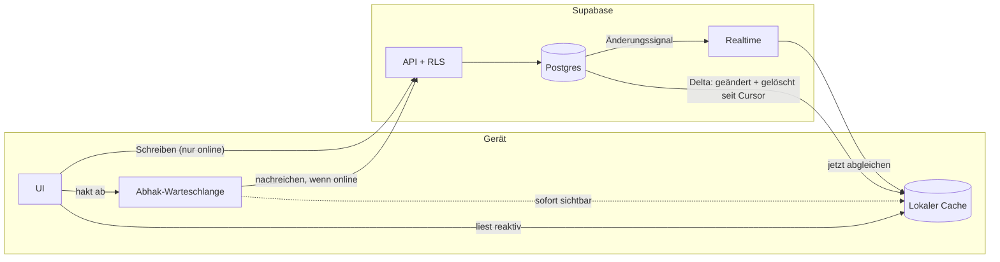

# Sync-Konzept: offline lesen, online schreiben

> Entscheidung: [ADR-0008](../adr/0008-offline-lesen-mit-eigenem-delta-sync.md) (löst ADR-0002
> ab). Dieses Dokument beschreibt, **wie** Cache, Abgleich und Abhaken funktionieren, und gilt für
> jede Spec. Details einzelner Tabellen legt die jeweilige Spec fest.

## Ziel

| Ohne Netz möglich                                                         | Braucht Netz                              |
| ------------------------------------------------------------------------- | ----------------------------------------- |
| Alles **lesen**: Rezepte, Wochenplan, Einkaufslisten, Märkte und Bereiche | Anlegen, bearbeiten, löschen              |
| Einkaufsposten **abhaken** und Haken zurücknehmen                         | Einkaufsliste aus dem Wochenplan erzeugen |
| Einkaufsmodus mit Laufreihenfolge                                         | Anmelden, Haushalt anlegen, einladen      |

Ohne Netz sind Bearbeiten-Aktionen sichtbar deaktiviert, mit dem Hinweis „Offline – zum Bearbeiten
brauchst du Netz“. Das ist ein normaler Zustand, kein Fehler.

## Bausteine

- **Lokaler Cache:** eine Kopie aller Daten der eigenen Haushalte, gespeichert auf dem Gerät (im
  Browser IndexedDB/OPFS). Die UI liest **nur** daraus.
- **Supabase** ist die Quelle der Wahrheit. Gelesen und geschrieben wird über die normale API.
  **RLS gilt damit überall**, eine zweite Berechtigungsregel gibt es nicht.
- **Realtime** dient nur als Signal („es hat sich etwas geändert“). Daraufhin läuft der normale
  Delta-Abgleich. So gibt es genau einen Weg, auf dem Daten in den Cache kommen.

## Lesen: Delta-Abgleich

**Voraussetzungen je synchronisierter Tabelle:**

- `updated_at` wird **vom Server** per Trigger gesetzt, nie vom Client.
- Ein Lösch-Trigger schreibt jede gelöschte Zeile ins **Löschprotokoll** `deleted_records`
  (Tabelle, ID, Haushalt, Zeitpunkt). Es ist per RLS ebenfalls auf den eigenen Haushalt beschränkt.

**Ablauf:**

1. Das Gerät merkt sich je Tabelle einen **Cursor**: das höchste gesehene `updated_at`.
2. Es holt alle Zeilen mit `updated_at > Cursor − Sicherheitsfenster` und schreibt sie per
   Upsert in den Cache. Das **Sicherheitsfenster** (Startwert 2 Minuten) fängt Transaktionen ab,
   die später committen als ihr Zeitstempel. Doppelt geladene Zeilen schaden nicht.
3. Es holt das Löschprotokoll seit dem Cursor und entfernt diese Zeilen aus dem Cache.
4. Es schreibt den Cursor fort, erst wenn Schritt 2 und 3 vollständig geklappt haben.

**Voll-Load** beim ersten Start, nach dem Abmelden und Wiederanmelden, nach einem Wechsel der
Cache-Version und wenn der Cursor älter ist als die Aufbewahrungsfrist des Löschprotokolls
(Startwert 30 Tage, aufgeräumt per `pg_cron`).

**Auslöser:** App-Start, App kommt in den Vordergrund, Netz ist wieder da, direkt nach eigenem
Schreiben, Realtime-Signal, und als Rückfallebene alle paar Minuten, solange die App offen ist.

**Verlust der Mitgliedschaft:** Taucht ein Haushalt nicht mehr in den eigenen Mitgliedschaften auf,
löscht das Gerät dessen Daten aus dem Cache.

## Schreiben: online

- Schreibaktionen gehen direkt an Supabase (API oder RPC). RLS und Constraints prüfen sie.
- Nach Erfolg läuft sofort ein Delta-Abgleich, und der Cache ist aktuell. Wo es sich lohnt, zeigt
  die UI das Ergebnis schon vorher an und korrigiert sich im Fehlerfall.
- **Mehrteilige Aktionen** (z. B. Liste aus dem Wochenplan erzeugen) laufen als eine RPC in einer
  Transaktion. Halbe Zustände gibt es nicht.
- Ändern zwei Personen gleichzeitig online dasselbe, gilt: Was zuletzt ankommt, gewinnt, je Feld.
  Gesendet werden nur geänderte Felder.

## Abhaken: offline

Abhaken und Haken zurücknehmen wirken **sofort lokal** und landen in einer gespeicherten
**Abhak-Warteschlange**. Mit Netz werden sie der Reihe nach per RPC nachgereicht, z. B.
`set_shopping_item_checked(item_id, checked, seen_checked_at)`. Die Regel setzt der Server in
einer Transaktion durch:

| Stand auf dem Server                         | Auf dem Gerät getan  | Ergebnis                                                   |
| -------------------------------------------- | -------------------- | ---------------------------------------------------------- |
| nicht abgehakt                               | abgehakt             | **abgehakt**                                               |
| abgehakt                                     | nichts               | **bleibt abgehakt**, unberührte Posten werden nie gesendet |
| abgehakt, seit dem Gerät bekannt unverändert | Haken zurückgenommen | **nicht abgehakt**                                         |
| inzwischen von jemand anderem abgehakt       | Haken zurückgenommen | **bleibt abgehakt** („Abhaken gewinnt“)                    |
| Posten inzwischen gelöscht                   | beliebig             | verworfen, kein Fehler                                     |

- Mehrfaches Hin- und Hertippen wird zusammengefasst: Gesendet wird nur der Endzustand je Posten.
  Gleicht er dem Ausgangszustand, wird nichts gesendet.
- Die Warteschlange blockiert nie. Vorübergehende Fehler (offline, 5xx, Timeout) werden später
  wiederholt. Dauerhafte Fehler (4xx) werden verworfen und protokolliert.

## Anmeldung offline

- Die Sitzung wird lokal gespeichert. Die App startet offline mit der letzten Sitzung und dem Cache.
- Tokens werden beim nächsten Netz erneuert. Bis dahin liest die App aus dem Cache und sammelt
  Haken.
- **Abmelden löscht Cache und Warteschlange** auf diesem Gerät.

## Web und PWA

Das MVP läuft als Web-App und wird auf dem Handy als PWA vom Home-Bildschirm genutzt (siehe
Vision). Damit sie im Laden ohne Netz überhaupt startet:

- **App-Hülle:** Ein Service Worker cached HTML, JavaScript und Assets.
- **Daten:** Der Cache liegt im Browser-Speicher.
- **iOS Safari:** Nicht installierte Websites können ihren Speicher nach längerer Nichtnutzung
  verlieren. Als PWA zum Home-Bildschirm hinzugefügt ist das deutlich robuster. Die App weist beim
  ersten Start darauf hin.

Der Code bleibt plattformneutral: Datenzugriff nur über `packages/api`, und der Cache-Speicher
steckt hinter einer Schnittstelle. Die nativen Apps bekommen später einen anderen Speicher, aber
denselben Abgleich.

## Schema-Entwicklung

- Der Cache ist **wegwerfbar**. Ändert sich seine Struktur, erhöht die App die Cache-Version und
  lädt einmal voll neu. Eine Client-Migration gibt es nicht.
- Auf dem Server gilt weiter **expand → migrate → contract**, weil ältere App-Versionen dieselbe
  API nutzen.

## Fotos

Fotos lädt das Gerät bei Netz und hält sie im Cache vor. Hochladen geht nur online. Das Detail
regelt die erste Spec mit Fotos.

## Testen

- **Reine Funktionen in `packages/core`:** Delta anwenden (Upsert, Löschungen, Cursor,
  Sicherheitsfenster) und Haken zusammenfassen. Hier liegen die meisten Tests.
- **pgTAP:** RLS je Tabelle, Lösch-Trigger, die Regeln der Abhak-RPC (alle Zeilen der Tabelle oben).
- **Ende-zu-Ende:** zwei Browser, einer offline beim Abhaken, beide wieder online. Kommt mit der
  ersten Daten-Spec.

## Bewusst nicht gewählt

- **Offline-Bearbeiten für alles:** Jede Tabelle bräuchte Konfliktregeln. Erweiterbar je Feature,
  wenn es gebraucht wird. Erster Kandidat: Posten im Laden hinzufügen.
- **PowerSync oder ein anderer Sync-Dienst:** ein Dienst mehr (ADR-0008).
