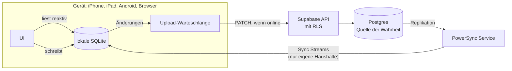

# Sync-Konzept (offline-first)

> Entscheidung: [ADR-0002](../adr/0002-offline-faehigkeit-und-synchronisation.md). Dieses Dokument
> beschreibt, **wie** Offline und Sync funktionieren, und gilt für jede Spec. Details einzelner
> Tabellen legt die jeweilige Spec fest.

## Ziel

Im Supermarkt gibt es oft kein Netz. Deshalb funktioniert **jede alltägliche Handlung ohne
Verbindung**: Rezepte ansehen und bearbeiten, Wochenplan ändern, Einkaufsliste erzeugen,
ergänzen und abhaken, Märkte und Bereiche pflegen. Sobald wieder Netz da ist, gleichen sich alle
Geräte des Haushalts automatisch ab.

Netz ist nur nötig für: die erste Anmeldung, das Anlegen eines Haushalts, Einladungen und das
erste Herunterladen von Fotos. Die Spec benennt solche Fälle ausdrücklich, und die App zeigt
offline einen klaren Hinweis statt eines Fehlers.

## Bausteine

- **Lokale SQLite** auf jedem Gerät, im Browser per OPFS/IndexedDB. Sie enthält alle Daten der
  Haushalte, in denen die Person Mitglied ist. Die Datenmenge ist klein (Rezepte, Listen), also
  wird alles vorab synchronisiert, nicht erst bei Bedarf.
- **Postgres in Supabase** ist die Quelle der Wahrheit. Row Level Security entscheidet, was
  geschrieben werden darf.
- **PowerSync** liest die Änderungen aus Postgres (logische Replikation) und verteilt sie über
  **Sync Streams** an die Geräte. Die Streams filtern nach Haushaltsmitgliedschaft, also nach
  derselben Regel wie RLS.

## Lesen

Die UI liest **ausschließlich lokal**, mit reaktiven Abfragen: Ändert sich eine Zeile (lokal oder
per Sync), aktualisiert sich der Screen von selbst. Es gibt keine Ladespinner fürs Netz.

PowerSync übernimmt Server-Änderungen nur an vollständigen **Checkpoints**. Ein Gerät sieht also
nie einen halben Zustand, etwa ein Rezept ohne seine Zutaten.

## Schreiben

1. Jede Änderung wird **lokal in einer Transaktion** geschrieben und ist sofort sichtbar.
2. PowerSync legt sie geordnet in die **Upload-Warteschlange**.
3. Sobald Netz da ist, überträgt die App die Einträge der Reihe nach an Supabase. Gesendet werden
   **nur die geänderten Spalten** (PATCH).
4. Der Server prüft sie über RLS und Constraints. Der bestätigte Stand kommt über den Sync zurück
   und ist maßgeblich.

## Konfliktregeln

| Situation                                                    | Regel                                                                                                                                                                                                                 | Folge für das Datenmodell                                                       |
| ------------------------------------------------------------ | --------------------------------------------------------------------------------------------------------------------------------------------------------------------------------------------------------------------- | ------------------------------------------------------------------------------- |
| Zwei Geräte legen offline etwas an                           | IDs (UUID) erzeugt der Client, also kollidieren sie nie                                                                                                                                                               | `id` ohne Server-Pflicht-Default                                                |
| Zwei Geräte legen offline **denselben** Artikel an („Milch“) | Deterministische ID aus Haushalt + normalisiertem Namen (UUIDv5). Beide Geräte erzeugen dieselbe ID, es entsteht nur ein Artikel. Ist die ID lokal schon vergeben (z. B. nach Umbenennung), gibt es eine zufällige ID | Gilt für Daten mit natürlichem Schlüssel                                        |
| Zwei Geräte ändern **verschiedene Felder** derselben Zeile   | Beide Änderungen bleiben (PATCH nur der geänderten Spalten)                                                                                                                                                           | —                                                                               |
| Zwei Geräte ändern **dasselbe Feld**                         | Was zuletzt beim Server ankommt, gewinnt (Last-Write-Wins je Feld)                                                                                                                                                    | Für Texte, Namen, Häkchen ausreichend                                           |
| Ein Gerät löscht, das andere ändert                          | Löschen gewinnt; die Änderung wird verworfen                                                                                                                                                                          | Wo „Rückgängig“ wichtig ist, legt die Spec Papierkorb-Logik fest (`deleted_at`) |
| Reihenfolgen (Bereiche im Markt, Rezeptschritte)             | Sortierschlüssel per Fractional Indexing: ein neuer Platz bekommt einen Wert zwischen seinen Nachbarn, nichts wird neu nummeriert                                                                                     | Spalte `sort_key text` statt `position int`                                     |
| Mengen und Summen                                            | **Nie Summen speichern, die zwei Geräte ändern.** Beiträge je Herkunft speichern, die Summe beim Anzeigen berechnen                                                                                                   | Z. B. Einkaufsposten mit Beiträgen je Rezept und manuell                        |
| Abhaken im Laden                                             | Status + Zeitpunkt, Last-Write-Wins (beide wollen dasselbe)                                                                                                                                                           | —                                                                               |

## Fehler beim Hochladen

Die Warteschlange darf **nie blockieren**.

| Fehlerart     | Beispiele                                | Verhalten                                                                                                   |
| ------------- | ---------------------------------------- | ----------------------------------------------------------------------------------------------------------- |
| Vorübergehend | offline, Timeout, 5xx                    | Später erneut, mit Backoff; Reihenfolge bleibt                                                              |
| Dauerhaft     | 4xx: RLS verweigert, Constraint verletzt | Operation verwerfen, lokal protokollieren, Hinweis in der UI („1 Änderung konnte nicht gespeichert werden“) |

## Anmeldung und Offline

- Die Sitzung wird lokal gespeichert, nativ im Secure Store. Die App startet offline mit der
  letzten Sitzung und den lokalen Daten.
- Abgelaufene Tokens werden beim nächsten Netz erneuert. Bis dahin arbeitet die App lokal weiter.
- **Abmelden löscht die lokale Datenbank** auf diesem Gerät.

## Schema-Entwicklung

- Das Client-Schema von PowerSync ist eine Sicht auf JSON-Daten. Neue Tabellen und Spalten
  brauchen **keine Client-Migration**.
- Installierte Apps aktualisieren sich verzögert. Deshalb gilt **expand → migrate → contract**:
  Neues hinzufügen und befüllen; Altes erst entfernen, wenn keine ausgelieferte Version es mehr
  liest.

## Fotos und Dateien

Fotos werden lokal gespeichert und über eine eigene Warteschlange hochgeladen
(PowerSync-Attachments). Andere Geräte laden sie bei Netz nach und halten sie dann offline vor.
Das Detail regelt die erste Spec mit Fotos.

## Web

Das MVP läuft **zuerst als Web-App** und wird auf dem Handy über „Zum Home-Bildschirm“ als PWA
genutzt (siehe Vision). Web-Offline ist deshalb **Teil des MVP**, nicht später:

- **Daten:** PowerSync Web SDK, SQLite im Browser (OPFS bzw. IndexedDB).
- **App-Hülle:** ein Service Worker cached HTML, JavaScript und Assets. Ohne ihn lädt die Seite im
  Laden ohne Netz gar nicht erst, auch wenn die Daten lokal liegen.
- **iOS Safari:** Nicht installierte Websites können ihren Speicher nach längerer Nichtnutzung
  verlieren. Als PWA zum Home-Bildschirm hinzugefügt ist das deutlich robuster. Die App weist beim
  ersten Start darauf hin.

Die nativen Apps folgen, wenn das MVP taugt. Der Code bleibt dafür plattformneutral:
Datenzugriff nur über `packages/api`, keine Web-only-APIs in Features.

## Testen

- Konflikt- und Merge-Regeln sind reine Funktionen in `packages/core` und werden dort per Unit-Test
  geprüft.
- Mandantentrennung: pgTAP-Tests je Tabelle (siehe `db-change`-Skill).
- Ende-zu-Ende: zwei Clients, beide offline ändern, beide online. Kommt mit der ersten Daten-Spec.

## Bewusst nicht gewählt

- **CRDTs** (z. B. für gemeinsames Bearbeiten eines Textes in Echtzeit): Für diese Daten reichen
  die Regeln oben. Ein CRDT bringt Komplexität ohne Nutzen. Neu bewerten, falls gemeinsames
  Live-Bearbeiten langer Texte gewünscht wird.
- **Eigene Sync-Engine**: Checkpoints, Reihenfolge und Wiederaufnahme selbst zu bauen ist genau
  der fehleranfällige Teil, den PowerSync abnimmt.
