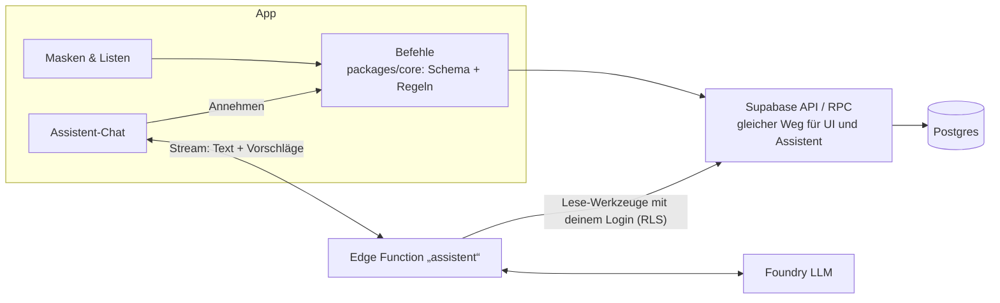

# Feature-Konzept — Brainstorming für Version 1

> Stand: 20.11.2026 · Status: **Entwurf zur Abstimmung**. Grundlage für den Click-Dummy. Danach
> entstehen daraus die Specs in `docs/specs/`. Fachbegriffe folgen `.agents/glossary.md`; neue
> Begriffe sind _kursiv_ markiert und kommen mit der jeweiligen Spec ins Glossar.

## 1. Überblick

| #   | Bereich                  | Kern in einem Satz                                                                                     | Etappe |
| --- | ------------------------ | ------------------------------------------------------------------------------------------------------ | ------ |
| F1  | **Haushalt und Profil**  | Haushalt, Mitglieder mit Farbe und Ernährungsvorlieben, Google-Login, Einladung, Einstellungen         | 1      |
| F2  | **Heute**                | Startseite: Was gibt es heute zu essen, was ist heute zu tun, wie steht die Einkaufsliste              | 1      |
| F3  | **Rezepte**              | Schnell anlegen, schön durchblättern, gut filtern, Varianten (vegan / mit Hähnchen), Portionen, Fotos  | 2      |
| F4  | **Wochenplan**           | Rezepte oder Freitext auf Tage und Mahlzeiten, direkt neues Rezept anlegen, Reste einplanen            | 3      |
| F5  | **Einkaufsliste**        | Aus ausgewählten Plantagen erzeugen, Vorratscheck, von Hand ergänzen, gemeinsam live, offline abhaken  | 3      |
| F6  | **Märkte und Bereiche**  | Optional: Markt wählen, Liste nach Laufreihenfolge sortiert, Bereiche lernen mit                       | 3      |
| F7  | **Haushaltsplan**        | Aufgaben mit Rhythmus, Zuständigkeit, Erledigt-Verlauf, spontane Erledigungen                          | 5      |
| F8  | **Benachrichtigungen**   | Tägliche Zusammenfassung zur eigenen Uhrzeit, Erinnerungen an fällige Aufgaben                         | 5      |
| F9  | **KI-Assistent**         | Zentraler Chat mit Sprache, Vorschläge mit Vorschau zum Annehmen, Ändern oder Verwerfen                | 4      |
| F10 | **KI an Ort und Stelle** | „✨ Mit KI“ in Masken: Rezept aus Text, Link oder Foto; Woche planen; Posten per Sprache               | 4      |
| F11 | **Suche**                | Überall gleich: sofort, offline, fehlertolerant; der Assistent sucht serverseitig mit                  | 2      |
| F12 | **Feedback-Hub**         | In zwei Tipps erreichbar, Status angenommen / abgelehnt / umgesetzt, auswertbar durch den Coding-Agent | 1      |

**Etappen** (Reihenfolge der Umsetzung, alles zusammen ist Version 1):

```
1 Fundament        Haushalt, Login, Sync, Design-Fundament, Heute (leer), Feedback-Hub
2 Rezepte          Rezepte, Artikel, Suche
3 Essen & Einkauf  Wochenplan, Einkaufsliste, Märkte & Einkaufsmodus
4 KI               Assistent, Sprache, Vorschläge, KI in den Masken
5 Haushalt         Haushaltsplan, Benachrichtigungen
```

Der Feedback-Hub kommt bewusst in Etappe 1: Ab dem ersten Tag, an dem ihr die App nutzt,
fließen eure Rückmeldungen direkt in die nächsten Specs.

## 2. Leitlinien für Bedienung und Gestaltung

1. **Bearbeiten ohne Bearbeiten-Modus.** Felder antippen, ändern, fertig. Gespeichert wird
   automatisch, mit klarem Status („gespeichert“ / „offline – nicht gespeichert“).
2. **Erst anlegen, dann ausfüllen.** Für jedes Objekt reicht der Name: Rezept „Mango-Curry“,
   Aufgabe „Bad putzen“. Alles andere ist optional und kann später kommen.
3. **Einfügen statt eintippen.** Eine Zutatenliste als Textblock einfügen, und die App zerlegt
   sie in Zeilen. Dasselbe per Sprache oder über die KI.
4. **Rückgängig statt Nachfragen.** Kein „Wirklich löschen?“; stattdessen fünf Sekunden
   „Rückgängig“. Rezepte werden archiviert, nicht gelöscht.
5. **Ein Daumen reicht.** Wichtige Aktionen unten, Sheets statt neuer Seiten, Wischen zum
   Abhaken, große Tippflächen.
6. **KI ist überall ein Angebot, nie eine Pflicht.** Jede Maske funktioniert ohne KI. Wo KI
   hilft, gibt es einen gleich aussehenden Einstieg „✨“.
7. **Jede Fläche hat einen Zustand für leer, offline und lädt.** Leere Zustände sagen, was man
   als Nächstes tun kann („Noch keine Rezepte – Link einfügen, Foto machen oder beschreiben“).
8. **Breite nutzen.** iPad und Desktop zeigen Liste und Detail nebeneinander und den Wochenplan
   als ganze Woche.

### Navigation

```
┌─────────────────────────────────────────────┐
│  Heute                              (●) ⚙︎   │  ← Avatar: Profil, Einstellungen, Feedback
│                                             │
│                                             │
│                                       ╭───╮ │
│                                       │ ✨ │ │  ← Assistent: überall erreichbar,
│                                       ╰───╯ │    lange drücken = sofort sprechen
├─────────────────────────────────────────────┤
│  ☀︎ Heute  📖 Rezepte  🗓 Plan  🛒 Liste  ✓ Haushalt │
└─────────────────────────────────────────────┘
```

Fünf Tabs. Der Assistent ist kein Tab, sondern schwebt über allem und kennt den aktuellen
Bildschirm. Feedback: Avatar → Feedback (zwei Tipps).

## 3. Features im Detail

### F1 — Haushalt und Profil

- **Mitglied:** Anzeigename, Farbe (für Zuständigkeiten und Avatare), _Ernährungsform_
  (vegan, vegetarisch, flexibel), Abneigungen und Unverträglichkeiten als Liste („kein Koriander“,
  „Laktose“). KI und Filter berücksichtigen das („passt für alle“).
- **Haushalt:** Name, Standard-Portionen, Mahlzeiten im Plan (Standard: Mittag, Abend),
  Wochenstart, Standardmarkt, Standardliste.
- **Einladen:** Link oder Code; die eingeladene Google-Adresse kommt auf die Allowlist.
- **Persönliche Einstellungen:** Uhrzeit der Tageszusammenfassung, welche Benachrichtigungen,
  Erscheinungsbild.

### F2 — Heute

Die Startseite beantwortet morgens in drei Sekunden: Was gibt es, was ist zu tun, was fehlt.

```
┌─────────────────────────────────────────────┐
│ Guten Morgen, Enrico               Do 20.11. │
│                                             │
│ ESSEN HEUTE                                 │
│ ┌─────────────┐ ┌─────────────┐             │
│ │ [Foto]      │ │ Reste vom   │             │
│ │ Mango-Curry │ │ Mittwoch    │             │
│ │ Abend · 25' │ │ Mittag      │             │
│ └─────────────┘ └─────────────┘             │
│                                             │
│ ZU TUN                                      │
│ ○ Bad putzen                  (E) heute     │
│ ○ Fenster Wohnzimmer          (N) überfällig│
│ + Was anderes erledigt?                     │
│                                             │
│ EINKAUF                                     │
│ 12 offen · Standardliste      [Einkaufen →] │
│                                             │
│ DIESE WOCHE  Mo Di Mi [Do] Fr Sa So         │
│              ●  ●  ●   ●   ○  ○  ○          │
└─────────────────────────────────────────────┘
```

- Tippen auf ein Gericht öffnet das Rezept (mit Kochmodus).
- „Was anderes erledigt?“ protokolliert eine spontane Erledigung (siehe F7).
- Offline ist alles lesbar. Aufgaben abhaken braucht Netz; offline abhaken gilt laut ADR-0008
  nur für Einkaufsposten (siehe offene Frage 8).

### F3 — Rezepte

**Ziel:** Ein Rezept ist in 10 Sekunden angelegt und in 2 Sekunden wiedergefunden.

**Anlegen**

- **Schnellanlage:** nur der Titel, Rest später.
- **Zutaten einfügen:** Textblock einfügen oder diktieren. Jede Zeile wird zerlegt in
  Rezeptangabe + Artikel („200 ml Kokosmilch“ → `200 ml` · Kokosmilch). Was die App nicht
  sicher erkennt, bleibt Freitext und ist markiert.
- **Aus Link:** Rezeptseite einfügen. Strukturierte Rezeptdaten der Seite werden übernommen,
  inklusive Foto; was fehlt, ergänzt die KI.
- **Aus Foto:** Kochbuchseite, handgeschriebene Karte oder ein Bild des Gerichts. Die KI macht
  daraus einen Rezeptentwurf.
- **Aus Beschreibung:** „Schnelles veganes Curry mit Mango und Tofu, eher mild“. Die KI schlägt
  ein komplettes Rezept vor.

Alle KI-Wege landen **in derselben Rezeptmaske als Entwurf**. Man sieht alles, ändert, was man
will, und speichert.

**Aufbau eines Rezepts**

| Teil             | Inhalt                                                                                                       |
| ---------------- | ------------------------------------------------------------------------------------------------------------ |
| Kopf             | Titel, Foto(s), Portionen, Zeit (Vorbereitung / gesamt), Kurzbeschreibung                                    |
| Einordnung       | Gang (Frühstück, Hauptgericht, Beilage, Dessert, Snack, Getränk), Küche, Aufwand, Saison, eigene Schlagworte |
| _Ernährungsform_ | **abgeleitet** aus den Zutaten (vegan, vegetarisch, mit Fisch, mit Fleisch), überschreibbar                  |
| Zutaten          | Rezeptzutaten mit Rezeptangabe und Einkaufsregel, optional in Gruppen („Für die Soße“)                       |
| _Varianten_      | z. B. „mit Tofu“ (Standard, vegan) · „mit Hähnchen“; jede Variante tauscht oder ergänzt Zutaten              |
| Zubereitung      | Schritte; Zeitangaben im Text („10 Min köcheln“) werden zu antippbaren Timern                                |
| Persönliches     | Favorit, Bewertung (1–5), Notizen („beim nächsten Mal mehr Limette“), zuletzt gekocht, wie oft               |
| Herkunft         | Link, Kochbuch, „von Oma“, KI                                                                                |

**Ernährungsform und Varianten (dein Mango-Curry-Beispiel)**

- Jeder Artikel hat eine Ernährungseigenschaft: vegan, vegetarisch, Fisch, Fleisch. Bei neuen
  Artikeln schlägt die KI das im Hintergrund vor („Halloumi → vegetarisch“).
- Daraus ergibt sich die Ernährungsform des Rezepts von selbst, auch je Variante:
  **Mango-Curry** · Variante _mit Tofu_ → vegan · Variante _mit Hähnchen_ → mit Fleisch.
- Filter „vegan“ findet auch Rezepte, bei denen **eine Variante** vegan ist.
- Im Wochenplan wählt man die Variante; die Einkaufsliste nimmt deren Zutaten.
- KI-Aktion: „Mach eine vegane Variante“ schlägt Ersatzzutaten vor.

**Durchblättern und Filtern**

```
┌─────────────────────────────────────────────┐
│ Rezepte                         🔍  ⊞ / ☰    │
│ [Alle][Favoriten][Schnell <30'][Vegan][+]   │ ← Filter-Chips, horizontal
│ Sortierung: Zuletzt gekocht ▾               │
│ ┌────────────┐ ┌────────────┐               │
│ │  [Foto]    │ │  [Foto]    │               │
│ │ Mango-Curry│ │ Lasagne    │               │
│ │ 25' · 🌱   │ │ 60' · ★ 5  │               │
│ └────────────┘ └────────────┘               │
└─────────────────────────────────────────────┘
```

- Filter als Chips: Ernährungsform, Gang, Küche, Zeit, Saison, Favoriten, „lange nicht gekocht“,
  „passt für alle“. Kombinationen lassen sich als eigener Chip speichern („Schnell & vegan“).
- Sortieren: zuletzt gekocht, am häufigsten, Bewertung, neu, A–Z.
- Suche über Titel, Zutaten, Schlagworte und Notizen, fehlertolerant („Halumi“ findet Halloumi).

**Aus dem Rezept heraus**

- Portionen ändern skaliert alle erkennbaren Mengen.
- „Einplanen…“: Tag und Mahlzeit wählen.
- „Auf die Liste“: Zutaten direkt auf eine Einkaufsliste, ohne Plan.
- **Kochmodus:** große Schrift, ein Schritt pro Bildschirm, Display bleibt an, Timer, Zutaten
  des Schritts eingeblendet.

### F4 — Wochenplan

```
┌─────────────────────────────────────────────┐
│ ‹  KW 47 · 17.–23. Nov  ›        ✨ Planen   │
│                                             │
│ Mo 17  Mittag  —                            │
│        Abend   Lasagne · 4 P.          ✓    │
│ Di 18  Abend   Reste von Montag             │
│ Mi 19  Abend   Mango-Curry · mit Tofu       │
│ Do 20  Abend   + hinzufügen                 │
│ …                                           │
│ [Auf die Einkaufsliste…]                    │
└─────────────────────────────────────────────┘
```

- **Eintrag hinzufügen** auf „+ hinzufügen“: ein Sheet mit Suche über alle Rezepte, Vorschlägen
  („lange nicht gekocht“, Favoriten) und drei Wegen, wenn nichts passt:
  **Freitext** („Essen bei Oma“), **neues Rezept** (Schnellanlage oder ✨ beschreiben) und
  **Reste** von einem früheren Tag.
- **Portionen je Eintrag**, Vorgabe aus dem Haushalt. Kocht man für mehr Portionen als
  gegessen, bietet die App an, die Reste gleich einzuplanen.
- **Verschieben** per Ziehen (Drag & Drop) zwischen Tagen; Kopieren mit langem Druck.
- **Gekocht markieren:** passiert automatisch, sobald der Tag vorbei ist, und lässt sich
  korrigieren („haben wir doch nicht gekocht“). Speist „zuletzt gekocht“ und die
  Abwechslungslogik.
- **Woche kopieren** oder als Vorlage speichern.
- **✨ Planen:** siehe F10.

### F5 — Einkaufsliste

**Grundsatz:** Die Einkaufsliste ist zuerst einfach eine Liste. Markt, Bereiche und Pläne sind
Zusätze.

```
┌─────────────────────────────────────────────┐
│ Standardliste ▾           Markt: keiner ▾   │
│ Für: Lasagne (Mo) · Curry (Mi)  ›           │ ← antippen: Rezepte dieser Liste
│                                             │
│ ○ Milch                 2×                  │
│ ○ Kokosmilch            400 ml      Curry   │
│ ○ Eier                  6×                  │
│ ○ Spülmittel                        ← Hand  │
│                                             │
│ ✓ Erledigt (3)                     leeren   │
│ ┌─────────────────────────────────────────┐ │
│ │ + Artikel hinzufügen …            🎤    │ │ ← immer unten, Autovervollständigung
│ └─────────────────────────────────────────┘ │
└─────────────────────────────────────────────┘
```

**Aus dem Wochenplan übernehmen** — ein geführter, kurzer Ablauf:

1. **Tage wählen:** Chips Mo–So, vorausgewählt sind die kommenden Tage, die noch nicht auf
   einer Liste sind.
2. **Vorschau:** zusammengeführte Posten mit Herkunft.
3. **_Vorratscheck_:** „Was davon hast du schon?“ Antippen oder Wegwischen, was nicht gekauft
   werden muss. Artikel, die du oft wegwischst, schlägt die App als _meist vorrätig_ vor; die
   sind beim nächsten Mal schon abgewählt.
4. **Übernehmen** in die gewählte Liste.

**Weiteres**

- **Eine Zeile je Artikel** mit zusammengeführtem Zusatz; Antippen zeigt die Herkunft.
- **Gemeinsam live:** Was die andere Person hinzufügt oder abhakt, erscheint sofort.
- **Abhaken offline**, mit Regel „Abhaken gewinnt“ (ADR-0008). Abgehakte Posten wandern in
  „Erledigt“ und lassen sich mit einem Tipp zurückholen.
- **Mehrere Listen**: Standardliste plus z. B. „Drogerie“ oder „Grillabend“.
- **Hinzufügen per Sprache:** „Milch, sechs Eier und Brot“ → drei Posten (im Test bereits
  zuverlässig, siehe ADR-0009).

### F6 — Märkte und Bereiche (optional)

- Ohne Markt ist die Liste nach Bereichen in einer Standardreihenfolge gruppiert, Posten ohne
  Bereich stehen unten.
- **Markt wählen** → **Einkaufsmodus**:

```
┌─────────────────────────────────────────────┐
│ Rewe Südstadt              ███████░░  7/10  │
│ OBST & GEMÜSE                               │
│ ○ Mango                                     │  → nach rechts wischen = abhaken (Haptik)
│ ○ Limette                   2×              │
│ KÜHLUNG                                     │
│ ○ Milch                     2×              │
│ OHNE BEREICH                                │
│ ○ Spülmittel          [Bereich zuordnen]    │  → einmal zuordnen, gilt künftig
│                         ⚡ Offline – Abhaken funktioniert │
└─────────────────────────────────────────────┘
```

- **Laufreihenfolge** je Markt per Ziehen sortieren; Bereiche ausblenden.
- **Später, lernend:** Aus der Reihenfolge, in der ihr abhakt, schlägt die App eine bessere
  Laufreihenfolge vor.

### F7 — Haushaltsplan

**Begriffe:** _Aufgabe_ (was), _Rhythmus_ (wann), _Zuständigkeit_ (wer), _Erledigung_ (Eintrag
im Verlauf: wer, wann, optional Notiz).

| Rhythmus                                       | Beispiel                                                       |
| ---------------------------------------------- | -------------------------------------------------------------- |
| Einmalig, mit oder ohne Datum                  | „Glühbirne Flur tauschen“                                      |
| Wöchentlich an bestimmten Tagen, alle n Wochen | „Jeden Freitag Bad putzen“, „alle 2 Wochen Montag Müll“        |
| Monatlich (am Tag X oder am n-ten Wochentag)   | „Am 1. Kühlschrank auswischen“                                 |
| Alle n Monate / jährlich                       | „Alle 6 Monate Matratze drehen“                                |
| **Flexibel nach letzter Erledigung**           | „Bettwäsche alle 2 Wochen“, die Uhr startet beim Erledigen neu |

| Zuständigkeit    | Bedeutung                                                                        |
| ---------------- | -------------------------------------------------------------------------------- |
| Fest             | „Enrico“                                                                         |
| **Abwechselnd**  | Rotation zwischen Mitgliedern; nach jeder Erledigung ist die nächste Person dran |
| Gemeinsam / egal | Wer es zuerst erledigt                                                           |

```
┌─────────────────────────────────────────────┐
│ Haushalt        [Heute][Woche][Alle][Verlauf] │
│ HEUTE                                       │
│ ○ Bad putzen          (E)  wöchentlich Fr   │ → wischen: erledigt / später
│ ÜBERFÄLLIG                                  │
│ ○ Fenster Wohnzimmer  (N)  seit 2 Tagen     │
│ DIESE WOCHE                                 │
│ ○ Müll rausbringen    (E↔N) So              │
│ ┌─────────────────────────────────────────┐ │
│ │ + Aufgabe … oder „hab gerade …“    🎤   │ │
│ └─────────────────────────────────────────┘ │
└─────────────────────────────────────────────┘
```

- **Erledigen**: abhaken → Eintrag im Verlauf, nächster Termin wird berechnet, bei
  „abwechselnd“ wechselt die Person.
- **Später / Überspringen**: verschiebt um einen Tag bzw. auf den nächsten Termin, ohne
  Erledigung.
- **Spontan erledigt** („Hab heute die Fenster geputzt“): wird als Erledigung verbucht. Gibt es
  eine passende Aufgabe, zählt es für sie (bei flexiblem Rhythmus startet die Uhr neu); sonst
  entsteht ein Eintrag „spontan“ im Verlauf.
- **Verlauf:** wer hat wann was gemacht, filterbar nach Person und Aufgabe. Optional eine kleine
  faire Übersicht („diesen Monat: E 14 · N 12“).
- **Unteraufgaben** (optional): „Bad putzen“ mit Checkliste Spiegel, Waschbecken, Boden.
- **Querverbindung:** Aus einer Aufgabe „Glühbirne kaufen“ wird mit einem Tipp ein
  Einkaufsposten.
- Räume oder Kategorien (Küche, Bad, Garten) als optionale Gruppierung.

### F8 — Benachrichtigungen

- **Tageszusammenfassung** zur persönlichen Uhrzeit (z. B. 7:30): „Heute: Bad putzen (du) ·
  Abendessen Mango-Curry · 12 Posten auf der Liste.“ Eine Nachricht statt zehn.
- **Erinnerung bei Überfälligkeit**, höchstens einmal am Tag je Aufgabe.
- **Optional:** „Nadja hat 5 Posten zur Liste hinzugefügt“, „Dein Feedback wurde umgesetzt“.
- **Technik:** Web Push. iOS unterstützt das für PWAs, die zum Home-Bildschirm hinzugefügt
  wurden; Android voll. Versand über eine geplante Supabase-Funktion (`pg_cron` + Edge Function).
  Später nativ über Expo Push. Kein zusätzlicher Dienst.

### F9 — KI-Assistent (zentral)

**Was er kann**

- **Fragen beantworten:** „Welche Rezepte gibt es mit Halloumi?“, „Was koche ich heute?“,
  „Wann gab es zuletzt Lasagne?“, „Was steht diese Woche im Haushalt an?“
- **Dinge vorschlagen:** Rezept, Wochenplan, Einkaufsposten, Aufgaben, Feedback-Eintrag.
- **Mit Sprache:** Mikro gedrückt halten, der Text erscheint live, beim Loslassen wird gesendet.
  Die Länge entspricht deinen Nachrichten an mich.

**Wie ein Vorschlag aussieht**

```
┌─────────────────────────────────────────────┐
│ Du: Plan mir die Woche, Mo und Di was       │
│     Schnelles, Mi kommen Gäste, kein Fisch  │
│                                             │
│ Assistent: Hier ist ein Vorschlag. Ich habe │
│ die letzten 4 Wochen berücksichtigt.        │
│ ┌─ Vorschlag: Wochenplan KW 48 ───────────┐ │
│ │ Mo  Pasta Aglio e Olio   15'  schnell   │ │
│ │ Di  Shakshuka            25'  ↻         │ │ ← ↻ = nur diesen Tag neu vorschlagen
│ │ Mi  Lasagne · 6 P.       60'  Gäste     │ │
│ │ Do  NEU: Mango-Curry ✨  25'  Entwurf ›  │ │ ← neues Rezept, als Entwurf ansehbar
│ │ ☑ Mo ☑ Di ☑ Mi ☑ Do                     │ │ ← teilweise übernehmen
│ │ [Übernehmen]  [Ändern…]  [Verwerfen]    │ │
│ └─────────────────────────────────────────┘ │
│ 🎤  Nachricht …                         ➤   │
└─────────────────────────────────────────────┘
```

- **Übernehmen**: führt aus, alles oder nur die angehakten Teile.
- **Ändern…**: entweder sagen, was anders sein soll („Do lieber was mit Linsen“; der Assistent
  ändert gezielt nur das), oder den Vorschlag in der normalen Maske öffnen und selbst anpassen.
- **Verwerfen**: verwirft ihn und merkt sich das als Signal.
- **Transparenz:** Unter jeder Antwort steht kurz, was der Assistent nachgeschaut hat
  („3 Rezepte gesucht · Plan der letzten 4 Wochen gelesen“).

**Kontext:** Der Assistent weiß, auf welchem Bildschirm du bist. Auf einem Rezept bezieht sich
„mach das vegan“ auf dieses Rezept; im Plan auf Donnerstag bezieht sich „was Schnelles“ auf
Donnerstag.

### F10 — KI an Ort und Stelle

Überall derselbe Einstieg ✨, der den Assistenten **im Kontext der Maske** öffnet:

| Ort                     | Angebot                                                                                               |
| ----------------------- | ----------------------------------------------------------------------------------------------------- |
| Neues Rezept            | „Beschreiben“, „Link einfügen“, „Foto“ → Entwurf füllt die Maske                                      |
| Rezept ansehen          | „Vegane Variante“, „für 6 Personen“, „weniger scharf“, „Schlagworte vorschlagen“                      |
| Plan → Tag → hinzufügen | „Was Passendes vorschlagen“ (aus euren Rezepten) oder „Neues Rezept beschreiben“                      |
| Wochenplan              | „✨ Planen“ mit Wünschen; berücksichtigt Abwechslung (letzte Wochen), Saison, Vorlieben, Gäste, Reste |
| Einkaufsliste           | 🎤 im Eingabefeld: Sprache → Posten                                                                   |
| Haushalt                | „Jeden Freitag Bad, Nadja alle 2 Wochen Fenster“ → Aufgaben mit Rhythmus und Zuständigkeit            |
| Feedback                | Diktieren statt tippen                                                                                |

**Unsichtbare Helfer** (ohne Rückfrage, jederzeit änderbar):

- Neuer Artikel → Bereich und Ernährungseigenschaft vorschlagen.
- Neues Rezept → Schlagworte, Gang, Aufwand vorschlagen.
- Eingefügte Zutatenzeilen, die der normale Parser nicht versteht, interpretieren.

**Rezeptbilder:**

- Aus dem Link wird das Bild übernommen, eigene Fotos gehen immer.
- KI-generierte Bilder bräuchten ein zusätzliches Bildmodell in Foundry (Kosten je Bild);
  siehe offene Frage 6.

**Recherche im Web:** Die KI kennt sehr viele Rezepte aus ihrem Training, und der Import per Link
deckt den Rest ab. Eine echte Websuche bräuchte einen zusätzlichen Suchdienst; das ist erst für
später vorgesehen.

### F11 — Suche

| Wo                                            | Wie                                                                                                                                                                                     |
| --------------------------------------------- | --------------------------------------------------------------------------------------------------------------------------------------------------------------------------------------- |
| In der App (Rezepte, Artikel, Aufgaben)       | **Lokal im Cache:** sofort, offline, fehlertolerant, mit deutscher Wortnormalisierung (Umlaute, Plural)                                                                                 |
| Für den Assistenten                           | **Serverseitig:** Postgres-Volltextsuche (deutsch) + Ähnlichkeitssuche (`pg_trgm`) + Filter                                                                                             |
| Unscharfe Wünsche („Hunger auf was Leichtes“) | Das LLM übersetzt den Wunsch in Suchbegriffe und Filter; bei wenigen hundert Rezepten bekommt es zusätzlich einen kompakten Katalog (Titel, Schlagworte, Hauptzutaten) und wählt selbst |

**Embeddings (RAG) — Empfehlung: nicht in Version 1, aber vorbereitet.**

- „Rezepte mit Halloumi“ und „Hunger auf Tofu“ sind Stichwortsuchen. Volltext +
  Fehlertoleranz finden sie zuverlässig.
- Für vage Wünsche reicht bei eurer Größenordnung der kompakte Katalog: 300 Rezepte × ca.
  40 Tokens ≈ 12 000 Tokens. Das kostet pro Anfrage Bruchteile eines Cents und versteht
  „was Leichtes, Sommerliches“ besser als jede Vektorsuche.
- Embeddings lohnen sich, wenn es **über ~1 000 Rezepte** werden oder lange Texte dazukommen
  (Anleitungen, Notizen, Dokumente). Dann: `pgvector` in Supabase (im Free-Plan enthalten) plus
  ein Embedding-Modell aus Foundry, kombiniert mit der Volltextsuche (Hybrid-Suche).
- Vorbereitet wird das durch eine zentrale Such-Textspalte je Rezept, aus der später auch das
  Embedding entsteht.

### F12 — Feedback-Hub

- **Erreichbar:** Avatar → Feedback (zwei Tipps), oder im Assistenten „Feedback: …“.
- **Eintrag:** Art (Idee, Problem, Lob), Text oder Sprache. Automatisch dabei: Bildschirm, auf
  dem man war, App-Version, Gerät. Optional ein Screenshot.
- **Status:** neu → angenommen / abgelehnt (mit Begründung) → umgesetzt (mit Spec-Nummer).
  Die andere Person kann ein Feedback mit „+1“ unterstützen.
- **Sichtbar** für alle im Haushalt, mit Benachrichtigung, wenn das eigene Feedback umgesetzt ist.
- **Für den Coding-Agent:** ein Skill `feedback-triage` mit zwei Skripten:
  - `pnpm feedback:pull` holt offene Einträge als Markdown nach `tmp/feedback/`. Der Agent
    gruppiert sie und schlägt Specs vor.
  - `pnpm feedback:status <id> <status> [--spec NNNN]` setzt den Status.

  Die Skripte laufen nur lokal und laden den Schlüssel aus der `.env`, ohne ihn auszugeben.

## 4. KI-Architektur: eine Logik für App und Assistent

Deine Vorgabe: **Der Agent bekommt keine eigene Geschäftslogik.** Was der Assistent tut,
passiert über exakt dieselben Funktionen wie in der App.



1. **Befehle als einzige Quelle.** Jede Schreibaktion (Rezept anlegen, einplanen, Posten
   hinzufügen, Aufgabe erledigen …) ist **ein** Befehl: Name, Beschreibung, Zod-Schema,
   Fachregeln in `packages/core`, ausgeführt über **denselben** API-Weg. Mehrteilige Befehle laufen
   als eine Datenbankfunktion in einer Transaktion.
2. **Werkzeuge des Assistenten werden aus den Befehlen erzeugt.** Beschreibung und Schema eines
   Befehls sind zugleich die Werkzeugdefinition für das LLM. Es gibt keine zweite
   Implementierung.
3. **Der Assistent liest selbst, schreibt aber nie selbst.** Lese-Werkzeuge (suchen, Plan lesen,
   Verlauf lesen) führt er direkt aus, mit deinem Login, also unter RLS. Schreibende Werkzeuge
   erzeugen nur einen **Vorschlag**. Ausgeführt wird erst, wenn du annimmst, und zwar von der App
   über den normalen Weg.
4. **Vorschläge werden gespeichert** (offen, angenommen, teilweise, abgelehnt). So bleibt der
   Chat-Verlauf nachvollziehbar, und Ablehnungen fließen als Signal in künftige Vorschläge.
5. **Dokumentation entsteht aus dem Code.** Aus dem Befehlsverzeichnis wird automatisch
   `docs/architecture/befehle.md` erzeugt: alle Befehle mit Schema, Regeln und ob der Assistent sie
   anbieten darf.
6. **Grenzen:** KI nur online. Begrenzung je Haushalt (Anfragen pro Stunde, Token-Budget).
   Modellnamen nur über Konfiguration.

**Werkzeuge (erster Wurf)**

| Lesen (führt der Assistent aus)                                                                                   | Vorschlagen (führt die App nach Zustimmung aus)                                                                                           |
| ----------------------------------------------------------------------------------------------------------------- | ----------------------------------------------------------------------------------------------------------------------------------------- |
| Rezepte suchen, Rezept lesen, Wochenplan lesen, Kochverlauf, Einkaufsliste lesen, Aufgaben lesen, Haushaltsprofil | Rezept anlegen oder ändern, Variante ergänzen, Plan-Einträge setzen, Posten hinzufügen, Aufgabe anlegen oder erledigen, Feedback erfassen |
| Link importieren, Foto auswerten (serverseitig, liefern einen Entwurf)                                            |                                                                                                                                           |

## 5. Datenmodell: Leitlinien

Kein Schema, sondern die Regeln, nach denen es entsteht. Die Tabellen legt jede Spec mit dem
`db-change`-Skill an.

**Relational, was gefiltert, verknüpft oder synchronisiert wird. JSON, was nur als Ganzes
gelesen wird.**

| Bereich       | Relational (Tabellen, indiziert)                                                                                             | JSON (`jsonb`, per Zod geprüft)                                          |
| ------------- | ---------------------------------------------------------------------------------------------------------------------------- | ------------------------------------------------------------------------ |
| Haushalt      | Haushalt, Mitglieder, Einladungen                                                                                            | Einstellungen (Mahlzeiten, Uhrzeiten, Vorlieben)                         |
| Rezepte       | Rezept (Titel, Zeiten, Portionen, Gang, Bewertung, archiviert), Rezeptzutaten, Varianten, Schlagworte (`text[]` + GIN-Index) | Schritte, Nährwerte, Herkunft                                            |
| Artikel       | Artikel (Name, Bereich, Ernährungseigenschaft, meist vorrätig)                                                               | —                                                                        |
| Plan          | Plan-Einträge (Datum, Mahlzeit, Rezept, Variante, Portionen, Status)                                                         | —                                                                        |
| Einkauf       | Listen, Posten, Beiträge je Herkunft, Märkte, Bereiche, Laufreihenfolge                                                      | —                                                                        |
| Haushaltsplan | Aufgaben (inkl. `next_due_on`, indiziert), Erledigungen                                                                      | Rhythmus (z. B. `{"type":"weekly","every":2,"days":[5]}`), Unteraufgaben |
| KI            | Gespräche, Vorschläge (Status)                                                                                               | Nachrichteninhalte, Vorschlagsinhalt (Liste von Befehlen)                |
| Feedback      | Einträge (Art, Status, Spec-Bezug), Unterstützungen                                                                          | Kontext (Bildschirm, Version, Gerät)                                     |

- **Erweiterbar:** JSON-Felder haben ein Zod-Schema mit Versionsfeld. Neue optionale Felder
  brauchen keine Migration. Was später gefiltert werden muss, wandert in eine echte Spalte.
- **Schnell:** Indizes auf `(household_id, …)` für jede häufige Abfrage. Volltext über eine
  gepflegte Such-Textspalte (Titel, Zutaten, Schlagworte, Notizen) mit `tsvector` + GIN.
  Fehlertoleranz über `pg_trgm` auf Namen.
- **Rhythmus-Logik** (nächster Termin, Rotation) ist eine reine, gründlich getestete Funktion in
  `packages/core`. Gespeichert wird zusätzlich das berechnete `next_due_on`, damit Abfragen und
  Benachrichtigungen schnell bleiben.
- **Abgeleitetes wird nicht doppelt gepflegt:** Ernährungsform eines Rezepts, Summen auf der
  Einkaufsliste und „zuletzt gekocht“ werden berechnet, nicht von Hand gespeichert.
- **Bilder** liegen in Supabase Storage unter `haushalt/<id>/…`, vor dem Hochladen verkleinert,
  per RLS geschützt.
- Für alle Tabellen gelten die bestehenden Regeln: `household_id`, RLS, Lösch-Trigger, vom
  Server gesetztes `updated_at` (ADR-0004, ADR-0008).

## 6. Über den Tellerrand: Ideen für danach

| Idee                                                                        | Nutzen                                   | Aufwand        |
| --------------------------------------------------------------------------- | ---------------------------------------- | -------------- |
| **Vorratsschrank:** was da ist, mit Mindestmenge; Vorratscheck wird genauer | weniger Doppelkäufe                      | mittel         |
| **„Was koche ich mit dem, was da ist?“** (Kühlschrank-Foto oder Aufzählung) | Reste verwerten                          | klein (mit KI) |
| **Ausgaben:** Kassenbon fotografieren, KI liest Summe und Posten            | Haushaltsbuch nebenbei                   | mittel         |
| **Lernende Laufreihenfolge** aus der Abhak-Reihenfolge                      | Märkte pflegen sich selbst               | klein          |
| **Embeddings / RAG**                                                        | bei sehr vielen Rezepten oder Dokumenten | mittel         |
| **Websuche für Rezepte**                                                    | aktuelle Rezepte statt Trainingswissen   | mittel         |
| **Kalender-Export** (Plan und Aufgaben als iCal-Abo)                        | im eigenen Kalender sehen                | klein          |
| **Widgets, Kurzbefehle, Uhr**                                               | „Milch auf die Liste“ ohne App öffnen    | nativ          |
| **Rezept teilen** als Link oder Text                                        | an Freunde schicken                      | klein          |
| **Nährwerte** (KI-geschätzt)                                                | Überblick                                | klein          |
| **Fairness-Übersicht** im Haushaltsplan                                     | wer macht wie viel                       | klein          |

## 7. Offene Fragen

| #   | Frage                         | Optionen                                                                                           | Empfehlung                                                                                    |
| --- | ----------------------------- | -------------------------------------------------------------------------------------------------- | --------------------------------------------------------------------------------------------- |
| 1   | Navigation                    | A: 5 Tabs + schwebender Assistent · B: Assistent als eigener Tab                                   | **A**: Der Assistent ist überall einen Tipp entfernt und kennt den Bildschirm                 |
| 2   | Varianten                     | A: eine Variantengruppe je Rezept (z. B. Protein) · B: beliebig viele                              | **A** für Version 1: deckt „Tofu oder Hähnchen“ ab und bleibt einfach; B ist später ergänzbar |
| 3   | Ernährungsform                | A: aus Artikeln abgeleitet, überschreibbar · B: von Hand je Rezept                                 | **A**: kein Pflegeaufwand, KI ordnet neue Artikel ein                                         |
| 4   | KI-Vorschläge bestätigen      | A: immer bestätigen · B: einfache Posten per Sprache direkt übernehmen                             | **A** zum Start (ein Tipp); B als Einstellung, wenn es sich bewährt                           |
| 5   | Erinnerungen                  | A: eine Tageszusammenfassung + Überfälligkeit · B: jede Aufgabe einzeln                            | **A**: weniger Rauschen; einzelne Erinnerungen optional je Aufgabe                            |
| 6   | KI-generierte Rezeptbilder    | A: nein, nur Fotos und Link-Bilder · B: ja, zusätzliches Bildmodell in Foundry                     | **A** in Version 1; B später, falls ihr viele Rezepte ohne Foto habt                          |
| 7   | Click-Dummy                   | A: im echten App-Gerüst mit Beispieldaten (läuft im Browser und auf dem Handy) · B: separates HTML | **A**: echtes Gefühl auf dem Handy, Komponenten werden später weiterverwendet                 |
| 8   | Aufgaben offline abhaken      | A: nur online (wie Bearbeiten) · B: wie Einkaufsposten offline mit Warteschlange                   | **A**: Aufgaben erledigt man zu Hause mit WLAN; hält ADR-0008 einfach                         |
| 9   | Feedback für den Coding-Agent | A: Skripte + Skill `feedback-triage` · B: Supabase MCP (nur lesend) · C: beides                    | **A**: funktioniert ohne zusätzliches Setup; MCP bei Bedarf                                   |
| 10  | Assistent-Verlauf             | A: Gespräche speichern (löschbar) · B: nichts speichern                                            | **A**: man kann an alte Vorschläge anknüpfen, und Ablehnungen verbessern künftige Vorschläge  |

## 8. Nächste Schritte

1. Dieses Dokument gemeinsam durchgehen, offene Fragen entscheiden.
2. **Click-Dummy** der wichtigsten Abläufe:
   - Heute
   - Rezept anlegen (inklusive ✨)
   - Wochenplan mit Hinzufügen-Sheet
   - Liste aus dem Plan mit Vorratscheck
   - Einkaufsmodus
   - Assistent mit Vorschlagskarte
   - Haushaltsplan
3. Nach dem Click-Dummy: Specs je Etappe, Design-Fundament (`DESIGN.md`), dann Umsetzung.
