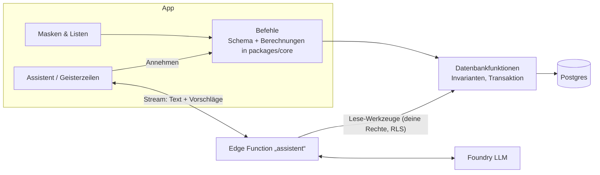

# Feature-Konzept — Brainstorming für Version 1

> Stand: 20.11.2026 · Status: **abgestimmt**, dritte Fassung (alle Entscheidungen getroffen). Grundlage
> für das Frontend mit Beispieldaten; danach entstehen daraus die Specs in `docs/specs/`. Fachbegriffe folgen
> `.agents/glossary.md`; neue Begriffe sind _kursiv_ und kommen mit der jeweiligen Spec ins
> Glossar.
>
> In diese Fassung eingeflossen: deine Notizen (`tmp/REQ.md`), deine Rückmeldungen zur ersten
> Fassung und fünf unabhängige Ideen-Runden. Die Runden betrachteten UX, KI, Haushaltsalltag,
> Marktvergleich mit 15 Apps und ein Architektur-Review.

## Inhalt

1. Überblick
2. Bereits entschieden
3. Leitlinien für Bedienung und Gestaltung
4. Features im Detail (F1–F15)
5. KI-Architektur
6. Datenmodell: Leitlinien und Entitäten
7. Randfälle aus dem Alltag
8. Was wir von anderen Apps lernen
9. Was wir bewusst nicht machen
10. Entscheidungen
11. Nächste Schritte

## 1. Überblick

| #   | Bereich                        | Kern in einem Satz                                                                                   | Etappe |
| --- | ------------------------------ | ---------------------------------------------------------------------------------------------------- | ------ |
| F1  | **Haushalt, Profil und Start** | Mitglieder mit Farbe und Ernährung, Google-Login, Einladung, Start in zwei Minuten                   | 1      |
| F2  | **Heute**                      | Startseite nach Tageszeit: Essen, Vorbereitung, Aufgaben, Einkauf                                    | 1      |
| F3  | **Rezepte**                    | Schnell anlegen, filtern; Varianten (Tofu / Hähnchen / beide); Kochmodus; Starter-Rezepte            | 2      |
| F4  | **Wochenplan**                 | „Wer isst mit?“ je Mahlzeit, Rezept oder Freitext, Reste, Vormerken ohne Tag                         | 3      |
| F5  | **Einkaufsliste**              | Smart-Eingabe, Vorratscheck, Dauerposten, Sammlungen, gemeinsam live, offline abhaken                | 3      |
| F6  | **Märkte und Bereiche**        | Optional: Markt wählen, ruhiger Einkaufsmodus in Laufreihenfolge                                     | 3      |
| F7  | **Haushaltsplan**              | Aufgaben mit Rhythmus, Zuständigkeit (fest, abwechselnd, egal, zu zweit), Verlauf, spontan erledigt  | 5      |
| F8  | **Benachrichtigungen**         | Eine Tageszusammenfassung zur eigenen Uhrzeit statt vieler Einzelnachrichten                         | 5      |
| F9  | **KI-Assistent**               | Zentraler Chat mit Sprache; Vorschläge mit Vorschau und Diff; Haushaltsgedächtnis                    | 4      |
| F10 | **KI an Ort und Stelle**       | ✨ in jeder Maske; Vorschläge als Geisterzeilen direkt in Liste und Plan                             | 4      |
| F11 | **Suche**                      | Stichwortsuche sofort und offline; KI-Suche im selben Feld, sucht selbst in mehreren Runden          | 2 / 4  |
| F12 | **Feedback-Hub**               | Zwei Tipps entfernt, Status angenommen / abgelehnt / umgesetzt, auswertbar für den Coding-Agent      | 1      |
| F13 | **Artikel**                    | Ein Katalog für alles Kaufbare: Starter-Katalog, Synonyme gegen Doppelte, Bereich, Ernährung, Vorrat | 2      |
| F14 | **Abwesenheit und Pause**      | Urlaub, Dienstreise, krank: Plan, Rotation und Erinnerungen passen sich an                           | 5      |
| F15 | **Restaurants**                | Aus geteiltem Karten-Link anlegen, je Person bewerten, im Wochenplan einplanen, Route mit einem Tipp | 3      |

**Etappen** (Reihenfolge der Umsetzung; alles zusammen ist Version 1):

```
1 Fundament        Haushalt, Login, Sync, Design-Fundament, Heute (Gerüst), Feedback-Hub
2 Rezepte          Artikel inkl. Starter-Katalog, Rezepte, Stichwortsuche
3 Essen & Einkauf  Wochenplan, Einkaufsliste, Märkte & Einkaufsmodus
4 KI               Assistent, Sprache, Vorschläge, KI in den Masken, KI-Suche
5 Haushalt         Haushaltsplan, Abwesenheit, Benachrichtigungen
```

Der Feedback-Hub kommt bewusst in Etappe 1: Ab dem ersten Tag fließen eure Rückmeldungen in die
nächsten Specs.

## 2. Bereits entschieden

Von dir festgelegt, nicht mehr offen:

- **Vorrat ist eine ausdrückliche Markierung am Artikel** (Gewürze, Öl …). Die App lernt nichts
  automatisch.
- **Notiz in Klammern** am Einkaufsposten: „Käse (Gouda oder Emmentaler)“.
- **Synonyme** an Artikeln gegen Doppelte („Möhren“ findet „Karotten“).
- **Beide Varianten** eines Rezepts gleichzeitig planen und einkaufen.
- **Vorgegebene Supermarkt-Bereiche**, Freitext als Ausweg.
- **KI-Suche ohne Embeddings**, die selbst in der Datenbank sucht und nachschärft.
- **Flexibler Rhythmus** und **spontan erledigt** im Haushaltsplan.
- **Dauerposten, Sammlungen und Vorbereitung am Vortag** kommen in Version 1.
- **Keine KI ohne ausdrückliche Aktion** (siehe Leitlinie 8).
- **Offline wird ruhig angezeigt**, orange statt rot.
- **Ebenfalls in Version 1:** Foto am Artikel, Wochenvorschau, Saisonfenster für Aufgaben.
  Websuche für Rezepte und freihändiger Kochmodus sind gestrichen. Weitere „Ideen für später“ gibt es nicht
  mehr.
- **Alle offenen Fragen** sind nach Empfehlung entschieden (Abschnitt 10).

## 3. Leitlinien für Bedienung und Gestaltung

1. **Bearbeiten ohne Bearbeiten-Modus.** Antippen, ändern, fertig. Automatisch gespeichert, mit
   sichtbarem Status. Was offline nicht gesendet werden kann, bleibt lokal erhalten
   („nicht gespeichert – erneut senden“).
2. **Erst anlegen, dann ausfüllen.** Für jedes Objekt reicht der Name.
3. **Einfügen statt eintippen.** Zutatenblöcke, mehrere Posten, ganze Sätze. Dieselbe
   _Smart-Eingabe_ überall: `2 Käse (Gouda oder Emmentaler)` → Menge · Artikel · Zusatz, schon
   beim Tippen sichtbar zerlegt.
4. **Dauer-Eingabe.** Enter speichert und leert das Feld, die Tastatur bleibt offen. In Zutaten
   und Schritten legt Enter eine neue Zeile an, die Rücktaste löscht eine leere Zeile.
5. **Rückgängig statt Nachfragen.** Fünf Sekunden „Rückgängig“. Rezepte, Artikel, Märkte werden
   archiviert, nicht gelöscht.
6. **Ein Daumen reicht.** Wichtiges unten, Sheets statt neuer Seiten.
7. **Gesten sind überall gleich:** nach **rechts** wischen heißt „erledigt / kommt mit“, nach
   **links** heißt „weg / später / haben wir“. Jede Geste hat eine Alternative per Tipp und
   funktioniert mit Screenreader.
8. **KI nur auf ausdrücklichen Wunsch.** Jede Maske funktioniert ohne KI. Kein KI-Aufruf
   passiert unbemerkt im Hintergrund. KI startet nur durch eine ausdrückliche Aktion: einen ✨-Knopf,
   eine Nachricht im Chat oder einen bewusst eingeschalteten Schalter (z. B. KI-Suche), der dann
   eingeschaltet bleiben darf. Der Einstieg ✨ sieht überall gleich aus.
9. **Leer, offline, lädt:** Jede Fläche hat diese drei Zustände. Leere Zustände zeigen einen echten
   ersten Schritt statt einer Einführungstour. **Offline** ist ein ruhiger Zustand: ein schmaler
   oranger Hinweis („Offline – Lesen und Abhaken gehen“), nie rot, nie als Fehler. Was offline nicht
   geht, ist sichtbar ausgegraut.
10. **Ruhe statt Druck.** Kein Rot-Alarm, keine Punkte, keine Serien, keine Ranglisten zwischen
    Partnern. Überfälliges heißt „fällig seit“.
11. **Responsiv und auf jedem Gerät hochwertig.** Gearbeitet wird vor allem auf dem Handy, das
    Design ist deshalb zuerst fürs Handy gemacht. Die Web-Version auf Tablet und Desktop muss
    aber genauso gut aussehen und die Breite nutzen: Liste und Detail nebeneinander, Woche als
    Raster, Rezepte als großzügiges Raster.

**Grenzen der PWA bis zur nativen App** (ehrlich einplanen):

- **Haptik:** iOS Safari kann nicht vibrieren; Haptik gibt es vorerst nur auf Android.
- **Timer:** Kochmodus-Timer laufen bei gesperrtem Bildschirm nicht zuverlässig.
- **Bildschirm anlassen** (Wake Lock): auf dem Gerät testen.
- **Push auf iOS** nur, wenn die App zum Home-Bildschirm hinzugefügt ist.

### Navigation

```
┌──────────────────────────────────────────────┐
│ Heute                               (●)  ⚙︎   │  ← Avatar: Profil, Einstellungen, Feedback
│                                              │
│                                        ╭───╮ │
│                                        │ ✨ │ │  ← Assistent schwebt über allem;
│                                        ╰───╯ │    lange drücken = sofort sprechen
├──────────────────────────────────────────────┤
│ ☀︎ Heute  📖 Rezepte  🗓 Plan  🛒 Liste  ✓ Haushalt │
└──────────────────────────────────────────────┘
```

- Fünf Tabs; der Assistent ist kein Tab, sondern überall einen Tipp entfernt und kennt den
  Bildschirm.
- **Daumenzone entlasten:** Auf der Liste wandert ✨ in die Eingabezeile, dort gibt es dann nur
  ein Mikrofon. Im Einkaufs- und Kochmodus ist ✨ ausgeblendet.
- Feedback: Avatar → Feedback (zwei Tipps).

## 4. Features im Detail

### F1 — Haushalt, Profil und Start

- **Mitglied:** Anzeigename, Farbe, _Ernährungsform_ (vegan, vegetarisch, flexibel),
  Abneigungen und Unverträglichkeiten.
- **Haushalt:** Name, Zeitzone, Mahlzeiten im Plan (Standard: Mittag, Abend), Wochenstart,
  Standardmarkt, Standardliste. _Geändert durch UI-Konzept v2 / Spec 0006: keine Standardliste
  mehr, genau eine Einkaufsliste je Haushalt._
- **Einladen** per Link oder Code; die Google-Adresse kommt auf die Allowlist.
- **Persönlich:** Uhrzeit der Tageszusammenfassung, Benachrichtigungen, Erscheinungsbild,
  KI-Schalter. Die KI-Schalter werden lokal auf dem Gerät gespeichert.
- **Mehrere Haushalte, Testhaushalt:** Wer einen Haushalt anlegt, ist dessen Verwalter. Man kann
  jederzeit einen weiteren anlegen, zum Beispiel „Test“, und oben zwischen Haushalten wechseln.
  Starter-Katalog und Starter-Rezepte sind sofort da, ein Testhaushalt ist also in einer Minute
  voll benutzbar. Lokal in der Entwicklung legt zusätzlich ein Seed einen fertigen Testhaushalt mit
  Beispieldaten an.

**Start in zwei Minuten** (die App muss am ersten Abend schon etwas bringen):

1. **„Was kocht ihr oft?“** 10 Gerichte tippen oder sagen, daraus entstehen _Schnellrezepte_
   (nur Titel). Die sind sofort planbar und lassen sich später anreichern.
2. **Starter-Katalog** (F13): Rund 300 gängige Artikel mit Bereich, Ernährung und Vorrat sind ab
   Sekunde eins da. Die Liste ist sofort sortiert.
3. **Aufgaben-Vorlagen** zum Antippen: „Bad putzen – wöchentlich“, „Bettwäsche – alle 2 Wochen
   flexibel“ …
4. **Starter-Rezepte** (F3): Klassiker durchstöbern und mit einem Tipp ins eigene Rezeptbuch
   übernehmen, im Testhaushalt auch „alle übernehmen“.
5. **Mehrere Rezept-Links auf einmal** einfügen. Sie werden im Hintergrund importiert, danach
   heißt es „12 Entwürfe prüfen“.
6. **Installations-Hinweis** (iOS Safari): Nach der ersten Liste erklären drei Bilder „Teilen →
   Zum Home-Bildschirm“, mit Begründung („sonst kann iOS die Offline-Daten löschen“).

### F2 — Heute

Die Startseite passt sich der Tageszeit an: morgens der ganze Tag, ab 16 Uhr „Heute Abend“ mit
großem Kochmodus-Knopf, nach dem Essen „Morgen“.

```
┌──────────────────────────────────────────────┐
│ Guten Morgen, Enrico                Do 20.11. │
│                                              │
│ ┌ Gestern: Mango-Curry ─ gekocht? ★★★★☆ ─ ✓ ┐ │ ← „Wie war's?“, ein Tipp
│                                              │
│ ESSEN HEUTE                                  │
│ ┌─────────────┐ ┌──────────────┐             │
│ │ [Foto]      │ │ Reste vom    │             │
│ │ Lasagne     │ │ Mittwoch     │             │
│ │ Abend · (E) │ │ Mittag       │             │ ← (E) = Enrico kocht
│ └─────────────┘ └──────────────┘             │
│ ⏰ Für morgen: Kichererbsen einweichen (12 h) │ ← Vorbereitung am Vortag
│                                              │
│ ZU TUN  · ca. 4 Punkte                       │
│ ○ Bad putzen                 (E)  heute      │
│ ○ Fenster Wohnzimmer         (N)  fällig seit 2 T. │
│ + Was anderes erledigt?                      │
│                                              │
│ EINKAUF   12 offen · Standardliste [Einkaufen →] │
│ DIESE WOCHE  Mo Di Mi [Do] Fr Sa So          │
└──────────────────────────────────────────────┘
```

- **„Wie war's?“** am Morgen danach: Ein Tipp bestätigt den automatischen Status „gekocht“ und
  vergibt Sterne, je Person. Bewertungen speisen Favoriten und KI.
- **Sonntags-Impuls:** Ist die nächste Woche leer, erscheint „Woche vorschlagen?“. Die Karte selbst
  braucht keine KI; der Vorschlag entsteht erst beim Antippen. Höchstens ein Impuls pro Tag, nie
  als Push.

### F3 — Rezepte

**Ziel:** in 10 Sekunden angelegt, in 2 Sekunden wiedergefunden.

**Anlegen**

- **Schnellanlage:** nur der Titel.
- **Zutaten einfügen oder diktieren:** Jede Zeile wird zu Rezeptangabe + Artikel. Was der Parser
  nicht sicher erkennt, bleibt markierter Freitext. _Geändert durch UI-Konzept v2 / Spec 0007:_
  Unsichere Zeilen stehen orange mit „Artikel wählen“ und werden erst mit Artikel gespeichert; eine
  Zutat ohne Artikel gibt es nicht mehr.
- **Aus Link:** Strukturierte Rezeptdaten der Seite inklusive Foto. Instagram-, TikTok- und
  YouTube-Links werden aus der Beschreibung gelesen.
- **Aus Foto:** Kochbuchseite, handgeschriebene Karte oder ein Bild des Gerichts.
- **Aus Beschreibung:** „Schnelles veganes Curry mit Mango, eher mild“.
- **Import scheitert nie still.** Es gibt immer einen Entwurf mit dem Hinweis, was fehlt, und
  „Text einfügen“ als Ausweg. Von der KI geschätzte Mengen sind als „bitte prüfen“ markiert.

Alle Wege landen **als Entwurf in derselben Rezeptmaske**.

**Aufbau eines Rezepts**

| Teil             | Inhalt                                                                                                        |
| ---------------- | ------------------------------------------------------------------------------------------------------------- |
| Kopf             | Titel, Fotos, Portionen, Zeiten (Vorbereitung / gesamt), Kurzbeschreibung                                     |
| Einordnung       | _Gerichtart_ (Frühstück, Hauptgericht, Beilage, Dessert, Snack, Getränk), Küche, Aufwand, Saison, Schlagworte |
| _Ernährungsform_ | **abgeleitet** aus den Artikeln, je Variante; überschreibbar                                                  |
| Zutaten          | Rezeptzutaten mit Rezeptangabe und Einkaufsregel, optional in Gruppen („Für die Soße“)                        |
| _Varianten_      | z. B. _mit Tofu_ (Standard) · _mit Hähnchen_                                                                  |
| _Vorlauf_        | „Kichererbsen einweichen, 12 h vorher“; erscheint am Vortag in Heute und in der Zusammenfassung               |
| Zubereitung      | Schritte; Zeitangaben im Text werden zu antippbaren Timern; Schritte können einer Variante gehören            |
| Persönlich       | **je Person:** Favorit, Bewertung · gemeinsam: Notizen, zuletzt gekocht, wie oft                              |
| Herkunft         | Link, Kochbuch, „von Oma“, KI                                                                                 |

> „Gerichtart“ statt „Gang“, weil „Gang“ im Supermarkt etwas anderes bedeutet.

**Varianten: Basis plus Ergänzung**

- Zutaten **ohne** Variante sind die Basis (Mango, Kokosmilch, Reis). Die austauschbare Zutat
  steht **nur** in den Varianten (_mit Tofu_: Tofu · _mit Hähnchen_: Hähnchen).
- Jeder Artikel hat eine Ernährungseigenschaft (vegan, vegetarisch, Fisch, Fleisch, unbekannt).
  Die Ernährungsform einer Variante ist die „strengste“ über Basis und Variante. Unbekannt bleibt
  unbekannt, nie automatisch vegan.
- Filter „vegetarisch“ findet auch Rezepte, bei denen eine Variante passt.
- „✨ Mach eine vegane Variante“ verschiebt die tierische Zutat aus der Basis in eine Variante und
  schlägt Ersatz vor.
- **Passt nicht:** Gibt es für ein Mitglied keine passende Variante, zeigt der Plan dessen Avatar
  durchgestrichen. Ein Tipp öffnet „Variante wählen“ oder „✨ anlegen“.
- Variante ist jederzeit umschaltbar, auch nachträglich im Plan.

**Durchblättern und Filtern**

```
┌──────────────────────────────────────────────┐
│ 🔍 Rezepte suchen …                   ⊞ / ☰   │
│ [Favoriten][Schnell <30'][Vegetarisch][Für alle][+] │
│ Sortierung: Zuletzt gekocht ▾                │
│ ┌────────────┐ ┌────────────┐                │
│ │  [Foto]    │ │  [Foto]    │                │
│ │ Mango-Curry│ │ Lasagne    │                │
│ │ 25' · 🌱/🍗│ │ 60' · ★ 5  │                │
│ └────────────┘ └────────────┘                │
└──────────────────────────────────────────────┘
```

- Filter-Chips: Ernährungsform, Gerichtart, Küche, Zeit, Saison, Favoriten (meine / beide),
  „lange nicht gekocht“, „passt für alle“. Kombinationen als eigener Chip speicherbar.
- Sortieren: zuletzt gekocht, am häufigsten, Bewertung, neu, A–Z.

**Aus dem Rezept heraus**

- Portionen ändern skaliert alle erkennbaren Mengen.
- „Einplanen…“: Tag, Mahlzeit, wer isst mit.
- „Auf die Liste“: läuft durch denselben Vorratscheck wie der Plan.
- **„Ist alle“:** Eine Zutat antippen, und sie kommt auf die Standardliste. Das fängt Gewürze und
  Vorrat auf.
- **Kochmodus:** große Schrift, ein Schritt pro Bildschirm, Bildschirm bleibt an, Timer, Zutaten
  des Schritts. Bei beiden Varianten zeigt er beide Zutatensätze und markiert Schritte mit „nur
  Hähnchen“; vorab gibt es den Hinweis „2 Pfannen“.

**Starter-Rezepte**

- Rund **150 Klassiker** der Alltagsküche (deutsch und international), mit Zutaten aus dem
  Starter-Katalog, Varianten (vegetarisch / mit Fleisch) wo sinnvoll, Zeiten, Gerichtart,
  Schlagworten und Schritten. Vorerst ohne Fotos.
- **Herkunft:** einmalig während der Entwicklung mit unserer KI im festen Rezeptformat erzeugt,
  durch den Zutaten-Parser geprüft und gegengelesen. **Nicht** von Rezeptseiten kopiert, wegen
  Urheberrecht und Nutzungsbedingungen.
- Sie liegen wie der Starter-Katalog fest in der App. Ins eigene Rezeptbuch kommen sie erst, wenn
  man sie übernimmt; dort sind sie normale, änderbare Rezepte mit Herkunft „Starter“.
- Nebeneffekt: Die Rezepte prüfen den Starter-Katalog. Jede Zutat muss einem Katalog-Artikel
  entsprechen, sonst fehlt dort etwas.

### F4 — Wochenplan

```
┌──────────────────────────────────────────────┐
│ ‹ KW 47 · 17.–23. Nov ›            ✨ Planen  │
│ Mo 17  Abend  Lasagne              (E)(N) 4P │
│ Di 18  Abend  Reste von Montag               │
│ Mi 19  Abend  Mango-Curry                    │
│               🌱 Tofu 2 · 🍗 Hähnchen 2  (N)🍳│ ← beide Varianten, Nadja kocht
│ Do 20  Abend  + hinzufügen                   │
│ VORGEMERKT    Shakshuka · Linsen-Dal         │ ← „bald kochen“, ohne Tag
│ [Auf die Einkaufsliste…]                     │
└──────────────────────────────────────────────┘
```

- **Wer isst mit?** Chips mit den Mitgliedern und „+ Gäste“ je Mahlzeit, vorausgewählt sind alle,
  die nicht abwesend sind. Daraus ergeben sich die Portionen und die **Aufteilung auf Varianten**:
  vegetarisch → Tofu, alles → Hähnchen. Ein Tipp auf die Aufteilung ändert sie.
- **Mehrere Gerichte je Mahlzeit:** Ein Eintrag ist ein Gericht. Abends kann neben der Lasagne
  ein Salat stehen, jeder Eintrag mit eigenen Portionen und eigener kochender Person.
- **Wer kocht?** Optionaler Avatar je Eintrag. Die Tageszusammenfassung sagt „Du kochst heute“.
- **Eintrag hinzufügen:** Suche über Rezepte, Vorschläge („lange nicht gekocht“, Favoriten), dazu
  **Freitext** („Essen bei Oma“), **neues Rezept** (Schnellanlage oder ✨ beschreiben) und
  **Reste** eines früheren Tags. Wurde der Quelltag nicht gekocht, wird der Reste-Eintrag markiert.
- **Vormerken ohne Tag** („bald kochen“). Die Zutaten können schon auf die Liste, den Tag legt man
  später per Ziehen fest.
- **Verschieben** per Ziehen, **kopieren** mit langem Druck, **Woche kopieren** oder als Vorlage
  speichern.
- **Gekocht** wird abgeleitet (Tag vorbei) und über „Wie war's?“ bestätigt oder korrigiert.
- **Ändert sich der Plan, nachdem die Liste erzeugt wurde**, sagt die Liste Bescheid (F5).

### F5 — Einkaufsliste

**Grundsatz:** zuerst einfach eine Liste. Markt, Bereiche und Pläne sind Zusätze.

> _Geändert durch UI-Konzept v2 / Spec 0006 und 0009:_ Es gibt genau eine Einkaufsliste je
> Haushalt (keine Standardliste, keine weiteren Listen, Markt nur noch beim Einkaufen). Eine
> Sammlung ist kein Set von Artikeln mehr, sondern ein Rezept der Art „Sammlung“ mit eigenen
> Zutaten und enthaltenen Rezepten. Die Skizzen unten zeigen noch den alten Stand.

```
┌──────────────────────────────────────────────┐
│ Standardliste ▾            Markt: keiner ▾   │
│ Für: Lasagne (Mo) · Curry (Mi) ›             │
│ ⚠ Curry geändert · 3 Posten betroffen [Ansehen] │
│ ○ Milch                              2×    • │ ← • = noch nicht synchronisiert
│ ○ Kokosmilch                     400 ml      │
│ ○ Käse (Gouda oder Emmentaler)               │
│ ○ Bananen                     🔁             │ ← Dauerposten
│ ✓ Erledigt (3)                      leeren   │
│ [Milch][Brot][Eier][Bananen][Kaffee] …       │ ← häufige Artikel als Kacheln
│ ┌──────────────────────────────────────────┐ │
│ │ 2 Käse (Gouda) ▸ 2 · Käse · (Gouda)  ✨ 🎤│ │ ← Smart-Eingabe, Zerlegung sichtbar
│ └──────────────────────────────────────────┘ │
└──────────────────────────────────────────────┘
```

**Hinzufügen**

- **Smart-Eingabe** mit Synonym-Treffern („Möhren · auch: Karotten“).
- **Bremse gegen Doppelte:** Bei einem ähnlichen neuen Namen fragt die Zeile „Meinst du
  _Möhren_? [Als Synonym] [Neu]“. Steht der Artikel schon offen auf der Liste, zählt die Zeile
  hoch, statt eine zweite anzulegen.
- **Notiz in Klammern** wird zum Zusatz; per Sprache genauso („Käse, Gouda oder Emmentaler“).
  Der Zusatz hängt am einzelnen Beitrag. Bringen zwei Herkünfte verschiedene Zusätze mit, stehen
  beide nebeneinander.
- **Häufige Artikel als Kacheln** über dem Eingabefeld. Ein Tipp fügt hinzu.

**Aus Plan oder Rezept übernehmen**

1. **Tage wählen:** Chips Mo–So plus „Vorgemerkte“. Vorausgewählt sind die kommenden Tage, die
   noch auf keiner Liste stehen.
2. **_Vorratscheck_ in zwei Zonen:**

```
┌──────────────────────────────────────────────┐
│ Was brauchst du wirklich?                    │
│ KOMMT AUF DIE LISTE                          │
│ ● Mango                    für Curry         │  ← nach links wischen = haben wir
│ ● Kokosmilch   400 ml      für Curry         │
│ ● Hähnchen     300 g       für Curry (E)     │
│ ▸ VORRAT & GEWÜRZE (5)                 aus   │  ← eingeklappt, Abzeichen „Vorrat“
│   ○ Kreuzkümmel ○ Reis ○ Olivenöl …          │     antippen = kommt doch mit
│ 🎤 „Zwiebeln hab ich, Butter nicht“          │  ← Vorratscheck per Sprache
│              [ 12 übernehmen ]               │
└──────────────────────────────────────────────┘
```

3. **Übernehmen** in die gewählte Liste.

Der Vorratscheck gilt genauso für „Auf die Liste“ aus dem Rezept und für Sammlungen. Was weggewischt
wurde, bleibt gemerkt: „Liste erneut erzeugen“ holt es nicht zurück.

**Was die Liste sonst kann**

- **Dauerposten:** Artikel mit eigenem Rhythmus, fest („Milch montags“) oder flexibel („Kaffee
  etwa alle 3 Wochen nach dem letzten Kauf“). Sie haben eine eigene Herkunft und kommen nie
  doppelt.
- **Sammlungen:** benannte Sets mit Zusätzen („Grillabend“, „Plätzchen“, „Frühstück“), die mit
  einem Tipp durch den Vorratscheck auf eine Liste gehen. _Geändert durch UI-Konzept v2 / Spec
  0009: ein Rezept der Art „Sammlung“ mit eigenen Zutaten und enthaltenen Rezepten._
- **Plan geändert:** Statt die Liste still anzupassen, zeigt sie „Curry geändert · 3 Posten
  betroffen“, mit Vorschau vor dem Neuberechnen. Geändert werden nur offene Posten. Ist schon
  gekauft, fragt die App: „Zutaten sind da – neu einplanen?“.
- **Gebraucht bis:** Jeder Posten kennt seinen frühesten Plantag. Mit dem Filter „nur bis Mi“
  lassen sich Großeinkauf und Frischeinkauf trennen.
- **Gemeinsam live:** Haken der anderen Person leuchten kurz in deren Farbe auf.
- **Einkauf läuft:** Die andere Person sieht „Nadja ist bei Rewe“. Was sie währenddessen
  ergänzt, erscheint beim Einkaufenden oben unter „Neu dazu“. Optional schickt der Start eine
  Nachricht („Enrico ist bei Rewe – noch was?“).
- **Offline im Laden** (Entscheidung 8): Abhaken, „Nicht da“, Posten hinzufügen und Bereich
  zuordnen gehen ohne Netz und werden nachgereicht. Beim Abhaken gilt „Abhaken gewinnt“. Ein
  kleiner Punkt zeigt, was noch nicht synchronisiert ist. Festgehalten im Nachtrag zu ADR-0008.
- **Einkauf abschließen:** „8 gekauft · 2 bleiben“. Erledigte Posten werden geleert, sobald Netz
  da ist.
- **Mehrere Listen:** Standardliste plus z. B. „Drogerie“ oder „Grillabend“. _Geändert durch
  UI-Konzept v2 / Spec 0006: entfällt, es gibt genau eine Einkaufsliste (D25)._

### F6 — Märkte und Bereiche (optional)

- **Vorgegebene Bereiche** als Start, lassen sich übernehmen, umbenennen, löschen oder per Freitext
  ergänzen:

  | Gruppe   | Bereiche                                                                                            |
  | -------- | --------------------------------------------------------------------------------------------------- |
  | Frisch   | Obst & Gemüse · Brot & Backwaren · Kühlregal & Molkerei · Käse · Fleisch & Wurst · Fisch · Tiefkühl |
  | Vorrat   | Nudeln, Reis & Hülsenfrüchte · Konserven & Saucen · Backen · Gewürze & Öl · Frühstück & Aufstriche  |
  | Genuss   | Süßes & Snacks · Getränke · Kaffee & Tee                                                            |
  | Non-Food | Drogerie & Hygiene · Haushalt & Reinigung · Tierbedarf                                              |
  | Rest     | Sonstiges                                                                                           |

- Starter-Katalog und KI ordnen Artikel diesen Bereichen zu; ändern geht mit einem Tipp.
- Ohne Markt ist die Liste nach Bereichen in der Standardreihenfolge gruppiert.
- **Laufreihenfolge** je Markt per Ziehen. Bereiche ausblenden (Drogerie bei Aldi): Deren Posten
  stehen gleich unter „Woanders kaufen“.

**Einkaufsmodus: ruhig, groß, einhändig**

```
┌──────────────────────────────────────────────┐
│ Rewe Südstadt                ███████░░  7/10 │
│ OBST & GEMÜSE                                │
│ ○ Mango                                      │ → rechts = abhaken
│ ̶○̶ ̶L̶i̶m̶e̶t̶t̶e̶                     2×           │ ← bleibt 2 s stehen, gleitet dann weg
│ KÜHLUNG                                      │
│ ○ Milch                       2×             │ ← links = nicht da → „Woanders kaufen“
│ OHNE BEREICH                                 │
│ ○ Spülmittel        [Bereich: Gerade hier ▸] │ ← große Kacheln, vorn der letzte Bereich
│ ⚡ Offline · Stand vor 8 Min                  │
└──────────────────────────────────────────────┘
```

- Zeilen mindestens 56 pt hoch, Bildschirm bleibt an, ✨ ausgeblendet.
- Zwei Läden gleichzeitig: Jede Person sortiert nach dem eigenen Markt; Abgehaktes verschwindet
  bei der anderen live.
- **Offline:** Abhaken, „Nicht da“, Posten hinzufügen und Bereich zuordnen gehen auch ohne Netz
  (Entscheidung 8).

### F7 — Haushaltsplan

**Begriffe:** _Aufgabe_ (was), _Rhythmus_ (wann), _Zuständigkeit_ (wer), _Aufwand_ (wie viel),
_Erledigung_ (Eintrag im Verlauf).

| Rhythmus                                       | Beispiel                                                      |
| ---------------------------------------------- | ------------------------------------------------------------- |
| Einmalig, mit oder ohne Datum                  | „Glühbirne Flur tauschen“                                     |
| Wöchentlich an Tagen, alle n Wochen            | „Jeden Freitag Bad“, „alle 2 Wochen Montag Altpapier“         |
| Monatlich (Tag X oder n-ter Wochentag)         | „Am 1. Kühlschrank auswischen“                                |
| Alle n Monate, jährlich                        | „Alle 6 Monate Matratze drehen“                               |
| **Flexibel nach letzter Erledigung**           | „Bettwäsche etwa alle 2 Wochen“                               |
| _Saisonfenster_ (zusätzlich zu jedem Rhythmus) | „Balkon gießen, nur April–September“, „Winterreifen, Oktober“ |

| Zuständigkeit | Bedeutung                                                     |
| ------------- | ------------------------------------------------------------- |
| Fest          | „Enrico“                                                      |
| Abwechselnd   | Dran ist, wer nach der Person kommt, die zuletzt erledigt hat |
| Egal          | Wer es zuerst macht                                           |
| **Zu zweit**  | Braucht beide (Matratze drehen); zählt für beide              |

```
┌──────────────────────────────────────────────┐
│ Haushalt         [Heute][Woche][Alle][Verlauf] │
│ HEUTE · ca. 4 Punkte                         │
│ ○ Bad putzen            (E)   wöchentlich Fr │ → rechts = erledigt · links = später
│ FLEXIBEL                                     │
│ ○ Bettwäsche            (E↔N) ▓▓▓▓▓▓░░       │ ← Fälligkeitsbalken statt Datum
│ FÄLLIG SEIT                                  │
│ ○ Fenster Wohnzimmer    (N)   2 Tagen        │
│ ┌──────────────────────────────────────────┐ │
│ │ + Aufgabe … oder „hab gerade …“        🎤│ │
│ └──────────────────────────────────────────┘ │
└──────────────────────────────────────────────┘
```

**Erledigen**

- **Abhaken** bucht eine Erledigung, berechnet den nächsten Termin und wechselt bei
  „abwechselnd“ die Person. Der Hinweis danach („Erledigt von dir · [Nadja]“) bucht mit einem Tipp
  auf die andere Person um.
- **Später:** verschiebt nur diesen Termin.
- **Überspringen:** wird als „übersprungen“ verbucht, nicht als erledigt.
- **Spontan erledigt** („Hab heute die Fenster geputzt“):
  - Fester Rhythmus: Es zählt für den anstehenden Termin, der nächste bleibt wie geplant.
  - Flexibler Rhythmus: Die Uhr startet neu.
  - Ohne passende Aufgabe: Eintrag „spontan“ im Verlauf.
- **Doppelt erledigt** zählt nur einmal: „Nadja war schneller (10:02)“.

**Weiteres**

- **Abgeben:** „Kannst du heute?“ geht an die andere Person. Angenommen gilt es nur für diesen
  Termin, die Rotation bleibt.
- **Neustart statt Schuldenberg:** Ab drei überfälligen Aufgaben bietet die App „Neu verteilen“ auf
  die nächsten Tage an.
- **Aufwand** als 1–3 Punkte je Aufgabe. Heute zeigt die Summe des Tages.
- **Unteraufgaben** als Checkliste, **Räume** als optionale Gruppierung.
- **Querverbindung:** „Glühbirne kaufen“ wird mit einem Tipp zum Einkaufsposten.
- **Verlauf:** wer, wann, was; filterbar nach Person und Aufgabe.

### F8 — Benachrichtigungen

- **Tageszusammenfassung** zur eigenen Uhrzeit: „Heute: Bad putzen (du) · du kochst Lasagne · für
  morgen Kichererbsen einweichen · 12 Posten auf der Liste.“
- **Überfällig:** höchstens eine Erinnerung pro Aufgabe und Tag, nur an die zuständige Person.
- **Wochenvorschau** am Sonntagabend (optional): Plan der Woche, Aufgaben je Person, Lücken
  („Do noch leer“). Eine Zusammenfassung ohne KI.
- **Optional:** „Enrico ist bei Rewe – noch was?“, „Dein Feedback wurde umgesetzt“.
- **Stumm** bei Abwesenheit und Urlaub (F14). Jede Art einzeln abschaltbar.
- Es gibt **keinen** „Nadja erinnern“-Knopf. Erinnerungen kommen nur von der App, neutral
  formuliert.
- **Technik:**
  - Web Push. Auf iOS geht das nur, wenn die App auf dem Home-Bildschirm liegt; auf Android voll.
  - Ein Takt per `pg_cron` alle 5–10 Minuten ruft eine Edge Function auf. Sie schickt keine
    Nachricht doppelt, rechnet in der Zeitzone des Haushalts und kommt mit der Zeitumstellung
    zurecht.
  - Später nativ über Expo Push.

### F9 — KI-Assistent (zentral)

**Was er kann**

- **Fragen beantworten:** „Welche Rezepte gibt es mit Halloumi?“, „Was koche ich heute?“,
  „Wann gab es zuletzt Lasagne?“, „Was steht diese Woche an?“
- **Vorschlagen:** Rezepte, Varianten, Wochenpläne, Posten, Aufgaben, Feedback.
- **Sammel-Vorschläge:** Aus „Milch auf die Liste, Bad hab ich geputzt, Mittwoch Curry“ wird
  **eine** Karte mit drei Teilen, einzeln abwählbar.

**Sprechen**

- Halten = sprechen, der Text erscheint live.
- Nach oben ziehen = freihändig weiter.
- Nach links = verwerfen.
- Vor dem Senden lässt sich der Text noch ändern.

```
┌──────────────────────────────────────────────┐
│ Du: mach das Curry vegan und für 6 Personen  │
│ ┌─ Vorschlag: Mango-Curry ändern ──────────┐ │
│ │ Portionen   4 → 6                         │ │ ← Diff: nur was sich ändert
│ │ ~~Hähnchen 300 g~~ → Räuchertofu 450 g ☑  │ │
│ │ ~~Fischsauce~~ → Sojasauce            ☑  │ │
│ │ [Übernehmen]  [Ändern…]  [Verwerfen]      │ │
│ └───────────────────────────────────────────┘ │
│ 3 Rezepte gelesen · Plan KW 47 gelesen        │ ← Transparenz
│ [Bezug: Mango-Curry ×]                        │ ← worauf sich „das“ bezieht
│ 🎤  Nachricht …                          ➤    │
└──────────────────────────────────────────────┘
```

- **Übernehmen:** ganz oder teilweise. Dann schreibt die App die Änderung über dieselben Befehle
  wie bei einer Eingabe von Hand. **Ändern…:** sagen, was anders sein soll; geändert wird
  nur das, Änderungsrunden sind markiert. Oder in der normalen Maske weiterbearbeiten.
  **Verwerfen** zählt als Signal.
- **Streaming:** Plan-Vorschläge füllen sich Zeile für Zeile; man sieht sofort, dass etwas passiert.
- **Bezug sichtbar:** Ein Chip zeigt, worauf sich die Anfrage bezieht. Wegtippen macht sie
  allgemein.
- **_Haushaltsgedächtnis_:** Was der Assistent über euch weiß, ist sichtbar und editierbar, etwa
  „unter der Woche max. 30 Min“ oder „Nadja mag keinen Koriander“, jeweils mit Quelle. Neue
  Einträge kommen selbst als Vorschlag („3× Fisch verworfen – merken?“). Jede Planung nennt,
  welche Einträge sie genutzt hat.

### F10 — KI an Ort und Stelle

| Ort                     | Angebot                                                                                                    |
| ----------------------- | ---------------------------------------------------------------------------------------------------------- |
| Neues Rezept            | Beschreiben, Link, Foto, mehrere Links auf einmal → Entwurf füllt die Maske                                |
| Rezept ansehen          | „Vegane Variante“, „für 6 Personen“, „weniger scharf“, „Schlagworte vorschlagen“                           |
| Plan → Tag → hinzufügen | „Was Passendes“ aus euren Rezepten oder „neues Rezept beschreiben“                                         |
| Wochenplan              | „✨ Planen“: Abwechslung (letzte Wochen), Saison, Vorlieben, Gäste, Varianten für beide, Reste von Zutaten |
| Einkaufsliste           | Sprache → Posten · Vorratscheck per Sprache                                                                |
| Haushalt                | „Jeden Freitag Bad, Nadja alle 2 Wochen Fenster“ → Aufgaben mit Rhythmus und Zuständigkeit                 |
| Feedback                | Diktieren; ähnliche offene Einträge werden als „+1“ angeboten                                              |

- **Geisterzeilen:** Vorschläge, die in Liste oder Plan gehören, erscheinen **dort** als
  gestrichelte Zeilen, nicht nur im Chat. Wischen heißt annehmen oder verwerfen; dazu gibt es
  „Alle übernehmen“.
- **Plan-Prüfer:** Eine feste Funktion prüft jeden KI-Plan: keine gleiche Hauptzutat zweimal
  hintereinander, Zeitlimit unter der Woche, passende Variante für jede Person. Verstöße gehen
  zurück an die KI, höchstens zwei Reparaturrunden.
- **Zutaten aufbrauchen:** Der Planer bevorzugt Kombinationen, die Angebrochenes verwerten (halber
  Bund Koriander), und sagt das dazu.
- **Mengen-Plausibilität:** Unplausible Mengen je Portion („12 Eier für 2“) werden markiert.
- **KI-Hilfe beim Anlegen, nur auf Wunsch:** Neue Artikel bekommen Bereich, Ernährung und
  Synonyme zuerst **ohne KI** aus dem Starter-Katalog. Fehlt etwas, gibt es am Feld „✨
  vorschlagen“. Wer das automatisch will, schaltet in den Einstellungen „KI-Hilfe beim Anlegen“
  ein (lokal gespeichert, bleibt an). Dasselbe gilt für Schlagworte, Gerichtart und Aufwand bei
  neuen Rezepten.
- **Bilder:** übernommen aus dem Link oder als eigene Fotos. Keine KI-generierten Bilder in
  Version 1 (Entscheidung 6).

### F11 — Suche

**Ein Suchfeld, zwei Stufen**

```
┌──────────────────────────────────────────────┐
│ 🔍 was Schnelles mit Tofu, nicht scharf, lange nicht gehabt │
│ Treffer (Stichwort): Tofu-Bowl, Mapo Tofu    │ ← sofort, lokal, offline
│ ✨ KI-Suche: an                              │ ← ausdrücklich eingeschaltet, lokal gespeichert
│ ─────────────────────────────────────────── │
│ [Tofu ×][≤ 30 Min ×][nicht scharf ×][lange nicht ×] │ ← Deutung der KI als echte Filter
│ ┌ Tofu-Bowl ─── 20' · zuletzt vor 7 Wochen ─┐ │
│ │ schnell, mild, lange nicht gekocht        │ │ ← Grund je Treffer
│ └────────────────────────────────────────────┘ │
│ 2 Runden · gesucht: tofu, bowl, curry mild   │
│ [Nochmal suchen] [schneller] [ohne Kokos …] 🎤 │
└──────────────────────────────────────────────┘
```

- **Stufe 0, Stichwort** (immer, sofort, offline, kostenlos): Sie sucht lokal über Titel,
  Zutaten **samt Synonymen**, Schlagworte und Notizen, fehlertolerant („Halumi“ findet
  Halloumi). Kurze Eingaben mit klaren Treffern enden hier.
- **Stufe 1, KI-Suche** (online, im selben Feld, kein eigener Bildschirm). Sie muss
  **ausdrücklich eingeschaltet** werden: Schalter ✨ neben dem Suchfeld, lokal auf dem Gerät
  gespeichert, bleibt an, bis man ihn ausschaltet. Ist er aus, gibt es nur die Stichwortsuche,
  ohne jeden KI-Aufruf.
  1. Die KI macht aus dem Wunsch einen **Suchplan** mit 1–3 parallelen Abfragen (streng, breit,
     andere Deutung): Begriffe, gewünschte und ausgeschlossene Artikel, Ernährung je Person,
     Zeit, Saison, „nicht gekocht seit“.
  2. Eine Datenbankfunktion sucht per Volltext und Ähnlichkeit, unter euren Rechten. Harte
     Bedingungen wie „vegetarisch für Nadja“ oder Abneigungen prüft **die Datenbank**, nicht
     die KI.
  3. Die KI sieht nur Trefferzahlen und warum etwas getroffen hat. Bei 0 Treffern lockert sie,
     bei über 30 schärft sie nach.
  4. Sie stoppt bei 5 passenden Kandidaten, wenn nichts Neues mehr kommt, oder nach höchstens
     3 Runden bzw. etwa 8 Sekunden.
  5. **Sortieren nur innerhalb echter Treffer:** Die Datenbank liefert die Top 20 (mit Boni für
     Favorit, Bewertung, lange nicht gekocht, Saison, passt für alle). Die KI ordnet sie neu und
     gibt je Treffer einen kurzen Grund. Jede ID wird geprüft, erfundene Rezepte kann es nicht
     geben.
- **Deutung als Chips:** Entfernt man einen Chip, wird sofort neu gesucht, ohne KI, denn der
  Suchplan ist strukturiert. Chips lassen sich als gespeicherte Filter übernehmen.
- **Nochmal suchen:** bisher gezeigte Treffer werden ausgeschlossen, mindestens eine Bedingung
  ändert sich. Kommt nichts Neues, sagt die App das ehrlich und bietet „✨ Neues Rezept
  beschreiben“ an.
- **Qualität messen:** Was nach einer Suche angetippt oder eingeplant wird, wird protokolliert.
  Daraus entsteht eine Testsammlung aus 30–50 echten Anfragen, die jede Prompt-Änderung prüft.
- **Embeddings (RAG): nicht in Version 1.** Stichworte, Synonyme und Suchschleife decken eure
  Anfragen ab. Sinnvoll erst ab rund 1 000 Rezepten oder langen Texten; dann `pgvector` plus
  Volltext als Hybrid-Suche.

### F12 — Feedback-Hub

- **Erreichbar:** Avatar → Feedback, oder im Assistenten „Feedback: …“.
- **Eintrag:** Art (Idee, Problem, Lob), Text oder Sprache. Automatisch dabei sind Bildschirm,
  App-Version und Gerät; ein Screenshot ist optional.
- **Doppelte vermeiden:** Ähnliche offene Einträge werden angezeigt (Ähnlichkeitssuche, ohne
  KI), „+1“ statt neu.
- **Status:**
  - neu → angenommen oder abgelehnt (mit Begründung) → umgesetzt (mit Spec-Nummer)
  - Benachrichtigung an den Autor, wenn umgesetzt
- **Für den Coding-Agent:** Skill `feedback-triage` mit den Skripten `pnpm feedback:pull`
  (offene Einträge als Markdown nach `tmp/feedback/`) und
  `pnpm feedback:status <id> <status> [--spec NNNN]`. Die Skripte laufen lokal und laden den
  Schlüssel aus `.env`, ohne ihn auszugeben.

### F13 — Artikel

Der Katalog hinter Rezepten und Listen. Niemand pflegt ihn bewusst; er wächst beim Benutzen.

- **Felder:**
  - Name und **Synonyme**
  - Bereich, Ernährungseigenschaft
  - **Vorrat** (ausdrücklich gesetzt)
  - Standard-Einkaufsregel
- **Starter-Katalog:** Rund 300 gängige deutsche Artikel liegen **fest in der App**, mit Bereich,
  Ernährung, Vorrat und Synonymen. Sie sind offline und ohne KI verfügbar. Ein Artikel des
  Haushalts entsteht erst, wenn man ihn das erste Mal benutzt; er übernimmt dann die Vorgaben.
- **Doppelte vermeiden:**
  - Name und Synonyme sind je Haushalt eindeutig, das sichert die Datenbank.
  - Gleichzeitiges Anlegen von „Karotten“ auf zwei Handys ergibt trotzdem nur einen Artikel.
  - Singular und Plural werden **nie automatisch** zusammengelegt (Ei/Eier, Nudel/Nudeln). Die App
    schlägt nur vor („Meinst du Möhre?“) und speichert nach Bestätigung ein Synonym.
- **Zusammenführen:** zwei Artikel werden zu einem; alle Rezepte, Listen und Synonyme ziehen mit.
  Auch ein offline gesetzter Haken findet den Posten danach noch.
- **Foto am Artikel** (optional): „genau diese Hafermilch“. Es erscheint klein am Einkaufsposten
  und groß beim Antippen, damit die andere Person das Richtige kauft.
- **Artikelseite:** in welchen Rezepten, wann zuletzt gekauft, welcher Bereich, Foto.

### F14 — Abwesenheit und Pause

- **Zeitraum je Person** (Dienstreise) oder **für den Haushalt** (Urlaub).
- Wirkung:
  - „Wer isst mit?“ lässt Abwesende weg.
  - Die Rotation überspringt sie.
  - Feste Termine im Haushaltsurlaub entfallen, flexible Uhren stehen still.
  - Benachrichtigungen sind stumm.
- **„Heute raus“** (krank): Die eigenen Aufgaben wandern auf morgen oder werden der anderen Person
  angeboten, das Kochen ist wieder frei.
- **Saisonale Pause** einzelner Aufgaben über das Saisonfenster (F7).

### F15 — Restaurants

Spec: `docs/specs/0002-restaurants/spec.md`. Restaurants sind ein eigener Bereich neben den
Rezepten; der Tab „Rezepte“ heißt dafür **„Essen“** und hat oben den Umschalter **Rezepte ·
Restaurants**.

- **Schnell hinzufügen:** Teilen aus Google Maps oder Apple Karten (Android-PWA, später nativ auch
  iOS) über die Route `/teilen`, Link einfügen (überall) oder von Hand, nur der Name ist Pflicht.
  Aus dem Link werden Name und Koordinaten gelesen; Kurzlinks löst später der Server auf.
- **Doppelte vermeiden:** Gleicher Name oder fast gleicher Ort → „Gibt es schon“ mit „Öffnen“.
- **Je Person:** Bewertung und Favorit; die Notiz gilt für den Haushalt.
- **Im Wochenplan:** Statt eines Rezepts lässt sich ein Restaurant eintragen. Es erzeugt keine
  Einkaufsposten. _Besuche_ werden daraus abgeleitet („Zuletzt: vor 12 Tagen · 3 Besuche“).
- **Route:** Auf „Heute“ und in der Detailseite öffnet „Route“ Apple Karten oder Google Maps mit
  dem Restaurant als Ziel.
- **Nicht dabei:** Restaurantsuche über Google (kostenpflichtige Places-API), Öffnungszeiten,
  Speisekarten, Reservierungen.

## 5. KI-Architektur: eine Logik für App und Assistent

Deine Vorgabe: **Der Agent bekommt keine eigene Geschäftslogik.** Was der Assistent tut, passiert
über exakt dieselben Funktionen wie in der App.



1. **Befehle als einzige Quelle.** Jede Schreibaktion ist genau ein Befehl: Name, Beschreibung,
   Zod-Schema.
   - **Berechnungen** liegen in `packages/core`, getestet und offline nutzbar: Parser,
     Skalierung, Rhythmus, Ernährungsform.
   - **Invarianten** sichert die Datenbank: Eindeutigkeit, Mandantengrenze, Abhak-Regel, Summe
     der Portionen.
   - Mehrteiliges läuft als **eine** Datenbankfunktion in einer Transaktion.
2. **Werkzeuge werden aus den Befehlen erzeugt.** Beschreibung und Schema sind zugleich die
   Werkzeugdefinition. Es gibt keine zweite Implementierung.
3. **Der Assistent liest selbst und schreibt nie selbst.**
   - Lese-Werkzeuge laufen mit deinem Login.
   - Schreib-Werkzeuge erzeugen nur Vorschläge.
   - Löschen und Archivieren werden in Version 1 gar nicht als Werkzeug angeboten.
4. **Vorschläge veralten nicht still.**
   - Jeder Teil merkt sich die Versionsnummer der Zeilen, die er ändert. Beim Annehmen meldet die
     Datenbank einen Konflikt („Donnerstag ist inzwischen belegt“), statt zu überschreiben.
   - Annehmen ist idempotent, ein doppelter Tipp schadet also nicht.
   - Abhängigkeiten werden beachtet: Wird der Donnerstag abgewählt, entfällt auch das dafür
     vorgeschlagene neue Rezept.
5. **Werkzeug-Diät:** Je Bildschirm bekommt die KI nur die passenden Werkzeuge plus einen Router,
   dazu einen festen Prompt-Anfang für Caching. Das bedeutet weniger Tokens und weniger Fehlgriffe.
6. **Dokumentation aus dem Code:** Aus dem Befehlsverzeichnis entsteht `docs/architecture/befehle.md`.

**Leitplanken**

- **Kein unbemerkter KI-Aufruf:** KI läuft nur nach einer ausdrücklichen Aktion (✨-Knopf,
  Chat-Nachricht, bewusst eingeschalteter Schalter). Es gibt keine Hintergrund-Jobs mit KI.

- **Eingeschleuste Anweisungen:**
  - Importierte Seiten werden zuerst ohne KI gelesen (strukturierte Rezeptdaten). Der KI-Teil des
    Imports hat keine Werkzeuge, nur ein festes Ausgabeformat.
  - Seiten ruft nur der Server ab, mit Schutz vor internen Adressen, Größen- und Zeitlimit.
  - Werkzeugergebnisse sind als Daten gekennzeichnet, nie als Anweisung.
- **Keine erfundenen Daten:** Jede ID wird gegen die Datenbank geprüft, jeder Befehl serverseitig
  validiert. Mengen rechnet nur `core`, nie die KI.
- **Kosten:** Budget je Haushalt und Monat, Rundenlimits, Stufe 0 ohne KI, Caching. Kosten je
  Gespräch werden protokolliert; ein Notschalter steht in der Konfiguration.
- **Proaktiv, aber nicht nervig:** höchstens ein Impuls pro Tag, nur auf Heute, nie als Push.
  Wegwischen bedeutet zwei Wochen Ruhe für diese Art.
- **Privatsphäre:**
  - Audio wird nicht gespeichert.
  - Das Gedächtnis ist je Person einsehbar und löschbar.
  - Vorschläge, die die andere Person betreffen, sind gekennzeichnet.
- **Qualität messen:** Annahmequote, Teilannahmen und Änderungen nach dem Annehmen je Befehlstyp.
  Eine Testsammlung prüft jede Prompt-Änderung.
- **Wo keine KI:** Abhaken, Laufreihenfolge, Rhythmus, Mengen, Ernährungsform, Stichwortsuche.
  Das bleibt deterministisch, offline-fähig und testbar.

## 6. Datenmodell: Leitlinien und Entitäten

**Relational, was gefiltert, verknüpft oder synchronisiert wird. `jsonb` nur, was immer als
Ganzes gelesen und nie gefiltert wird.** Die Tabellen legt jede Spec mit dem `db-change`-Skill an.

**Grundregeln**

- **Jede Tabelle** hat `id`, `household_id`, `created_at`, vom Server gesetztes `updated_at` und
  eine **`row_version`** für Konfliktprüfungen. RLS, Lösch-Trigger und pgTAP-Test sind Pflicht
  (ADR-0004, ADR-0008).
- **Mandantengrenze auch über Fremdschlüssel:** Verweise laufen über `(household_id, id)`. Eine
  Zeile in Haushalt A kann so nie auf einen Artikel aus B zeigen, auch nicht über einen
  manipulierten Client. Dafür gibt es einen eigenen Negativtest.
- **Archivieren statt Löschen** für alles, worauf etwas verweist: Rezepte, Varianten, Artikel,
  Bereiche, Märkte. Ein benutzter Artikel verschwindet nur durch Zusammenführen.
- **`jsonb` mit Versionsfeld** und Zod-Schema in `core`, inklusive `upgrade()`. Eine ältere
  App-Version zeigt neuere Felder nur an und schreibt sie nie als Ganzes zurück.
- **Abgeleitetes wird berechnet, nicht gepflegt:** Ernährungsform, Summen auf der Liste, „zuletzt
  gekocht“ (Tag vorbei und nicht als „nicht gekocht“ markiert).
- **Rhythmus:** Fälligkeiten nur als Datum (`date`), nie als Zeitpunkt; die Zeitzone hängt am
  Haushalt. Damit spielt die Sommerzeit keine Rolle. „Am 31.“ wird zum Monatsletzten, immer vom
  Anker aus gerechnet.
- **Mengen:** Gespeichert werden der Originaltext und die erkannten Werte (`qty_min`, `qty_max`,
  Einheit, Parser-Version). Einheitenfamilien:

  | Familie          | Einheiten                    | Verhalten                              |
  | ---------------- | ---------------------------- | -------------------------------------- |
  | Masse, Volumen   | g/kg, ml/l                   | werden umgerechnet                     |
  | Löffel           | EL, TL                       | werden skaliert, nie in ml umgerechnet |
  | Stück            | Stück                        | werden skaliert                        |
  | Gebinde          | Dose, Bund, Zehe, Packung    | addiert nur bei gleicher Einheit       |
  | Nicht skalierbar | Prise, etwas, nach Geschmack | bleiben wie sie sind                   |

  „½“, „1,5“ und „2–3“ werden erkannt. Die Einkaufsregel „Anzahl“ skaliert **nicht** mit den
  Portionen, „Rezeptmenge“ schon.

- **Liste ist eine Momentaufnahme:**
  - Jeder Beitrag kennt seine Quelle und deren Version. Ändert sich der Plan, zeigt die Liste
    „veraltet – neu berechnen“.
  - Neu berechnen aktualisiert über einen festen Schlüssel, die IDs bleiben stabil.
  - Abgehakte Posten werden nie still verändert.
- **Suchindex** in einer eigenen, **nicht synchronisierten** Tabelle (Titel A · Artikel und
  Synonyme B · Schlagworte C · Notizen D). Sonst würde ein neues Synonym hunderte Rezepte neu
  synchronisieren.

**Entitäten (Überblick)**

| Bereich       | Tabellen und wichtige Felder                                                                                                                                                                                                                                                                             | `jsonb`                              |
| ------------- | -------------------------------------------------------------------------------------------------------------------------------------------------------------------------------------------------------------------------------------------------------------------------------------------------------- | ------------------------------------ |
| Haushalt      | `households` (Zeitzone) · `household_members` (Farbe, Ernährung, Abneigungen) · `absences` (Person oder Haushalt, von–bis) · `user_settings` (Uhrzeit Zusammenfassung) · `push_subscriptions`                                                                                                            | Einstellungen                        |
| Artikel       | `articles` (Bereich, Ernährung, Vorrat, Standard-Einkaufsregel, Foto, archiviert) · `article_names` (Name/Synonym, normalisiert, **eindeutig je Haushalt**)                                                                                                                                              | —                                    |
| Rezepte       | `recipes` (Titel, Portionen, Zeiten, Gerichtart, Küche, Aufwand, Saison, Schlagworte `text[]`, Vorlauf, archiviert) · `recipe_variants` · `recipe_ingredients` (Variante oder Basis, Menge strukturiert, Einkaufsregel, Zusatz) · `recipe_member_prefs` (Favorit, Bewertung je Person) · `recipe_images` | Schritte, Herkunft, Nährwerte        |
| Plan          | `meal_slots` · `meal_plan_entries` (Datum oder vorgemerkt, Art: Rezept/Freitext/Reste, Portionen, Koch, „nicht gekocht“) · `meal_plan_entry_variants` (Portionen je Variante) · `meal_plan_entry_eaters`                                                                                                 | —                                    |
| Einkauf       | `shopping_lists` · `shopping_items` (eine Zeile je Artikel, Haken) · `shopping_contributions` (Herkunft: Rezept/Hand/Dauerposten/Aufgabe, Menge, Zusatz, abgewählt, Quellversion) · `shopping_list_sources` · `recurring_items` (Dauerposten) · `collections`                                            | Rhythmus der Dauerposten             |
| Märkte        | `areas` (Vorgabe-Schlüssel, Standardreihenfolge) · `stores` · `store_areas` (Reihenfolge, ausgeblendet)                                                                                                                                                                                                  | —                                    |
| Haushaltsplan | `chores` (Anker, `next_due_on`, Zuständigkeit, Rotation, Aufwand, Raum, aktive Monate) · `chore_events` (erledigt/übersprungen/spontan, für Termin, von wem)                                                                                                                                             | Rhythmus, Unteraufgaben              |
| KI            | `ai_conversations` · `ai_messages` · `ai_proposals` (Status, Teile) · `household_memory` (Eintrag, Quelle, Person)                                                                                                                                                                                       | Inhalte, Vorschlagsteile, Kontext    |
| Feedback      | `feedback` (Art, Status, Begründung, Spec) · `feedback_votes`                                                                                                                                                                                                                                            | Kontext (Bildschirm, Version, Gerät) |

_Geändert durch UI-Konzept v2 / Spec 0006 und 0009:_ `shopping_lists` hat genau eine Zeile je
Haushalt. `collections` entfällt: Eine Sammlung ist ein Rezept der Art „Sammlung“; welche Rezepte
sie enthält, steht in einer eigenen kleinen Tabelle (Konzept 4.3).

**Fest in der App** (keine Tabellen): Starter-Katalog, Starter-Rezepte, vorgegebene Bereiche,
Aufgaben-Vorlagen. **Nur lokal auf dem Gerät:** KI-Schalter.

**Nicht synchronisiert** (nur online gelesen): KI-Tabellen, Suchindex, `user_settings`,
`push_subscriptions`. Das braucht einen Nachtrag zu ADR-0008 und eine Präzisierung der Regel 5 in
`AGENTS.md`.

## 7. Randfälle aus dem Alltag

| Situation                                                          | Verhalten                                                                                      |
| ------------------------------------------------------------------ | ---------------------------------------------------------------------------------------------- |
| Das Curry fällt aus, nachdem die Liste erzeugt wurde               | Offene Beiträge werden entfernt; wurde schon gekauft: „Zutaten sind da – neu einplanen?“       |
| Enrico ist weg, das Curry war aufgeteilt                           | Hähnchen fällt auf 0 Portionen; offene Beiträge werden neu gerechnet, gekaufte bleiben         |
| „Reste von Montag“, aber Montag wurde nicht gekocht                | Der Reste-Eintrag wird markiert, nicht still gelöscht                                          |
| Sie ergänzt, während er im Funkloch einkauft                       | Erscheint nach dem Wiederverbinden unter „Neu dazu“; der Modus zeigt „Stand vor 8 Min“         |
| Beide haken dieselbe Aufgabe ab                                    | Es bleibt eine Erledigung: „Nadja war schneller“                                               |
| Fenster mittwochs geputzt, die Aufgabe steht freitags an           | Zählt für diesen Freitag, nächster Termin bleibt der Freitag danach (nur flexibel startet neu) |
| Aufgabe „am 31.“ im Februar                                        | Wird am 28./29. fällig, im März wieder am 31.                                                  |
| „Karotten“ wird offline abgehakt, dann zu „Möhren“ zusammengeführt | Der Haken folgt der Weiterleitung auf den neuen Artikel                                        |
| KI-Vorschlag für Donnerstag, Nadja belegt Donnerstag vorher        | Beim Annehmen: Konflikt wird gezeigt, nichts überschrieben                                     |
| Ein Rezept bekommt später Varianten                                | Alte Plan-Einträge ohne Aufteilung gelten als Standardvariante                                 |
| Ein Mitglied verlässt den Haushalt                                 | Fällt aus Rotationen; seine Bewertungen und der Verlauf bleiben mit Namen erhalten             |

## 8. Was wir von anderen Apps lernen

Recherchiert bei Paprika, Mealie, Tandoor, Plan to Eat, Mealime, KptnCook, Bring!, AnyList,
Tody, Sweepy, Flatastic, OurHome, Cozi, Ollie und weiteren KI-Planern.

**Übernommen** (in den Features oben eingearbeitet):

| Idee                                       | Vorbild     |
| ------------------------------------------ | ----------- |
| Liste folgt Plan-Änderungen (mit Vorschau) | Plan to Eat |
| „Bald kochen“-Stapel ohne festen Tag       | AnyList     |
| Vorbereitung am Vortag                     | Plan to Eat |
| „Ich gehe einkaufen“                       | Bring!      |
| Häufige Artikel als Kacheln                | Bring!      |
| Fälligkeitsbalken                          | Tody        |
| Aufwandspunkte                             | Sweepy      |
| Pause und Urlaub                           | Tody        |
| Zuordnung im Laden gilt künftig            | Tandoor     |

**Häufige Beschwerden, die wir vermeiden:**

- Überladung und Werbung (Bring!, Cozi)
- Unzuverlässiger Sync ohne sichtbaren Stand (AnyList)
- Zu viele, nicht einstellbare Benachrichtigungen (Bring!, Flatastic, Cozi)
- Mühsame Einrichtung (Sweepy, Tody, Mealie)
- Parser, die an deutschen Einheiten scheitern (Mealie)
- Daten ohne Export (Mealime wurde im Oktober 2026 eingestellt und löschte alles)
- Druck durch Punkte und Deadlines (OurHome, Tody)
- Repetitive KI-Vorschläge (Ollie)
- Nicht umkehrbare Einstellungen (KptnCook: vegetarisch nicht zurückschaltbar)
- Importe, die still scheitern

Quellen (Auswahl): [Plan to Eat: Updates 11/2025](https://www.plantoeat.com/blog/2025/11/the-meal-planning-updates-youve-been-asking-for/) ·
[AnyList: Meal Plan Queue](https://help.anylist.com/articles/meal-plan-queue/) ·
[Tandoor: Shopping](https://docs.tandoor.dev/features/shopping/) ·
[Mealie: Features](https://mealie.io/documentation/getting-started/features/) ·
[Mealime: Schließung](https://www.mealime.com/closing) ·
[Bring! im App Store](https://apps.apple.com/de/app/bring-einkaufsliste-rezepte/id580669177) ·
[Tody im App Store](https://apps.apple.com/us/app/tody/id595339588) ·
[Sweepy](https://sweepy.com/) ·
[Cozi im App Store](https://apps.apple.com/us/app/cozi-family-organizer/id407108860) ·
[Inquirer: KI-Mealplanner](https://www.inquirer.com/food/ai-apps-meal-planning-shopping-20250828.html) ·
[heise: Einkaufslisten-Apps](https://www.heise.de/tipps-tricks/Einkaufslisten-Apps-im-Ueberblick-4883163.html)

## 9. Was wir bewusst nicht machen

- **Punkte, Serien, Ranglisten, Belohnungen zwischen Partnern.** Das macht Hausarbeit zum
  Wettkampf und erzeugt nach Urlaub oder Krankheit Schuldgefühle.
- **„Nadja erinnern“-Knopf.** Das wäre Nörgeln über die App.
- **Grammgenauer Vorratsbestand.** Den pflegt nach zwei Wochen niemand mehr. Vorrat-Markierung,
  Vorratscheck und „Ist alle“ reichen.
- **Automatisches Lernen von „meist vorrätig“.** Nichts soll unerwartet verschwinden.
- **Preise und Budget je Posten.**
- **Werbung, Prospekte, Angebote.**
- **Einführungstour.** Leere Zustände mit einem echten ersten Schritt erklären besser.
- **Eigener Bildschirm für die KI-Suche.** Es ist ein Suchfeld.
- **Aktionen nur per Geste.**

## 10. Entscheidungen

Am 20.11.2026 wurden alle Empfehlungen übernommen.

| #   | Thema                              | Entscheidung                                                                                 |
| --- | ---------------------------------- | -------------------------------------------------------------------------------------------- |
| 1   | Navigation                         | 5 Tabs + schwebender Assistent                                                               |
| 2   | Varianten                          | Eine Variantengruppe je Rezept; Plan-Eintrag mit Portionen je Variante („beide“)             |
| 3   | Ernährungsform                     | Aus den Artikeln abgeleitet, überschreibbar                                                  |
| 4   | KI-Vorschläge                      | Immer bestätigen (ein Tipp, Geisterzeilen); Annehmen schreibt über die normalen Befehle      |
| 5   | Erinnerungen                       | Tageszusammenfassung + Überfälligkeit                                                        |
| 6   | KI-generierte Rezeptbilder         | Nein in Version 1; Fotos und Link-Bilder                                                     |
| 7   | Click-Dummy                        | Echtes App-Frontend mit Beispieldaten, an das später das Backend angeschlossen wird          |
| 8   | Offline im Laden                   | Abhaken, „Nicht da“, Posten hinzufügen, Bereich zuordnen gehen offline; Nachtrag zu ADR-0008 |
| 9   | Haushaltsaufgaben offline abhaken  | Nein, nur online                                                                             |
| 10  | Feedback für den Coding-Agent      | Skripte + Skill `feedback-triage`                                                            |
| 11  | Verlauf und Gedächtnis             | Speichern, sichtbar und löschbar                                                             |
| 12  | Plan geändert nach Listenerzeugung | Momentaufnahme mit Hinweis „neu berechnen“                                                   |
| 13  | Favorit und Bewertung              | Je Person                                                                                    |
| 14  | Rotation                           | Dran ist, wer nach der Person kommt, die erledigt hat                                        |
| 15  | Starter-Katalog                    | Fest in der App; Haushalts-Artikel entsteht bei Nutzung                                      |
| 16  | Abwesenheit und Pause              | In Version 1                                                                                 |

## 11. Nächste Schritte

1. **Design-Richtung festlegen:** 2–3 Richtungen für einen Kernbildschirm als Bilder (Handy und
   Desktop, hell und dunkel), du wählst. Danach wird `docs/design/DESIGN.md` geschrieben.
2. **Frontend mit Beispieldaten** im echten App-Gerüst: alle Kernabläufe, Daten aus einer
   austauschbaren Beispiel-Schicht in `packages/api`, später ersetzt durch Supabase.
3. **Video-Rundgang:** Ein Skript klickt die Abläufe im Handyformat durch und nimmt sie mit
   eingeblendeten Erklärungen auf.
4. Danach: Specs je Etappe und Anschluss des Backends.
