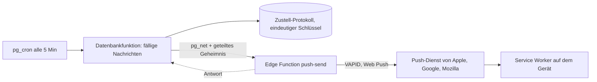
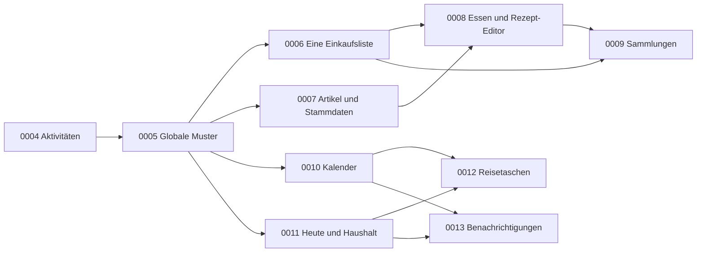

# UI-Konzept v2

> Stand: 20.11.2026 · Status: **Freigegeben am 20.11.2026, alle Empfehlungen** · Für: Enrico
>
> Grundlage: dein UI-Review vom 20.11.2026, deine Zusatzwünsche (Sammlungen als besondere Rezepte,
> nur eine Einkaufsliste, Kalender mit Urlaub und Haushalt, alles Planbare bewertbar, Verwalten in
> der Seitenleiste) und der gebaute Stand nach Spec 0001 bis 0004. Daraus entstehen die Specs 0005
> bis 0013 (Abschnitt 5).
>
> Nachtrag vom selben Tag: Verwalten in der Seitenleiste (3.12), Reisetaschen (3.13) und
> Benachrichtigungen (3.14), mit den Entscheidungen D30 bis D43.

**So liest du das Dokument**

- Jeder Bereich hat: was sich ändert, warum, eine Skizze (Handy, bei Bedarf Desktop) und die
  Entscheidungen.
- Entscheidungen heißen **D1 bis D43**. Alle sind entschieden: D1 bis D29 mit deiner Freigabe
  („alle Empfehlungen“), D30 bis D43 nach deiner Regel „Empfehlung übernehmen“. Abschnitt 6 sammelt
  alle in einer Tabelle.
- Vorausgesetzt ist Spec 0004 (läuft gerade): Vormittag, Aktivitäten, „Neu anlegen beim
  Einplanen“, „Heute geplant“ mit Kennzeichen, eigene Fotos. Das Konzept baut darauf auf.
- Fachbegriffe folgen `.agents/glossary.md`. Neue oder geänderte Begriffe sind _kursiv_; sie kommen
  mit der jeweiligen Spec ins Glossar.

**Zeichen in den Skizzen**

```text
◆ Rezept   ■ Sammlung   ● Restaurant   ▲ Aktivität   ○ Aufgabe offen   ✓ erledigt / ausgewählt
(E) (N)  Enrico, Nadja        ═══ / ┃  Abwesenheit (Urlaub)        ▸ eingeklappt   ▾ Menü
‹ ›  blättern   ⋯  weitere Aktionen   +  hinzufügen   ⊞  Verwalten   ⌕  Suche   ✎  bearbeiten
```

In der App sind das Symbole (Kochmütze, Stapel, Besteck, Berg, Haken), keine Emojis.

## Inhalt

1. Kurzfassung
2. Globale Muster
3. Bereiche
4. Datenmodell-Änderungen
5. Specs und Reihenfolge
6. Entscheidungen

- Anhang A: Dein Review, Punkt für Punkt
- Anhang B: Was dieses Konzept nicht abdeckt

## 1. Kurzfassung

1. **Navigation überall.** Jede Seite, auch Rezept, Markt, Aktivität und Einstellungen, behält
   Tab-Leiste bzw. Seitenleiste. Die Kopfzeile bleibt beim Scrollen oben.
2. **Ein ruhiges Bedien-Vokabular.** Ansichts-Tabs statt breiter Segment-Balken, Sortieren als
   Menü, Filter in einer einzigen Zeile mit aufklappbarem Bereich. Fenster haben eine feste Größe
   und scrollen innen.
3. **Abhaken ohne „Rückgängig“-Hinweis.** Haken setzen streicht durch, nochmal tippen nimmt ihn
   zurück. Zwei Sekunden nach dem letzten Haken räumt die App alles Abgehakte auf einmal weg.
4. **„Suchen oder anlegen“ an jeder Stelle.** Wer etwas nicht findet, legt es im selben Feld neu
   an: Zutaten, Aufgaben, Kalender-Einträge, Rezepte in Sammlungen, Bereiche.
5. **Nur eine Einkaufsliste.** Die Seite „Liste“ ist zum Bearbeiten da: Menge ±, Zusatz,
   entfernen, hinzufügen, leeren mit Bestätigung. „Einkaufen“ wählt oben den Markt.
6. **Zutaten kommen aus dem Artikel-Katalog.** Kein Freitext mehr; was fehlt, wird bewusst neu
   angelegt. Artikel, Märkte und Bereiche bekommen vollständige Verwaltungsseiten.
7. **Essen aufgeräumt.** Suchfeld und eine Filterzeile mit Küche und „Zufall“, Endlos-Liste,
   größere Kacheln am Desktop. Die Rezeptseite ist vollständig bearbeitbar und plant direkt ein.
8. **Sammlungen sind besondere Rezepte.** „Grillabend“ = Grillkohle + Bier + Kartoffelsalat +
   Grillgemüse. Einplanen, bewerten, mit einem Tipp auf die Liste.
9. **Aus „Plan“ wird „Kalender“.** Woche, Monat, Jahr. Urlaub als Streifen mit Namen, Aufgaben in
   einer eigenen, abschaltbaren Haushalt-Zeile.
10. **Heute wird zur Tagesansicht.** Wochen blättern, Tag wählen, „Heute geplant“ mit allen Arten,
    „Wie war's?“ für Rezepte, Sammlungen, Restaurants und Aktivitäten mit halben Sternen.
11. **Haushalt und Einstellungen entrümpelt.** Aufgaben bearbeitbar, Verlauf nach Monat und Woche,
    „Was anderes erledigt?“ mit Suche. Einstellungen nur noch persönlich. Die Stammdaten stehen als
    „Verwalten“ direkt in der Desktop-Seitenleiste, auf dem Handy hinter dem Knopf ⊞.
12. **KI ausgeblendet, Frisch ruhiger, Desktop großzügiger.** Die KI kommt am Ende zurück. Frisch
    nutzt eine Bereichsfarbe je Bildschirm statt fünf.
13. **Reisetaschen für den Urlaub.** Wiederverwendbare Packlisten; je Urlaub entsteht daraus eine
    Packliste zum Abhaken, auch ohne Netz, mit Link auf „Heute“.
14. **Benachrichtigungen.** Tagesüberblick, Aktivitäten am Vortag, Aufgaben mit Uhrzeit und
    Restaurant-Reservierungen per Web Push; ruhig voreingestellt, je Person einstellbar.

## 2. Globale Muster

Diese Muster gelten überall. Spec 0005 baut sie als Bausteine in `packages/ui`; alle anderen
Specs nutzen sie.

### 2.1 Navigation auf jeder Seite

**Heute:** Rezept, Restaurant, Märkte, Markt, Einstellungen und Feedback öffnen sich außerhalb der
Tabs. Dort fehlen Tab-Leiste und Seitenleiste, oft auch eine richtige Kopfzeile. Die Seiten wirken
unfertig.

**Neu:** Jede Seite gehört zu einem Bereich und öffnet sich in dessen Stapel. Tab-Leiste (Handy)
und Seitenleiste (ab Tablet) bleiben sichtbar. Oben links führt ein Pfeil zurück. Spec 0004 macht
das für Aktivitäten schon so vor.

| Seite                                                                            | gehört zu                                   |
| -------------------------------------------------------------------------------- | ------------------------------------------- |
| Rezept, Sammlung, Restaurant                                                     | Essen                                       |
| Aktivitäten, Aktivität, Abwesenheiten, Urlaubsseite mit Packliste                | Kalender (auch über „Verwalten“ erreichbar) |
| Einkaufen                                                                        | Liste (Vollbild-Modus, D5)                  |
| Aufgabe                                                                          | Haushalt                                    |
| Reisetaschen, Artikel, Märkte & Bereiche, Markt, Haushalt & Mitglieder, Feedback | Verwalten                                   |
| Einstellungen (Profil, Darstellung, Benachrichtigungen)                          | Avatar (Handy oben rechts, Desktop unten)   |

**Seitenleiste am Desktop** bekommt eine zweite Gruppe „Verwalten“ mit den Stammdaten, wie du es
dir wünschst. Aufbau und Skizzen stehen in 3.12.

Der Knopf „Assistent“ entfällt, solange die KI ausgeblendet ist (2.9).

**Auf dem Handy** passt die Gruppe nicht in die Tab-Leiste. Du möchtest sie nicht im Profil-Knopf
verstecken. Drei Wege:

| D2  | So geht's                                                                                                    | Pro                                                                                    | Contra                                                                                  |
| --- | ------------------------------------------------------------------------------------------------------------ | -------------------------------------------------------------------------------------- | --------------------------------------------------------------------------------------- |
| A   | 6. Tab „Mehr“                                                                                                | immer einen Tipp entfernt                                                              | sechs Tabs sind eng; iOS und Android raten zu höchstens fünf; teurer Platz für Seltenes |
| B   | **Knopf „Verwalten“ (⊞) im Kopf jeder Tab-Startseite**, links neben dem Avatar; öffnet die Seite „Verwalten“ | Tab-Leiste bleibt bei fünf; nicht im Profil versteckt; gleiche Einträge wie am Desktop | ein Symbol mehr im Kopf                                                                 |
| C   | Avatar öffnet „Ich & Verwalten“                                                                              | so machen es viele Apps                                                                | genau das wolltest du nicht                                                             |

**ENTSCHIEDEN: B** (Empfehlung). Verwalten braucht man selten. Es soll auffindbar sein, aber keinen
Tab kosten. Dazu kommen Abkürzungen am Ort (3.12).

**Vollbild-Modi (D5):** Einkaufen und Kochen sind Modi, in denen nichts ablenken soll (Vision:
„Einhändig im Laden“). **ENTSCHIEDEN A:** Sie verdecken auf dem Handy die Tab-Leiste und haben oben
immer „Fertig“. Option B: Die Tab-Leiste bleibt auch dort. Am Desktop bleibt die Seitenleiste in
beiden Fällen.

### 2.2 Kopfzeile bleibt oben

**Heute:** Titel und Knöpfe scrollen mit weg. Auf dem Handy ist dann zum Beispiel „Neues Rezept“
nicht mehr erreichbar.

**Neu:**

- **Handy:** großer Titel. Beim Scrollen schrumpft er in eine schmale Leiste (Titel klein, Aktionen
  bleiben, halbtransparenter Hintergrund). Ansichts-Tabs kleben darunter. Suchfeld und Filterzeile
  rutschen beim Runterscrollen weg und kommen beim kurzen Hochscrollen zurück. So bleibt Platz für
  Inhalt.
- **Desktop:** Titel, Tabs und Aktionen stehen fest. Eine feine Kante erscheint erst, wenn Inhalt
  darunter liegt.
- **Gruppenüberschriften** in langen Listen („Obst & Gemüse“, „November 2026“) kleben, bis die
  nächste kommt.

```text
Oben                                     Nach dem Scrollen
┌──────────────────────────────────┐     ┌──────────────────────────────────┐
│ Essen                  ⊞  +  (E) │     │ Essen                ⊞  +  (E)   │ ← schmale Leiste
│ Rezepte   Restaurants            │     │ Rezepte   Restaurants            │ ← klebt
│ ───────                          │     │ ───────                          │
│ ⌕ Rezepte suchen …               │     ├──────────────────────────────────┤
│ [Filter] [↕ Zuletzt ▾] Favoriten │     │ ┌──────────────┐ ┌─────────────┐ │
├──────────────────────────────────┤     │ │    [Foto]    │ │   [Foto]    │ │
│ ┌──────────────┐ ┌─────────────┐ │     │ │ Shakshuka    │ │ Linsen-Dal  │ │
│ │    [Foto]    │ │   [Foto]    │ │     │ …                                │
```

Technisch ist das klein: Der Baustein `Screen` hat schon einen festen Kopfbereich, die Bildschirme
nutzen ihn nur noch nicht.

### 2.3 Fenster mit fester Größe

**Heute:** Fenster wachsen mit dem Inhalt. Im Hinzufügen-Fenster des Plans springt die Höhe bei
jedem Wechsel zwischen „Rezept“, „Restaurant“, „Freitext“ und „Reste“. Auch Suchergebnisse und
Fehlermeldungen lassen es springen.

**Neu:** Drei feste Größen. Ein Fenster behält seine Größe, egal welcher Tab offen ist, wie viele
Treffer es gibt oder ob ein Fehler erscheint. Kopf (Titel, Tabs, Suchfeld) und Fuß (Hauptknopf)
stehen fest, nur die Mitte scrollt.

| Größe      | Wofür                                                                                | Handy                                        | Desktop (Dialog in der Mitte)            |
| ---------- | ------------------------------------------------------------------------------------ | -------------------------------------------- | ---------------------------------------- |
| **Klein**  | Bestätigen, eine Wahl aus wenigen (Markt wählen)                                     | so hoch wie der Inhalt, höchstens die Hälfte | 440 px breit, Höhe nach Inhalt           |
| **Mittel** | Formulare (Aufgabe, Abwesenheit, Posten bearbeiten, Filter)                          | 90 % der Bildschirmhöhe, fest                | 560 × 640 px, fest                       |
| **Groß**   | Suchen und Auswählen mit Tabs (Hinzufügen im Kalender, Vorratscheck, Rezepte wählen) | 90 %, fest                                   | 760 × 720 px, fest (höchstens 85 % Höhe) |

**Ausnahme** wie von dir genannt: Aufklappen („Vorrat & Gewürze“) darf ein kleines Fenster einmal
auf „Groß“ wachsen lassen. Es springt danach nicht zurück. In mittleren und großen Fenstern klappt
der Abschnitt einfach im Scrollbereich auf.

**Bestätigungsdialoge bleiben selten:** nur bei Löschen, das viel auf einmal trifft (Liste leeren,
Bereich mit Artikeln löschen, Markt löschen). Sonst gilt weiter „Rückgängig im Hinweis“
(DESIGN.md).

```text
┌ Sa 2. Jan · Abend ──────────────── ✕ ┐ ← Kopf steht
│ ⌕ Was steht an?                      │
│ Alle  Rezepte  Sammlungen  Restau…   │ ← Tab-Wechsel ändert die Größe nicht
├──────────────────────────────────────┤
│ ◆ Paella                             │ ↕ nur hier wird gescrollt
│ ◆ Pan con tomate                     │
│ …                                    │
├──────────────────────────────────────┤
│              [ Weiter ]              │ ← Fuß steht
└──────────────────────────────────────┘
```

### 2.4 Ansichts-Tabs statt Segment-Balken

**Heute:** Der Umschalter (`Segmented`) ist ein Balken über die volle Breite mit eigenem
Hintergrund. Auf „Essen“ stehen zwei davon übereinander (Rezepte/Restaurants und Sortierung). Mit
Suche und Chips liegen auf dem Handy rund 280 px Bedienelemente vor dem ersten Rezept.

**Neu:** Ein Muster je Aufgabe, überall gleich. `Segmented` verschwindet aus der App.

| Aufgabe                       | Muster                                                                                     | Beispiele                                                                                  |
| ----------------------------- | ------------------------------------------------------------------------------------------ | ------------------------------------------------------------------------------------------ |
| Zwischen Ansichten wechseln   | **Ansichts-Tabs:** nur Text, der aktive mit Akzentlinie darunter, linksbündig, ohne Kasten | Rezepte · Restaurants; Woche · Monat · Jahr; Anstehend · Alle · Verlauf; Märkte · Bereiche |
| Reihenfolge wählen            | **Menü-Knopf** „↕ Zuletzt ▾“ mit kurzer Liste                                              | Sortieren in Essen, Restaurants, Artikel                                                   |
| Filtern                       | **Chips**, mehrfach wählbar                                                                | Favoriten, Vegan, Italienisch                                                              |
| Ein Wert aus wenigen, im Form | **Auswahl-Chips**, genau einer aktiv                                                       | Tageszeit, Zuständigkeit, „Rezept oder Sammlung“                                           |
| An / aus                      | **Schalter** oder Symbol-Knopf                                                             | Haushalt-Zeile im Kalender, später KI-Suche                                                |

```text
Heute: Segment-Balken                         Neu: Ansichts-Tabs
┌──────────────────────────────────────┐      Rezepte    Restaurants
│▓▓▓▓▓ Rezepte ▓▓▓▓▓│   Restaurants    │      ───────
└──────────────────────────────────────┘      etwa 40 statt 56 px, kein Kasten
```

| D1  | Muster                                                           | Pro                                                                                                       | Contra                                                            |
| --- | ---------------------------------------------------------------- | --------------------------------------------------------------------------------------------------------- | ----------------------------------------------------------------- |
| A   | **Ansichts-Tabs** (Text + Akzentlinie)                           | wenig Höhe; liest sich als Navigation; trägt 2–5 Einträge, notfalls seitlich wischbar; gleich in Fenstern | auf iOS ist das Segment-Feld üblicher                             |
| B   | Kleine Pillen-Tabs (aktive Pille gefüllt, nur so breit wie Text) | iOS-nah, kompakt                                                                                          | sieht aus wie Filter-Chips direkt darunter: Verwechslungsgefahr   |
| C   | Titel als Menü („Essen: Rezepte ▾“)                              | spart eine ganze Zeile                                                                                    | Optionen unsichtbar; ein Tipp mehr; schlecht für Woche/Monat/Jahr |

**ENTSCHIEDEN: A** (Empfehlung).

### 2.5 Abhaken mit Sammel-Fenster

**Heute:** Abhaken verschiebt sofort und zeigt unten „Rückgängig“. Wer schnell mehrere Dinge
abhakt, trifft leicht die falsche Zeile, weil die Liste nachrutscht.

**Neu (deine Idee, übernommen):**

1. Tipp auf den Haken: Haken gesetzt, Text durchgestrichen. Die Zeile bleibt, wo sie ist.
2. Nochmal tippen: Haken weg. Kein Hinweis, kein Knopf.
3. Jeder Tipp startet die Uhr neu. **2 Sekunden nach dem letzten Tipp** gleiten alle abgehakten
   Zeilen gemeinsam weg (nach „Erledigt“ oder ganz weg).
4. Wer die Seite vorher verlässt, dem räumt die App sofort auf.
5. Später zurücknehmen: in „Erledigt“ (Liste, Einkaufen) bzw. im Verlauf (Aufgaben).
6. Bewegung: kurz ausblenden und nachrücken (200 ms). Mit „Bewegung reduzieren“ nur ausblenden. Der
   Screenreader sagt „Milch abgehakt“.

```text
0,0 s   Tipp auf „Milch“   ✓ Milch   durchgestrichen, bleibt stehen
0,8 s   Tipp auf „Brot“    ✓ Brot    Uhr beginnt neu
1,5 s   Tipp auf „Milch“   ○ Milch   Haken zurück, ohne Hinweis
3,5 s   2 s nach dem letzten Tipp: „Brot“ gleitet nach „Erledigt“
```

**Gilt für:** Einkaufen, „Zu tun“ auf Heute, Haushalt „Anstehend“, Haushalt-Zeile im Kalender,
„Wie war's?“ (nach dem Bewerten). **Nicht für den Vorratscheck:** Dort ist der Haken eine Auswahl,
nichts verschwindet.

**Für die Spec:** Einkaufsposten werden sofort beim Tipp geschrieben (offline über die
Laden-Warteschlange, „Abhaken gewinnt“ bleibt). Aufgaben buchen die Erledigung erst, wenn das
Fenster abläuft. So entsteht kein Verlaufseintrag, der gleich wieder gelöscht wird. Der Hinweis
„Erledigt von dir · Nadja“ entfällt. Wer es war, wählt man bei „Was anderes erledigt?“ oder ändert
es im Verlauf (3.10).

| D3  | Länge des Fensters | Pro                                                   | Contra                             |
| --- | ------------------ | ----------------------------------------------------- | ---------------------------------- |
| A   | **2 s**            | dein Vorschlag; entspricht dem heutigen Einkaufsmodus | bei sehr langsamem Abhaken knapp   |
| B   | 3 s                | mehr Zeit zum Korrigieren                             | Liste bleibt länger „unaufgeräumt“ |
| C   | 1,5 s              | schneller sauber                                      | Korrigieren wird hektisch          |

**ENTSCHIEDEN: A** (Empfehlung). Der Wert steht an einer Stelle und lässt sich nach einer Woche Alltag anpassen.

### 2.6 Suchen oder anlegen

Dein Wunsch: Abkürzungen „überall bei so Sachen“. Ein Baustein für jede Stelle, an der man etwas
Vorhandenes auswählt:

1. Suchfeld mit Treffern: fehlertolerant, mit Synonymen, offline.
2. Unter den Treffern: „„Milchkokos“ neu anlegen“. Gibt es mehrere Arten, steht je Art eine Zeile.
3. Bei ähnlichem Namen bremst die Zeile: „Meinst du _Kokosmilch_? [Ja] [Trotzdem neu]“.
4. Optional „Mehr Angaben ▸“: klappt die wichtigsten Felder auf (z. B. Rhythmus einer Aufgabe), ohne
   das Fenster zu verlassen.
5. Nach dem Anlegen ist das Neue sofort ausgewählt bzw. eingeplant.

```text
┌──────────────────────────────────────┐
│ ⌕ Milchko|                        ✕  │
├──────────────────────────────────────┤
│ Kokosmilch              Konserven    │ ← Treffer über Ähnlichkeit
│ Kokosmilch light        Konserven    │
│ + „Milchko“ neu anlegen              │
│   Meinst du Kokosmilch? [Ja] [Neu]   │ ← Bremse gegen Doppelte
└──────────────────────────────────────┘
```

| Stelle                                     | sucht in                                      | legt neu an                    |
| ------------------------------------------ | --------------------------------------------- | ------------------------------ |
| Hinzufügen im Kalender                     | Rezepte, Sammlungen, Restaurants, Aktivitäten | jede dieser Arten, Freitext    |
| Zutat im Rezept, eigene Zutat der Sammlung | Artikel und Starter-Katalog                   | Artikel                        |
| Liste „Was fehlt?“                         | Artikel                                       | Artikel (wie heute)            |
| Sammlung „Rezept hinzufügen“               | Rezepte                                       | Rezept                         |
| „Was anderes erledigt?“                    | Aufgaben                                      | Aufgabe, optional mit Rhythmus |
| Küche und Schlagworte am Rezept            | vorhandene Werte                              | neuer Wert                     |
| Bereich zuordnen, Bereich im Markt         | Bereiche                                      | Bereich                        |

### 2.7 Filter einklappbar

Jede Liste mit Filtern hat höchstens zwei Zeilen: das Suchfeld und eine Zeile mit [Filter (n)],
[↕ Sortierung ▾] und seitlich wischbaren Schnell-Chips. Das volle Filterfeld öffnet auf dem Handy
als mittleres Fenster und klappt am Desktop unter der Zeile auf. Aktive Filter stehen als Chips mit
✕ in der Zeile. Der Knopf im Filterfeld sagt, was passiert: „8 Rezepte zeigen“. Details in 3.2.

### 2.8 Endlos-Listen

Lange Listen (Rezepte, Restaurants, Aktivitäten, Artikel, Verlauf) laden beim Scrollen nach statt
in Seiten. Die Daten liegen schon im lokalen Speicher, auch offline. Es geht nur ums flüssige
Zeichnen: Gezeichnet wird nur, was sichtbar ist. Zurück aus einem Rezept landet man an derselben
Stelle. Bei „Zufall“ bleibt die Reihenfolge stabil, bis man „Neu mischen“ tippt.

### 2.9 KI ausgeblendet

Bis zum Schluss unsichtbar. Ein Schalter im Code, Standard „aus“. Daten, Kontingent und
Server-Funktionen bleiben unangetastet. Ausgeblendet werden:

- Assistent-Knopf (Handy) und „Assistent“ in der Seitenleiste
- KI-Suche-Schalter in Essen, „Beschreiben ✨“ im leeren Zustand, „Anpassen“ im Rezept
- Mikrofon und ✨ in der Eingabezeile der Liste, Vorschlagszeilen
- Abschnitt „KI“ in den Einstellungen

Für später festgehalten (dein Wunsch): Die KI-Suche ist ein Symbol-Knopf **im** Suchfeld, rechts.
Aus: graues Symbol. An: Symbol und Feldrand in Akzentfarbe, Platzhalter „Was möchtet ihr essen?“.
Kein zweites Element neben dem Feld.

```text
aus:  ┌ ⌕ Rezepte suchen …                 ✧ ┐   Symbol grau
an:   ┏ ⌕ Was möchtet ihr essen?           ✦ ┓   Symbol und Rand in Akzentfarbe
```

### 2.10 Frisch ruhiger

**Befund:** Auf „Heute“ stehen in Frisch bis zu sechs Farben gleichzeitig: Pfirsich (Essen), Gelb
(Plan), Mint (Liste), Hellblau (Haushalt), Violett (Assistent) und Signalgelb (Sterne). Jeder
Abschnitt ist eine eigene farbige Fläche. Das wirkt bunt statt frisch.

**Neue Regeln für Frisch:**

1. **Eine Bereichsfarbe je Bildschirm**, die des aktiven Tabs. Sie färbt den aktiven Tab, den
   Akzent der Kopfzeile und den Hauptknopf, sonst nichts.
2. **Abschnitte ohne Farbfläche:** weiße Kacheln auf dem warmen Grund, Abschnittstitel in Tinte.
3. **Bereichsfarben gedämpft** (Sättigung etwa −40 %). Richtwerte für hell; der Kontrast-Test
   entscheidet:

   | Rolle           | heute     | neu (Richtwert) |
   | --------------- | --------- | --------------- |
   | Essen           | `#FFD9CC` | `#F5E3DB`       |
   | Plan / Kalender | `#FFE9A8` | `#F3EACB`       |
   | Liste           | `#CFF3E0` | `#DCEDE3`       |
   | Haushalt        | `#D9E2FF` | `#E0E5F4`       |
   | Sterne          | `#F2B807` | `#C9961C`       |
   | Assistent-Knopf | `#7C4DFF` | Tinte `#15151B` |

4. **Höchstens drei Farben gleichzeitig:** Tinte, eine Bereichsfarbe, eine Zustandsfarbe (grün
   erledigt, orange Hinweis).
5. **Tab-Leiste:** aktiver Tab als Tinten-Pille statt in Bereichsfarbe.
6. **Arten im Kalender** nur als Symbol mit feiner Farbkante, nie als Farbfläche (D19).

Was bleibt, ist der Charakter: Bricolage Grotesque und DM Sans, große Rundungen, eine Kachel je
Listenzeile.

| D4  | Option                                    | Pro                          | Contra                               |
| --- | ----------------------------------------- | ---------------------------- | ------------------------------------ |
| A   | **Frisch nach diesen Regeln beruhigen**   | Charakter bleibt, Chaos geht | Kontrast-Tests neu                   |
| B   | Frisch streichen, nur Markthalle und Klar | weniger Pflege               | du hattest dich für drei entschieden |
| C   | so lassen                                 | kein Aufwand                 | dein Befund bleibt                   |

**ENTSCHIEDEN: A** (Empfehlung).

### 2.11 Desktop-Regeln

Vergleich der gebauten App mit der Design-Richtung „Markthalle“, die dir besser gefiel:

| Was stört                                               | Ursache im Code                                          | Regel neu                                                                         |
| ------------------------------------------------------- | -------------------------------------------------------- | --------------------------------------------------------------------------------- |
| Seitenleiste fehlt auf Detailseiten                     | Seiten liegen außerhalb der Tabs                         | 2.1: alles in den Tabs                                                            |
| Breite springt (Haushalt: Anstehend breit, Alle schmal) | jeder Tab setzt eine eigene Höchstbreite (1180 / 820 px) | eine Inhaltsbreite je Bereich, nie abhängig von Tab oder Inhalt                   |
| Rezept-Kacheln klein (6 Spalten à etwa 170 px)          | Raster füllt nach kleiner Mindestbreite                  | Kachel mindestens 260 px, Foto 4:3, Titel 20 px; bei 1440 px vier Spalten         |
| Fotos und Titel wirken klein                            | Karten-Fotos etwa 120 px hoch                            | wie in der Richtung: „Heute geplant“-Karten mit Fotos 16:10, Seitentitel 44–48 px |
| Avatar doppelt (Kopfzeile und Seitenleiste)             | Kopfzeile zeigt ihn auch am Desktop                      | Avatar nur in der Seitenleiste                                                    |
| Viel Leerraum neben kurzen Listen                       | eine schmale Spalte, zentriert                           | Liste und Detail nebeneinander (Haushalt, Märkte, Artikel, Verwalten)             |
| Fenster springen                                        | Dialog wächst mit dem Inhalt                             | 2.3: feste Größen                                                                 |

Dazu:

- Der Inhalt beginnt immer gleich neben der Seitenleiste (36 px Rand) und füllt bis 1320 px. Erst
  darüber wird zentriert.
- Es gibt drei Layouts, sonst keine: **Übersicht** (Heute, Verhältnis 1,6 : 1), **Raster** (Essen,
  Aktivitäten), **Liste und Detail** (Haushalt, Märkte, Artikel, Verwalten). Der Kalender ist sein
  eigenes Raster.
- Rezepte öffnen am Desktop als ganze Seite (D11).

## 3. Bereiche

### 3.1 Heute

**Was sich ändert**

- **Wochen-Navigation im Kopf:** ‹ › blättert beliebig weit vor und zurück. In der Mitte steht
  „Diese Woche · KW 47“. Sobald du woanders bist (andere Woche oder anderer Tag), wird daraus der
  Knopf **„Heute“**.
- **Tagesauswahl** (deine zweite Idee, verfeinert; D6): Die Woche steht als Leiste oben, heute ist
  gewählt. Tippst du einen anderen Tag, zeigt die ganze Seite diesen Tag: „Geplant am Samstag“,
  „Zu tun am Samstag“. Der Titel sagt klar, welcher Tag zu sehen ist:
  „Morgen, Samstag 21. November“. Das Kalender-Symbol oben rechts öffnet den Kalender in der
  gewählten Woche.
- Jeder Tag in der Leiste zeigt bis zu drei Punkte in den Farben der Arten. Darunter liegen
  Urlaubsstreifen. Am Desktop sind die Tage Kacheln mit Foto und Titel des ersten Eintrags und
  „+2“ (wie in der Design-Richtung).
- **„Heute geplant“** (kommt mit Spec 0004) als waagerecht wischbare Karten auf dem Handy (D7), in
  der Reihenfolge der Tageszeiten. Jede Karte: Foto, Kennzeichen (Rezept, Sammlung, Restaurant,
  Aktivität), Tageszeit, Zusatz, wer kocht, „Route“ bei Ort. Desktop: Raster mit großen Fotos.
- **„Wie war's?“ für alle vier Arten:** alles, was du in den letzten Tagen noch nicht bewertet hast
  (D8). Je Zeile Bild, Name, Kennzeichen, Sterne. **Halbe Sterne** (D9): Am Desktop füllt die Maus
  schon beim Darüberfahren vor, linke Sternhälfte halb, rechte voll. Auf dem Handy tippt man links
  oder rechts im Stern oder zieht mit dem Finger über die Sterne. Nach dem Bewerten gleitet die
  Zeile nach 2 s weg (2.5). „Nicht gemacht“ ist ein kleiner Link je Zeile. Freitext und Reste werden
  nicht abgefragt. Bei einer Sammlung wird die Sammlung bewertet, nicht jedes enthaltene Rezept.
- **„Zu tun“** mit dem neuen Abhaken (2.5), ohne „Rückgängig“-Hinweis. Heute: fällig und
  überfällig, abhakbar. Künftige Tage: nur Anzeige.
- **Urlaub** steht als ruhige Zeile: „Nadja ist im Urlaub bis Do 26.11.“
- **„Einkauf“** bleibt (offen, kurze Vorschau, „Einkaufen“) und gilt für die eine Liste.
- **Reisetasche:** Steht ein Urlaub mit Packliste an, erscheint ganz unten eine Karte „Reisetasche
  · 12/30 gepackt“ (3.13).

**Warum Tagesauswahl statt „+n weitere“:** Mit Vormittag, Mittag und Abend und mehreren Einträgen
je Tageszeit passt ein Tag nicht mehr in eine 76-px-Kachel. „+2“ verrät nicht, was geplant ist, und
Aufklappen macht die Leiste unruhig. Die Tagesauswahl nutzt den ganzen Bildschirm für den
gewählten Tag. Die Leiste bleibt ein schneller Überblick, und die ganze Woche ist einen Tipp
entfernt im Kalender.

```text
Handy, heute gewählt                     Handy, Samstag gewählt (gekürzt)
┌──────────────────────────────────────┐ ┌──────────────────────────────────────┐
│ Freitag, 20. November      ▦  ⊞  (E) │ │ Morgen, Samstag 21. Nov.   ▦  ⊞  (E) │
│ Guten Morgen, Enrico                 │ │ ‹            [ Heute ]            ›  │
│ ‹      Diese Woche · KW 47       ›   │ │  Mo   Di   Mi   Do   Fr  [Sa]  So    │
│  Mo   Di   Mi   Do  [Fr]  Sa   So    │ │  …                                   │
│  16   17   18   19   20   21   22    │ ├──────────────────────────────────────┤
│  ◆    ◆●   ◆    ◆    ▲◆●  ■    ◆     │ │ Geplant am Samstag                   │
│                           ═══ (N) ══ │ │ ┌────────────┐                       │
├──────────────────────────────────────┤ │ │ REZEPT     │                       │
│ Heute geplant                        │ │ │ Kürbissuppe│                       │
│ ┌────────────┐ ┌────────────┐ ┌──    │ │ └────────────┘                       │
│ │   [Foto]   │ │   [Foto]   │ │      │ │ Zu tun am Samstag                    │
│ │ AKTIVITÄT  │ │ REZEPT     │ │      │ │ ○ Küche wischen      fällig  (E)     │
│ │ Bouldern   │ │ Lasagne    │ │      │ │ Nadja ist ab Samstag im Urlaub       │
│ │ Vormittag  │ │ Abend · (E)│ │      │ │ Einkauf  12 offen      [Einkaufen]   │
│ └────────────┘ └────────────┘ └──    │ └──────────────────────────────────────┘
│ ◷ Für morgen: Kichererbsen einweichen│
│                                      │ ▦ = Kalender in dieser Woche öffnen
│ Wie war's?                           │ Punkte = Arten des Tages (◆ ■ ● ▲)
│ [▫] Mango-Curry  Rezept    ★★★★½     │
│ [▫] Eislaufen    Aktivität  ☆☆☆☆☆    │
│                                      │
│ Zu tun                 ca. 4 Punkte  │
│ ○ Bad putzen                   (E)   │
│ ✓ Fenster Wohnzimmer  durchgestr.(N) │ ← gleitet 2 s nach dem letzten Tipp weg
│ + Was anderes erledigt?              │
│                                      │
│ Einkauf  12 offen       [Einkaufen]  │
├──────────────────────────────────────┤
│ Heute  Essen  Kalender  Liste  Haush.│
└──────────────────────────────────────┘
```

```text
Desktop (1440 px)
┌────────────────────┬──────────────────────────────────────────────────────────────────────────────┐
│ ⌂ Enrico & Nadja ▾ │ Freitag, 20. November                       ‹ Diese Woche · KW 47 ›    ▦     │
│                    │ Guten Morgen, Enrico                                                         │
│   Heute            │ ┌Mo 16──┐┌Di 17──┐┌Mi 18──┐┌Do 19──┐┏Fr 20━━┓┌Sa 21──┐┌So 22──┐              │
│   Essen            │ │[Foto] ││[Foto] ││[Foto] ││[Foto] │┃[Foto] ┃│[Foto] ││   +   │              │
│   Kalender         │ │Linsen-││Hallou-││Mango- ││Shak-  │┃Bould- ┃│Grill- ││       │              │
│   Liste            │ │Dal    ││mi  +1 ││Curry  ││shuka  │┃ern +2 ┃│abend  ││       │              │
│   Haushalt         │ └───────┘└───────┘└───────┘└───────┘┗━━━━━━━┛└───────┘└───────┘              │
│                    │                                              ══ (N) Urlaub ════              │
│ VERWALTEN          │ Heute geplant                                    │ Wie war's?                │
│   Aktivitäten      │ ┌──────────────┐┌──────────────┐┌──────────────┐ │ Mango-Curry ◆   ★★★★½     │
│   Artikel          │ │ [Foto 16:10] ││ [Foto 16:10] ││ [Foto 16:10] │ │ Eislaufen   ▲   ☆☆☆☆☆     │
│   Märkte & Bereiche│ │ AKTIVITÄT    ││ REZEPT       ││ RESTAURANT   │ │                           │
│   Abwesenheiten    │ │ Bouldern     ││ Lasagne      ││ Da Enzo      │ │ Zu tun      ca. 4 Punkte  │
│   Mitglieder       │ │ Vormittag    ││ Abend · (E)  ││ Abend        │ │ ○ Bad putzen        (E)   │
│   Feedback         │ └──────────────┘└──────────────┘└──────────────┘ │ ○ Fenster Wohnz.    (N)   │
│                    │ ◷ Für morgen: Kichererbsen einweichen (12 h)     │ + Was anderes erledigt?   │
│ (E) Enrico         │                                                  │ Einkauf        12 offen   │
│     Profil & Darst.│                                                  │ [ Einkaufen ]             │
└────────────────────┴──────────────────────────────────────────────────────────────────────────────┘
```

| D6  | Wochenleiste auf Heute                                              | Pro                                                                           | Contra                                                              |
| --- | ------------------------------------------------------------------- | ----------------------------------------------------------------------------- | ------------------------------------------------------------------- |
| A   | **Tagesauswahl** (Idee 2): Tag wählen, die Seite zeigt diesen Tag   | ganzer Bildschirm für den Tag; Leiste bleibt ruhig; Woche einen Tipp entfernt | „Heute“ zeigt manchmal einen anderen Tag; Titel muss das klar sagen |
| B   | Kacheln mit erstem Eintrag und „+n weitere“ zum Aufklappen (Idee 1) | Woche auf einen Blick                                                         | Kacheln zu klein für drei Tageszeiten; Aufklappen macht Unruhe      |
| C   | beides: Tagesauswahl oben und alte Wochenleiste unten               | alles da                                                                      | doppelt, Seite wird lang                                            |

**ENTSCHIEDEN: A** (Empfehlung).

| D7  | „Heute geplant“ auf dem Handy            | Pro                                                                           | Contra                                        |
| --- | ---------------------------------------- | ----------------------------------------------------------------------------- | --------------------------------------------- |
| A   | **waagerecht wischbar** (dein Vorschlag) | Platz für „Wie war's?“ und „Zu tun“; angeschnittene Karte zeigt „da ist mehr“ | ab vier Einträgen nicht alles auf einen Blick |
| B   | untereinander                            | alles sichtbar                                                                | schiebt „Zu tun“ weit nach unten              |

**ENTSCHIEDEN: A** (Empfehlung). Ab vier Einträgen steht rechts im Titel zusätzlich „Alle 5 ›“ (öffnet den Tag
im Kalender).

| D8  | „Wie war's?“ fragt ab               | Pro                                   | Contra                                  |
| --- | ----------------------------------- | ------------------------------------- | --------------------------------------- |
| A   | nur gestern (wie heute)             | kurz                                  | Wochenende geht unter                   |
| B   | **Unbewertetes der letzten 3 Tage** | Wochenende wird nicht vergessen; kurz | —                                       |
| C   | Unbewertetes der letzten 7 Tage     | vollständig                           | lange Liste, fühlt sich nach Pflicht an |

**ENTSCHIEDEN: B** (Empfehlung).

| D9  | Halbe Sterne                                            | Pro                 | Contra                |
| --- | ------------------------------------------------------- | ------------------- | --------------------- |
| A   | **ja**, Bewertungen in halben Schritten speichern (4.5) | dein Wunsch; feiner | kleine Datenmigration |
| B   | nur ganze Sterne                                        | kein Aufwand        | Wunsch nicht erfüllt  |

**ENTSCHIEDEN: A** (Empfehlung).

### 3.2 Essen

**Was sich ändert**

- **Kopf:** Titel „Essen“, ⊞ Verwalten, „+“ (Neu: Rezept · Sammlung · Restaurant; dazu
  „Starter-Rezepte“), Avatar. Darunter Ansichts-Tabs **Rezepte · Restaurants**. Sammlungen stehen
  unter „Rezepte“ mit Kennzeichen „Sammlung“.
- **Eine Such- und Filterzeile** (D10): Suchfeld, darunter eine Zeile mit [Filter (n)],
  [↕ Sortierung ▾] und seitlich wischbaren Schnell-Chips (Favoriten, < 30 Min, Vegetarisch, Vegan,
  Passt für alle, Lange nicht gekocht). Auf dem Handy etwa 100 statt 280 px vor dem ersten Rezept.
- **Filterfeld** (aufklappbar): Schnell-Filter, Ernährung, Gerichtart, **Küche** (Werte aus euren
  Rezepten mit Anzahl: „Italienisch 8 · Asiatisch 5 · Orientalisch 3“), Zeit, Bewertung („ab 4 ★“),
  Art (Rezepte / Sammlungen). Fuß: „Zurücksetzen“ und „8 Rezepte zeigen“.
- **Sortieren** als Menü: Zuletzt gekocht · Am häufigsten · Bewertung · Neu · A–Z · **Zufall**. Bei
  Zufall erscheint „⟳ Neu mischen“ in der Zeile. Die Reihenfolge bleibt beim Scrollen und
  Zurückkommen gleich, bis du neu mischst.
- **Endlos-Liste** (2.8) statt Seiten.
- **Kacheln:** Handy zwei Spalten wie heute. Desktop mindestens 260 px (vier Spalten bei 1440 px),
  Foto 4:3.
- **Küche am Rezept** wählt man per „Suchen oder anlegen“. So entstehen „Italienisch“ und
  „italienisch“ nicht doppelt.
- **Restaurants** bekommen dieselbe Zeile: Filter (Favoriten, Küche, Preisniveau, Bewertung),
  Sortieren (Zuletzt besucht, Bewertung, A–Z, Zufall).

```text
Handy                                    Filterfeld (mittleres Fenster)
┌──────────────────────────────────────┐ ┌ Filter ─────────────────────────── ✕ ┐
│ Essen                     ⊞  +  (E)  │ │ Schnell                              │
│ Rezepte   Restaurants                │ │ [Favoriten] [< 30 Min]               │
│ ───────                              │ │ [Passt für alle] [Lange nicht gek.]  │
│ ⌕ Rezepte suchen …                   │ │ Ernährung   [Vegan] [Vegetarisch]    │
│ [Filter 1] [↕ Zuletzt ▾] Favoriten  ›│ │ Gerichtart  [Hauptgericht] [Beilage] │
│ ✕ Italienisch                        │ │             [Dessert] [Frühstück] …  │
├──────────────────────────────────────┤ │ Küche       [Italienisch 8]          │
│ 8 Rezepte                            │ │             [Asiatisch 5]            │
│ ┌────────────────┐ ┌────────────────┐│ │             [Orientalisch 3] …       │
│ │     [Foto]     │ │ [Foto-Collage] ││ │ Zeit        [< 15] [< 30] [< 60 Min] │
│ │ Lasagne        │ │ Grillabend     ││ │ Bewertung   [ab 4 ★] [ab 4,5 ★]      │
│ │ 60 Min · ★ 4,5 │ │ SAMMLUNG · 2 R.││ │ Art         [Rezepte] [Sammlungen]   │
│ └────────────────┘ └────────────────┘│ ├──────────────────────────────────────┤
│ ┌────────────────┐ ┌────────────────┐│ │ Zurücksetzen   [ 8 Rezepte zeigen ]  │
│ │ …              │ │ …              ││ └──────────────────────────────────────┘
│      (lädt beim Scrollen nach)       │
├──────────────────────────────────────┤ Sortier-Menü
│ Heute  Essen  Kalender  Liste  Haush.│ ┌──────────────────────┐
└──────────────────────────────────────┘ │ ✓ Zuletzt gekocht    │
                                         │   Am häufigsten      │
                                         │   Bewertung          │
                                         │   Neu                │
                                         │   A–Z                │
                                         │   Zufall             │
                                         └──────────────────────┘
```

```text
Desktop
┌───────────────┬───────────────────────────────────────────────────────────────────────────────┐
│ ⌂ Enrico & …  │ Essen                                                              [+ Neu ▾]  │
│               │ Rezepte   Restaurants                                                         │
│   Heute       │ ───────                                                                       │
│ ▸ Essen       │ ⌕ Rezepte suchen …                                                            │
│   Kalender    │ [Filter 1 ▴] [↕ Zuletzt ▾]  Favoriten  < 30 Min  Vegetarisch  Vegan  …        │
│   …           │ ┌ Ernährung …  Gerichtart …  Küche [Italienisch 8] [Asiatisch 5] … ─────────┐ │
│               │ └──────────────────────────────────────────────────────── [Einklappen ▴] ─┘   │
│               │ ┌───────────────┐ ┌───────────────┐ ┌───────────────┐ ┌───────────────┐       │
│               │ │               │ │               │ │               │ │               │       │
│               │ │  [Foto 4:3]   │ │  [Foto 4:3]   │ │  [Foto 4:3]   │ │  [Foto 4:3]   │       │
│               │ │               │ │               │ │               │ │               │       │
│               │ │ Lasagne       │ │ Grillabend    │ │ Mango-Curry   │ │ Shakshuka     │       │
│               │ │ 60 Min ★ 4,5  │ │ SAMMLUNG      │ │ 25 Min vegan  │ │ 30 Min        │       │
│               │ └───────────────┘ └───────────────┘ └───────────────┘ └───────────────┘       │
└───────────────┴───────────────────────────────────────────────────────────────────────────────┘
```

| D10 | Filterleiste                                                                     | Pro                                                       | Contra                                         |
| --- | -------------------------------------------------------------------------------- | --------------------------------------------------------- | ---------------------------------------------- |
| A   | **eine Zeile:** Filter-Knopf, Sortier-Menü, Schnell-Chips; Filterfeld auf Wunsch | häufigste Filter einen Tipp entfernt, trotzdem eine Zeile | Chips am Rand teils nur durch Wischen sichtbar |
| B   | nur Filter-Knopf und Sortier-Menü, alles andere im Filterfeld                    | am ruhigsten                                              | Favoriten und Vegan kosten immer zwei Tipps    |
| C   | heutige Leiste, nur ein- und ausklappbar                                         | wenig Umbau                                               | bleibt hässlich, nur seltener sichtbar         |

**ENTSCHIEDEN: A** (Empfehlung).

### 3.3 Rezept-Seite und Rezept-Editor

**Was sich ändert**

- Die Seite liegt im Bereich Essen: Tab-Leiste bzw. Seitenleiste bleiben. Die Kopfzeile klebt
  (Zurück, Titel erscheint beim Scrollen, ♡, ⋯).
- **Aktionen:** **Einplanen** öffnet das Einplanen-Fenster direkt hier, kein Sprung mehr zum Plan.
  **Auf die Liste** startet den Vorratscheck (3.5). **Kochen** startet den Kochmodus. Im ⋯: Foto
  ändern, Zu Sammlung hinzufügen, Löschen.
- **Abschnittsweise bearbeiten** (D12): Jeder Abschnitt (Kopf, Einordnung, Zutaten, Zubereitung,
  Notizen) hat einen Stift. Er macht nur diesen Abschnitt bearbeitbar, „Fertig“ speichert. Beim
  Kochen bleibt die Seite ruhig.
- **Bearbeitbar wird alles, was heute fehlt:** Titel, Beschreibung, Portionen, Zeit, Gerichtart,
  **Küche**, **Schlagworte** (Chips mit „Suchen oder anlegen“), **Mengen** („200 ml“), Einkaufsregel
  und Einkaufs-Zusatz je Zutat, Varianten, Schritte, **Notizen**, Vorlauf.
- **Zutaten nur aus dem Artikel-Katalog** (2.6): Menge tippen, Artikel per Suche wählen. Findet die
  Suche nichts: „„…“ neu anlegen“ mit Doppelt-Bremse. „Mehrere einfügen“ bleibt: Jede Zeile wird
  zerlegt und bekommt einen Artikel. Was nicht sicher passt, steht orange mit „Artikel wählen“.
  Diese Zeile lässt sich erst speichern, wenn ein Artikel gewählt ist; der Rest schon.
- Optional je Zutat ein _Hinweis_ fürs Kochen („fein gehackt“). Er geht nicht auf die Liste.
- **Bewertung:** deine Sterne zum Setzen, die der anderen Person daneben.

**Warum Katalog statt Freitext:** Bereich, Vorrat, Ernährungseigenschaft und Synonyme hängen am
Artikel. Schreibst du einmal „Kokosmilch“ und einmal „Milchkokos“, sind das heute zwei
verschiedene Dinge: zweimal einem Bereich zuordnen, zwei Zeilen auf der Liste, und der
Vegan-Filter kennt den zweiten nicht. Freitext ohne Artikel kann der Vorratscheck heute gar nicht
übernehmen („Nicht im Katalog – bitte von Hand eintragen“). Mit Pflicht-Artikel gibt es je Ding
genau eine Zuordnung. Details in 4.2.

```text
Lesen (Handy)                            Zutaten bearbeiten
┌──────────────────────────────────────┐ ┌──────────────────────────────────────┐
│ ‹ Essen                  ♡   ⋯       │ │ Zutaten bearbeiten           Fertig  │
├──────────────────────────────────────┤ │ ≡ [150 g ] Rote Linsen         ⋯     │
│ [Foto groß]                          │ │ ≡ [2     ] Zwiebeln            ⋯     │
│ Lasagne                          ✎   │ │ ≡ [400 ml] Milchko|                  │
│ 60 Min · Hauptgericht · Italienisch  │ │   ┌──────────────────────────────┐   │
│ vegetarisch · Ofen · Familie     ✎   │ │   │ Kokosmilch        Konserven  │   │
│ Du ★★★★½    Nadja ★★★★★              │ │   │ Kokosmilch light  Konserven  │   │
│ [Einplanen] [Auf die Liste] [Kochen] │ │   │ + „Milchko“ neu anlegen      │   │
│                                      │ │   └──────────────────────────────┘   │
│ Zutaten      − 4 +  Portionen    ✎   │ │ + Zutat      Mehrere einfügen        │
│ 150 g   Rote Linsen                  │ │                                      │
│ 2       Zwiebeln · fein gehackt      │ │ ⋯ an einer Zeile:                    │
│ 400 ml  Passierte Tomaten            │ │   Einkaufsregel: ◉ Anzahl            │
│                                      │ │     ○ Rezeptmenge ○ nicht übernehmen │
│ Zubereitung                      ✎   │ │   Zusatz für die Liste „Philadelphia“│
│ 1  Zwiebeln glasig dünsten …         │ │   Hinweis fürs Kochen „fein gehackt“ │
│                                      │ │   Variante · Gruppe · Entfernen      │
│ Notizen                          ✎   │ └──────────────────────────────────────┘
│ Mit doppelt Béchamel noch besser.    │
├──────────────────────────────────────┤ Einplanen (mittleres Fenster)
│ Heute  Essen  Kalender  Liste  Haush.│ ┌ Lasagne einplanen ─────────────── ✕ ┐
└──────────────────────────────────────┘ │ ‹    KW 47 · 16.–22. Nov    ›        │
                                         │ [Mo] [Di] [Mi] [Do] [Fr] [Sa] [So]   │
                                         │ [Ohne Tag vormerken]                 │
                                         │ Tageszeit [Vormittag][Mittag][Abend] │
                                         │ Wer isst mit?  (E) ✓  (N) ✓  + Gast  │
                                         │ Variante  mit Tofu 1 · mit Hähnchen 1│
                                         │ Wer kocht?  (E)  (N)  niemand        │
                                         ├──────────────────────────────────────┤
                                         │      [ Am Fr Abend einplanen ]       │
                                         └──────────────────────────────────────┘
                                         danach Hinweis „Eingeplant: Fr Abend · Ansehen“
```

```text
Desktop: ganze Seite (D11 A)
┌───────────────┬───────────────────────────────────────────────────────────────────────────────┐
│ …             │ ‹ Essen   Lasagne                   ♡  [Einplanen] [Auf die Liste] [Kochen] ⋯ │
│ ▸ Essen       │ ┌──────────────────────────────┐  Lasagne                               ✎     │
│               │ │                              │  60 Min · Hauptgericht · Italienisch         │
│               │ │          [Foto 4:3]          │  vegetarisch · Ofen · Familie          ✎     │
│               │ │                              │  Du ★★★★½   Nadja ★★★★★                      │
│               │ └──────────────────────────────┘                                              │
│               │ Zutaten        − 4 +        ✎   │ Zubereitung                           ✎     │
│               │ 150 g   Rote Linsen             │ 1  Zwiebeln glasig dünsten …                │
│               │ 2       Zwiebeln · fein gehackt │ 2  …                                        │
│               │ …                               │ Notizen                               ✎     │
└───────────────┴───────────────────────────────────────────────────────────────────────────────┘
```

| D11 | Rezept auf dem Desktop                                                                | Pro                                    | Contra                                              |
| --- | ------------------------------------------------------------------------------------- | -------------------------------------- | --------------------------------------------------- |
| A   | **ganze Seite** mit Seitenleiste, innen zwei Spalten; Zurück an dieselbe Listenstelle | Kacheln bleiben groß, Rezept hat Platz | ändert AC-008 aus Spec 0001 („nebeneinander“)       |
| B   | wie heute: Liste (380 px) und Rezept nebeneinander                                    | schnelles Durchklicken                 | Kacheln schrumpfen auf Mini-Format, Rezept gedrängt |

**ENTSCHIEDEN: A** (Empfehlung).

| D12 | Rezept bearbeiten                                  | Pro                                                        | Contra                                                     |
| --- | -------------------------------------------------- | ---------------------------------------------------------- | ---------------------------------------------------------- |
| A   | **abschnittsweise** (Stift je Abschnitt, „Fertig“) | beim Kochen nichts versehentlich ändern; kein großer Modus | weicht leicht von Leitlinie 1 („ohne Bearbeiten-Modus“) ab |
| B   | ein Bearbeiten-Modus für das ganze Rezept          | vertraut                                                   | großer Moduswechsel, Seite sieht dann ganz anders aus      |
| C   | alles immer direkt bearbeitbar                     | Leitlinie 1 pur                                            | Lese- und Kochansicht voller Eingabefelder                 |

**ENTSCHIEDEN: A** (Empfehlung).

| D13 | Bestehende Zutaten ohne Artikel                                                                                        | Pro                                          | Contra                               |
| --- | ---------------------------------------------------------------------------------------------------------------------- | -------------------------------------------- | ------------------------------------ |
| A   | **automatisch zuordnen** (Name, Synonym), sonst neuen Artikel anlegen; Artikel-Seite zeigt „Neu aus Rezepten – prüfen“ | sofort sauberes Modell; nichts geht verloren | ein paar Doppelte zum Zusammenführen |
| B   | Freitext bleibt, bis jemand das Rezept bearbeitet                                                                      | keine Migration                              | zwei Welten bleiben lange bestehen   |
| C   | Zeile für Zeile nachfragen                                                                                             | genau                                        | mühsam bei vielen Rezepten           |

**ENTSCHIEDEN: A** (Empfehlung).

### 3.4 Sammlungen

**Deine Idee:** Eine Sammlung ist ein besonderes Rezept. Sie hat eigene Zutaten (Grillkohle, Bier)
und enthält bestehende Rezepte (Kartoffelsalat, Grillgemüse). Sie steht unter Essen → Rezepte mit
Kennzeichen „Sammlung“. Man plant sie ein, bewertet und favorisiert sie wie ein Rezept und setzt
sie mit einem Tipp auf die Liste.

**So funktioniert sie**

- **Anlegen:** „+“ → Fenster „Neu“ mit Auswahl-Chips **Rezept · Sammlung** und Titel. Danach öffnet
  die Sammlung zum Bearbeiten.
- **Rezepte hinzufügen:** In der Sammlung „+ Rezept hinzufügen“ (großes Fenster: Suche,
  Mehrfachauswahl, „neues Rezept anlegen“). Oder auf einer Rezeptseite ⋯ → „Zu Sammlung
  hinzufügen“ (Liste der Sammlungen und „Neue Sammlung“).
- **Portionen:** Die Sammlung hat Portionen („für 6“). Jedes enthaltene Rezept übernimmt sie, einzeln
  änderbar. Beim Einplanen mit „Wer isst mit?“ und Gästen wird alles im selben Verhältnis skaliert.
  Eigene Zutaten mit Einkaufsregel „Anzahl“ skalieren nicht (Regel aus dem Glossar).
- **Auf die Liste** (aus der Sammlung, aus dem Kalender, aus der Rezeptseite): Der Vorratscheck
  zeigt eigene Zutaten und die Zutaten aller enthaltenen Rezepte, mit Herkunft („Grillabend“,
  „Grillabend · Kartoffelsalat“). Alles landet in der einen Liste.
- **Bewerten und Favorit** je Person, wie beim Rezept. „Wie war's?“ fragt Sammlungen ab (Wunsch:
  alles Planbare bewertbar).
- **Im Kalender** ein Eintrag mit ■, Titel und „2 Rezepte“. Antippen öffnet die Sammlung.
- **Nicht dabei:** Schritte, Varianten (enthaltene Rezepte nutzen ihre Standardvariante, in der
  Sammlung änderbar), eigener Kochmodus (die enthaltenen Rezepte führen in ihren), Sammlungen in
  Sammlungen (D15).

```text
Sammlung (Handy)                         Rezepte hinzufügen (großes Fenster)
┌──────────────────────────────────────┐ ┌ Rezepte zu „Grillabend“ ────────── ✕ ┐
│ ‹ Essen                  ♡   ⋯       │ │ ⌕ Rezepte suchen …                   │
├──────────────────────────────────────┤ ├──────────────────────────────────────┤
│ [Foto oder Collage der Rezepte]      │ │ ✓ Kartoffelsalat                     │
│ Grillabend            SAMMLUNG   ✎   │ │ ✓ Grillgemüse                        │
│ für 6 · 2 Rezepte · 4 eigene Zutaten │ │ ○ Tzatziki                           │
│ Du ★★★★☆    Nadja ★★★★½              │ │ ○ Nudelsalat                         │
│ [ Einplanen ]   [ Auf die Liste ]    │ │ + „Kräuterbutter“ als neues Rezept   │
│                                      │ ├──────────────────────────────────────┤
│ Enthält                          ✎   │ │       [ 2 Rezepte übernehmen ]       │
│ [▫] Kartoffelsalat    6 Port.    ›   │ └──────────────────────────────────────┘
│ [▫] Grillgemüse       6 Port.    ›   │
│ + Rezept hinzufügen                  │ Auf einer Rezeptseite: ⋯ → „Zu Sammlung
│                                      │ hinzufügen“ → Liste der Sammlungen
│ Eigene Zutaten                   ✎   │ + „Neue Sammlung“
│ 2    Grillkohle                      │
│ 1    Bier (Kasten)                   │
│ 1    Grillanzünder                   │
│ 12   Würstchen                       │
│                                      │
│ Notizen                          ✎   │
├──────────────────────────────────────┤
│ Heute  Essen  Kalender  Liste  Haush.│
└──────────────────────────────────────┘
```

| D14 | Datenmodell der Sammlung                                                      | Pro                                                                                                                   | Contra                                                 |
| --- | ----------------------------------------------------------------------------- | --------------------------------------------------------------------------------------------------------------------- | ------------------------------------------------------ |
| A   | **Rezept mit Art „Sammlung“** plus kleine Tabelle für die enthaltenen Rezepte | Bewertung, Favorit, Foto, Suche, Filter, Einplanen und Vorratscheck gibt es schon; Planeintrag braucht keine neue Art | Rezeptfelder wie Schritte bleiben bei Sammlungen leer  |
| B   | eigene Tabellen für Sammlungen                                                | sauber getrennt                                                                                                       | jede Funktion doppelt bauen (Bewertung, Plan, Suche …) |

**ENTSCHIEDEN: A** (Empfehlung).

| D15 | Sammlung in Sammlung | Pro                                 | Contra                                         |
| --- | -------------------- | ----------------------------------- | ---------------------------------------------- |
| A   | **nein**             | einfach; keine Kreise, klare Mengen | „Sommerfest = Grillabend + Kuchen“ geht nicht  |
| B   | ja, mit Kreis-Schutz | sehr flexibel                       | Kreis-Prüfung, verschachtelte Mengen verwirren |

**ENTSCHIEDEN: A** (Empfehlung).

### 3.5 Kalender

**Umbenennen (D16):** Mit Monat und Jahr ist „Plan“ ein Kalender. **ENTSCHIEDEN A:** Der Tab heißt
**Kalender**. Option B: „Plan“ bleibt. Das Wort „Wochenplan“ bleibt im Glossar für das, was in
einer Woche geplant ist.

**Kopf:** Ansichts-Tabs **Woche · Monat · Jahr**, ‹ › und „Heute“. Rechts: ▲ Aktivitäten, ⊔ Auf
die Einkaufsliste, ⋯ (Haushalt-Zeile an/aus, Abwesenheit eintragen, Abwesenheiten).

**Woche** (wie Spec 0004: je Tag Vormittag, Mittag, Abend mit mehreren Einträgen, Reihenfolge
Aktivitäten → Rezepte und Sammlungen → Restaurants). Neu:

- **Haushalt-Zeile** über Vormittag: dünn, grau, nur Symbol, Titel und Avatar. Vergangene Tage:
  was erledigt wurde (✓, aus dem Verlauf). Heute: fällig und überfällig, abhakbar (2.5). Zukunft:
  berechnete Termine, flexible Aufgaben mit „etwa“ und gestrichelt. Ein- und ausschaltbar (D18);
  die Wahl bleibt auf dem Gerät.
- **Abwesenheit:** Desktop: eigene Zeile ganz oben, Streifen über mehrere Tage wie ganztägige
  Termine bei Apple. Handy: senkrechte Leiste links neben den Tagen in der Farbe der Person, am
  ersten Tag beschriftet. Regeln in 3.6.
- **Hinzufügen-Fenster** (groß, feste Größe): ein Suchfeld „Was steht an?“, Tabs Alle · Rezepte ·
  Sammlungen · Restaurants · Aktivitäten. Darunter „Neu anlegen als …“, „„…“ als Freitext“ und in
  „Alle“ die Gruppe „Reste“. Der zweite Schritt (Tageszeit, Wer isst mit?, Zusatz, Variante) läuft
  im selben Fenster. „Neu anlegen“ kommt mit Spec 0004; hier geht es um Form und feste Größe.

```text
Woche, Handy (Enrico 1.–4.1., Nadja 1.–7.1.)   Hinzufügen (großes Fenster)
┌──────────────────────────────────────┐       ┌ Sa 2. Jan · Abend ──────────────── ✕ ┐
│ Kalender             ▲  ⊔  ⋯  ⊞ (E)  │       │ ⌕ Was steht an?  paella|             │
│ Woche   Monat   Jahr                 │       │ Alle  Rezepte  Sammlungen  Restau›   │
│ ─────                                │       ├──────────────────────────────────────┤
│ ‹ KW 53 · 28. Dez – 3. Jan ›  Heute  │       │ ◆ Paella                             │
├──────────────────────────────────────┤       │ ◆ Paella vegetarisch                 │
│    MO 28. DEZ                        │       │ ● Bar Barceloneta                    │
│      ○ Müll rausbringen       (E)    │       │ NEU                                  │
│      Abend     ◆ Linsen-Dal          │       │ + „paella“ als Rezept anlegen        │
│    DI 29. DEZ                        │       │ + als Restaurant · Aktivität · Samml.│
│      Abend     ● Da Enzo             │       │ + „paella“ als Freitext eintragen    │
│    MI 30. DEZ                        │       │ RESTE                                │
│      ○ Bettwäsche, etwa       (N)    │       │ ◆ Reste von Raclette (Do)            │
│    DO 31. DEZ                        │       ├──────────────────────────────────────┤
│      Abend     ■ Raclette-Abend      │       │              [ Weiter ]              │
│ ┃┃ FR 1. JAN  (E) Urlaub bis Mo 4.1. │       └──────────────────────────────────────┘
│ ┃┃            (N) Urlaub bis Do 7.1. │
│ ┃┃   Vormittag ▲ Strandtag           │       ○ = Haushalt-Zeile (dünn, grau, abschaltbar)
│ ┃┃   Abend     ◆ Paella              │       ┃┃ = zwei Streifen, weil die Zeiträume
│ ┃┃ SA 2. JAN                         │           verschieden sind; gleicher Zeitraum
│ ┃┃   Mittag    ● Chiringuito         │           = ein Streifen mit beiden Namen
│ ┃┃   Abend     + Hinzufügen          │
│ ┃┃ SO 3. JAN                         │
│ ┃┃   (beide Streifen gehen in KW 1   │
│ ┃┃    weiter)                        │
│ VORGEMERKT  ◆ Shakshuka              │
├──────────────────────────────────────┤
│ Heute  Essen  Kalender  Liste  Haush.│
└──────────────────────────────────────┘
```

```text
Woche, Desktop
┌──────────────┬─────────────────────────────────────────────────────────────────────────────────────┐
│ …            │ Kalender  Woche  Monat  Jahr       ‹ KW 53 · 28. Dez – 3. Jan › [Heute]   ▲  ⊔  ⋯   │
│ ▸ Kalender   │           Mo 28      Di 29      Mi 30      Do 31      Fr 1       Sa 2       So 3    │
│              │ Urlaub                                                ═(E) Urlaub bis Mo 4.1.══════▶│
│              │                                                       ═(N) Urlaub bis Do 7.1.══════▶│
│              │ Haushalt  ○ Müll (E)            ○ Bettw. (N)                     ○ Blumen (N)       │
│              │ Vormittag                                             ▲ Strand   ▲ Schnorch.        │
│              │ Mittag                                                           ● Chiringu.        │
│              │ Abend     ◆ Dal      ● Da Enzo             ■ Raclette ◆ Paella              ◆ Tapas │
│              │                                                       ◆ Salat                       │
│              │ Vorgemerkt  ◆ Shakshuka  ◆ Linsen-Dal                                               │
└──────────────┴─────────────────────────────────────────────────────────────────────────────────────┘
```

**Monat**

- **Handy** (D20 A): Raster mit Datum, bis zu drei Punkten je Tag (Farbe der Art), Abwesenheiten als
  dünne Linien unter den Tagen. Ein Tipp auf einen Tag zeigt seine Einträge unter dem Raster, wie
  Apple Kalender auf dem iPhone.
- **Desktop:** Raster mit Einträgen als Zeilen („◆ Lasagne“), bis zu drei je Tag, dann
  „+2 weitere“. Ein Klick öffnet ein kleines Menü am Tag mit allen Einträgen nach Tageszeit,
  „Hinzufügen“ und „Tag öffnen“ (springt in die Woche).
- **Haushalt** ist im Monat standardmäßig aus (sonst zu voll). Eingeschaltet erscheint je Tag
  „3 Aufgaben“.

```text
Monat, Handy                             Monat, Desktop: Menü hinter „+2 weitere“
┌──────────────────────────────────────┐ ┌───────────┬───────────┬───────────┬───────────┐
│ Kalender             ▲  ⊔  ⋯  ⊞ (E)  │ │ Do 31     │ Fr 1      │ Sa 2      │ So 3      │
│ Woche   Monat   Jahr                 │ │ ■ Raclette│═(E) Urlaub bis Mo 4.1.════════════│
│         ─────                        │ │           │═(N) Urlaub bis Do 7.1.════════════│
│ ‹       Januar 2027        ›  Heute  │ │           │ ▲ Strandtag│ ● Chiring.│ ◆ Tapas   │
├──────────────────────────────────────┤ │           │ ◆ Paella  │ ▲ Schnorch.│           │
│  Mo   Di   Mi   Do   Fr   Sa   So    │ │           │ +2 weitere│           │           │
│  28   29   30   31    1    2    3    │ └───────────┴─────┬─────┴───────────┴───────────┘
│  ◆    ●    ○    ■    ▲◆   ●▲   ◆     │                   ▼
│                      ━━━━━━━━━━━ (E) │     ┌ Freitag, 1. Januar ─────────── ✕ ┐
│                      ━━━━━━━━━━━ (N) │     │ (E) Urlaub · (N) Urlaub          │
│   4    5    6    7    8    9   10    │     │ Vormittag  ▲ Strandtag           │
│  ◆    ◆    ◆●        ◆               │     │ Mittag     ● Chiringuito         │
│  ━━━ (E)                             │     │ Abend      ◆ Paella              │
│  ━━━━━━━━━━━━━━━━━━ (N)              │     │            ◆ Tomatensalat        │
│  11   12   …                         │     │ Haushalt   ○ Blumen gießen (N)   │
├──────────────────────────────────────┤     │ + Hinzufügen        Tag öffnen › │
│ FR 1. JANUAR                         │     └──────────────────────────────────┘
│ (E) Urlaub bis Mo 4.1.               │
│ (N) Urlaub bis Do 7.1.               │
│ Vormittag  ▲ Strandtag               │
│ Abend      ◆ Paella                  │
│ + Hinzufügen                         │
├──────────────────────────────────────┤
│ Heute  Essen  Kalender  Liste  Haush.│
└──────────────────────────────────────┘
```

**Jahr**

- Zwölf kleine Monate (Handy drei Spalten, Desktop vier). Tage mit Einträgen bekommen einen Punkt.
  Abwesenheiten färben die Tage zart in der Farbe der Person. Sind zwei Personen zu verschiedenen
  Zeiten weg, bekommt jeder betroffene Tag je Person eine feine Linie.
- Darunter die Abwesenheiten des Jahres als Liste. Ein Tipp auf einen Monat öffnet die
  Monatsansicht. Aufgaben erscheinen im Jahr nicht.

```text
┌──────────────────────────────────────┐
│ Woche   Monat   Jahr                 │
│                 ────                 │
│ ‹            2027            ›       │
├──────────────────────────────────────┤
│ JANUAR       FEBRUAR      MÄRZ       │
│ M D M D F S S M D M D F S S …        │
│         1 2 3 1 2 3 4 5 6 7          │
│         ▔ ▔ ▔ · ·   ·     ·          │ ← ▔ = Urlaub (zart gefärbt), · = geplant
│ 4 5 6 7 8 9 10 …                     │
│ …                                    │
│ ABWESENHEITEN 2027                   │
│ (E)     1.–4. Jan    Urlaub Mallorca │
│ (N)     1.–7. Jan    Urlaub Mallorca │
│ (E)(N)  9.–23. Aug   Sommerurlaub    │
└──────────────────────────────────────┘
```

**Arten erkennbar (D19):** Jede Art hat ein Symbol und eine ruhige Farbe (neue Farbrollen je
Theme): Rezept Terrakotta, Sammlung Pflaume, Restaurant Ocker, Aktivität Moos, Aufgabe Grau. Ein
Eintrag ist Symbol plus Text. Farbe gibt es nur als 3-px-Kante bzw. als Punkt.

**Aktivitäten (D17):** Spec 0004 legt die Sammlung „Aktivitäten“ als zweite Ansicht neben „Woche“
an. Mit Woche, Monat und Jahr würden Zeit-Ansichten und ein Katalog gemischt.

| D17 | Wo liegen Aktivitäten                                                                      | Pro                                                              | Contra                                       |
| --- | ------------------------------------------------------------------------------------------ | ---------------------------------------------------------------- | -------------------------------------------- |
| A   | **eigene Seite im Kalender-Bereich**, über ▲ im Kopf und über „Verwalten“                  | deine 0004-Entscheidung bleibt; Tabs nur für Zeit; kleiner Umbau | ein Tipp mehr als heute                      |
| B   | dritter Tab in Essen („Rezepte · Restaurants · Aktivitäten“), Tab heißt dann z. B. „Ideen“ | alles Planbare an einem Ort, gleiche Filter                      | Aktivitäten sind kein Essen; Tab-Name unklar |
| C   | vierte Ansicht im Kalender (Woche · Monat · Jahr · Aktivitäten)                            | wie gebaut                                                       | mischt Zeit und Katalog                      |

**ENTSCHIEDEN: A** (Empfehlung).

**„Auf die Einkaufsliste“ neu**

Probleme heute: (1) Im Vorratscheck erscheint durchgestrichen, was mitkommen soll. Der Grund: Die
Darstellung „erledigt“ wurde für „ausgewählt“ benutzt. (2) Man wählt nur Tage der aktuellen Woche.

Neu:

- **Schritt 1 „Was soll auf die Liste?“:** ‹ › blättert in vorige und nächste Wochen. Gewählt
  werden Einträge, nicht nur Tage; ein Tipp auf den Tag wählt alle seine Einträge. Es erscheinen
  Rezepte und Sammlungen; Restaurants und Aktivitäten fehlen (nichts einzukaufen). „Vorgemerkt“
  steht unten.
- **Vorausgewählt (D21 A):** Einträge ab heute bis Ende der Woche, aus der du kommst (aus dem
  Kalender die angezeigte Woche, aus der Liste die aktuelle), die noch nicht auf der Liste stehen.
  **Nicht vorausgewählt:** vergangene Tage, andere Wochen, Vorgemerktes und Einträge, die schon auf
  der Liste stehen (mit Hinweis „steht schon auf der Liste“).
- **Schritt 2 Vorratscheck:** **Ausgewählt = normaler Text mit Haken. Abgewählt („haben wir“) =
  blass und durchgestrichen.** „Vorrat & Gewürze (5)“ ist eingeklappt und abgewählt.
- Beide Schritte im selben großen Fenster; die Größe bleibt.

```text
┌ Was soll auf die Liste? ────────── ✕ ┐ ┌ Was brauchst du wirklich? ──────── ✕ ┐
│ ‹       KW 47 · 16.–22. Nov      ›   │ │ KOMMT AUF DIE LISTE                  │
├──────────────────────────────────────┤ │ ✓ Kürbis          1×  Kürbissuppe    │
│ DO 19 · vorbei                       │ │ ✓ Grillkohle      2×  Grillabend     │
│   ○ ◆ Shakshuka                      │ │ ✓ Kartoffeln     1 kg Grillabend ·   │
│ FR 20 · HEUTE                        │ │                       Kartoffelsalat │
│   ✓ ◆ Lasagne                        │ │ ○ Zwiebeln        blass, durchgestr. │
│   ○ ◆ Mango-Curry  schon auf d. Liste│ │   = haben wir                        │
│ SA 21                                │ │ ▸ VORRAT & GEWÜRZE (5)          aus  │
│   ✓ ◆ Kürbissuppe                    │ │                                      │
│ SO 22                                │ │                                      │
│   ✓ ■ Grillabend (2 Rezepte)         │ ├──────────────────────────────────────┤
│ VORGEMERKT                           │ │ ‹ Zurück          [ 11 übernehmen ]  │
│   ○ ◆ Linsen-Dal                     │ └──────────────────────────────────────┘
├──────────────────────────────────────┤
│       [ Weiter: 3 Gerichte ]         │
└──────────────────────────────────────┘
```

| D16 | Name des Tabs | Pro                            | Contra                        |
| --- | ------------- | ------------------------------ | ----------------------------- |
| A   | **Kalender**  | trifft, was der Tab jetzt kann | neues Wort für Gewohntes      |
| B   | Plan          | gewohnt                        | passt nicht zu Monat und Jahr |

**ENTSCHIEDEN: A** (Empfehlung).

| D18 | Haushalt-Zeile, Standard          | Pro                                    | Contra                            |
| --- | --------------------------------- | -------------------------------------- | --------------------------------- |
| A   | **Woche an, Monat aus, Jahr nie** | Woche zeigt alles, Monat bleibt lesbar | Monat muss man selbst einschalten |
| B   | überall an                        | nichts verpasst                        | Monat wird voll                   |
| C   | überall aus                       | ruhig                                  | Funktion kaum entdeckt            |

**ENTSCHIEDEN: A** (Empfehlung).

| D19 | Arten im Kalender                          | Pro                                     | Contra                                               |
| --- | ------------------------------------------ | --------------------------------------- | ---------------------------------------------------- |
| A   | **Symbol plus feine Farbkante bzw. Punkt** | erkennbar, ruhig, passt zu allen Themes | Farben müssen gelernt werden                         |
| B   | nur Symbol                                 | am ruhigsten                            | im Monat auf dem Handy (Punkte) nicht unterscheidbar |
| C   | farbige Flächen wie bei Apple              | sehr deutlich                           | genau das Bunte, das Frisch schon hat                |

**ENTSCHIEDEN: A** (Empfehlung).

| D20 | Monat auf dem Handy                                      | Pro                             | Contra                        |
| --- | -------------------------------------------------------- | ------------------------------- | ----------------------------- |
| A   | **Punkte im Raster, Tagesliste darunter** (Apple iPhone) | Raster lesbar; Details per Tipp | Titel erst nach Tipp sichtbar |
| B   | Text im Raster wie am Desktop                            | alles sichtbar                  | bei 52 px Zellbreite unlesbar |

**ENTSCHIEDEN: A** (Empfehlung).

| D21 | Vorauswahl bei „Auf die Einkaufsliste“                                                      | Pro                                      | Contra                                                     |
| --- | ------------------------------------------------------------------------------------------- | ---------------------------------------- | ---------------------------------------------------------- |
| A   | **ab heute bis Ende der Woche, aus der man kommt; nur, was noch nicht auf der Liste steht** | trifft den Wocheneinkauf; nichts doppelt | Wochenmitte → wenige Tage vorausgewählt                    |
| B   | die nächsten 7 Tage ab heute                                                                | immer eine volle Woche                   | greift in die nächste Woche, auch wenn man die nicht meint |
| C   | nichts vorausgewählt                                                                        | volle Kontrolle                          | jedes Mal viele Tipps                                      |

**ENTSCHIEDEN: A** (Empfehlung).

### 3.6 Urlaub und Abwesenheit

Baut auf der vorhandenen **Abwesenheit** auf: Person oder ganzer Haushalt, von–bis, Notiz. Kein
neues Konzept, keine neue Tabelle. (Die Reisetaschen aus 3.13 hängen sich an die Abwesenheit an.)

- **Eintragen:** Kalender ⋯ → „Abwesenheit eintragen“ oder „+“ auf der Seite „Abwesenheiten“.
  Fenster (mittel): Wer? (Mitglieder als Auswahl-Chips, mehrfach), Von, Bis, Notiz („Urlaub
  Mallorca“) und optional Reisetaschen (3.13).
- **Mehrere Personen (D23 A):** Sind alle Mitglieder gewählt, entsteht eine Abwesenheit des ganzen
  Haushalts (wirkt wie heute: Rotation pausiert, feste Termine entfallen). Sind einzelne gewählt,
  entsteht je Person eine Abwesenheit mit denselben Daten.
- **Streifen-Regel:** gleicher Zeitraum = **ein** Streifen mit allen Namensbadges; verschiedener
  Zeitraum = **je Person ein** Streifen. Beispiel: Enrico 1.–4.1., Nadja 1.–7.1. → zwei Streifen.
  Beide 1.–7.1. → ein Streifen „(E)(N) Urlaub Mallorca“. Ganzer Haushalt → ein Streifen mit
  Haus-Symbol und allen Avataren.
- **Beschriftung (D22 A):** Die Notiz steht auf dem Streifen („Urlaub Mallorca“, „Dienstreise
  Hamburg“). Ohne Notiz steht „abwesend“. Damit man verschiedene Enden sieht, trägt jeder Streifen
  sein Ende („bis Mo 4.1.“).
- **Farbe:** Streifen einer Person zart in ihrer Mitgliederfarbe; gemeinsamer Streifen neutral mit
  Avataren.
- **Sichtbar:** Kalender (alle Ansichten), Heute (Tagesleiste und Hinweiszeile), „Wer isst mit?“
  (wie heute).
- **Verwalten:** Seite „Abwesenheiten“ (Kalender ⋯ und Verwalten): kommende und vergangene,
  bearbeiten, löschen. Ein Tipp auf einen Streifen öffnet die Urlaubsseite mit Packliste (3.13). Aus
  den Einstellungen verschwindet der Abschnitt.

```text
┌ Abwesenheit eintragen ──────────── ✕ ┐
│ Wer?   [(E) Enrico ✓] [(N) Nadja ✓]  │
│        alle gewählt = ganzer Haushalt│
│ Von    Fr 1.1.2027                   │
│ Bis    Mo 4.1.2027                   │
│ Notiz  Urlaub Mallorca               │
│                                      │
│ Wer weg ist, fehlt bei „Wer isst     │
│ mit?“; die Rotation überspringt ihn. │
├──────────────────────────────────────┤
│            [ Speichern ]             │
└──────────────────────────────────────┘
```

| D22 | Was steht auf dem Streifen                                  | Pro                                    | Contra                  |
| --- | ----------------------------------------------------------- | -------------------------------------- | ----------------------- |
| A   | **die Notiz** („Urlaub Mallorca“), sonst „abwesend“         | keine Datenänderung; frei formulierbar | kein Symbol je Anlass   |
| B   | neues Feld „Anlass“ (Urlaub, Dienstreise, krank) mit Symbol | einheitlicher, Symbol im Kalender      | neues Feld, mehr Pflege |

**ENTSCHIEDEN: A** (Empfehlung).

| D23 | Mehrere Personen in einer Abwesenheit                                                                    | Pro                                                         | Contra                           |
| --- | -------------------------------------------------------------------------------------------------------- | ----------------------------------------------------------- | -------------------------------- |
| A   | **alle gewählt = ganzer Haushalt; sonst eine Zeile je Person; Anzeige fasst gleiche Zeiträume zusammen** | keine neue Tabelle; Regeln für Rotation und Termine bleiben | zwei Zeilen gemeinsam bearbeiten |
| B   | neue Tabelle „Teilnehmer“ je Abwesenheit                                                                 | eine Zeile je Urlaub                                        | Datenmodell und Sync-Änderung    |

**ENTSCHIEDEN: A** (Empfehlung).

### 3.7 Liste

**Eine Liste.** Der Titel heißt „Einkaufsliste“. Kein Pfeil zum Wechseln, kein „Neue Liste“, keine
„Standardliste“.

**Die Seite „Liste“ ist zum Bearbeiten da (D24 A):**

- **Zeile:** Artikel mit Zusatz in Klammern, rechts **− 2× +** für Anzahlen. Bei Mengen („500 g“)
  stehen die Menge und ›.
- **Antippen** öffnet „Posten bearbeiten“ (mittel): Menge ±, **Zusatz** („laktosefrei“, erscheint
  in Klammern), Bereich (Suchen oder anlegen), Herkunft („Pfannkuchen (Mi): 1× · von Hand: 1ד),
  **Entfernen**.
- **Nach links wischen** = entfernen, mit 5 s „Rückgängig“ (Löschen ist kein Abhaken).
- **Plus und Minus:** + erhöht den eigenen Anteil („von Hand“). − verringert zuerst den eigenen
  Anteil, dann die Anzahl aus dem Kalender. Bei 1× entfernt − den Posten (mit „Rückgängig“).
- **Kein Abhaken auf „Liste“.** Abgehakt wird beim Einkaufen. Kauft gerade jemand ein, steht oben
  „Nadja ist bei Rewe · 7 von 14“; ihre Haken erscheinen live durchgestrichen.
- **Hinzufügen:** unten die Eingabezeile „Was fehlt?“ (Smart-Eingabe wie heute, häufige Artikel
  als Kacheln). Oben zwei Knöpfe: **Einkaufen** und **+ Aus Kalender …** (öffnet „Auf die
  Einkaufsliste“; dort auch „Rezept oder Sammlung wählen“).
- **⋯ im Kopf:** Erledigt leeren · **Liste leeren …** · Märkte & Bereiche · Artikel.
- **Liste leeren:** Dialog, danach 5 s „Rückgängig“ als Sicherheitsnetz.
- **Erledigt** bleibt eingeklappt unten. Dort Haken raus = wieder offen.

**Zu „Ich kann keine Einträge hinzufügen“:** Im gebauten Stand gibt es unten die Eingabezeile „Was
fehlt?“. Entweder war sie nicht zu finden, oder das Speichern ging mit dem echten Backend schief.
Rückfrage F1 in Abschnitt 6. Spec 0006 bekommt dafür einen Test gegen das echte Backend.

```text
Handy                                    Posten bearbeiten (mittel)
┌──────────────────────────────────────┐ ┌ Milch ──────────────────────────── ✕ ┐
│ Einkaufsliste             ⋯  ⊞  (E)  │ │ Menge      − 2× +                    │
│ 14 offen · für Lasagne, Grillabend   │ │ Zusatz     laktosefrei               │
│ [ Einkaufen ]  [+ Aus Kalender …]    │ │            erscheint in Klammern     │
├──────────────────────────────────────┤ │ Bereich    Kühlregal & Molkerei   ›  │
│ OBST & GEMÜSE                        │ │ Herkunft   Pfannkuchen (Mi): 1×      │
│ Zwiebeln                  − 2× +     │ │            von Hand: 1×              │
│ Möhren                    500 g  ›   │ ├──────────────────────────────────────┤
│ Bananen ⟳                 − 1× +     │ │ Entfernen               [ Fertig ]   │
│ KÜHLREGAL & MOLKEREI                 │ └──────────────────────────────────────┘
│ Milch (laktosefrei)       − 2× +     │
│ Käse (Gouda oder Emmentaler) − 1× +  │ Liste leeren (klein)
│ ▸ ERLEDIGT (3)                       │ ┌ Einkaufsliste leeren? ─────────────┐
├──────────────────────────────────────┤ │ Alle 14 Posten werden entfernt,    │
│ [+ Milch] [+ Brot] [+ Eier] …        │ │ auch die aus dem Kalender.         │
│ ┌ Was fehlt? z. B. 2 Käse (Gouda) ➤ ┐│ │                                    │
│ └──────────────────────────────────┘ │ │ [ Abbrechen ]   [ Liste leeren ]   │
├──────────────────────────────────────┤ └────────────────────────────────────┘
│ Heute  Essen  Kalender  Liste  Haush.│
└──────────────────────────────────────┘ ⟳ = Dauerposten
```

| D24 | Abhaken auf „Liste“                               | Pro                                              | Contra                                       |
| --- | ------------------------------------------------- | ------------------------------------------------ | -------------------------------------------- |
| A   | **nein: „Liste“ bearbeitet, „Einkaufen“ hakt ab** | klare Aufgabe je Seite; ± und Zusatz haben Platz | online Gekauftes zuhause = entfernen         |
| B   | Haken und ± in derselben Zeile                    | alles an einem Ort                               | volle Zeilen, Fehltipps zwischen Haken und − |
| C   | Umschalter Bearbeiten ↔ Abhaken                   | beides möglich                                   | ein Modus mehr, den man suchen muss          |

**ENTSCHIEDEN: A** (Empfehlung).

| D25 | Was passiert mit weiteren Listen (z. B. „Drogerie“)             | Pro                                                                              | Contra                                                       |
| --- | --------------------------------------------------------------- | -------------------------------------------------------------------------------- | ------------------------------------------------------------ |
| A   | **offene Posten wandern in die eine Liste, die Liste entfällt** | nichts geht verloren; Drogerie-Posten stehen über ihren Bereich ohnehin zusammen | der Name „Drogerie“ verschwindet                             |
| B   | zusätzlich als Sammlung „Drogerie“ speichern                    | Inhalt mit einem Tipp wieder auf der Liste                                       | Sammlungen sind fürs Essen gedacht; Rezeptliste wird unruhig |
| C   | nur als Sammlung speichern, Posten nicht übernehmen             | Liste bleibt schlank                                                             | offene Posten fehlen plötzlich                               |

**ENTSCHIEDEN: A** (Empfehlung).

### 3.8 Einkaufen

- Vollbild-Modus (D5): groß, einhändig, Abhaken mit Sammel-Fenster (2.5).
- **Oben der Markt:** Chip „Rewe Südstadt ▾“ öffnet ein kleines Fenster: Märkte (Standard
  markiert), „Ohne Markt – nach Bereichen“, „Märkte verwalten ›“. Ein Wechsel sortiert sofort um.
- **Vorausgewählt (D26 A):** der Markt, den du auf diesem Gerät zuletzt gewählt hast, sonst der
  Standardmarkt des Haushalts. Zwei Personen in zwei Läden sortieren jede nach ihrem Markt.
- **Keine Listenwahl** mehr, es gibt nur eine Liste.
- Wie bisher: Fortschritt „7 von 12“, Gruppen in Laufreihenfolge, „Woanders kaufen“, „Ohne Bereich“
  mit „Bereich zuordnen“, „Im Wagen (7)“ eingeklappt, Posten hinzufügen (auch offline), „Fertig“
  mit „8 gekauft · 2 bleiben“.

```text
┌──────────────────────────────────────┐ ┌ Wo kaufst du ein? ──────────────── ✕ ┐
│ Einkaufen                   Fertig   │ │ ◉ Rewe Südstadt           Standard   │
│ [Rewe Südstadt ▾]     ▓▓▓▓▓▓░░  7/12 │ │ ○ Aldi Nord                          │
├──────────────────────────────────────┤ │ ○ dm                                 │
│ OBST & GEMÜSE                        │ │ ○ Ohne Markt – nach Bereichen        │
│ ○ Mango                              │ │ Märkte verwalten ›                   │
│ ✓ Limetten   durchgestrichen    2×   │ └──────────────────────────────────────┘
│ KÜHLREGAL                            │
│ ○ Milch (laktosefrei)           2×   │ ✓ gleitet 2 s nach dem letzten Tipp
│ OHNE BEREICH                         │   nach „Im Wagen“
│ ○ Geschenkpapier [Bereich zuordnen]  │
│ WOANDERS KAUFEN (1)                  │
│ ▸ IM WAGEN (7)                       │
│ ┌ + Posten hinzufügen ─────────────┐ │
│ └──────────────────────────────────┘ │
└──────────────────────────────────────┘
```

| D26 | Welcher Markt ist beim Einkaufen gewählt                  | Pro                                                 | Contra                                       |
| --- | --------------------------------------------------------- | --------------------------------------------------- | -------------------------------------------- |
| A   | **zuletzt auf diesem Gerät gewählt, sonst Standardmarkt** | passt sich jeder Person an; zwei Läden gleichzeitig | Gerätewechsel startet beim Standard          |
| B   | immer der Standardmarkt                                   | vorhersehbar                                        | wer meist woanders kauft, wechselt jedes Mal |
| C   | jedes Mal fragen                                          | nie falsch                                          | ein Tipp mehr bei jedem Einkauf              |

**ENTSCHIEDEN: A** (Empfehlung).

### 3.9 Märkte, Bereiche und Artikel

Stammdaten bekommen vollständige Seiten mit Navigation (2.1). Am Desktop stehen Liste und Detail
nebeneinander.

**Märkte & Bereiche** (Ansichts-Tabs Märkte · Bereiche)

- **Märkte:** Liste mit Kennzeichen „Standard“ und „14 Bereiche · 2 ausgeblendet“, „+ Neuer
  Markt“.
- **Markt:** Name ändern (✎), „Als Standard“, Laufweg per Ziehen (dazu Pfeile für Tastatur und
  Screenreader), Bereich ausblenden, **„+ Bereich hinzufügen“** (Suchen oder anlegen; legt den
  Bereich bei Bedarf für den ganzen Haushalt an), ⋯ „Markt löschen …“ mit Dialog („Die
  Laufreihenfolge geht verloren“).
- **Bereiche** (gelten im ganzen Haushalt): Liste mit Zahl der Artikel. **Neu anlegen**,
  **umbenennen**, **Reihenfolge ohne Markt**, **zusammenlegen mit …** (Artikel ziehen um),
  **löschen** mit Dialog („12 Artikel stehen danach unter ‚Ohne Bereich‘“).

**Artikel** (neue Seite)

- Suche und Filter-Chips: Alle · Ohne Bereich · Vorrat · Neu aus Rezepten · Ähnliche Namen.
- Zeile: Name, Bereich, Ernährung, Vorrat-Kennzeichen.
- **Artikel bearbeiten** (mittel, Desktop rechte Spalte): Name, **Synonyme** (Chips), Bereich,
  Vorrat, Ernährungseigenschaft, Standard-Einkaufsregel, „In Rezepten: …“ (Links),
  **Zusammenführen mit …** (Rezepte, Posten und Synonyme ziehen mit), Löschen nur, wenn unbenutzt.

```text
Markt (Handy)                            Bereiche
┌──────────────────────────────────────┐ ┌──────────────────────────────────────┐
│ ‹ Märkte    Rewe Südstadt   ✎   ⋯    │ │ ‹ Verwalten  Märkte & Bereiche    +  │
├──────────────────────────────────────┤ │ Märkte   Bereiche                    │
│ LAUFWEG                              │ │          ────────                    │
│ ≡ 1  Obst & Gemüse              ◉    │ ├──────────────────────────────────────┤
│ ≡ 2  Brot & Backwaren           ◉    │ │ Obst & Gemüse         38 Artikel  ⋯  │
│ ≡ 3  Kühlregal & Molkerei       ◉    │ │ Drogerie & Hygiene    12 Artikel  ⋯  │
│ ≡ 4  Getränke                   ◉    │ │ Ohne Bereich           6 Artikel  ›  │
│ AUSGEBLENDET                         │ │ + Neuer Bereich                      │
│ ≡    Tierbedarf                 ◌    │ └──────────────────────────────────────┘
│ + Bereich hinzufügen                 │ ⋯ = Umbenennen · Zusammenlegen mit … ·
├──────────────────────────────────────┤     Löschen …
│ Heute  Essen  Kalender  Liste  Haush.│ ⋯ am Markt = Als Standard · Löschen …
└──────────────────────────────────────┘ ◉ sichtbar  ◌ ausgeblendet  ≡ ziehen
```

```text
Artikel, Desktop (Liste und Detail)
┌──────────────┬────────────────────────────────────────────────────────────────────────────────┐
│ …            │ Artikel                                                            [+ Neu]     │
│ VERWALTEN    │ ⌕ Artikel suchen …   [Alle] [Ohne Bereich 6] [Vorrat] [Neu aus Rezepten 4]     │
│ ▸ Artikel    │ ┌ Kokosmilch   Konserven · vegan ──┐ ┌ Kokosmilch ───────────────────────────┐ │
│              │ │ Milchkokos   ohne Bereich      ⚠ │ │ Synonyme     [Kokos-Milch ×] [+]      │ │
│              │ │   ähnlich wie Kokosmilch         │ │ Bereich      Konserven & Saucen  ›    │ │
│              │ │ Kreuzkümmel  Gewürze · Vorrat    │ │ Vorrat       ☐                        │ │
│              │ │ Milch        Kühlregal           │ │ Ernährung    vegan ▾                  │ │
│              │ │ …                                │ │ Einkaufsregel  Anzahl ▾               │ │
│              │ └──────────────────────────────────┘ │ In Rezepten  Mango-Curry, Linsen-Dal  │ │
│              │                                      │ Zusammenführen mit …        Löschen   │ │
│              │                                      └───────────────────────────────────────┘ │
└──────────────┴────────────────────────────────────────────────────────────────────────────────┘
```

### 3.10 Haushalt

- **Ansichts-Tabs** Anstehend · Alle · Verlauf (2.4). Anstehend und Alle bleiben inhaltlich, wie du
  schreibst.
- **Stabile Breite:** Alle drei Tabs nutzen dieselbe Inhaltsbreite. Desktop: Anstehend zweispaltig
  wie heute; Alle und Verlauf als Liste links, Detail der gewählten Aufgabe rechts. Nichts springt.
- **Aufgabe bearbeiten:** Antippen öffnet die Aufgabe (mittel; Desktop rechte Spalte): Rhythmus,
  Zuständigkeit, nächster Termin, letzte Erledigungen, Aktionen Erledigt · Später · Überspringen.
  Darunter „Bearbeiten“ (Titel, Rhythmus, Zuständigkeit, Aufwand, Raum, Saison) im selben Fenster,
  und „Löschen“.
- **Verlauf gruppiert:** Abschnitte je Monat („November 2026“), darin Unterüberschriften je Woche
  („KW 47 · 16.–22. Nov“). Beim Jahreswechsel trennt eine Jahreszahl („2025“). Nichts ist
  eingeklappt, Monats-Überschriften kleben beim Scrollen. Ein Eintrag steht immer unter seinem
  eigenen Monat; eine Woche über den Monatswechsel erscheint deshalb in beiden Monaten, je mit
  ihren Tagen. Zeile: Symbol (erledigt, übersprungen, spontan), Aufgabe, Avatar, Tag. Antippen:
  „Erledigt von“ ändern oder Eintrag entfernen.
- **„Was anderes erledigt?“** (auf Heute und im Haushalt; großes Fenster): Suchfeld über alle
  Aufgaben. Ein Treffer gilt als heute erledigt. Flexibler Rhythmus: Der nächste Termin rechnet ab
  heute. Fester Rhythmus: Es zählt für den anstehenden Termin (Regel aus dem Feature-Konzept). Kein
  Treffer: „„Fenster putzen“ als erledigt eintragen“ legt eine Aufgabe mit Rhythmus _bei Bedarf_ an
  (D27 A). Sie steht danach in „Alle“ und wird beim nächsten Mal gefunden. „Mehr Angaben ▸“ klappt
  Rhythmus und Zuständigkeit auf; dann entsteht gleich eine geplante Aufgabe, die ab heute zählt.
  Unten: „Erledigt von (E) (N)“ und „heute ▾“ (gestern, vorgestern).

```text
Verlauf (Handy)                          Was anderes erledigt? (groß)
┌──────────────────────────────────────┐ ┌ Was hast du erledigt? ──────────── ✕ ┐
│ Haushalt                  ⊞  +  (E)  │ │ ⌕ fenster|                           │
│ Anstehend   Alle   Verlauf           │ ├──────────────────────────────────────┤
│                    ───────           │ │ AUFGABEN                             │
├──────────────────────────────────────┤ │ ○ Fenster Wohnzimmer  alle 2 Monate  │
│ NOVEMBER 2026                        │ │ ○ Fenster Küche       bei Bedarf     │
│ KW 47 · 16.–22. Nov                  │ │ + „fenster“ als neue Aufgabe         │
│ ✓ Bad putzen              (E) Fr 20. │ │   ▸ Mehr Angaben (Rhythmus, wer)     │
│ ✓ Fenster geputzt spontan (N) Mi 18. │ │                                      │
│ ↷ Müll übersprungen       (E) Mo 16. │ ├──────────────────────────────────────┤
│ KW 46 · 9.–15. Nov                   │ │ Erledigt von (E) ✓  (N)   [heute ▾]  │
│ ✓ Bettwäsche wechseln     (N) So 15. │ │     [ Als erledigt eintragen ]       │
│ KW 44 · 1. Nov                       │ └──────────────────────────────────────┘
│ ✓ Pflanzen gießen         (E) So 1.  │
│ OKTOBER 2026                         │
│ KW 44 · 26.–31. Okt                  │
│ …                                    │
│ ─────────────── 2025 ─────────────── │
│ DEZEMBER 2025                        │
└──────────────────────────────────────┘
```

```text
Alle, Desktop (Liste und Detail, gleiche Breite wie Anstehend)
┌──────────────┬──────────────────────────────────────────────────────────────────────────────────┐
│ …            │ Haushalt                                                           [+ Neu]       │
│ ▸ Haushalt   │ Anstehend   Alle   Verlauf                                                       │
│              │             ────                                                                 │
│              │ ┌ Bad putzen     wöchentlich Fr  (E) ┐ ┌ Bad putzen ───────────────────────────┐ │
│              │ │ Bettwäsche     etwa 2 Wo.   (E↔N)  │ │ wöchentlich Fr · Enrico · 2 Punkte    │ │
│              │ │ Fenster Küche  bei Bedarf          │ │ Nächstes Mal  Fr 27.11.               │ │
│              │ │ Fenster Wohnz. alle 2 Mon.  (N)    │ │ Zuletzt       Fr 20.11. (E)           │ │
│              │ │ Müll           wöchentlich So      │ │ [Erledigt] [Später] [Überspringen]    │ │
│              │ │ …                                  │ │ Bearbeiten ›                Löschen   │ │
│              │ └────────────────────────────────────┘ └───────────────────────────────────────┘ │
└──────────────┴──────────────────────────────────────────────────────────────────────────────────┘
```

| D27 | „Was anderes erledigt?“ ohne Treffer                                           | Pro                                              | Contra                       |
| --- | ------------------------------------------------------------------------------ | ------------------------------------------------ | ---------------------------- |
| A   | **neue Aufgabe mit Rhythmus „bei Bedarf“**; erscheint in „Alle“, wird gefunden | dein Wunsch; beim nächsten Mal sauber zuordenbar | „Alle“ wächst um Einmaliges  |
| B   | nur Verlaufseintrag „spontan“ (wie heute)                                      | „Alle“ bleibt schlank                            | nächstes Mal wieder Freitext |

**ENTSCHIEDEN: A** (Empfehlung). Wer eine solche Aufgabe nicht mehr braucht, löscht sie in „Alle“; der Verlauf
bleibt.

### 3.11 Einstellungen und Verwalten

**Heute:** eine lange Seite mit Profil, Haushalten, Mitgliedern, Einladungen, Märkten, Feedback,
Showroom, Abwesenheit, Darstellung, KI und Entwicklung.

**Neu (D28 A, mit dem Nachtrag in 3.12 geschärft):** Persönliches liegt hinter dem Avatar, alles,
was den Haushalt betrifft, unter „Verwalten“.

| Seite                              | Inhalt                                                                                                                                | erreichbar über                                                        |
| ---------------------------------- | ------------------------------------------------------------------------------------------------------------------------------------- | ---------------------------------------------------------------------- |
| **Einstellungen** (persönlich)     | Profil (Name, Farbe, Ernährung, Abneigungen), Darstellung (Theme, Hell/Dunkel/System), Benachrichtigungen (3.14), Abmelden; später KI | Avatar (Handy oben rechts, Desktop unten in der Seitenleiste)          |
| **Haushalt & Mitglieder**          | Name des Haushalts, Mitglieder, einladen, offene Einladungen, Einladungen an mich, weitere Haushalte (wechseln, neu anlegen)          | Verwalten; Desktop zusätzlich Haushaltsname oben in der Seitenleiste ▾ |
| **Aktivitäten**                    | Spec 0004                                                                                                                             | Verwalten, Kalender                                                    |
| **Reisetaschen**                   | 3.13                                                                                                                                  | Verwalten, Abwesenheit-Fenster                                         |
| **Abwesenheiten**                  | 3.6                                                                                                                                   | Verwalten, Kalender                                                    |
| **Artikel**, **Märkte & Bereiche** | 3.9                                                                                                                                   | Verwalten, Liste ⋯, Einkaufen                                          |
| **Feedback**                       | wie heute                                                                                                                             | Verwalten                                                              |
| Showroom, „Offline simulieren“     | nur in Entwicklungs-Builds                                                                                                            | Verwalten, Gruppe „Entwicklung“                                        |

Seitenleiste und Handy-Seite „Verwalten“ sind in 3.12 skizziert.

```text
Einstellungen (Handy, über den Avatar)
┌──────────────────────────────────────┐
│ ‹ Einstellungen                      │
├──────────────────────────────────────┤
│ PROFIL                               │
│ (E) Enrico                       ✎   │
│ Farbe Blau · Ernährung flexibel      │
│                                      │
│ DARSTELLUNG                          │
│ Theme  [Markthalle] [Klar] [Frisch]  │
│ Modus  [Hell] [Dunkel] [System]      │
│                                      │
│ Benachrichtigungen       2 an     ›  │
│                                      │
│ Abmelden                             │
├──────────────────────────────────────┤
│ Heute  Essen  Kalender  Liste  Haush.│
└──────────────────────────────────────┘
```

| D28 | Aufbau der Einstellungen                                                           | Pro                                                                                                  | Contra                                            |
| --- | ---------------------------------------------------------------------------------- | ---------------------------------------------------------------------------------------------------- | ------------------------------------------------- |
| A   | **nur persönlich hinter dem Avatar; alles andere eigene Seiten unter „Verwalten“** | dein Gefühl („Profil und Einstellungen passen zusammen, der Rest gehört woanders hin“); kurze Seiten | eine Seite mehr pro Thema                         |
| B   | eine Einstellungsseite mit Unterseiten (wie iOS-Einstellungen)                     | ein Ort für alles                                                                                    | Märkte und Feedback wieder „in den Einstellungen“ |
| C   | wie heute, nur besser gegliedert                                                   | wenig Umbau                                                                                          | bleibt überladen                                  |

**ENTSCHIEDEN: A** (Empfehlung).

### 3.12 Verwalten in der Seitenleiste (Nachtrag)

**Dein Wunsch:** Die Stammdaten (Aktivitäten, Artikel, Märkte, Feedback …) stehen am Desktop direkt
in der Seitenleiste. Auf dem Handy sind sie erreichbar, aber nicht über den Profil-Knopf.

**Neu**

- **Seitenleiste (Desktop und Tablet)** mit zwei Gruppen. Oben die fünf Bereiche. Darunter die
  Gruppe **Verwalten**, immer sichtbar (D30), in drei Blöcken mit feiner Trennlinie:
  - Planen: Aktivitäten · Reisetaschen · Abwesenheiten
  - Einkaufen: Artikel · Märkte & Bereiche
  - Haushalt: Haushalt & Mitglieder · Feedback
- Ist das Fenster niedrig, scrollt die Seitenleiste; die fünf Bereiche bleiben oben stehen.
- Der aktive Eintrag ist hervorgehoben wie ein Bereich. Unterseiten (ein Markt, eine Reisetasche)
  halten ihren Eintrag aktiv.
- **Oben** steht der Haushaltsname mit ▾: wechseln, neuen Haushalt anlegen. **Unten** steht der
  Avatar: persönliche **Einstellungen** (Profil, Darstellung, Benachrichtigungen, Abmelden).
  Verwalten und Persönliches sind damit sauber getrennt.
- **Handy:** Knopf ⊞ im Kopf jeder Tab-Startseite (D2 B). Er öffnet die Seite „Verwalten“ mit
  denselben Einträgen und Blöcken. Die Tab-Leiste bleibt sichtbar, kein Tab ist hervorgehoben. Der
  Avatar führt nur zu den persönlichen Einstellungen.
- **Abkürzungen am Ort** bleiben: ▲ im Kalender (Aktivitäten), Kalender ⋯ (Abwesenheiten),
  „Märkte verwalten“ beim Einkaufen, Liste ⋯ (Märkte & Bereiche, Artikel), „Artikel bearbeiten“ an
  einer Zutat, „Neue Reisetasche“ im Abwesenheit-Fenster.
- **Entwicklung:** In Entwicklungs-Builds gibt es eine dritte Gruppe „Entwicklung“ (Showroom,
  Offline simulieren).
- **Datenmodell:** keine Änderung.

```text
Desktop: Seitenleiste mit „Verwalten“, Seite „Reisetaschen“ offen (Liste und Detail)
┌──────────────────────────┬──────────────────────────────────────────────────────────────────┐
│ ⌂ Enrico & Nadja      ▾  │ Reisetaschen                                          [+ Neu]    │
│                          │ ┌ Strand           12 Packstücke   ┐ ┌ Strand ─────────────────┐ │
│   Heute                  │ │ Wintersport      18 Packstücke   │ │ für alle            ✎ ⋯ │ │
│   Essen                  │ │ Kulturbeutel (N)  9 Packstücke   │ │ ≡ Sonnencreme        1× │ │
│   Kalender               │ │ Technik           6 Packstücke   │ │ ≡ Badehose           2× │ │
│   Liste                  │ └──────────────────────────────────┘ │ ≡ T-Shirts     1 je Tag │ │
│   Haushalt               │                                      │ + Packstück             │ │
│                          │                                      └─────────────────────────┘ │
│ VERWALTEN                │                                                                  │
│   Aktivitäten            │                                                                  │
│ ▸ Reisetaschen           │                                                                  │
│   Abwesenheiten          │                                                                  │
│   ───────────            │                                                                  │
│   Artikel                │                                                                  │
│   Märkte & Bereiche      │                                                                  │
│   ───────────            │                                                                  │
│   Haushalt & Mitglieder  │                                                                  │
│   Feedback               │                                                                  │
│                          │                                                                  │
│ (E) Enrico               │                                                                  │
│     Einstellungen        │                                                                  │
└──────────────────────────┴──────────────────────────────────────────────────────────────────┘
```

```text
Handy: Seite „Verwalten“ (über ⊞)
┌──────────────────────────────────────┐
│ ‹ Verwalten                          │
├──────────────────────────────────────┤
│ PLANEN                               │
│ ▲  Aktivitäten                    ›  │
│ ▣  Reisetaschen                   ›  │
│ ═  Abwesenheiten                  ›  │
│ EINKAUFEN                            │
│ ◇  Artikel                        ›  │
│ ⌂  Märkte & Bereiche              ›  │
│ HAUSHALT                             │
│ (E)(N) Haushalt & Mitglieder      ›  │
│ ✉  Feedback                       ›  │
├──────────────────────────────────────┤
│ Heute  Essen  Kalender  Liste  Haush.│
└──────────────────────────────────────┘
```

| D30 | „Verwalten“ in der Seitenleiste                 | Pro                                                    | Contra                                                  |
| --- | ----------------------------------------------- | ------------------------------------------------------ | ------------------------------------------------------- |
| A   | **immer sichtbare Gruppe mit drei Blöcken**     | ein Klick zu jeder Stammdaten-Seite; genau dein Wunsch | Seitenleiste wird länger, scrollt bei niedrigem Fenster |
| B   | einklappbare Gruppe, Zustand wird gemerkt       | Seitenleiste bleibt kurz                               | ein Klick mehr, Einträge versteckt                      |
| C   | nur ein Eintrag „Verwalten“ mit Übersichtsseite | sehr ruhig                                             | zwei Klicks; widerspricht deinem Wunsch                 |

**ENTSCHIEDEN: A** (Empfehlung).

### 3.13 Reisetaschen für den Urlaub (Nachtrag)

**Idee:** Wiederverwendbare Packlisten, zum Beispiel „Strand“, „Wintersport“, „Kulturbeutel Nadja“
oder „Technik“. Beim Eintragen eines Urlaubs hängt man eine oder mehrere an. Daraus entsteht die
Packliste dieses Urlaubs: eine Kopie, die man abhakt und ergänzt, ohne die Vorlage zu ändern.

**Begriffe** (neu im Glossar): _Reisetasche_ = die Vorlage. _Packliste_ = die Liste eines Urlaubs,
genauer: einer Abwesenheit. _Packstück_ = eine Zeile mit Name und optionaler Anzahl. Packstücke
sind Freitext und keine Artikel: Man kauft sie nicht, ein Katalog wäre hier nur Ballast.

**Reisetaschen verwalten** (Verwalten → Reisetaschen)

- Liste: Name, Zahl der Packstücke, optional „für“ eine Person (Avatar). „+ Neue Reisetasche“.
- Reisetasche: Name, „für“ (alle oder eine Person), Packstücke mit Anzahl. Die Anzahl ist fest
  („2ד) oder **je Tag** („1 je Tag“ → bei 7 Tagen 7×; D32). Ziehen zum Sortieren. Eingabe wie auf
  der Liste: „2 Badehose“ tippen, Enter legt die nächste Zeile an. Beim Tippen schlägt die App Namen
  aus anderen Taschen vor. ⋯: Duplizieren, Löschen (Packlisten behalten ihre Kopie).

**Beim Urlaub anhängen**

- Das Abwesenheit-Fenster (3.6) bekommt den Abschnitt **„Reisetaschen (optional)“**: alle Taschen
  als Auswahl-Chips, zuletzt benutzte zuerst, dazu „+ Neue“. Nichts ist vorausgewählt.
- „Speichern“ legt Abwesenheit und Packliste in einem Schritt an. „Je Tag“ wird mit der Dauer der
  Abwesenheit ausgerechnet. Ändert sich später die Dauer, rechnet die App die offenen „je
  Tag“-Packstücke neu; gepackte bleiben, wie sie sind.
- Taschen lassen sich auch später auf der Urlaubsseite hinzufügen oder entfernen.
- **Mehrere Personen:** Jede Abwesenheit hat ihre eigene Packliste. Ein gemeinsamer Streifen
  (ganzer Haushalt) hat eine Packliste; Taschen „für Nadja“ stehen dort als eigene Gruppe mit ihrem
  Avatar. Bei zwei Streifen (Enrico 1.–4.1., Nadja 1.–7.1.) packt jede Person ihre eigene Liste;
  „je Tag“ rechnet dann mit 4 bzw. 7 Tagen.

**Urlaubsseite mit Packliste** (Tipp auf den Urlaubsstreifen, auf eine Abwesenheit in der Liste
oder auf die Karte in „Heute“)

- **Kopf:** Notiz als Titel („Urlaub Mallorca“), wer, Zeitraum, Dauer, „beginnt in 12 Tagen“.
  Bearbeiten (✎) öffnet das Abwesenheit-Fenster. ⋯: „Für die Rückreise zurücksetzen“ (alle Haken
  weg, mit Dialog, weil es viele auf einmal sind), „Abwesenheit löschen“ (der Dialog nennt auch die
  Packliste).
- **Fortschritt:** „12 von 30 gepackt“ mit Balken.
- **Gruppiert nach Tasche:** je Tasche ein Abschnitt mit eigenem Zähler („Strand 4/9“) und Avatar,
  falls sie einer Person gehört.
- **Abhaken (D31 A):** wie überall (2.5). Haken, durchgestrichen, und 2 s nach dem letzten Tipp
  gleiten die gepackten Stücke in „Gepackt (n)“ am Ende ihrer Tasche (eingeklappt). So sieht man
  immer, was noch fehlt. Wie beim Einkaufen: Was im Koffer ist, verschwindet aus dem Blick.
- **„Alles einpacken“** je Tasche (⋯ am Abschnitt), z. B. für den Kulturbeutel, der fertig im
  Schrank steht. Weil es viele auf einmal sind, gibt es danach 5 s „Rückgängig“.
- **Ergänzen:** „+ Packstück“ je Tasche. Ein kleiner Haken „auch in der Reisetasche ‚Strand‘
  speichern“ (aus) übernimmt es in die Vorlage. Die Vorlage selbst ändert sich sonst nie (D35).
- **„+ Reisetasche hinzufügen“** kopiert eine weitere Vorlage dazu. ⋯ an einer Tasche: „Aus der
  Packliste entfernen“.
- **Offline (D34 A):** Abhaken geht auch ohne Netz, wie im Laden. Hinzufügen und Entfernen brauchen
  Netz.
- **Desktop:** Taschen als Spalten nebeneinander, der Kopf mit Zeitraum und Fortschritt darüber.

**Auf „Heute“ und im Kalender**

- **„Heute“:** unten, nach „Einkauf“, eine Karte je Packliste: „Reisetasche · Urlaub Mallorca ·
  12/30 gepackt ›“ mit Balken. Sie erscheint, wenn die gezeigte Woche einen Urlaubstag enthält
  **oder** der Urlaub in den 7 Tagen nach dem gezeigten Tag beginnt (D33). Ist alles gepackt, steht
  „alles gepackt ✓“ bis zum ersten Urlaubstag. Ein Tipp öffnet die Packliste.
- **Kalender:** Ein Urlaubsstreifen mit Packliste trägt ein kleines Taschen-Symbol. Ein Tipp öffnet
  die Urlaubsseite.

```text
Abwesenheit-Fenster mit Reisetaschen     Reisetasche bearbeiten (Handy)
┌ Abwesenheit eintragen ──────────── ✕ ┐ ┌──────────────────────────────────────┐
│ Wer?   [(E) Enrico ✓] [(N) Nadja ✓]  │ │ ‹ Reisetaschen   Strand       ✎  ⋯   │
│ Von    Fr 1.1.2027                   │ ├──────────────────────────────────────┤
│ Bis    Do 7.1.2027                   │ │ für   [alle] [(E)] [(N)]             │
│ Notiz  Urlaub Mallorca               │ │ ≡ Sonnencreme                   1×   │
│                                      │ │ ≡ Badehose                      2×   │
│ Reisetaschen (optional)              │ │ ≡ T-Shirts                1 je Tag   │
│ [Strand ✓] [Kulturbeutel (N) ✓]      │ │ ≡ Strandtuch                    2×   │
│ [Wintersport] [Technik] [+ Neue]     │ │ ≡ Sonnenbrille                       │
├──────────────────────────────────────┤ │ ┌ Packstück … z. B. 2 Badehose   ➤ ┐ │
│     [ Speichern · 21 Packstücke ]    │ │ └──────────────────────────────────┘ │
└──────────────────────────────────────┘ ├──────────────────────────────────────┤
                                         │ Heute  Essen  Kalender  Liste  Haush.│
                                         └──────────────────────────────────────┘
```

```text
Urlaubsseite mit Packliste (Handy)       Karte unten auf „Heute“
┌──────────────────────────────────────┐ ┌──────────────────────────────────────┐
│ ‹ Kalender                    ✎  ⋯   │ │ …                                    │
├──────────────────────────────────────┤ │ Einkauf  12 offen       [Einkaufen]  │
│ Urlaub Mallorca                      │ │                                      │
│ (E)(N) · Fr 1.1. – Do 7.1. · 7 Tage  │ │ ┌ Reisetasche · Urlaub Mallorca ───┐ │
│ beginnt in 12 Tagen                  │ │ │ ▓▓▓▓▓▓▓░░░░░░  12/30 gepackt   › │ │
│                                      │ │ │ beginnt in 5 Tagen               │ │
│ Packliste          12 von 30 gepackt │ │ └──────────────────────────────────┘ │
│ ▓▓▓▓▓▓▓▓░░░░░░░░░░░░                 │ ├──────────────────────────────────────┤
│                                      │ │ Heute  Essen  Kalender  Liste  Haush.│
│ STRAND                   4/9    ⋯    │ └──────────────────────────────────────┘
│ ○ Sonnencreme                   1×   │
│ ✓ Badehose   durchgestrichen    2×   │ ⋯ an der Tasche: Alles einpacken ·
│ ○ T-Shirts                      7×   │   Aus der Packliste entfernen
│ ○ Strandtuch                    2×   │ ⋯ oben: Für die Rückreise zurücksetzen ·
│ + Packstück                          │   Abwesenheit löschen
│ ▸ Gepackt (3)                        │
│                                      │ ✓ gleitet 2 s nach dem letzten Tipp
│ KULTURBEUTEL (N)         0/9    ⋯    │   nach „Gepackt“
│ ○ Zahnbürste                         │
│ …                                    │
│ + Reisetasche hinzufügen             │
├──────────────────────────────────────┤
│ Heute  Essen  Kalender  Liste  Haush.│
└──────────────────────────────────────┘
```

```text
Urlaubsseite, Desktop
┌──────────────┬───────────────────────────────────────────────────────────────────────────────┐
│ …            │ ‹ Kalender   Urlaub Mallorca                                   ✎ Bearbeiten ⋯ │
│ ▸ Kalender   │ (E)(N) · Fr 1.1. – Do 7.1.2027 · 7 Tage · beginnt in 12 Tagen                 │
│              │ Packliste  ▓▓▓▓▓▓▓▓░░░░░░░░░░  12 von 30 gepackt           [+ Reisetasche]    │
│              │ ┌ STRAND       4/9  ⋯ ┐ ┌ KULTURBEUTEL (N) 0/9 ⋯ ┐ ┌ TECHNIK       8/12  ⋯ ┐  │
│              │ │ ○ Sonnencreme    1× │ │ ○ Zahnbürste           │ │ ○ Ladekabel           │  │
│              │ │ ○ T-Shirts       7× │ │ ○ Zahnpasta            │ │ ○ Kopfhörer           │  │
│              │ │ ○ Strandtuch     2× │ │ ○ Sonnenmilch          │ │ + Packstück           │  │
│              │ │ + Packstück         │ │ + Packstück            │ │ ▸ Gepackt (8)         │  │
│              │ │ ▸ Gepackt (3)       │ │                        │ │                       │  │
│              │ └─────────────────────┘ └────────────────────────┘ └───────────────────────┘  │
└──────────────┴───────────────────────────────────────────────────────────────────────────────┘
```

| D31 | Was passiert mit Gepacktem                                             | Pro                                                          | Contra                                    |
| --- | ---------------------------------------------------------------------- | ------------------------------------------------------------ | ----------------------------------------- |
| A   | **wie 2.5: nach 2 s in „Gepackt (n)“ am Ende der Tasche, eingeklappt** | man sieht nur, was fehlt; ein Abhak-Muster in der ganzen App | Kontrolle „hab ich X?“ braucht einen Tipp |
| B   | bleibt durchgestrichen an seinem Platz                                 | alles auf einen Blick                                        | bei 30 Stücken sucht man das Fehlende     |
| C   | Schalter „Gepackte zeigen“                                             | beides möglich                                               | noch ein Schalter                         |

**ENTSCHIEDEN: A** (Empfehlung).

| D32 | Anzahl am Packstück           | Pro                                     | Contra                    |
| --- | ----------------------------- | --------------------------------------- | ------------------------- |
| A   | **fest („2ד) oder „je Tag“** | Kleidung passt sich der Urlaubslänge an | ein Feld mehr             |
| B   | nur feste Anzahl              | einfacher                               | jedes Mal von Hand ändern |

**ENTSCHIEDEN: A** (Empfehlung).

| D33 | Wann erscheint die Karte auf „Heute“                                                      | Pro                                                       | Contra                                         |
| --- | ----------------------------------------------------------------------------------------- | --------------------------------------------------------- | ---------------------------------------------- |
| A   | **gezeigte Woche enthält einen Urlaubstag oder der Urlaub beginnt in den 7 Tagen danach** | enthält deinen Vorschlag und deckt die Packwoche davor ab | —                                              |
| B   | nur, wenn die gezeigte Woche einen Urlaubstag enthält (dein Vorschlag)                    | einfach                                                   | Urlaub ab Montag: am Freitag davor keine Karte |

**ENTSCHIEDEN: A** (Empfehlung).

| D34 | Packen ohne Netz                                                          | Pro                                                                        | Contra                                                      |
| --- | ------------------------------------------------------------------------- | -------------------------------------------------------------------------- | ----------------------------------------------------------- |
| A   | **Abhaken offline wie im Laden** (Laden-Warteschlange, „Abhaken gewinnt“) | Rückreise aus Ferienwohnung oder Zelt ohne Netz geht; Muster gibt es schon | Nachtrag zu ADR-0008, eine Aktion mehr in der Warteschlange |
| B   | nur online                                                                | kein neuer Offline-Fall                                                    | ausgerechnet am Urlaubsort oft kein Netz                    |

**ENTSCHIEDEN: A** (Empfehlung).

| D35 | Wirkt eine geänderte Reisetasche auf bestehende Packlisten | Pro                                          | Contra                                |
| --- | ---------------------------------------------------------- | -------------------------------------------- | ------------------------------------- |
| A   | **nein, die Packliste ist eine Kopie**                     | vorhersehbar; laufender Urlaub bleibt stabil | Neues muss man ggf. von Hand ergänzen |
| B   | die App fragt, ob offene Packlisten mitziehen              | nichts vergessen                             | Rückfrage bei jeder Änderung          |

**ENTSCHIEDEN: A** (Empfehlung).

### 3.14 Benachrichtigungen (Nachtrag)

**Heute:** Es gibt keine. Spec 0003 hat sie bewusst ausgelassen; das Feature-Konzept (F8)
beschreibt eine Tageszusammenfassung per Web Push.

**Was die App schickt**

| Art                         | Beispiel                                                                                                           | Wann                                                               | an wen (D39)                                      | Standard (D36) |
| --------------------------- | ------------------------------------------------------------------------------------------------------------------ | ------------------------------------------------------------------ | ------------------------------------------------- | -------------- |
| **Tagesüberblick**          | „Heute: Bouldern (Vormittag) · Lasagne (Abend, du kochst) · Bad putzen (du) · Für morgen: Kichererbsen einweichen“ | täglich zur eigenen Uhrzeit, Standard 7:30; nur wenn es etwas gibt | jede Person ihren Teil                            | aus            |
| **Aktivitäten am Vortag**   | „Morgen: Eislaufen (Hohenschönhausen), Vormittag“                                                                  | am Vortag zur eigenen Uhrzeit, Standard 19:00                      | alle, die nicht abwesend sind                     | aus            |
| **Aufgaben mit Uhrzeit**    | „Müll rausbringen · 19:00 · du bist dran“                                                                          | zur Uhrzeit der Aufgabe am Fälligkeitstag                          | wer dran ist; bei „egal wer“ und „zu zweit“ beide | an             |
| **Restaurant-Reservierung** | „Trattoria Da Enzo um 19:30 · in 2 Stunden · Route ›“                                                              | n Stunden vor der Reservierung, Standard 2 h, je Eintrag änderbar  | wer mitisst                                       | an             |

- Der **Tagesüberblick** ist eine einzige Nachricht (D37). Welche Teile hinein kommen, wählt jede
  Person: Essen (Rezepte, Sammlungen, Restaurants), Aktivitäten, Aufgaben (fällig und überfällig),
  Vorbereitung für morgen. Leere Tage schicken nichts.
- **Überfälliges** steht im Tagesüberblick, nie als eigene Nachricht; höchstens einmal je Aufgabe
  und Tag (Feature-Konzept F8).
- **Ruhe:** Während einer eigenen Abwesenheit kommt nichts (F14). Keine Nachricht zwischen den
  Personen („Nadja erinnern“ gibt es nicht). Ein Tipp auf die Nachricht öffnet die passende Seite:
  Heute, die Aufgabe, den Kalendereintrag mit „Route“.

**Seite „Benachrichtigungen“** (persönliche Einstellungen über den Avatar, D41)

- **Dieses Gerät:** Status („erlaubt“, „nicht erlaubt“, „auf dem iPhone erst die App zum
  Home-Bildschirm hinzufügen“), Schalter „Auf diesem Gerät benachrichtigen“, „Probe senden“.
- **Was und wann:** je Art Schalter, Uhrzeit und beim Tagesüberblick die Teile. Das gilt für die
  Person auf allen ihren Geräten (D38).
- **Deine Geräte:** Liste mit „Entfernen“ (z. B. altes Handy).
- **Erlaubnis** fragt die App nur, wenn man etwas einschaltet oder eine Uhrzeit setzt, nie beim
  Start.

**Uhrzeiten setzen**

- **Aufgabe** (3.10, Bearbeiten): optionales Feld „Uhrzeit“ (D42). Mit Uhrzeit erinnert die App am
  Fälligkeitstag zu dieser Zeit. Die Haushalt-Zeile im Kalender und „Zu tun“ zeigen „19:00“.
- **Restaurant-Eintrag** im Kalender: „Reserviert um 19:30“ und „Erinnern 2 h vorher ▾“ (D43). Die
  Karte auf „Heute“ zeigt die Uhrzeit. Rezepte und Aktivitäten bekommen keine Uhrzeit (Spec 0004,
  Nicht-Ziel).

```text
Benachrichtigungen (Handy)               So sieht eine Nachricht aus
┌──────────────────────────────────────┐ ┌──────────────────────────────────────┐
│ ‹ Einstellungen  Benachrichtigungen  │ │ HOUSEKEEPING · 7:30                  │
├──────────────────────────────────────┤ │ Heute: Bouldern (Vormittag) ·        │
│ DIESES GERÄT                         │ │ Lasagne (Abend, du kochst) ·         │
│ iPhone · als App installiert         │ │ Bad putzen (du) · Für morgen:        │
│ ✓ erlaubt                            │ │ Kichererbsen einweichen              │
│ Auf diesem Gerät benachrichtigen [an]│ └──────────────────────────────────────┘
│ Probe senden                         │ ┌──────────────────────────────────────┐
│                                      │ │ HOUSEKEEPING · 17:30                 │
│ WAS UND WANN · gilt für alle Geräte  │ │ Trattoria Da Enzo um 19:30 ·         │
│ Tagesüberblick                 [aus] │ │ in 2 Stunden · Route ›               │
│   7:30 · Essen · Aktivitäten ·       │ └──────────────────────────────────────┘
│   Aufgaben · Vorbereitung          › │ ┌──────────────────────────────────────┐
│ Aktivitäten am Vortag          [aus] │ │ HOUSEKEEPING · 19:00                 │
│   19:00                            › │ │ Müll rausbringen · du bist dran      │
│ Aufgaben mit Uhrzeit            [an] │ └──────────────────────────────────────┘
│ Restaurant-Reservierung         [an] │
│   2 h vorher, je Eintrag änderbar    │
│ Während Abwesenheiten bist du stumm. │
│                                      │
│ DEINE GERÄTE                         │
│ iPhone · Safari        dieses Gerät  │
│ Mac · Chrome               Entfernen │
├──────────────────────────────────────┤
│ Heute  Essen  Kalender  Liste  Haush.│
└──────────────────────────────────────┘
```

```text
Aufgabe bearbeiten (Ausschnitt)          Restaurant-Eintrag im Kalender
┌ Müll rausbringen ───────────────── ✕ ┐ ┌ Sa 2. Jan · Abend ──────────────── ✕ ┐
│ Rhythmus   wöchentlich, So        ›  │ │ ● Trattoria Da Enzo                  │
│ Wer        abwechselnd (E↔N)      ›  │ │ Wer isst mit?  (E) ✓  (N) ✓          │
│ Uhrzeit    19:00                  ✕  │ │ Reserviert um  19:30              ✕  │
│ Erinnern   zur Uhrzeit          [an] │ │ Erinnern       2 h vorher ▾          │
│ Aufwand    1 Punkt                ›  │ │ Route ›                              │
├──────────────────────────────────────┤ ├──────────────────────────────────────┤
│              [ Fertig ]              │ │              [ Fertig ]              │
└──────────────────────────────────────┘ └──────────────────────────────────────┘
```

```text
Desktop: persönliche Einstellungen (Liste und Detail)
┌──────────────┬───────────────────────────────────────────────────────────────────────────────┐
│ …            │ Einstellungen                                                                 │
│ (E) Enrico   │ ┌ Profil              ┐ ┌ Benachrichtigungen ───────────────────────────────┐ │
│ ▸ Einstell.  │ │ Darstellung         │ │ DIESES GERÄT   Mac · Chrome · ✓ erlaubt     [an]  │ │
│              │ │ ▸ Benachrichtigungen│ │ Tagesüberblick       7:30  Essen · Aufgaben [aus] │ │
│              │ │ Abmelden            │ │ Aktivitäten am Vortag  19:00                [aus] │ │
│              │ └─────────────────────┘ │ Aufgaben mit Uhrzeit                         [an] │ │
│              │                         │ Restaurant-Reservierung  2 h vorher          [an] │ │
│              │                         └───────────────────────────────────────────────────┘ │
└──────────────┴───────────────────────────────────────────────────────────────────────────────┘
```

**Technik** (für Spec 0013; kritischer Pfad: Sicherheit und Infrastruktur)

- **Web Push an die installierte PWA.** Der Service Worker empfängt die Nachricht und zeigt sie an;
  ein Tipp öffnet die passende Seite.
- **Schlüssel:** ein VAPID-Schlüsselpaar. Der öffentliche Schlüssel steht im App-Build (öffentlich,
  unbedenklich). Der private liegt nur als Secret bei der Edge Function.
- **Plattformen:** Android (Chrome) und Desktop (Chrome, Edge, Firefox) gehen; Desktop-Chrome lässt
  sich lokal auf `localhost` testen. iPhone und iPad nur als zum Home-Bildschirm hinzugefügte PWA
  über HTTPS, ab iOS 16.4. Auf dem iPhone geht es also erst nach der Betriebs- bzw. Cloud-Spec mit
  öffentlicher HTTPS-Adresse. Native Push (Expo) kommt mit den nativen Apps.
- **Zeitplaner (D40 A): Die Datenbank plant, die Edge Function stellt nur zu.**
  1. `pg_cron` (gibt es schon für das Aufräumen von Löschmarken) startet alle 5 Minuten eine
     Datenbankfunktion. Sie läuft in der Datenbank selbst und braucht keinen Schlüssel.
  2. Die Funktion findet fällige Nachrichten in der Zeitzone des Haushalts, trägt jede in das
     Zustell-Protokoll ein (eindeutiger Schlüssel, also nie doppelt) und baut nur das Nötigste:
     Titel, Text, Ziel-Link, Push-Adresse des Geräts.
  3. Sie schickt das per `pg_net` an die Edge Function `push-send`, zusammen mit einem geteilten
     Geheimnis aus dem Supabase Vault.
  4. `push-send` prüft das Geheimnis und den Inhalt (Zod) und stellt mit dem privaten VAPID-Schlüssel
     zu. Sie hat **keinen Datenbankzugang und kein `service_role`**.
  5. Der nächste Takt wertet die Antworten aus: abgelaufene Abos (Antwort 404/410) werden
     abgeschaltet, Fehler im Protokoll vermerkt.
- **Zeit:** Uhrzeiten sind Ortszeit; umgerechnet wird erst im Takt mit der Zeitzone des Haushalts,
  so stimmt es auch bei der Zeitumstellung. Was mehr als 30 Minuten zu spät wäre (z. B. weil das
  Projekt pausiert war), wird verworfen, nicht nachgeholt.
- **Sicherheit:** kein `service_role` in App oder Function; Push-Inhalte minimal (keine E-Mail,
  keine Notizen); Abos gehören der Person, fremde Abos sind weder lesbar noch löschbar; Abmelden
  löscht das Abo des Geräts; wer den Haushalt verlässt, bekommt aus ihm nichts mehr. Der Plan von
  0013 bekommt ein Bedrohungsmodell, Negativtests (fremder Haushalt, abgemeldet, gefälschter Aufruf
  der Function ohne Geheimnis) und `/security-check`.
- **Kosten:** Web Push ist kostenlos. Die Edge Function läuft nur, wenn es etwas zu senden gibt;
  das bleibt weit unter dem Kontingent von Supabase Free. Pausiert ein Free-Projekt nach 7 Tagen ohne
  Nutzung, kommen keine Nachrichten (ADR-0007).



| D36 | Was ist am Anfang eingeschaltet                                                                 | Pro                                                      | Contra                                 |
| --- | ----------------------------------------------------------------------------------------------- | -------------------------------------------------------- | -------------------------------------- |
| A   | **nur Erinnerungen mit selbst gesetzter Uhrzeit (Aufgabe mit Uhrzeit, Reservierung); Rest aus** | wer eine Uhrzeit setzt, will erinnert werden; sonst Ruhe | Tagesüberblick muss man entdecken      |
| B   | alles aus                                                                                       | ganz ruhig                                               | Uhrzeit setzen ohne Wirkung überrascht |
| C   | zusätzlich der Tagesüberblick                                                                   | Nutzen sofort sichtbar                                   | jeden Morgen eine Nachricht ungefragt  |

**ENTSCHIEDEN: A** (Empfehlung).

| D37 | Morgens                                     | Pro                              | Contra                           |
| --- | ------------------------------------------- | -------------------------------- | -------------------------------- |
| A   | **ein Tagesüberblick** mit wählbaren Teilen | eine Nachricht statt vieler (F8) | lange Nachricht an vollen Tagen  |
| B   | je Art eine eigene Nachricht                | einzeln abhakbar                 | drei, vier Nachrichten am Morgen |

**ENTSCHIEDEN: A** (Empfehlung).

| D38 | Einstellungen gelten                                          | Pro                                           | Contra                         |
| --- | ------------------------------------------------------------- | --------------------------------------------- | ------------------------------ |
| A   | **was und wann je Person (alle Geräte); je Gerät nur an/aus** | einmal einstellen; neues Handy sofort richtig | kein „Laptop nur Aufgaben“     |
| B   | alles je Gerät                                                | sehr fein                                     | auf jedem Gerät neu einstellen |

**ENTSCHIEDEN: A** (Empfehlung).

| D39 | Wer bekommt was                                                            | Pro                                    | Contra                                    |
| --- | -------------------------------------------------------------------------- | -------------------------------------- | ----------------------------------------- |
| A   | **nur Betroffene:** wer mitisst, wer kocht, wer dran ist; Abwesende nichts | keine fremden Erinnerungen, kein Druck | „Was macht Nadja heute?“ steht nicht drin |
| B   | alle im Haushalt alles                                                     | jeder weiß alles                       | Lärm; wirkt wie Kontrolle                 |

**ENTSCHIEDEN: A** (Empfehlung).

| D40 | Wie bekommt der Zeitplaner seine Rechte                                                                             | Pro                                                                            | Contra                                                       |
| --- | ------------------------------------------------------------------------------------------------------------------- | ------------------------------------------------------------------------------ | ------------------------------------------------------------ |
| A   | **Datenbank plant und baut die Nachricht; Edge Function stellt nur zu (geteiltes Geheimnis, kein Datenbankzugang)** | kein `service_role` irgendwo; Logik mit pgTAP testbar; kleinste Angriffsfläche | `pg_net` arbeitet verzögert; Antworten erst im nächsten Takt |
| B   | Edge Function liest selbst mit `service_role`                                                                       | einfach                                                                        | ein Schlüssel, der jede Zeile jedes Haushalts lesen kann     |
| C   | eigene Datenbankrolle mit eigenem Token für die Function                                                            | engere Rechte als B                                                            | eigenes Token zu signieren braucht wieder den JWT-Schlüssel  |

**ENTSCHIEDEN: A** (Empfehlung).

| D41 | Wo liegt die Seite „Benachrichtigungen“ | Pro                                        | Contra                           |
| --- | --------------------------------------- | ------------------------------------------ | -------------------------------- |
| A   | **persönliche Einstellungen (Avatar)**  | sie gilt je Person und Gerät; passt zu D28 | nicht in „Verwalten“             |
| B   | Verwalten                               | alles Einstellbare an einem Ort            | Verwalten ist für Haushaltsdaten |

**ENTSCHIEDEN: A** (Empfehlung).

| D42 | Uhrzeit für Aufgaben                                              | Pro                                     | Contra                             |
| --- | ----------------------------------------------------------------- | --------------------------------------- | ---------------------------------- |
| A   | **optional je Aufgabe; Erinnerung zur Uhrzeit am Fälligkeitstag** | „Müll raus 19:00“ geht; sonst wie heute | ein Feld mehr                      |
| B   | keine Uhrzeit, nur der Tagesüberblick                             | einfacher                               | Termin-Aufgaben gehen im Tag unter |

**ENTSCHIEDEN: A** (Empfehlung).

| D43 | Reservierung                                                                   | Pro                                       | Contra                                           |
| --- | ------------------------------------------------------------------------------ | ----------------------------------------- | ------------------------------------------------ |
| A   | **nur bei Restaurant-Einträgen: Uhrzeit und Erinnerung (Standard 2 h vorher)** | genau der Fall, in dem eine Uhrzeit zählt | Aktivitäten mit Uhrzeit (Kino) gehen nicht       |
| B   | Uhrzeit für alle Planeinträge                                                  | auch Kino und Konzert                     | widerspricht 0004 (keine Uhrzeiten); mehr Felder |

**ENTSCHIEDEN: A** (Empfehlung).

## 4. Datenmodell-Änderungen

In einfachen Worten: was sich ändert, und was mit den Daten passiert, die schon da sind.

| Änderung                        | Was passiert mit bestehenden Daten                                                                 | Kritischer Pfad                                   | Spec |
| ------------------------------- | -------------------------------------------------------------------------------------------------- | ------------------------------------------------- | ---- |
| Eine Einkaufsliste              | weitere Listen werden zusammengeführt; abgehakte Posten weiterer Listen gelöscht                   | ja: Migration, Löschen, Sync, Laden-Warteschlange | 0006 |
| Zutat braucht einen Artikel     | Zutaten ohne Artikel werden zugeordnet oder bekommen einen neuen Artikel                           | ja: Migration                                     | 0007 |
| Sammlung = Rezept-Art + Tabelle | nichts; Sammlungen gibt es in der Datenbank noch nicht                                             | neue Tabelle: Mandantengrenze, RLS, pgTAP         | 0009 |
| Halbe Sterne                    | vorhandene Sterne werden umgerechnet (4 → 4,0)                                                     | ja: Migration                                     | 0011 |
| Rhythmus „bei Bedarf“           | nichts; alte „spontan“-Einträge im Verlauf bleiben                                                 | nein                                              | 0011 |
| Markt-Wahl auf dem Gerät        | Markt an der Liste wird nicht mehr gelesen                                                         | nein                                              | 0006 |
| Hinweis je Zutat                | neu, optional                                                                                      | nein                                              | 0007 |
| Abwesenheit, Kalender           | keine Änderung                                                                                     | nein                                              | 0010 |
| Reisetaschen und Packlisten     | neu, drei Tabellen; nichts zu migrieren                                                            | ja: neue Offline-Aktion, Sync, RLS                | 0012 |
| Benachrichtigungen              | neue Spalten (Zeitzone, Uhrzeit an Aufgabe, Reservierung), drei neue Tabellen; nichts zu migrieren | ja: Sicherheit, Zeitplaner, Ausnahme von Regel 5  | 0013 |

### 4.1 Eine Einkaufsliste

- **Heute:** Ein Haushalt hat mehrere Listen, eine davon ist die Standardliste. Jeder Posten hängt
  an einer Liste, jede Liste kann einen Markt haben.
- **Neu:** genau **eine** Liste je Haushalt. Kein Wechseln, kein Anlegen, keine Standardliste.
- **Umsetzung** (erweitern → umziehen → aufräumen, Regel aus `30-database.md`):
  1. Eine Migration führt je Haushalt alle Listen in die Standardliste zusammen. Offene Posten
     ziehen um und behalten ihre Kennung. Steht derselbe Artikel schon offen in der Standardliste,
     werden die beiden zu einem Posten; jeder Beitrag (Herkunft, Menge, Zusatz) bleibt einzeln
     erhalten. Abgehakte Posten weiterer Listen werden gelöscht (sie waren erledigt). Die weiteren
     Listen verschwinden.
  2. Die Datenbank sichert ab dann „höchstens eine Liste je Haushalt“.
  3. Der Markt an der Liste wird nicht mehr gelesen und später entfernt.
  4. Die App lädt mit einer neuen Speicher-Version alles einmal neu.
- **Risiken für den Plan der Spec:** Ein offline gesetzter Haken auf einem Posten, der beim
  Zusammenführen aufgeht, muss auf den neuen Posten zeigen (wie beim Zusammenführen von Artikeln).
  Eine alte App-Version, die eine zweite Liste anlegen will, wird von der Datenbank abgewiesen und
  zeigt einen Fehler, bis sie aktualisiert ist.
- **Dokumente:** Vision („Es kann mehrere Einkaufslisten geben“), Feature-Konzept F5 und Glossar
  (Einkaufsliste, Standardliste) werden mit Spec 0006 angepasst.

### 4.2 Zutaten und Artikel-Katalog

- **Heute:** Eine Rezeptzutat speichert ihren Namen als Text; der Verweis auf einen Artikel ist
  optional. Ohne Verweis: kein Bereich, kein Vorrat, keine Ernährungseigenschaft, kein Vorratscheck,
  Doppelte entstehen.
- **Neu:** Jede Zutat verweist auf einen Artikel (Pflicht). Angezeigt wird der Artikelname. Was nur
  zu diesem Rezept gehört, steht im Einkaufs-Zusatz (geht auf die Liste) oder im neuen _Hinweis_
  (nur fürs Kochen, z. B. „fein gehackt“).
- **Speicherung:** Die Zutaten bleiben, wie heute, eine Liste im Rezept (Spec 0003, Entscheidung
  8). Der Server prüft beim Speichern, dass jede Zutat auf einen Artikel des eigenen Haushalts
  zeigt.
- **Migration (D13 A):** Abgleich über Name und Synonyme mit den Artikeln des Haushalts und dem
  Starter-Katalog. Was nicht passt, bekommt einen neuen Artikel. Die Artikel-Seite zeigt diese unter
  „Neu aus Rezepten – prüfen“, damit ihr Doppelte zusammenführen könnt.
- **Starter-Katalog:** Wählt man einen Katalog-Artikel, entsteht der Haushalts-Artikel wie heute
  erst dabei (mit Bereich, Ernährung, Vorrat, Synonymen).

### 4.3 Sammlungen

- **Glossar heute:** „Sammlung: ein benanntes Set von Artikeln mit Zusätzen.“ **Neu:** ein
  besonderes Rezept, das eigene Zutaten und andere Rezepte bündelt.
- **Modell (D14 A):** Das Rezept bekommt eine Art (Rezept oder Sammlung). Eigene Zutaten sind
  normale Rezeptzutaten (aus dem Katalog). Welche Rezepte enthalten sind, steht in einer neuen
  kleinen Tabelle: Sammlung, Rezept, Portionen, Reihenfolge. Sie ist relational, weil man auch
  rückwärts fragt („In welchen Sammlungen ist Kartoffelsalat?“) und Löschen sauber bleiben muss.
  Wie jede Tabelle: Haushaltsgrenze, RLS, pgTAP-Test, Sync.
- **Ohne neue Tabellen:** Bewertung, Favorit, Foto, Suche, Filter. Der Planeintrag zeigt wie bei
  einem Rezept auf die Sammlung.
- **Auf die Liste:** eigene Zutaten plus Zutaten der enthaltenen Rezepte, skaliert, durch den
  Vorratscheck. Herkunft „Grillabend · Kartoffelsalat“.
- **Löschen:** Wird ein enthaltenes Rezept gelöscht, verschwindet es aus der Sammlung; die Sammlung
  zeigt einen Hinweis.

### 4.4 Kalender, Abwesenheiten, Haushalt-Zeile

- Keine Tabellenänderung. Abwesenheiten bleiben, wie sie sind (D22 A, D23 A).
- Monat und Jahr lesen aus dem lokalen Speicher, der schon alle Planeinträge des Haushalts enthält.
- Künftige Aufgaben-Termine der Haushalt-Zeile berechnet `packages/core` aus dem Rhythmus. Sie
  werden nicht gespeichert.

### 4.5 Bewertungen in halben Sternen

- Heute speichern die Bewertungen von Rezepten, Restaurants und Aktivitäten ganze Sterne (1–5).
- Neu: halbe Schritte (0,5–5). Erweitern → umziehen → aufräumen: neue Spalte, alte Werte
  übernehmen, alte Spalte entfernen, wenn keine App sie mehr liest.

### 4.6 Aufgaben „bei Bedarf“

- Neuer Rhythmus „bei Bedarf“: nie fällig, steht in „Alle“, wird bei „Was anderes erledigt?“
  gefunden. Ein Wert mehr in der vorhandenen Rhythmus-Prüfung.

### 4.7 Markt-Wahl auf dem Gerät

- Der zuletzt gewählte Markt wird nur auf dem Gerät gespeichert (wie das Theme). Der Standardmarkt
  des Haushalts bleibt in der Datenbank.

### 4.8 Reisetaschen und Packlisten

- **Neue Tabellen**, jede mit `household_id`, RLS, Grants, pgTAP-Isolationstest, vom Server
  gesetztem `updated_at`, Lösch-Trigger und Sync (Regel 5):
  - _Reisetaschen_ (`packing_bags`): Name (eindeutig je Haushalt), optional „für“ ein Mitglied,
    Reihenfolge.
  - _Packstücke einer Reisetasche_ (`packing_bag_items`): Tasche, Name, Anzahl (optional), „je Tag“
    (ja/nein), Reihenfolge.
  - _Packstücke einer Packliste_ (`packing_items`): Abwesenheit, Herkunftstasche (wird beim Löschen
    der Vorlage leer), Name der Tasche als Kopie (damit die Gruppe bleibt), Mitglied als Kopie, Name,
    ausgerechnete Anzahl, „je Tag“, gepackt (ja/nein, wann, von wem, Zähler wie beim
    Einkaufsposten), Reihenfolge.
- **Eine Funktion, eine Transaktion:** Abwesenheit speichern und Packliste kopieren ist ein
  einziger Datenbankaufruf (Regel aus `31-sync.md`). Ebenso „Tasche hinzufügen“, „Alles einpacken“
  und „Für die Rückreise zurücksetzen“.
- **Löschen:** Löschen der Abwesenheit löscht ihre Packliste. Löschen einer Reisetasche lässt
  Packlisten unberührt.
- **Offline (D34 A):** „gepackt / nicht gepackt“ wird eine weitere Aktion der Laden-Warteschlange,
  mit derselben Regel „Abhaken gewinnt“. Das braucht einen Nachtrag zu ADR-0008 (Regel aus
  `31-sync.md`: jede neue Offline-Aktion braucht Spec und Nachtrag).
- **Bestehende Daten:** nichts zu migrieren.

### 4.9 Benachrichtigungen

| Änderung                           | Art                                                                                           | Wer darf lesen und schreiben                                             |
| ---------------------------------- | --------------------------------------------------------------------------------------------- | ------------------------------------------------------------------------ |
| Zeitzone am Haushalt               | neue Spalte, Standard „Europe/Berlin“                                                         | wie der Haushalt                                                         |
| Uhrzeit an der Aufgabe             | neue Spalte, optional                                                                         | wie die Aufgabe                                                          |
| Reservierung am Restaurant-Eintrag | zwei neue Spalten: Uhrzeit, Minuten vorher (Standard 120)                                     | wie der Planeintrag; nur bei Art „Restaurant“ erlaubt                    |
| _Benachrichtigungs-Einstellungen_  | neue Tabelle je Mitglied und Haushalt: Arten an/aus, Uhrzeiten, Teile des Tagesüberblicks     | nur das Mitglied selbst; synchronisiert                                  |
| _Push-Abos_                        | neue Tabelle je Person und Gerät: Push-Adresse, Schlüssel, Gerätename, an/aus, letzter Erfolg | nur die Person selbst, über eine Datenbankfunktion; nicht synchronisiert |
| _Zustell-Protokoll_                | neue Tabelle: eindeutiger Schlüssel je Nachricht, Zeitpunkt, Status; 30 Tage aufbewahrt       | niemand aus der App; nur der Zeitplaner                                  |

- **Ausnahme von Regel 5:** Push-Abos und Zustell-Protokoll gehören einer Person bzw. dem Server,
  nicht einem Haushalt, und werden nicht synchronisiert. Das Feature-Konzept (Abschnitt 6) hat das
  schon vorgesehen. Es braucht eine Präzisierung von Regel 5 in `AGENTS.md` und eine ADR.
- **Neue ADR** „Benachrichtigungen per Web Push“: Zeitplaner in der Datenbank, Zustellung über eine
  Edge Function ohne Datenbankzugang, VAPID, Umgang mit Push-Abos.
- **Bestehende Daten:** nichts zu migrieren; Haushalte bekommen die Standard-Zeitzone.

### 4.10 Begriffe und Gestaltungsregeln, die sich mit den Specs ändern

| Dokument        | Änderung                                                                                                                                                                                                                                                                  |
| --------------- | ------------------------------------------------------------------------------------------------------------------------------------------------------------------------------------------------------------------------------------------------------------------------- |
| Glossar         | _Einkaufsliste_ (genau eine je Haushalt; Standardliste entfällt), _Sammlung_ (neu definiert), _Kalender_ (Tab), Rhythmus _bei Bedarf_, _Hinweis_ (an der Zutat), _Reisetasche_, _Packliste_, _Packstück_, _Tagesüberblick_; „Laden-Warteschlange“ um das Packen erweitert |
| DESIGN.md       | Ansichts-Tabs statt `Segmented`; Fenstergrößen; Abhaken mit Sammel-Fenster; Bestätigungsdialog nur für Massen-Löschen; Frisch-Regeln; Farbrollen je Art; Desktop-Layouts                                                                                                  |
| Vision          | „mehrere Einkaufslisten“ → eine Liste                                                                                                                                                                                                                                     |
| Feature-Konzept | F2 (Heute), F4 (Kalender), F5 (eine Liste, Sammlungen), F8 (Benachrichtigungen: was 0013 umsetzt), F14 (Reisetaschen am Urlaub), Leitlinie 1 (abschnittsweises Bearbeiten im Rezept)                                                                                      |
| AGENTS.md       | Regel 5: Ausnahme für Push-Abos und Zustell-Protokoll (personen- bzw. serverbezogen, nicht synchronisiert)                                                                                                                                                                |
| Spec 0001       | AC-008 (Rezept am Desktop als ganze Seite, wenn D11 A)                                                                                                                                                                                                                    |

**Architektur:** Spec 0013 braucht eine neue ADR „Benachrichtigungen per Web Push“ (Zeitplaner in
der Datenbank, Zustellung ohne Datenbankzugang, VAPID, Push-Abos). Spec 0012 braucht einen Nachtrag
zu ADR-0008 (Packen als weitere Offline-Aktion). Die übrigen Specs ändern Fachregeln und Oberfläche,
keine Architektur.

## 5. Specs und Reihenfolge

**Größen:** S = ein Bildschirm, keine Datenbank. M = mehrere Bildschirme oder eine
Datenbankänderung. L = mehrere Bildschirme und Migration bestehender Daten oder neue
Infrastruktur.

| Spec | Titel                          | Inhalt                                                                                                                                                                                                                                                                        | Datenbank                                    | Größe | hängt ab von     |
| ---- | ------------------------------ | ----------------------------------------------------------------------------------------------------------------------------------------------------------------------------------------------------------------------------------------------------------------------------- | -------------------------------------------- | ----- | ---------------- |
| 0005 | Globale Muster und Navigation  | Alle Seiten in den Tabs, klebende Kopfzeile, Fenstergrößen, Ansichts-Tabs, Abhak-Baustein, „Suchen oder anlegen“, Filterzeile, Endlos-Raster, KI ausblenden, Frisch, Desktop-Regeln, Seitenleiste mit „Verwalten“ und Handy-Seite „Verwalten“ (3.12), Einstellungen aufteilen | nein                                         | M–L   | 0004 fertig      |
| 0006 | Eine Einkaufsliste             | Listen zusammenführen, Liste bearbeiten (±, Zusatz, Bereich, entfernen, hinzufügen), Liste leeren, Einkaufen mit Marktwahl, „Auf die Einkaufsliste“ neu; F1 prüfen (Test gegen das echte Backend)                                                                             | ja, kritisch                                 | L     | 0005             |
| 0007 | Artikel-Katalog und Stammdaten | Zutaten nur aus dem Katalog (mit Migration), Hinweis je Zutat, Seite „Artikel“ (Synonyme, Bereich, Vorrat, Zusammenführen), Märkte und Bereiche vollständig                                                                                                                   | ja, kritisch                                 | L     | 0005             |
| 0008 | Essen und Rezept-Editor        | Filterzeile mit Küche und Zufall, Endlos-Liste, Kacheln, Rezept- und Restaurantseiten, abschnittsweises Bearbeiten, Einplanen und „Auf die Liste“ von der Rezeptseite                                                                                                         | nein                                         | L     | 0005, 0006, 0007 |
| 0009 | Sammlungen                     | Art „Sammlung“, enthaltene Rezepte, eigene Zutaten, Einplanen, „Auf die Liste“ mit enthaltenen Rezepten, Bewertung und Favorit                                                                                                                                                | ja (Spalte + Tabelle)                        | M     | 0006, 0007, 0008 |
| 0010 | Kalender und Abwesenheiten     | Umbenennen, Woche/Monat/Jahr, „+n weitere“, Urlaubsstreifen, Haushalt-Zeile, Hinzufügen-Fenster mit Tabs, Aktivitäten-Seite, Seite „Abwesenheiten“                                                                                                                            | nein                                         | L     | 0005             |
| 0011 | Heute und Haushalt             | Tagesauswahl, „Heute geplant“, „Wie war's?“ für alle Arten mit halben Sternen, „Zu tun“; Haushalt: Tabs, Bearbeiten, Verlauf gruppiert, „Was anderes erledigt?“ mit „bei Bedarf“                                                                                              | ja (Sterne, Rhythmus)                        | M–L   | 0005             |
| 0012 | Reisetaschen                   | Seite „Reisetaschen“, Anhängen im Abwesenheit-Fenster, Urlaubsseite mit Packliste, „Alles einpacken“, Rückreise, Karte auf „Heute“, Taschen-Symbol im Kalender, offline packen (Nachtrag ADR-0008)                                                                            | ja, kritisch (drei Tabellen, Offline-Aktion) | M–L   | 0010, 0011       |
| 0013 | Benachrichtigungen             | Seite „Benachrichtigungen“, vier Arten, Uhrzeit an Aufgabe und Reservierung am Restaurant-Eintrag, Service Worker, Push-Abos, Zeitplaner (`pg_cron` + `pg_net` + Edge Function), Zeitzone am Haushalt, ADR, Präzisierung Regel 5                                              | ja, kritisch (Sicherheit, Infrastruktur)     | L     | 0010, 0011       |



**Reihenfolge**

| Welle | Specs       | Warum so                                                                                                 |
| ----- | ----------- | -------------------------------------------------------------------------------------------------------- |
| 1     | 0005        | Alle anderen bauen auf den Bausteinen auf.                                                               |
| 2     | 0006 ‖ 0010 | Getrennte Bildschirme (Liste / Kalender); nur 0006 hat eine Migration.                                   |
| 3     | 0007 ‖ 0011 | Getrennte Bereiche; beide haben Migrationen, die nacheinander zusammengeführt werden.                    |
| 4     | 0008 ‖ 0012 | 0008 braucht 0006 und 0007; 0012 braucht Abwesenheiten (0010) und „Heute“ (0011). Getrennte Bildschirme. |
| 5     | 0009 ‖ 0013 | 0009 braucht Liste, Katalog und Editor; 0013 braucht Kalender-Einträge und Aufgaben-Bearbeiten.          |

Parallele Specs arbeiten je in eigenem Zweig; Migrationen werden in fester Reihenfolge
zusammengeführt. 0013 läuft lokal und am Desktop vollständig; auf dem iPhone kommen Nachrichten
erst mit der Betriebs- bzw. Cloud-Spec (öffentliche HTTPS-Adresse).

| D29 | Schnitt der Specs                                                                           | Pro                                                       | Contra                             |
| --- | ------------------------------------------------------------------------------------------- | --------------------------------------------------------- | ---------------------------------- |
| A   | **kleine Specs in fünf Wellen** wie oben (seit dem Nachtrag 0005 bis 0013)                  | kleine, prüfbare Schritte; kritische Migrationen getrennt | mehr Specs zu lesen                |
| B   | vier große Specs (Muster + Heute + Haushalt; Liste + Katalog; Essen + Sammlungen; Kalender) | weniger Dokumente                                         | große Diffs, Migrationen gebündelt |

**ENTSCHIEDEN: A** (Empfehlung).

## 6. Entscheidungen

Freigegeben am 20.11.2026: **alle Empfehlungen** (D1 bis D29). D30 bis D43 kamen mit dem Nachtrag
vom selben Tag dazu und gelten nach Enricos Regel „Empfehlung übernehmen“ als entschieden.

| ID  | Frage                                       | Optionen                                                                                                      | Entscheidung                |
| --- | ------------------------------------------- | ------------------------------------------------------------------------------------------------------------- | --------------------------- |
| D1  | Muster statt Segment-Balken (2.4)           | **A Ansichts-Tabs (Text + Linie)** · B Pillen-Tabs · C Titel als Menü                                         | ENTSCHIEDEN: A              |
| D2  | „Verwalten“ auf dem Handy (2.1, 3.12)       | A 6. Tab „Mehr“ · **B Knopf ⊞ im Kopf** · C im Avatar-Menü                                                    | ENTSCHIEDEN: B              |
| D3  | Länge des Abhak-Fensters (2.5)              | **A 2 s** · B 3 s · C 1,5 s                                                                                   | ENTSCHIEDEN: A              |
| D4  | Frisch (2.10)                               | **A nach Regeln beruhigen** · B streichen · C lassen                                                          | ENTSCHIEDEN: A              |
| D5  | Einkaufen und Kochen (2.1)                  | **A Vollbild mit „Fertig“** · B Tab-Leiste bleibt                                                             | ENTSCHIEDEN: A              |
| D6  | Wochenleiste auf Heute (3.1)                | **A Tagesauswahl** · B Kacheln mit „+n weitere“ · C beides                                                    | ENTSCHIEDEN: A              |
| D7  | „Heute geplant“ auf dem Handy (3.1)         | **A waagerecht wischbar** · B untereinander                                                                   | ENTSCHIEDEN: A              |
| D8  | „Wie war's?“ fragt ab (3.1)                 | A nur gestern · **B Unbewertetes der letzten 3 Tage** · C letzte 7 Tage                                       | ENTSCHIEDEN: B              |
| D9  | Halbe Sterne (3.1)                          | **A ja** · B nein                                                                                             | ENTSCHIEDEN: A              |
| D10 | Filterleiste in Essen (3.2)                 | **A eine Zeile mit Schnell-Chips** · B nur Filter-Knopf und Menü · C heutige Leiste einklappbar               | ENTSCHIEDEN: A              |
| D11 | Rezept auf dem Desktop (3.3)                | **A ganze Seite mit Seitenleiste** · B Liste und Rezept nebeneinander                                         | ENTSCHIEDEN: A              |
| D12 | Rezept bearbeiten (3.3)                     | **A abschnittsweise** · B ein Modus fürs ganze Rezept · C immer bearbeitbar                                   | ENTSCHIEDEN: A              |
| D13 | Bestehende Zutaten ohne Artikel (3.3, 4.2)  | **A automatisch zuordnen oder neu anlegen, dann prüfen** · B Freitext lassen · C einzeln nachfragen           | ENTSCHIEDEN: A              |
| D14 | Datenmodell Sammlung (3.4)                  | **A Rezept mit Art „Sammlung“ + Tabelle** · B eigene Tabellen                                                 | ENTSCHIEDEN: A              |
| D15 | Sammlung in Sammlung (3.4)                  | **A nein** · B ja                                                                                             | ENTSCHIEDEN: A              |
| D16 | Tab „Plan“ umbenennen (3.5)                 | **A „Kalender“** · B „Plan“ bleibt                                                                            | ENTSCHIEDEN: A              |
| D17 | Wo liegen Aktivitäten (3.5)                 | **A eigene Seite (Kalender-Kopf + Verwalten)** · B dritter Tab in Essen · C vierte Kalender-Ansicht           | ENTSCHIEDEN: A              |
| D18 | Haushalt-Zeile, Standard (3.5)              | **A Woche an, Monat aus, Jahr nie** · B überall an · C überall aus                                            | ENTSCHIEDEN: A              |
| D19 | Arten im Kalender (3.5)                     | **A Symbol + feine Farbkante** · B nur Symbol · C farbige Flächen                                             | ENTSCHIEDEN: A              |
| D20 | Monat auf dem Handy (3.5)                   | **A Punkte + Tagesliste** · B Text im Raster                                                                  | ENTSCHIEDEN: A              |
| D21 | Vorauswahl „Auf die Einkaufsliste“ (3.5)    | **A ab heute bis Wochenende, nur Neues** · B nächste 7 Tage · C nichts                                        | ENTSCHIEDEN: A              |
| D22 | Text auf dem Urlaubsstreifen (3.6)          | **A die Notiz** · B neues Feld „Anlass“                                                                       | ENTSCHIEDEN: A              |
| D23 | Mehrere Personen in einer Abwesenheit (3.6) | **A alle = Haushalt, sonst je Person; Anzeige fasst zusammen** · B neue Tabelle                               | ENTSCHIEDEN: A              |
| D24 | Abhaken auf „Liste“ (3.7)                   | **A nein, nur beim Einkaufen** · B Haken und ± zusammen · C Umschalter                                        | ENTSCHIEDEN: A              |
| D25 | Weitere Listen wie „Drogerie“ (3.7, 4.1)    | **A Posten in die eine Liste, Liste entfällt** · B zusätzlich als Sammlung · C nur als Sammlung               | ENTSCHIEDEN: A              |
| D26 | Markt beim Einkaufen (3.8)                  | **A zuletzt auf dem Gerät, sonst Standard** · B immer Standard · C jedes Mal fragen                           | ENTSCHIEDEN: A              |
| D27 | „Was anderes erledigt?“ ohne Treffer (3.10) | **A Aufgabe „bei Bedarf“ anlegen** · B nur Verlaufseintrag                                                    | ENTSCHIEDEN: A              |
| D28 | Aufbau der Einstellungen (3.11)             | **A nur persönlich, Rest unter „Verwalten“** · B Einstellungen mit Unterseiten · C wie heute gegliedert       | ENTSCHIEDEN: A              |
| D29 | Schnitt der Specs (5)                       | **A kleine Specs in fünf Wellen (0005–0013)** · B vier große Specs                                            | ENTSCHIEDEN: A              |
| D30 | „Verwalten“ in der Seitenleiste (3.12)      | **A immer sichtbar, drei Blöcke** · B einklappbar · C ein Eintrag mit Übersicht                               | ENTSCHIEDEN (Empfehlung): A |
| D31 | Gepacktes in der Packliste (3.13)           | **A nach 2 s in „Gepackt (n)“ je Tasche** · B bleibt stehen · C Schalter                                      | ENTSCHIEDEN (Empfehlung): A |
| D32 | Anzahl am Packstück (3.13)                  | **A fest oder „je Tag“** · B nur fest                                                                         | ENTSCHIEDEN (Empfehlung): A |
| D33 | Karte „Reisetasche“ auf Heute (3.13)        | **A Urlaubstag in der Woche oder Beginn in 7 Tagen** · B nur Urlaubstag in der gezeigten Woche                | ENTSCHIEDEN (Empfehlung): A |
| D34 | Packen ohne Netz (3.13, 4.8)                | **A offline abhaken wie im Laden** · B nur online                                                             | ENTSCHIEDEN (Empfehlung): A |
| D35 | Geänderte Reisetasche und Packlisten (3.13) | **A Packliste ist eine Kopie** · B nachfragen                                                                 | ENTSCHIEDEN (Empfehlung): A |
| D36 | Benachrichtigungen am Anfang (3.14)         | **A nur Erinnerungen mit selbst gesetzter Uhrzeit** · B alles aus · C auch Tagesüberblick                     | ENTSCHIEDEN (Empfehlung): A |
| D37 | Morgens (3.14)                              | **A ein Tagesüberblick** · B je Art eine Nachricht                                                            | ENTSCHIEDEN (Empfehlung): A |
| D38 | Einstellungen je Person oder Gerät (3.14)   | **A je Person, Gerät nur an/aus** · B alles je Gerät                                                          | ENTSCHIEDEN (Empfehlung): A |
| D39 | Wer bekommt was (3.14)                      | **A nur Betroffene, Abwesende nichts** · B alle alles                                                         | ENTSCHIEDEN (Empfehlung): A |
| D40 | Rechte des Zeitplaners (3.14)               | **A Datenbank plant, Edge Function stellt nur zu** · B Function mit `service_role` · C eigene Rolle mit Token | ENTSCHIEDEN (Empfehlung): A |
| D41 | Ort der Seite „Benachrichtigungen“ (3.14)   | **A persönliche Einstellungen** · B Verwalten                                                                 | ENTSCHIEDEN (Empfehlung): A |
| D42 | Uhrzeit für Aufgaben (3.14)                 | **A optional, Erinnerung zur Uhrzeit** · B nur Tagesüberblick                                                 | ENTSCHIEDEN (Empfehlung): A |
| D43 | Reservierung (3.14)                         | **A nur Restaurant-Einträge, Standard 2 h vorher** · B Uhrzeit für alle Einträge                              | ENTSCHIEDEN (Empfehlung): A |

**Rückfragen**

| ID  | Frage                                                                                                                                      | Stand                                                            |
| --- | ------------------------------------------------------------------------------------------------------------------------------------------ | ---------------------------------------------------------------- |
| F1  | „Ich kann keine Einträge hinzufügen“ (Liste): War die Eingabezeile „Was fehlt?“ nicht zu sehen, oder kam Eingegebenes nicht auf die Liste? | OFFEN: Spec 0006 prüft es mit einem Test gegen das echte Backend |
| F2  | Spec 0004 baut „Woche · Aktivitäten“ als Umschalter; 0005 baut das nach D17 A um. Wird 0004 trotzdem wie geplant fertig?                   | ENTSCHIEDEN: ja, 0004 wird wie geplant fertig                    |

## Anhang A: Dein Review, Punkt für Punkt

| #   | Dein Punkt (gekürzt)                                                                                      | Wo im Konzept                               |
| --- | --------------------------------------------------------------------------------------------------------- | ------------------------------------------- |
| 1   | Monats- und Jahresansicht im Plan wie ein Kalender                                                        | 3.5 Monat, Jahr                             |
| 2   | Urlaub hinterlegen, mit wem; gemeinsam ein Streifen, verschieden zwei; Woche hübsch                       | 3.6, Skizzen in 3.5; D22, D23               |
| 3   | Einträge in Monat/Jahr wie Apple Kalender, „+n weitere“ mit kleinem Menü                                  | 3.5 Monat (Desktop-Menü), D19, D20          |
| 4   | Haushaltsthemen im Kalender, nicht in den Tageszeiten                                                     | 3.5 Haushalt-Zeile, D18                     |
| 5   | Plan in Kalender umbenennen?                                                                              | 3.5, D16                                    |
| 6   | Vormittag im Plan                                                                                         | Spec 0004 (REQ-001), läuft                  |
| 7   | Desktop-Seitenleiste mit Stammdaten (Aktivitäten, Zutaten, Märkte, Feedback); mobil nicht im Profil-Knopf | 2.1, 3.12; D2, D30                          |
| 8   | Frisch zu bunt                                                                                            | 2.10, D4                                    |
| 9   | Dialoge gleich groß, innen scrollen; Ausnahme Aufklappen                                                  | 2.3                                         |
| 10  | KI überall ausblenden                                                                                     | 2.9                                         |
| 11  | Kopfzeilen nicht sticky                                                                                   | 2.2                                         |
| 12  | Abhaken: durchstreichen, nochmal tippen = zurück, nach 2 s aufräumen, gesammelt                           | 2.5, D3                                     |
| 13  | Aktivitäten anlegen fehlt; im Plan hinzufügen und per Abkürzung anlegen                                   | Spec 0004 (REQ-003, REQ-008), 2.6, 3.5      |
| 14  | Heute: andere Wochen, „Heute“/„Diese Woche“ als mittiger Knopf                                            | 3.1                                         |
| 15  | „Essen heute“ → alles, was heute ansteht, mit Kennzeichen, waagerecht wischbar                            | 3.1, D7 (Kennzeichen: Spec 0004)            |
| 16  | „Wie war's?“ für alles, Sterne beim Darüberfahren, halbe Sterne                                           | 3.1, D8, D9                                 |
| 17  | „Zu tun“ mit neuer Abhak-Logik                                                                            | 3.1, 2.5                                    |
| 18  | „Diese Woche“ zu klein, nur ein Eintrag; „+n weitere“ oder Tag simulieren + Link                          | 3.1, D6                                     |
| 19  | „Was anderes erledigt?“: Suche, neue Aufgabe in „Alle“, erweitert mit Rhythmus; Abkürzungen überall       | 3.10, 2.6, D27                              |
| 20  | Rezept/Restaurant-Umschalter hässlich, weniger Platz                                                      | 2.4, 3.2, D1                                |
| 21  | KI-Suche als farbiger Knopf im Suchfeld                                                                   | 2.9 (für später festgehalten)               |
| 22  | Sortierung hässlich; Filter ein-/ausblendbar; Küche aus der DB; Zufall                                    | 3.2, 2.7, D10                               |
| 23  | Endlos-Scrollen statt Seiten                                                                              | 2.8, 3.2                                    |
| 24  | Rezeptseite ohne Seitenleiste, Tab-Leiste, Kopf                                                           | 2.1, 3.3                                    |
| 25  | „Einplanen“ springt zum Plan                                                                              | 3.3 (Einplanen-Fenster)                     |
| 26  | Notizen, Mengen, Schlagworte nicht bearbeitbar                                                            | 3.3, D12                                    |
| 27  | Zutaten als Freitext statt aus dem Katalog                                                                | 3.3, 4.2, D13                               |
| 28  | Rezept-Kacheln auf dem Desktop größer                                                                     | 2.11, 3.2                                   |
| 29  | Beim Hinzufügen im Plan neu anlegen (Rezept, Restaurant, Aktivität)                                       | Spec 0004 (REQ-008), 3.5 Hinzufügen-Fenster |
| 30  | „Auf die Einkaufsliste“: Durchstreichen ist verkehrt herum                                                | 3.5 „Auf die Einkaufsliste neu“             |
| 31  | „Einkaufsliste leeren“ mit Bestätigungsdialog                                                             | 3.7                                         |
| 32  | Es gibt nur eine Einkaufsliste                                                                            | 3.7, 4.1, D25                               |
| 33  | Aus einer Sammlung auf die zentrale Liste                                                                 | 3.4                                         |
| 34  | „Liste“ = bearbeiten: entfernen, Zusatz bearbeiten                                                        | 3.7, D24                                    |
| 35  | + und − für die Menge                                                                                     | 3.7                                         |
| 36  | „Aus dem Plan“ auch vorige und nächste Woche                                                              | 3.5, D21                                    |
| 37  | Kann keine Einträge hinzufügen                                                                            | 3.7, F1 (wird in Spec 0006 geprüft)         |
| 38  | Markt: Bereiche hinzufügen/löschen fehlt, keine Navigation; Stammdaten-Seiten prüfen                      | 3.9, 2.1                                    |
| 39  | Haushalt: Umschalter hässlich                                                                             | 2.4, 3.10                                   |
| 40  | Haushalt: Breite springt zwischen den Tabs                                                                | 2.11, 3.10                                  |
| 41  | Aufgaben bearbeiten                                                                                       | 3.10                                        |
| 42  | Anstehend und Alle passen                                                                                 | 3.10 (bleiben inhaltlich)                   |
| 43  | Verlauf nach Jahr, Monat, Woche in Abschnitten                                                            | 3.10                                        |
| 44  | Einstellungen überladen; Einladungen, Märkte, Feedback woanders                                           | 3.11, 3.12, D28                             |
| 45  | Einkaufen: Liste und Markt oben wählen, Standard vorausgewählt                                            | 3.8, D26 (Listenwahl entfällt: eine Liste)  |
| 46  | Sammlungen als besondere Rezepte, mit Rezepten und eigenen Zutaten                                        | 3.4, 4.3, D14, D15                          |
| 47  | Alles Planbare je Person bewertbar, auch Sammlungen; „Wie war's?“ für alle vier                           | 3.1, 3.4                                    |
| 48  | Nachtrag: Verwalten-Links direkt in der Desktop-Seitenleiste; Handy über ⊞, nicht über den Profil-Knopf   | 3.12, 2.1, 3.11; D2, D30                    |
| 49  | Nachtrag: Reisetaschen als Vorlagen, je Urlaub eine Packliste zum Abhaken, Link auf „Heute“               | 3.13, 3.6, 4.8; D31 bis D35                 |
| 50  | Nachtrag: Benachrichtigungen (Tagesüberblick, Aktivitäten, Aufgaben mit Uhrzeit, Reservierung)            | 3.14, 4.9; D36 bis D43                      |

## Anhang B: Was dieses Konzept nicht abdeckt

- **KI** in allen Formen (Assistent, KI-Suche, Sprache, Vorschläge). Sie bleibt ausgeblendet und
  bekommt am Ende eine eigene Spec.
- **Besserer Starter-Rezeptkatalog** (Küchen, je Küche Gerichte, Beilagen und Desserts; Notiz in
  `tmp/TMP.md`). Passt gut zum neuen Küche-Filter, ist aber Inhalt, nicht Oberfläche; eigene Spec.
- **Code-Review, Refactoring, Deployment und Versions-Hinweis** (TODOs in `tmp/TMP.md`). Davon hängt
  ab, ab wann Benachrichtigungen auf dem iPhone ankommen (öffentliche HTTPS-Adresse).
- **Globale Suche** über Rezepte, Artikel und Aufgaben (war in der Design-Richtung angedeutet,
  stand nicht im Review).
- **Fotos für Restaurants** und **Löschen von Aktivitäten** (in Spec 0004 bewusst ausgelassen).
- **Weitere Benachrichtigungen** aus F8, die nicht in 0013 sind: Wochenvorschau am Sonntag,
  „Enrico ist bei Rewe – noch was?“, „Dein Feedback wurde umgesetzt“, eine Erinnerung an die
  Packliste. Dazu native Push-Nachrichten (Expo), wenn es die nativen Apps gibt.
