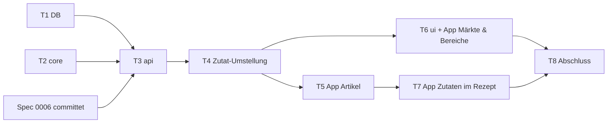

# 0007 — Plan

## Ansatz

Jede Rezeptzutat zeigt auf einen Artikel des eigenen Haushalts; die Datenbank setzt das durch
(Trigger an `recipes.ingredients`) und kennt drei neue RPCs für das, was mehrere Zeilen in einer
Transaktion ändert: Artikel löschen, Artikel zusammenführen, Bereiche zusammenlegen. Alles
andere (umbenennen, Synonyme, Bereich, Vorrat, Ernährung, Standard-Einkaufsregel, Märkte,
Laufreihenfolge, Bereiche anlegen, ordnen und löschen) läuft wie bisher über `apply_changes`
(ADR-0011). Die Regeln ohne Bildschirm liegen in `packages/core`: Suche über Haushalts-Artikel und
Starter-Katalog, Zuordnung von Zutaten ohne menschliche Wahl, Einordnung eingefügter Zeilen
(sicher / „Meinst du …?“ / neu), Filter, Sortierung und „Ähnliche Namen“, Prüfung von Namen und
Synonymen, Folgen von Löschen und Zusammenführen. `packages/api` bekommt die Befehle,
`packages/ui` eine Liste zum Ordnen (Ziehen, Pfeile, Ansage), die App die Seiten „Artikel“ und
„Märkte & Bereiche“ (Tabs „Märkte · Bereiche“) sowie die Zutat mit Artikelwahl und _Hinweis_.
Betroffen: `supabase`, `core`, `api`, `ui`, `app`.

**Entscheidungen beim Planen** (vom Lead vorab freigegeben; Annahmen auch als `OFFEN` in der Spec,
Offene Fragen 7 bis 11):

- **E1 — Keine Datenmigration (REQ-004, Offene Frage 7):** Es gibt keine Altdaten (ADR-0012).
  Die Zuordnungsregel aus REQ-004 wird eine reine Funktion `resolveIngredientArticle` in `core`
  und gilt überall, wo Zutaten ohne Wahl eines Menschen entstehen: Starter-Rezepte übernehmen,
  `replaceIngredient` des Assistenten, Beispieldaten. Nur dabei neu entstandene Artikel tragen
  `needs_review` („Neu aus Rezepten“). AC-014 bis AC-020 prüfen diese Funktion und den Server,
  nicht eine Migration. Kein SQL zum Umschreiben von Daten.
- **E2 — Freitext-Name entfällt (Offene Frage 8):** `RecipeIngredient.name` wird ersatzlos
  entfernt, `articleId` Pflicht. Kein Erweitern → Umziehen → Aufräumen; die Zeile im Abschnitt
  „Daten“ der Spec gilt damit nicht. AC-006 „ältere App-Version“ wird über eine vom Server
  abgelehnte Änderung geprüft (Hinweis „Hat nicht geklappt …“), nicht über eine alte App.
- **E3 — Grundlage direkt bearbeiten:** Die Schema-Änderungen gehen in die Grundlagen-Dateien
  (`supabase/migrations/20261121…_*.sql`), nicht in neue Migrationen, weil noch kein
  `supabase db push` in Produktion lief (ADR-0012, Vorgabe des Leads). Folgearbeit außerhalb dieses
  Plans: Den Satz „This exception is used up by that rebase“ in `.claude/rules/30-database.md`
  präzisieren („bis zum ersten Push werden die Grundlagen-Dateien bearbeitet“) — braucht Enricos
  Freigabe, weil es Agenten-Konfiguration ist.
- **E4 — Artikel löschen nur per RPC:** `authenticated` verliert das `delete`-Recht auf `articles`,
  `apply_changes` lässt das Löschen von Artikeln nicht mehr zu. `delete_article` prüft „unbenutzt“
  unter Zeilensperre; „Rückgängig“ (AC-033) fügt die Zeile über `apply_changes` wieder ein.
- **E5 — Weiterleitung nach dem Zusammenführen (AC-040, Offene Frage 9):** neue Spalte
  `deleted_records.replaced_by text`; `merge_articles` setzt sie am Grabstein des Quellpostens.
  `set_shopping_item_checked` und `set_shopping_item_not_available` folgen ihr (höchstens 5
  Schritte, nur im Haushalt des Grabsteins und nur für Mitglieder). Zurücknehmen auf einen
  ersetzten Posten bleibt wirkungslos (der gesehene `check_seq` gehört zum alten Posten). Keine
  neue Tabelle; die 30-Tage-Aufbewahrung der Grabsteine gilt auch für die Verweise.
- **E6 — Eindeutigkeit in der Datenbank (Frage 4, Offene Frage 10):** eindeutiger Index
  `areas (household_id, lower(name))`; Trigger `private.articles_keys_unique` (unter
  Haushalts-Sperre): kein `name_key` oder `synonym_keys`-Eintrag eines Artikels darf Name oder
  Synonym eines anderen Artikels desselben Haushalts sein (`name_taken`, 23505); Check
  `not (name_key = any (synonym_keys))`. GIN-Index auf `synonym_keys`. Die App prüft vorher mit
  `normalizeText` und zeigt die Texte der Spec.
- **E7 — Standard-Einkaufsregel (Offene Frage 2, A):** `articles.default_shopping_rule` (null =
  nicht gesetzt, dann gilt die heutige Regel: Vorrat → Anzahl, Menge mit Einheit → Rezeptmenge,
  sonst Anzahl). Jede Wahl der Regel an einer Zutat schreibt sie im selben Änderungssatz an den
  Artikel.
- **E8 — Zusammenführen-Regeln:** Ziel behält seine Angaben; leere Angaben (kein Bereich,
  Ernährung „unbekannt“, keine Standard-Einkaufsregel) füllt die Quelle; Vorrat bleibt wie am Ziel
  (6b). Name, Synonyme und Schlüssel der Quelle werden Synonyme des Ziels, doppelte Schlüssel fallen
  weg; mehr als 30 → `too_many_synonyms`, nichts ändert sich (Offene Frage 11). Beide Zeilen im
  selben Rezept bleiben (6c). Stehen beide offen auf der Liste, ziehen die Beiträge der Quelle in
  den Posten des Ziels; die Zusätze sind Beiträge und bleiben erhalten („Kokosmilch (Bio)“).
  `needs_review` des Ziels fällt weg (Offene Frage 1). Kein „Rückgängig“ (Offene Frage 3).
- **E9 — Bereich löschen über `apply_changes`:** Löschen des Bereichs plus Patch jeder
  Laufreihenfolge (`area_order`, `hidden_area_ids`) in einem Änderungssatz; die Artikel verlieren
  den Bereich über den bestehenden Fremdschlüssel (`on delete set null`, setzt `updated_at`).
  Zusammenlegen ist eine eigene RPC, weil es beliebig viele Artikel umzieht (Grenze von
  `apply_changes`: 200 Operationen).
- **E10 — Starter-Katalog in der Suche:** Die Daten bleiben in `packages/api/src/starter`; `core`
  bekommt sie als Parameter. Ein Katalog-Eintrag erscheint nur, wenn kein Haushalts-Artikel seinen
  Namen oder ein Synonym trägt. Beim Wählen entsteht der Artikel mit Synonymen, Ernährung, Vorrat
  und dem Bereich, dessen Name dem Starter-Bereich entspricht (sonst ohne Bereich), im selben
  Änderungssatz wie die Zutat.
- **E11 — Neue Abhängigkeit `expo-haptics`** (über `expo install`): Haptik beim Ablegen in der
  Laufreihenfolge (Spec „Plattformen“, Regel 40-ui); Teil des Expo SDK, im Web wirkungslos, keine
  Alternative ohne nativen Code.
- **E12 — Adressen:** „Artikel“ unter `/artikel` in einer eigenen Gruppe `(artikel)` mit
  `AreaStack`, Eintrag `articles` unter „Verwalten“ → „Einkaufen“. Herkunft in der Adresse
  (`?von=liste`), damit „Zurück“ zur Liste führt (AC-021), wie `?von=verwalten` in Spec 0010.
  „Bereiche“ ist die Ansicht `?ansicht=bereiche` von `/maerkte`.

## Datenbank und Sync

Umsetzung mit dem `db-change`-Skill und `supabase-postgres-best-practices`. Alles in den
Grundlagen-Dateien (E3), danach `pnpm db:reset`, `pnpm db:types`, `pnpm db:seed:gen`.

1. **`articles`** (`…_catalog.sql`): neu `default_shopping_rule text` (Check
   `in ('count','recipeAmount','skip')`), `needs_review boolean not null default false`; beide in
   den Insert- und Update-Grants. `delete` aus dem Grant entfernt (E4). Check
   `articles_name_key_not_synonym`, Trigger `articles_keys_unique` mit
   `pg_advisory_xact_lock` je Haushalt, GIN-Index `articles_synonym_keys_idx` (E6).
2. **`areas`** (`…_catalog.sql`): eindeutiger Index `areas_household_id_name_idx
(household_id, lower(name))` (E6).
3. **`recipes`** (`…_recipes.sql`): Trigger `recipes_check_ingredients` (before insert or update
   of `ingredients`): jedes Element ein Objekt mit `articleId` (UUID-Text), `prepNote` fehlt oder
   Text ≤ 200 Zeichen; alle Artikel existieren im Haushalt des Rezepts, gelesen mit
   `for key share` (sperrt gegen gleichzeitiges Löschen und Zusammenführen); sonst
   `ingredient_article_invalid` (23503). Kein Prüfen weiterer Schlüssel.
4. **`deleted_records`** (`…_foundation.sql`): neu `replaced_by text` (null). Kein Schreibrecht
   für `authenticated`; Lesen wie bisher über RLS.
5. **RPCs** (Wrapper in `public`, `search_path = ''`, `anon` ohne Ausführrecht;
   `delete_article` und `merge_articles` in `…_shopping_rpcs.sql`, weil sie Rezepte und Posten
   berühren, `merge_areas` in `…_catalog.sql`):
   - `delete_article(p_article_id) returns jsonb` — security definer; `not_authenticated` (42501),
     fremd oder fehlend `article_not_found` (P0002); Zeile `for update`; in einem Rezept oder in
     einem Posten (offen oder erledigt) → `article_in_use` (P0001); gibt die gelöschte Zeile
     zurück (für „Rückgängig“).
   - `merge_articles(p_source_id, p_target_id) returns jsonb` — security definer; Quelle = Ziel
     → `invalid_value` (22023); beide im selben Haushalt eines Mitglieds, sonst
     `article_not_found`; Sperren `lock_household_article` für beide in fester Reihenfolge, dann
     Zeilensperren. Reihenfolge: Zutaten in `recipes.ingredients` umschreiben → offene Posten
     zusammenlegen (Beiträge umziehen, Quellposten löschen, `replaced_by` am Grabstein) → übrige
     Posten der Quelle auf das Ziel → Angaben füllen (E8) → Quelle löschen → Synonyme und
     Schlüssel ans Ziel. Rückgabe `{"recipes": n, "items": m}`.
   - `merge_areas(p_source_id, p_target_id) returns integer` — security invoker; `not_member`
     (42501), fehlend oder fremd `area_not_found` (P0002), gleich `invalid_value`; Artikel
     umziehen, Quelle aus `area_order` und `hidden_area_ids` jedes Markts entfernen, Quelle löschen;
     Rückgabe Zahl der umgezogenen Artikel.
6. **Laden-RPCs** (`…_shopping_rpcs.sql`): `set_shopping_item_checked` und
   `set_shopping_item_not_available` folgen `replaced_by` (E5); `assign_article_area` bleibt (eine
   Zuordnung auf einen gelöschten oder zusammengeführten Artikel ergibt `null` und wird verworfen).
7. **`apply_changes`** (`…_apply_changes.sql`): Allowlist `articles` um `default_shopping_rule`,
   `needs_review` erweitert, `"delete": false`.
8. **Sync:** keine neue Tabelle; alle geänderten Tabellen sind schon registriert. Die Folgen von
   Zusammenführen und Löschen erreichen die Geräte über `updated_at` und Grabsteine. Neue Form des
   Caches (Artikel- und Zutatenfelder) → `CACHE_VERSION` 3 → 4; Warteschlange, gewählter Haushalt
   und Markt bleiben erhalten (wie Spec 0006).
9. **Beispieldaten:** Jede Zutat der Beispiel- und Starter-Rezepte muss auf einen Artikel des
   Katalogs zeigen, sonst scheitert `pnpm db:reset` am Trigger. `buildRecipe` wirft bei einem
   fehlenden Artikel; Test in `seed/demo.test.ts`.

## Risiken und Gegenmaßnahmen

Kritischer Pfad: RLS und Tenancy, Löschen, Zusammenführen, Laden-Warteschlange, Schema-Grundlage.

| Was könnte schiefgehen                                                      | Gegenmaßnahme                                                                                                          | Getestet durch                                                                                         |
| --------------------------------------------------------------------------- | ---------------------------------------------------------------------------------------------------------------------- | ------------------------------------------------------------------------------------------------------ |
| Zutat zeigt auf Artikel eines fremden Haushalts, auf keinen oder auf nichts | Trigger `recipes_check_ingredients`, Haushalt des Rezepts                                                              | pgTAP `recipe_ingredients.test.sql` AC-006, AC-019 (direkt, über `apply_changes`, ohne Anmeldung)      |
| Artikel wird gelöscht, während ein Rezept ihn einsetzt (Wettlauf)           | `delete_article` sperrt die Zeile `for update`, der Trigger liest `for key share`; Prüfung „unbenutzt“ nach der Sperre | pgTAP AC-034 (in Rezept, offen, erledigt → `article_in_use`); Ablauf nacheinander in beiden Richtungen |
| Löschen am Prüfen vorbei (direkt oder über `apply_changes`)                 | kein `delete`-Grant, Allowlist `"delete": false`                                                                       | pgTAP: direktes `delete` → 42501, `apply_changes` → `invalid_change`                                   |
| Fremder Haushalt, abgemeldet oder Quelle = Ziel beim Zusammenführen         | definer mit Mitgliedsprüfung, gleicher Haushalt, `invalid_value`; `anon` ohne Ausführrecht                             | pgTAP `article_rpcs.test.sql` AC-041 (beide Artikel unverändert), anon → 42501                         |
| Zusammenführen bricht halb ab                                               | eine RPC, eine Transaktion; Abbruch bei `too_many_synonyms` erst nach allen Schritten                                  | pgTAP: 31. Synonym → nichts geändert (Rezepte, Posten, beide Artikel)                                  |
| Offline-Haken auf die Quelle geht verloren (AC-040)                         | `replaced_by` am Grabstein, Laden-RPCs folgen ihm                                                                      | pgTAP `store_rpcs.test.sql`; api-Integrationstest Warteschlange nach Zusammenführen                    |
| Verweis führt in einen fremden Haushalt oder verrät Daten                   | Verweis nur im Haushalt des Grabsteins, Aufrufer muss Mitglied sein, sonst `null` wie bisher                           | pgTAP: fremde Posten-ID mit Verweis → `null`, nichts geändert                                          |
| Zwei Geräte legen gleichzeitig Doppelte an (Name, Synonym, Bereich)         | Trigger unter Haushalts-Sperre, eindeutige Indizes                                                                     | pgTAP 23505 je Fall; gleicher Name im anderen Haushalt erlaubt                                         |
| Bereiche zusammenlegen oder umbenennen in fremdem Haushalt (AC-056)         | `merge_areas` invoker + `not_member`; RLS für Patch und Delete                                                         | pgTAP `area_rpcs.test.sql` Mitglied B, anon                                                            |
| Gelöschter Bereich bleibt in Laufreihenfolgen                               | Patch der Märkte im selben Änderungssatz (E9); `merge_areas` entfernt serverseitig                                     | api-Test `deleteArea`; pgTAP AC-054                                                                    |
| Haushalt lässt sich wegen der neuen Trigger nicht mehr löschen              | Trigger prüfen nur Einfügen und Ändern von Zutaten; Löschen von Artikeln per Kaskade bleibt erlaubt                    | pgTAP `household_rpcs.test.sql`: Haushalt mit Rezepten, Artikeln, Posten löschen                       |
| Beispieldaten laden nicht mehr                                              | `buildRecipe` wirft bei fehlendem Artikel                                                                              | `seed/demo.test.ts`, `pnpm db:reset` im Gate                                                           |
| Verhalten verschiebt sich beim Bearbeiten der Grundlage                     | nur die genannten Abschnitte ändern; volle pgTAP-Suite                                                                 | `pnpm exec supabase test db`                                                                           |
| Gleichzeitiges Bearbeiten eines Artikels überschreibt Felder (AC-035)       | Patch enthält nur geänderte Spalten (bestehender Diff)                                                                 | api-Test AC-035                                                                                        |
| „Ähnliche Namen“ wird bei vielen Artikeln langsam                           | Vorfilter nach Länge (Ähnlichkeit ≥ 0,8 setzt ähnliche Länge voraus), Ergebnis je Datenstand gemerkt                   | core-Test mit 1000 Artikeln, Zahl der Vergleiche begrenzt (kein Zeitmessen)                            |
| Cache-Formwechsel verliert Offline-Aktionen                                 | Versionswechsel behält Warteschlange (bestehender Weg aus 0006)                                                        | api-Test `backend.test.ts`                                                                             |

## Aufgaben

Jede Aufgabe: Test rot (Ausgabe nach `tmp/0007/red-<task>.txt`) → Implementierung → grün → Gate
→ Commit mit `Spec: 0007`. **Gate je Aufgabe:** `pnpm format:check && pnpm check`; dazu
`pnpm db:reset && pnpm exec supabase test db`, wenn `supabase/` berührt ist; `pnpm e2e:dev` grün
(App startet ohne Konsolenfehler). Keine volle E2E-Suite (kommt nach allen Wellen); bekannte
Brüche schreibt jede Aufgabe nach `tmp/brief/e2e-impact.md` (Liste unten).

**Reihenfolge und Parallelität** (höchstens zwei Bau-Agenten, nie dieselbe Datei):

- Welle 1: **T1 ‖ T2** (disjunkt: `supabase/**` + `packages/api/src/db/types.gen.ts` + Seed-Daten
  gegen `packages/core/src/**`). T2 trägt seine Exporte in `core/src/index.ts` erst ein, wenn
  Spec 0006 committet ist (die Datei ist dort gerade geändert).
- Welle 2: **T3**, dann **T4** (allein; berühren Dateien von Spec 0006).
- Welle 3: **T5 ‖ T6**, danach **T7** (braucht das Fenster „Artikel bearbeiten“ aus T5).

### Task 1 — Datenbank: Artikel, Bereiche, Zutaten, RPCs (pgTAP zuerst)

- **Deckt ab:** AC-006, AC-019 (Server), AC-030, AC-031, AC-033, AC-034, AC-036, AC-038 bis AC-041,
  AC-045, AC-052, AC-054 bis AC-056; Daten für AC-005, AC-029
- **Berührt:** `supabase/migrations/…_foundation.sql`, `…_catalog.sql`, `…_recipes.sql`,
  `…_shopping_rpcs.sql`, `…_apply_changes.sql`; `supabase/tests/recipe_ingredients.test.sql`,
  `article_rpcs.test.sql`, `area_rpcs.test.sql` (neu), `apply_changes.test.sql`,
  `store_rpcs.test.sql`, `household_rpcs.test.sql`, `schema_lint.test.sql`; `supabase/seed.sql`
  (generiert), `packages/api/src/db/types.gen.ts` (generiert); nur falls nötig
  `packages/api/src/seed/recipes-data.ts`
- **Test (pgTAP, je mit Mitglied, Mitglied eines fremden Haushalts und `anon`):**
  - Zutaten: ohne `articleId`, mit unbekannter, mit fremder ID, mit `prepNote` > 200 → abgelehnt,
    Rezept unverändert; gültig → gespeichert; über `apply_changes` gleich.
  - `delete_article`: unbenutzt → gelöscht + Grabstein; in Rezept / offen / erledigt →
    `article_in_use`; fremd → `article_not_found`; anon → 42501; direktes `delete` → 42501.
  - `merge_articles`: AC-036 (Rezept umgeschrieben, ein offener Posten mit beiden Beiträgen,
    Synonyme „Milchkokos“ und „Kokosdrink“, Quelle weg), AC-038 (Angaben), AC-039 (zwei Zeilen),
    AC-041 (fremd, Quelle = Ziel, anon), 31 Synonyme → nichts geändert, `replaced_by` gesetzt.
  - Laden-RPCs: Haken und „nicht da“ auf den Quellposten treffen den Zielposten; Zurücknehmen
    bleibt wirkungslos; Kette über zwei Zusammenführungen; fremder Haushalt → `null`.
  - Eindeutigkeit: Synonym = Name eines anderen Artikels, Name = Synonym eines anderen, Bereich
    „getränke“ neben „Getränke“ → 23505; im anderen Haushalt erlaubt.
  - `merge_areas`: AC-054 (32 Artikel, Quelle aus allen Laufreihenfolgen, Stelle und Sichtbarkeit
    des Ziels unverändert), AC-056 (fremd, anon). Bereich löschen: Artikel ohne Bereich mit neuem
    `updated_at`. Markt löschen: Standardmarkt wird `null` (AC-045).
  - Haushalt mit Rezepten, Artikeln und Posten lässt sich löschen; `schema_lint` kennt die neuen
    definer-Funktionen.
- **Status:** offen

### Task 2 — Regeln in `core`

- **Deckt ab:** AC-001 bis AC-005, AC-008 bis AC-010, AC-011 bis AC-020 (Regel), AC-021 bis
  AC-024, AC-027, AC-030, AC-031, AC-034, AC-036 bis AC-039 (Vorschau und Angaben), AC-046,
  AC-052, AC-053
- **Berührt:** `packages/core/src/article-catalog.ts` + `.test.ts` (neu): `searchArticleCatalog`
  (Haushalt + Starter-Einträge, über `matchSearchOrCreate`), `resolveIngredientArticle`
  (Name/Synonym → Katalog → neu mit `needsReview`, 120 Zeichen), `classifyIngredientLines`
  (sicher / ähnlich mit Vorschlag / neu, AC-008 bis AC-010), `defaultShoppingRuleFor`,
  `validateArticleDraft` („Name fehlt“, „Gibt es schon: …“, „„Möhren“ ist schon ein Artikel“),
  `articleUsage` (Rezepte, offen/erledigt auf der Liste, Texte aus AC-034), `filterArticles`,
  `sortArticles` (A–Z, Neu), `similarArticleNames` (≥ 0,8 oder Einzahl/Mehrzahl, ohne Wortteile),
  `mergeArticlesPreview` (Zahl Rezepte und Posten, Angaben nach E8), `mergeTargets` (ohne die
  Quelle); `packages/core/src/areas.ts` + `.test.ts` (neu): `validateAreaName`, `moveInOrder`,
  `orderAnnouncement` („Getränke, Position 1 von 14“), Artikel je Bereich; `types.ts` additiv:
  `Article.defaultShoppingRule?`, `RecipeIngredient.prepNote?`; `recipes.ts`/`amounts.ts`:
  Zeile mit Hinweis „4 Zwiebeln · fein gehackt“ (AC-013)
- **Test:** je Funktion die Fälle der genannten AC mit den Daten der Spec, dazu leere Eingabe,
  Groß/Klein und Umlaute, Tippfehler, Grenzwerte (120 Zeichen, 30 Synonyme), fremde IDs werden
  nie getroffen (nur die übergebenen Artikel), 1000 Artikel bei `similarArticleNames` mit
  begrenzter Zahl von Vergleichen.
- **Status:** offen

### Task 3 — Befehle und Abgleich in `api`

- **Voraussetzung:** T1, T2, Spec 0006 committet.
- **Deckt ab:** AC-001 bis AC-003, AC-005, AC-006 (Hinweis bei Ablehnung), AC-014 bis AC-020
  (Starter-Rezepte, Assistent), AC-026, AC-029 bis AC-041, AC-043 bis AC-045, AC-047 bis AC-049,
  AC-052 bis AC-056
- **Berührt:** `packages/core/src/types.ts` (`Article.needsReview`, `Article.createdAt` als Pflicht),
  `packages/api/src/db/mapping.ts`, `db/tables.ts`, `backend.ts` (`CACHE_VERSION` 4),
  `transport.ts`, `transport-supabase.ts`, `transport-fake.ts` (neue RPCs und die Prüfungen von T1
  nachgebildet), `commands-articles.ts` (neu: `createArticle`, `updateArticle` setzt
  `needsReview` zurück, `confirmArticle` („Passt so“), `deleteArticle` mit „Rückgängig“,
  `mergeArticles`, `catalogChoice`), `commands-stores.ts` (neu; `createArea`, `createStore`,
  `fullAreaOrder`, `moveStoreArea`, `setStoreAreaHidden` ziehen unverändert aus
  `commands-shopping.ts` um, dazu `renameStore`, `setDefaultStore`, `deleteStore`, `renameArea`,
  `moveArea`, `mergeAreas`, `deleteArea` mit „Rückgängig“ bei leerem Bereich, `addAreaToStore`),
  `commands-household.ts` (`resolveArticle`, `updateArticle` ziehen nach `commands-articles.ts`),
  `commands-recipes.ts` (`adoptStarterRecipes`, `replaceIngredient` über
  `resolveIngredientArticle`), `starter/*` (Einträge für die Suche), `index.ts`, Tests daneben
  (`commands-articles.backend.test.ts`, `commands-stores.backend.test.ts`,
  `master-data.integration.test.ts`)
- **Test:** jeder Befehl gegen den Fake-Transport (ein Änderungssatz bzw. eine RPC, offline
  `OfflineError`, ungültige Eingabe schreibt nichts); AC-035 Patch nur mit geänderten Spalten;
  Ablehnung des Servers → „Hat nicht geklappt – bitte noch einmal versuchen“; Versionswechsel 3 → 4
  behält die Warteschlange; Integrationstest gegen die lokale Datenbank: Haken offline auf
  „Milchkokos“, Zusammenführen, Warteschlange senden → „Kokosmilch“ abgehakt, kein Fehler
  (AC-040); „Milchkokos“ in „Was fehlt?“ → „Kokosmilch“ (AC-037).
- **Status:** offen

### Task 4 — Zutat zeigt immer auf einen Artikel (Umstellung)

- **Voraussetzung:** T3.
- **Deckt ab:** AC-011, AC-012, AC-016 (kein „Nicht im Katalog“ mehr), E2
- **Berührt:** `packages/core/src/types.ts` (`RecipeIngredient.articleId` Pflicht, `name` entfällt),
  `shopping.ts`, `diet.ts`, `recipes.ts`, `recipe-variants.ts`, `shopping-picker.ts`,
  `test-fixtures.ts` und ihre Tests; `packages/api/src/commands-recipes.ts`,
  `commands-shopping.ts` (Zweig `text:` für Zutaten ohne Artikel entfällt), `seed/demo.ts`,
  `seed/seed-sql.ts`; App-Stellen, die `ingredient.name` lesen (`recipes/recipe-detail.tsx`,
  `cooking-screen.tsx`, `recipe-meta.tsx`, `shopping/pantry-check-sheet.tsx`,
  `shopping/list-picker.tsx`) lesen den Artikelnamen
- **Test:** core: Beiträge aus einem Rezept tragen nie den Hinweis (AC-011, AC-012), Ernährung
  ohne Sonderfall „ohne Artikel“; api: Vorratscheck-Zeilen haben immer einen Artikel; der Seed
  enthält keine Zutat ohne Artikel. Rein mechanisch sonst, `pnpm check` grün.
- **Status:** offen

### Task 5 — App: Seite „Artikel“, „Artikel bearbeiten“, Zusammenführen

- **Voraussetzung:** T4. Parallel zu T6.
- **Deckt ab:** AC-021 bis AC-041 (Bildschirm), AC-051 zweiter Teil (Ziel „Ohne Bereich“)
- **Berührt:** `apps/app/src/features/articles/*` (neu: `articles-screen.tsx`, `article-sheet.tsx`,
  `merge-article-dialog.tsx`, `labels.ts`), `apps/app/src/app/(tabs)/(artikel)/_layout.tsx`,
  `artikel.tsx` (neu), `features/manage/manage-entries.ts` (Eintrag `articles`),
  `features/shopping/list-screen.tsx` (nur der Menüpunkt „Artikel“ im ⋯), `e2e/dev/smoke.spec.ts`
  (Seite „Artikel“ und das Fenster einmal öffnen)
- **Test:** Regeln sind in T2/T3 getestet; hier e2e dev smoke und Klick-Durchlauf bei 390 und
  1440 px: Filter mit Zahlen, leerer Filter (AC-027), Suche „Karotten“ und „Kokosmilsh“, Sortierung
  „Neu“, Liste und Detail am Desktop mit Hervorhebung, „+ Neu“, Umbenennen mit „Gibt es schon“,
  Synonym-Chips, „In Rezepten“ öffnet das Rezept, „Löschen“ ausgegraut mit Grund, Löschen +
  „Rückgängig“, Zusammenführen mit Dialog, offline ausgegraut mit Hinweis.
- **Status:** offen

### Task 6 — `ui`-Liste zum Ordnen und App „Märkte & Bereiche“

- **Voraussetzung:** T4. Parallel zu T5.
- **Deckt ab:** AC-042 bis AC-056 (Bildschirm)
- **Berührt:** `packages/ui/src/reorder-list.tsx` (neu: Griff ≡, Ziehen mit Reanimated wie
  `swipe-row.tsx`, Pfeile „nach oben/unten“, Tastatur im Web, Ansage über `announce`, Haptik beim
  Ablegen), `packages/ui/src/index.ts`, `apps/app/package.json` (`expo-haptics`, E11),
  `apps/app/src/features/stores/*` (`stores-screen.tsx` mit Ansichts-Tabs, `areas-view.tsx`,
  `store-order-screen.tsx`, `store-dialogs.tsx`), `apps/app/src/app/(tabs)/(maerkte)/*`,
  `docs/design/DESIGN.md` (Baustein „Liste zum Ordnen“), `e2e/dev/smoke.spec.ts` (nur der Abschnitt
  Märkte; mit T5 abstimmen: T5 ergänzt, T6 ergänzt danach)
- **Test:** Positionslogik und Ansagetext sind in T2 getestet; Klick-Durchlauf: Markt anlegen ohne
  Namen, umbenennen, „Als Standard“, löschen mit Dialog → „Ohne Markt – nach Bereichen“, Ziehen und
  dreimal „nach oben“ mit Ansage, Aus- und Einblenden an alter Stelle, „+ Bereich hinzufügen“ neu
  und ausgeblendet, Bereiche: anlegen, umbenennen, Doppelte, Reihenfolge ohne Markt, Zusammenlegen
  mit Dialog, Löschen mit Artikeln (Dialog) und leer (Rückgängig), „Ohne Bereich ›“; Desktop
  Liste und Laufreihenfolge nebeneinander.
- **Status:** offen

### Task 7 — App: Zutat mit Artikel, Hinweis, Mehrere einfügen

- **Voraussetzung:** T5 (Fenster „Artikel bearbeiten“).
- **Deckt ab:** AC-001 bis AC-005, AC-007 bis AC-013 (Bildschirm)
- **Berührt:** `apps/app/src/features/recipes/ingredient-sheet.tsx` (neu: Menge, Artikel per
  „Suchen oder anlegen“ über Haushalt und Starter-Katalog, Einkaufsregel vorausgewählt, Zusatz,
  Hinweis, ⋯ → „Artikel bearbeiten“), `ingredients-paste-sheet.tsx` (orange Zeilen mit „Artikel
  wählen“, „Meinst du …?“, „„…“ neu anlegen“, „1 Zutat braucht noch einen Artikel“),
  `recipe-detail.tsx` und `cooking-screen.tsx` (Zeile „2 Zwiebeln · fein gehackt“, „+ Zutat“, ⋯
  je Zutat); Entwurfszeilen leben nur im Editor und kehren nach einer Ablehnung des Servers orange
  zurück
- **Test:** e2e dev smoke (Fenster einmal öffnen), Klick-Durchlauf: AC-001 bis AC-004, AC-008 bis
  AC-010 mit den Blöcken der Spec, Portionen 4 → 8 mit Hinweis (AC-013), Vorratscheck ohne Hinweis
  (AC-011, AC-012), Abkürzung „Artikel bearbeiten“ und zurück ins Rezept (AC-007).
- **Status:** offen

### Task 8 — Abschluss: Doku, Sicherheit, Nachweis

- **Deckt ab:** Rückverfolgbarkeit, Kritischer Pfad
- **Berührt:** `.agents/glossary.md` („Neu aus Rezepten“ ohne Migration, `articles.needs_review`;
  „Standard-Einkaufsregel“ `articles.default_shopping_rule`; „Hinweis“ `prepNote` endgültig;
  „Rezeptzutat“ ohne `name`; „Synonym“ und „Bereich“ eindeutig in der Datenbank),
  `docs/architecture/sync.md` (Nachtrag Spec 0007: Weiterleitung `replaced_by`, Löschen nur per RPC,
  Speicher-Version 4), Rückverfolgbarkeit in `spec.md`, dieser Nachweis
- **Test:** `/security-check` auf den ganzen Diff (Fokus: definer-Funktionen, Trigger, Grants,
  Weiterleitung, Befehle), Befunde behoben oder hier festgehalten; spec-auditor; `pnpm build:web`.
- **Status:** offen

## Erwartete E2E-Brüche (für `tmp/brief/e2e-impact.md`)

Nicht reparieren, nur festhalten; die volle Suite läuft am Ende aller Wellen.

- `rundgang-essen.spec.ts` AC-022 (Einfügen): das Einfüge-Fenster bekommt Einordnung und neue
  Test-IDs; `ingredientRows` schließt nur bekannte Präfixe aus, neue Elemente je Zutat (⋯, Hinweis)
  zählen sonst als Zeilen.
- `rundgang-backend-sync.spec.ts` (ab Zeile 232): der Zusatz wird über `ingredient-note-…`
  bearbeitet; zieht er ins Zutat-Fenster, bricht der Schritt.
- `rundgang-liste.spec.ts` AC-034 (Laufreihenfolge) und AC-032/AC-033: neue Bedienung der
  Laufreihenfolge (Griff, Pfeile), neue Test-IDs auf „Märkte“ (`store-new-name`/`store-new-save`
  → „+ Neuer Markt“).
- `rundgang-shell.spec.ts`: neuer Eintrag „Artikel“ unter „Verwalten“, falls Einträge gezählt oder
  der Reihe nach geprüft werden.
- `seed-ids.ts`: braucht IDs der Artikel für die neuen Rundgänge.

## Überschneidungen mit anderen Specs

- **Spec 0006 (läuft gerade aus):** T3, T4, T5 und T7 berühren Dateien, die 0006 gerade ändert
  (`commands-shopping.ts`, `shopping-picker.ts`, `core/src/index.ts`, `list-screen.tsx`,
  `pantry-check-sheet.tsx`, `list-picker.tsx`, `recipe-detail.tsx`, `packages/ui/src/index.ts`).
  Sie starten erst nach dem Commit von 0006. T1 und T2 berühren nichts davon (bis auf den
  Export-Eintrag in `core/src/index.ts`, siehe Welle 1).
- **Spec 0011 (wird parallel geplant):** Gemeinsam sind voraussichtlich die Grundlagen-Dateien
  `…_recipes.sql` und `…_restaurants_absences_feedback.sql`/`…_activities_and_meal_plan.sql`
  (halbe Sterne), `…_apply_changes.sql` (Allowlist) und `…_chores.sql`, dazu
  `packages/core/src/types.ts`, `api/src/db/mapping.ts`, `transport-fake.ts`, `types.gen.ts`,
  `seed.sql` und `CACHE_VERSION`. Regel: Die Datenbank-Aufgaben beider Specs laufen nicht
  gleichzeitig; `types.gen.ts` und `seed.sql` werden nach dem Zusammenführen neu erzeugt, nie von
  Hand gemischt; `CACHE_VERSION` steigt je ausgelieferter Spec um eins.
- **Spec 0008 (Rezept-Editor) und 0009 (Sammlungen):** übernehmen `classifyIngredientLines` und
  das Zutat-Fenster aus T2/T7 (0008 AC-032, 0009 AC-013); T7 baut deshalb nur im heutigen Editor
  und legt die Regel vollständig in `core`.

## Bewusst nicht Teil dieses Plans

- Keine Datenmigration und keine Übergangsfelder (E1, E2, ADR-0012).
- Kein Neubau des Rezept-Editors (Spec 0008); T7 ergänzt nur „+ Zutat“, ⋯ und das Einfügen.
- Kein Rückgängig für Zusammenführen und Zusammenlegen (Offene Frage 3).
- Keine Weiterleitung für Bereichszuordnungen auf zusammengeführte Artikel (Offene Frage 9).
- Volle E2E-Suite, `/ui-verify` mit allen Themes und impeccable-Kritik laufen am Ende der Wellen.
- Änderung an `.claude/rules/30-database.md` (E3) braucht Enricos Freigabe.

## Nachweis

Wird am Ende ausgefüllt.

- [ ] Alle AC haben einen Test, der rot war und jetzt grün ist (spec-auditor)
- [ ] `pnpm format:check && pnpm check && pnpm build:web` grün
- [ ] `pnpm exec supabase test db` grün
- [ ] `pnpm e2e:dev` grün, Klick-Durchlauf bei 390 und 1440 px ohne Konsolenfehler
- [ ] `/security-check` gelaufen, Befunde behoben oder hier festgehalten
- [ ] Offline-Verhalten wie in der Spec geprüft (Lesen, Suchen, gesperrtes Bearbeiten, AC-040)
- [ ] Glossar, `sync.md` und Rückverfolgbarkeitstabelle aktuell
- [ ] `tmp/brief/e2e-impact.md` mit den Brüchen dieser Spec
