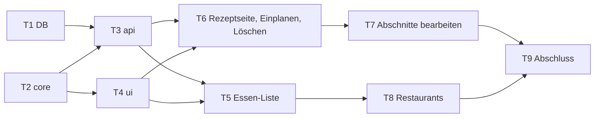

# 0008 — Plan

## Ansatz

„Essen“ bekommt die Filterzeile aus Spec 0005 (`FilterBar`, Sortier-`Menu`, `InfiniteList`) mit
einem Filtermodell, das ganz in `packages/core` liegt: Schnell-Chips, Filterfeld mit Küche aus den
Daten, Sortierung mit „Zufall“, gleich für Rezepte und Restaurants. Das Rezept öffnet sich immer
als ganze Seite (`/rezept/[id]`), am Desktop innen zweispaltig. Jeder Abschnitt (Kopf, Einordnung,
Zutaten, Zubereitung, Notizen) hat einen Entwurf, den `core` prüft und in ein Patch nur der Spalten
dieses Abschnitts übersetzt. „Fertig“ schickt ihn als genau ein `apply_changes` (ADR-0011). Die
Zutaten bauen auf den Entwurfszeilen von Spec 0007 auf; das Zutat-Fenster ändert nur noch den
Entwurf. „Einplanen“ ist ein eigenes mittleres Fenster mit Wochen-Blättern auf der Rezeptseite.
„Löschen“ mit „Rückgängig“ braucht trotz des Nicht-Ziels „keine Datenbankänderung“ zwei RPCs in
der Grundlage. Die Fremdschlüssel der Planeinträge sind `on delete restrict`, und die Bewertungen
anderer Mitglieder darf niemand schreiben (E1). Betroffen: `supabase`, `core`, `api`, `ui`, `app`.

**Entscheidungen beim Planen** (Empfehlung des Plans, vom Eigentümer vorab freigegeben; was eine
Annahme ist, steht zusätzlich als `OFFEN` in den Offenen Fragen der Spec, Nummer 4 bis 10):

- **E1 — Löschen braucht die Datenbank (Abweichung vom Nicht-Ziel, Offene Frage 4).** Zwei Gründe
  machen ein Löschen aus der App heraus unmöglich. Erstens sind `meal_plan_entries.recipe_id` und
  die Reste `on delete restrict`: Planeinträge müssen in derselben Transaktion umgeschrieben oder
  gelöscht werden. Zweitens haben `recipe_ratings` und `recipe_favorites` keine Schreibrechte, und
  so soll es bleiben (Spec 0011, AC-027). „Rückgängig“ kann Nadjas Bewertung also nicht vom Gerät
  zurückschreiben. Darum gibt es `delete_recipe` und `restore_recipe` direkt in der Grundlage
  (ADR-0012), ohne neue öffentliche Tabelle, ohne neue Spalte und ohne Änderung am Sync.
  `CACHE_VERSION` bleibt, weil sich die Form des Caches nicht ändert.
- **E2 — Rezepte werden nur per RPC gelöscht** (wie Spec 0007, E4): `authenticated` verliert
  `delete` auf `recipes`, und die Allowlist von `apply_changes` steht für `recipes` auf
  `"delete": false`. Nur so ist jedes Löschen rückgängig zu machen und lässt den Kalender stimmig.
  Ein Haushalt lässt sich weiter löschen (Kaskade ohne Grant).
- **E3 — Folgen für Kalender und Liste (Offene Frage 3 A, präzisiert in Offene Frage 5).**
  - `delete_recipe(p_recipe_id, p_today)` macht alle Einträge des Rezepts mit `date <= p_today` zu
    Freitext, nämlich `kind = 'text'`, `recipe_id = null`, `variants = '[]'` und als Text der
    Titel, bei Resten „Reste von <Titel>“ (Glossar). Esser, Portionen, Koch und „nicht gekocht“
    bleiben.
  - Einträge mit späterem Tag und vorgemerkte (`date is null`) werden gelöscht.
  - **Heute zählt zum Verlauf:** Das Essen kann schon auf dem Tisch gewesen sein, und „Wie war's?“
    fragt den heutigen Tag ab. Ein noch nicht gekochtes Essen als Freitext stört nicht und lässt
    sich entfernen.
  - `p_today` ist das Datum des Geräts, wie es die Oberfläche zeigt. Der Server nimmt nur
    `current_date - 1 … current_date + 1` an, sonst `invalid_value` (22023); der Puffer ist derselbe
    wie bei `complete_chore`, Spec 0011.
  - Beiträge auf der Einkaufsliste bleiben unverändert: `source.recipeId` ist kein Fremdschlüssel,
    der `label` trägt den Titel (Spec 0006).
- **E4 — „Rückgängig“ über einen Schnappschuss auf dem Server (Offene Frage 6).**
  - `delete_recipe` legt in `private.recipe_deletions` einen Schnappschuss ab:
    `household_id` (Fremdschlüssel mit Kaskade), `recipe_id`, `deleted_by`, `deleted_at` und
    `snapshot jsonb`. Der Schnappschuss enthält die Rezeptzeile, Bewertungen und Favoriten, die
    alten Werte (`kind`, `recipe_id`, `text`, `variants`) der zu Freitext gemachten Einträge und die
    gelöschten Einträge vollständig.
  - Die Tabelle liegt im Schema `private`, hat keine Grants und wird nicht synchronisiert, weil
    kein Gerät sie liest. Regel 5 („jede Tabelle synchronisiert“) gilt für Tabellen der App in
    `public`; diese Ausnahme steht im Nachtrag in `sync.md`.
  - `restore_recipe(p_recipe_id)` geht nur für die Person, die gelöscht hat, solange sie Mitglied
    ist, und nur innerhalb von 1 Stunde; sonst `recipe_not_restorable` (P0002). Es stellt Rezept
    (dieselbe ID, samt `photo_path`), Bewertungen und Favoriten wieder her, beide nur für heutige
    Mitglieder. Die gelöschten Einträge kommen zurück, mit `eater_ids` nur aus heutigen
    Mitgliedern und `cook_id = null`, wenn die Person fehlt. Die Freitext-Einträge werden wieder
    Rezept-Einträge, aber nur, wenn sie noch unverändert Freitext mit diesem Text sind. Danach wird
    der Schnappschuss gelöscht; ein zweiter Aufruf ergibt `recipe_not_restorable`.
  - Aufgeräumt wird bei jedem `delete_recipe` des Haushalts (älter als 1 Stunde) und nachts per
    `pg_cron` (`purge-recipe-deletions`).
  - Den Schnappschuss vom Gerät zu schicken, ist verworfen: Dann ließe sich die Bewertung anderer
    fälschen.
- **E5 — Das Foto bleibt bis zum Ende des Hinweises (Offene Frage 6).** Die Datenbank kann
  Storage-Objekte nicht löschen (Kommentar in `…_storage.sql`). Darum löscht die App das Objekt
  erst, wenn der Hinweis „… gelöscht · Rückgängig“ ohne „Rückgängig“ ausläuft (`removeMedia`). Dafür
  bekommt `toast` ein neues `onExpire`. Wird die App vorher beendet oder ist sie offline, bleibt
  das Objekt im Ordner des Haushalts liegen. Das ist bewusst hingenommen: Es ist privat und geht
  mit dem Haushalt. Der Kommentar in `…_storage.sql` („before deleting a recipe“) wird
  angepasst.
- **E6 — Sperren und Wettläufe beim Löschen.** `delete_recipe` (security definer,
  `search_path = ''`) prüft die Mitgliedschaft über `private.my_recipe_household_id`. Danach sperrt
  es die Rezeptzeile `for update` und erst dann die Planeinträge `for update`. Plant jemand das
  Rezept gleichzeitig ein, wartet sein Fremdschlüssel-Check auf die Sperre und scheitert danach
  mit 23503. Die App nimmt das Einplanen zurück und zeigt „Das Rezept gibt es nicht mehr“
  (`rejectedMessage`). `delete_recipe` sperrt keine Artikel, `merge_articles` sperrt Rezepte vor
  Artikeln; es gibt also keinen Zyklus. Ein trotzdem gemeldeter Deadlock wird einmal wiederholt,
  wie seit Spec 0007.
- **E7 — Entwurf je Abschnitt, Speichern beim Wechsel (Offene Frage 1 A).**
  - Es gibt höchstens einen offenen Abschnitt. Sein Entwurf (`RecipeSectionDraft` in `core`) lebt
    in der Seite.
  - „Fertig“ prüft den Entwurf. Ist er ungültig, bleibt der Abschnitt offen (AC-026, AC-032).
    Sonst geht ein Diff mit nur den Spalten dieses Abschnitts hinaus (AC-029), und das ist ein
    Aufruf.
  - Stift eines anderen Abschnitts, Seite verlassen (auch Tab-Wechsel und die Zurück-Taste unter
    Android) und Unmount speichern den gültigen Teil: Ein leerer Titel lässt den alten Titel stehen
    und speichert die übrigen Kopf-Felder, orange Zeilen fallen weg (AC-032, letzter Satz).
  - Lehnt der Server ab, erscheint „Hat nicht geklappt – bitte noch einmal versuchen“. Ist die
    Seite noch offen, öffnet sich der Abschnitt wieder mit dem Entwurf, wie die Entwurfszeilen in
    Spec 0007.
  - Ist das Rezept inzwischen gelöscht, wird nichts gesendet (Konflikttabelle der Spec).
  - Speichern eines Abschnitts hat kein „Rückgängig“; die Spec verlangt keins.
- **E8 — Grenzen der Felder (Offene Frage 7).** Wo die Datenbank eine Grenze hat, prüft `core`
  dieselbe:
  - Titel 1–200 Zeichen („Titel fehlt“), Beschreibung und Notizen höchstens 4000.
  - Portionen ganze Zahl 1–100, Zeit ganze Zahl 0–10000 oder leer, Küche höchstens 80.
  - Höchstens 30 Schlagworte mit zusammen höchstens 1000 Zeichen. Schlagworte werden getrimmt,
    Doppelte nach `normalizeText` zusammengefasst.
  - Höchstens 20 Varianten, 300 Zutaten und 100 Schritte; Zutaten und Schritte als JSON je
    höchstens 200 000 Byte, wie die Checks.

  Ohne Grenze in der Datenbank legt der Plan fest:
  - Schritt 1–1000 Zeichen.
  - Vorlauf: Text 1–200 Zeichen, Stunden ganze Zahl 1–168; leerer Text entfernt den Vorlauf.
  - Variantenname 1–60 Zeichen, eindeutig je Rezept nach `normalizeText`.

  Prüftexte wie in Spec 0007: „Höchstens n Zeichen“, dazu „1 bis 100 Portionen“ und „Gibt es
  schon“.

- **E9 — Der Abschnitt „Zutaten“ ersetzt das Einzel-Speichern aus Spec 0007.**
  - In der Leseansicht bleiben je Zutat „Ist alle“ und ⋯ mit „Artikel bearbeiten“ (Spec 0007,
    AC-007); ein Menü ist kein Eingabefeld (AC-028).
  - „+ Zutat“, „Mehrere einfügen“, „+ Variante“ und das ⋯ einer Zeile gibt es nur im Bearbeiten.
    Das ⋯ bietet Einkaufsregel, Zusatz, Hinweis, Variante, Gruppe, „Nach oben“, „Nach unten“ und
    „Entfernen“, und alles davon ändert nur den Entwurf.
  - Das Zutat-Fenster (`ingredient-sheet.tsx`) wird zum Fenster einer Entwurfszeile ohne eigenes
    Speichern. Ebenso gibt das Einfüge-Fenster seine Zeilen an den Abschnitt zurück.
  - Neue Artikel und Starter-Artikel entstehen bei „Fertig“ im selben Änderungssatz wie das Patch
    des Rezepts (`DraftArticle` aus Spec 0007).
  - **„Zutat entfernen“**, aus Spec 0007 übrig, ist ⋯ → „Entfernen“ im Entwurf.
  - **Spec 0007, AC-004, zweiter Teil:** Titel und Zutaten liegen in verschiedenen Abschnitten und
    werden getrennt gespeichert. Den Fall deckt dieser Test ab: Der Kopf ist mit neuem Titel
    gespeichert, danach bleibt im Abschnitt „Zutaten“ eine orange Zeile; „Fertig“ speichert die
    übrigen Zeilen, der neue Titel bleibt gespeichert, die orange Zeile nicht.
  - Ein neues Rezept mit eingefügten Zeilen öffnet seine Seite mit offenem Abschnitt „Zutaten“, in
    dem die orangen Zeilen stehen; sichere Zeilen sind schon gespeichert (wie in Spec 0007, T7).
- **E10 — Variante entfernen (Offene Frage 2 A, präzisiert in Offene Frage 8).**
  - Mit der Variante gehen ihre Zutaten und Schritte.
  - Planeinträge dieses Rezepts, an jedem Tag, geben die Portionen der entfernten Variante an die
    (neue) Standardvariante ab und werden zusammengefasst. Bleibt keine Variante, wird `variants`
    zu `[]`, und die Portionen bleiben am Eintrag.
  - Wird die Standardvariante entfernt, wird die erste verbleibende Standard.
  - Alles geht in denselben `apply_changes`-Aufruf wie das Rezept. Über 200 Operationen lehnt der
    Server mit Hinweis ab; das ist bewusst hingenommen, weil es in einem Haushalt nicht vorkommt.
- **E11 — Einplanen-Fenster (Offene Frage 9).**
  - Neues `PlanRecipeSheet` im Bereich `meal-plan`. „Wer isst mit?“, die Aufteilung auf Varianten
    und „Wer kocht?“ werden aus `add-entry-sheet.tsx` nach `plan-fields.tsx` gezogen, ohne
    Verhaltensänderung, und von beiden genutzt.
  - Die Woche beginnt am Montag. Vorausgewählt sind heute und die letzte Tageszeit des Haushalts
    („Abend“), „Wer kocht?“ steht auf „niemand“, Portionen = Esser + Gäste.
  - Ein anderer Tag setzt „Wer isst mit?“ auf die Mitglieder, die an dem Tag nicht abwesend sind,
    zurück; die Gäste bleiben.
  - Vergangene Tage sind erlaubt (Nachtragen wie im Kalender).
  - Der Knopf heißt „Am Sa Abend einplanen“ bzw. „Vormerken“.
  - Danach kommt der Hinweis „Eingeplant: Sa Abend · Ansehen“, und „Ansehen“ öffnet
    `/kalender?tag=JJJJ-MM-TT` (Spec 0011, Entscheidung 12). Beim Vormerken heißt er
    „Vorgemerkt · Ansehen“ und öffnet `/kalender`.
- **E12 — Rezept immer als ganze Seite (AC-019).**
  - `useOpenRecipe` öffnet auf jeder Breite `/rezept/[id]` im Stapel „Essen“. Keine
    Weiterleitung alter Adressen `/rezepte?id=…` (nichts ausgeliefert, ADR-0012); die
    Variante mit `?id=` wird entfernt.
  - Innen zweispaltig ab Breakpoint `desktop` (≥ 1100 px); Tablet bleibt einspaltig.
  - Die Kopfzeile zeigt „‹ Essen“ (`backLabel`), am Desktop mit allen Aktionen, auf dem Handy mit ♡
    und ⋯. Restaurants behalten ihre Seite und am Desktop „Liste und Detail“ (Nicht-Ziel der Spec).
- **E13 — Filtermodell (Offene Frage 10).**
  - Der Schnell-Chip „< 30 Min“ ist derselbe Wert wie Zeit „< 30“. Ernährung, Zeit und Bewertung
    haben je einen Wert, Gerichtart und Küche mehrere.
  - „Favoriten“ meint die eigenen. „Passt für alle“ meint alle Mitglieder des Haushalts.
    „Lange nicht gekocht“ heißt 21 Tage, wie heute.
  - Die Bewertung ist der Durchschnitt und zählt ab dem Schwellwert (≥ 4 bzw. ≥ 4,5).
  - Der Schlüssel der Küche ist `trim` + Kleinschreibung, nicht `normalizeText`: Die Spec nennt nur
    Groß/Klein und Rand. Gezeigt wird die häufigste Schreibweise, bei Gleichstand die erste nach
    A–Z.
  - Die Zahlen an der Küche zählen alle Rezepte, nicht die gefilterten.
  - „n Rezepte zeigen“ und „n Rezepte“ zählen nach Suche und allen Filtern.
- **E14 — Zufall und Listen-Zustand.**
  - „Zufall“ mischt die IDs mit Fisher-Yates; der Zufall wird hereingereicht, damit es testbar ist.
    Die Reihenfolge liegt im Listen-Zustand. Filter behalten die relative Reihenfolge. Neue Rezepte
    kommen ans Ende (untereinander A–Z), gelöschte fallen heraus.
  - Suche, Filter, Sortierung und Reihenfolge liegen je Ansicht in einem Modul-Speicher der App
    (`useSyncExternalStore`), solange die App läuft. Nach dem Neustart gilt der Ausgangszustand.
  - Die Scroll-Stelle merkt sich `InfiniteList` unter `restoreKey`. „⟳ Neu mischen“ und jede
    Änderung von Filter oder Sortierung beginnen oben.
- **E15 — Bewertungen auf der Seite.** Der Kopf zeigt „Du“ mit den einstellbaren Sternen aus Spec
  0011 (`Stars` mit `label`, `disabled` und `hint`). Daneben stehen alle anderen heutigen
  Mitglieder mit Namen und Sternen nur zur Anzeige; ohne Bewertung sind es leere Sterne. Die
  Kacheln zeigen den Durchschnitt mit einer Nachkommastelle und Komma („★ 4,8“ bei 4,75,
  kaufmännisch gerundet). Restaurants zeigen die eigene Bewertung.
- **E16 — Zurück-Taste unter Android:** Fenster, Menü und Filterfeld schließen sich selbst
  (`onRequestClose`). Danach speichert und schließt die Seite per `BackHandler` den offenen
  Abschnitt, erst dann geht es zurück.
- **E17 — Keine neue Abhängigkeit.** Alles baut auf vorhandenen Bausteinen auf.

## Datenbank und Sync

Umsetzung mit dem `db-change`-Skill und `supabase-postgres-best-practices`, direkt in den
Grundlagen-Dateien (ADR-0012, E1). Danach `pnpm db:reset`, `pnpm db:types`. `supabase/seed.sql`
ändert sich nicht: Die Beispieldaten haben genug Küchen (Italienisch 4, Indisch 2 …).

**Destruktiv, ausdrücklich:** `authenticated` verliert `delete` auf `public.recipes`. Zulässig nur,
weil die Grundlage noch nicht ausgeliefert ist.

| Datei                              | Änderung                                                                                                                                                                                                                                                                                                                                                                                                                                                                                                                                                                                                                                                                                                                                                                               |
| ---------------------------------- | -------------------------------------------------------------------------------------------------------------------------------------------------------------------------------------------------------------------------------------------------------------------------------------------------------------------------------------------------------------------------------------------------------------------------------------------------------------------------------------------------------------------------------------------------------------------------------------------------------------------------------------------------------------------------------------------------------------------------------------------------------------------------------------- |
| `20261121062348_recipes.sql`       | `grant select on public.recipes` ohne `delete`. Neu `private.recipe_deletions` (siehe E4; Primärschlüssel `(household_id, recipe_id)`, Index auf `deleted_at`, RLS an ohne Policies, keine Grants). `private.delete_recipe(p_recipe_id uuid, p_today date) returns jsonb` und `private.restore_recipe(p_recipe_id uuid) returns boolean`, beide `security definer`, `search_path = ''`, voll qualifizierte Namen, jeder Zugriff mit `household_id` des Rezepts eingeschränkt. Öffentliche Hüllen `public.delete_recipe(recipe_id, today)` und `public.restore_recipe(recipe_id)`, `execute` nur für `authenticated`. `private.purge_recipe_deletions()` und `cron.schedule('purge-recipe-deletions', '20 3 * * *', …)`. Rückgabe von `delete_recipe`: `{"converted": n, "removed": m}` |
| `20261121062357_apply_changes.sql` | Allowlist `recipes`: `"delete": false`                                                                                                                                                                                                                                                                                                                                                                                                                                                                                                                                                                                                                                                                                                                                                 |
| `20261121062402_storage.sql`       | nur Kommentar: Das Foto eines gelöschten Rezepts löscht die App nach Ablauf von „Rückgängig“ (E5)                                                                                                                                                                                                                                                                                                                                                                                                                                                                                                                                                                                                                                                                                      |
| `packages/api/src/db/types.gen.ts` | neu erzeugt (`pnpm db:types`), nie von Hand                                                                                                                                                                                                                                                                                                                                                                                                                                                                                                                                                                                                                                                                                                                                            |

**Regeln von `delete_recipe`:**

- Abgemeldet ergibt `not_authenticated` (42501). Ist das Rezept fremd oder fehlt es, ergibt das
  `recipe_not_found` (P0002); ob es existiert, verrät die Antwort nicht. `p_today` außerhalb von
  ±1 Tag ergibt `invalid_value`.
- Reihenfolge: Rezept `for update`, Einträge (`recipe_id = p_recipe_id`) `for update`, abgelaufene
  Schnappschüsse des Haushalts löschen, dann den Schnappschuss schreiben (Bewertungen und
  Favoriten vor dem Löschen gelesen). Danach Einträge mit `date <= p_today` umschreiben (E3),
  übrige Einträge löschen und schließlich das Rezept löschen. Bewertungen und Favoriten gehen per
  Kaskade, mit Grabsteinen.
- Gibt es schon einen Schnappschuss für dieselbe ID, etwa nach Löschen, Rückgängig und erneutem
  Löschen, wird er ersetzt.

**Regeln von `restore_recipe`:** Gesucht wird der Schnappschuss mit `deleted_by = auth.uid()`,
`deleted_at > now() - interval '1 hour'` in einem Haushalt, in dem die Person Mitglied ist. Ohne
Treffer heißt es `recipe_not_restorable`. Steht das Rezept schon wieder da, liefert der Aufruf
`false` und ändert nichts. Die Reihenfolge ist: Rezept einfügen (der Trigger
`recipes_check_ingredients` prüft die Artikel), Bewertungen und Favoriten heutiger Mitglieder,
gelöschte Einträge (`on conflict (id) do nothing`), Freitext-Einträge zurück, Schnappschuss
löschen, Rückgabe `true`. Fehlt inzwischen ein Artikel oder eine Tageszeit, scheitert der ganze
Aufruf, und das Rezept bleibt gelöscht (Risiko-Tabelle).

**Sync:** Es gibt keine neue synchronisierte Tabelle und keine neue Spalte. Das Löschen erreicht
die Geräte über die vorhandenen Grabsteine (`recipes`, `recipe_ratings`, `recipe_favorites`,
`meal_plan_entries`) und `updated_at` der umgeschriebenen Einträge. Ein wiederhergestelltes Rezept
kommt mit neuem `updated_at`; die spätere Zeile gewinnt gegen den Grabstein (Nachtrag Spec 0003).
Die Überlagerung zeigt das Löschen sofort. Die Wirkung rechnet `core` (`recipeDeletionEffect`) mit
denselben Regeln wie der Server, der Fake-Transport bildet sie nach. `CACHE_VERSION` bleibt
unverändert. `docs/architecture/sync.md` bekommt einen „Nachtrag Spec 0008“.

## Risiken und Gegenmaßnahmen

Kritische Pfade: Löschen von Daten, RLS und Grants (security-definer-Funktionen), Schreibweg über
`apply_changes`, Schema-Grundlage.

| Was könnte schiefgehen                                                                        | Gegenmaßnahme                                                                                                                              | Getestet durch                                                                                                                     |
| --------------------------------------------------------------------------------------------- | ------------------------------------------------------------------------------------------------------------------------------------------ | ---------------------------------------------------------------------------------------------------------------------------------- |
| Mitglied eines fremden Haushalts löscht ein Rezept oder stellt eines wieder her               | `my_recipe_household_id` (Mitgliedschaft), Schnappschuss nur im Haushalt eines Mitglieds und nur für `deleted_by`                          | pgTAP `recipe_deletion.test.sql` „foreign household …“: `recipe_not_found` / `recipe_not_restorable`, beide Haushalte unverändert  |
| Abgemeldeter Aufruf                                                                           | kein `execute` für `anon`; `not_authenticated`                                                                                             | pgTAP „anon …“ (42501), `schema_lint.test.sql` (definer-Liste, `search_path`)                                                      |
| Löschen am RPC vorbei (direkt oder per `apply_changes`), dann ohne Schnappschuss und Kalender | `delete`-Grant entzogen, Allowlist `"delete": false` (E2)                                                                                  | pgTAP: direktes `delete` → 42501; `apply_changes`-`delete` → `invalid_change`                                                      |
| „Rückgängig“ fälscht Bewertungen oder Favoriten anderer                                       | Schnappschuss nur auf dem Server, `restore_recipe` nimmt nur die ID (E4)                                                                   | pgTAP: Nadjas 5 Sterne nach Rückgängig unverändert 5; Nadja kann Enricos Löschen nicht zurücknehmen; Aufruf mit fremder ID         |
| Schnappschuss ist lesbar oder kommt auf Geräte                                                | Schema `private`, keine Grants, nicht im Sync                                                                                              | pgTAP: `select` als `authenticated` → 42501; `sync_pull` liefert ihn nicht                                                         |
| Halb gelöscht (Einträge weg, Rezept noch da, oder umgekehrt)                                  | eine RPC, eine Transaktion; `on delete restrict` als Netz                                                                                  | pgTAP: ungültiges `p_today` → nichts geändert; Rezept mit Einträgen per Superuser löschen → 23503                                  |
| Jemand plant das Rezept während des Löschens ein                                              | Zeilensperre, dann Fremdschlüssel (E6); App nimmt das Einplanen zurück mit Hinweis                                                         | pgTAP: Eintrag nach dem Löschen einfügen → 23503; api-Test `rejectedMessage` „Das Rezept gibt es nicht mehr“                       |
| Gefälschtes Gerätedatum verschiebt die Grenze Verlauf/Zukunft                                 | nur ±1 Tag um `current_date`; wirkt nur im eigenen Haushalt                                                                                | pgTAP `invalid_value` für −2 und +2 Tage                                                                                           |
| Verlauf geht verloren (gekochte Essen verschwinden)                                           | E3: bis heute Freitext mit Titel, Reste mit „Reste von …“                                                                                  | pgTAP AC-043 (Mo 16.11. Freitext, Sa 21.11. weg, vorgemerkt weg, heute Freitext); core `recipeDeletionEffect` mit denselben Fällen |
| Rückgängig trifft inzwischen geänderte Einträge                                               | nur unveränderte Freitext-Einträge zurück; gelöschte mit `on conflict do nothing`                                                          | pgTAP: geänderter Freitext bleibt; doppelter Aufruf → `false`/`recipe_not_restorable`                                              |
| Rückgängig scheitert an fehlendem Artikel, Mitglied oder Tageszeit                            | Mitglieder werden gefiltert; Artikel oder Tageszeit fehlt → ganzer Aufruf scheitert, Hinweis, Rezept bleibt gelöscht (bewusst hingenommen) | pgTAP: Mitglied entfernt → Rest kommt zurück; Artikel gelöscht → Fehler, nichts halb                                               |
| Schnappschuss mit Bewertungen bleibt liegen                                                   | 1 Stunde; Aufräumen bei jedem Löschen und nachts; Kaskade mit dem Haushalt                                                                 | pgTAP `purge_recipe_deletions`, Haushalt löschen entfernt Schnappschüsse                                                           |
| Foto geht beim Rückgängig verloren oder bleibt ewig liegen                                    | Objekt erst nach Ablauf des Hinweises löschen (E5); Waise bei Abbruch hingenommen                                                          | api-Test: `removeMedia` erst nach `onExpire`, nie nach „Rückgängig“; Klick-Durchlauf mit eigenem Foto                              |
| Abschnitt speichern überschreibt die gleichzeitige Änderung eines anderen Felds (AC-029)      | Diff nur mit den Spalten des Abschnitts (E7)                                                                                               | api-Test AC-029: Patch enthält nur `notes`, Nadjas Titel bleibt                                                                    |
| Planeinträge zeigen nach „Variante entfernen“ ins Leere                                       | E10 im selben Aufruf                                                                                                                       | core `removeVariant…`-Tests (AC-033); api-Test: ein Aufruf mit Rezept- und Eintrags-Patches                                        |
| Ungültige Eingaben (leerer Titel, Grenzen)                                                    | `core`-Prüfung vor dem Senden, Checks der Datenbank dahinter                                                                               | core-Tests je Grenze (E8); api-Test: ungültig schreibt nichts (AC-026)                                                             |
| Offline wird geschrieben                                                                      | jede Schreibaktion ausgegraut mit Hinweis; Befehle werfen `OfflineError`                                                                   | api-Tests `OfflineError`; Klick-Durchlauf offline (AC-022)                                                                         |
| Rezept eines fremden Haushalts über die Adresse                                               | RLS beim Lesen; `routeId` prüft die Form; Anzeige „Dieses Rezept gibt es nicht mehr“                                                       | Klick-Durchlauf AC-021 mit ID aus dem zweiten Testhaushalt                                                                         |
| Grundlage bearbeiten verschiebt Verhalten (Tests, die Rezepte per `apply_changes` löschen)    | Diese Tests löschen künftig `restaurants`; volle pgTAP-Suite                                                                               | `pnpm exec supabase test db`                                                                                                       |

## Aufgaben

Jede Aufgabe: Test rot (Ausgabe nach `tmp/0008/red-<task>.txt`) → Implementierung → grün → Gate →
Commit mit `Spec: 0008`. **Gate je Aufgabe:** `pnpm format:check && pnpm check`; dazu
`pnpm db:reset && pnpm exec supabase test db`, wenn `supabase/` berührt ist; `pnpm e2e:dev` grün
(App startet ohne Konsolenfehler). Keine volle E2E-Suite (läuft nach allen Wellen). Jede
App-Aufgabe macht einen kurzen Klick-Durchlauf bei 390 und 1440 px gegen den lokalen Stack
(Belege in `tmp/0008/`) und trägt ihre E2E-Brüche in `tmp/brief/e2e-impact.md` ein (Abschnitt
„Spec 0008“, erwartete Brüche siehe unten).

**Reihenfolge und Parallelität** (höchstens zwei Bau-Agenten gleichzeitig, nie dieselbe Datei):

- Welle 1: **T1 ‖ T2**, disjunkt: `supabase/**` und `types.gen.ts` gegen `packages/core/src/**`.
- Welle 2: **T3 ‖ T4**, disjunkt: `packages/api/**` gegen `packages/ui/**`,
  `docs/design/DESIGN.md`, Showroom und `features/shell/member-ratings.tsx`.
- Welle 3: **T5 ‖ T6**. T5 hat `recipes-screen.tsx`, `recipe-grid.tsx`, die Liste und `(essen)/rezepte.tsx`.
  T6 hat `recipe-detail.tsx`, `navigation.ts`, `recipe-screen.tsx`, `cooking-screen.tsx` und
  `meal-plan/*`. `e2e/dev/smoke.spec.ts` ergänzt zuerst T5, danach T6.
- Welle 4: **T7 ‖ T8**. T7 hat `features/recipes/*` und das Aufräumen in `commands-recipes.ts`, T8
  hat `features/restaurants/*`.

### Task 1 — Datenbank: Rezept löschen und wiederherstellen (pgTAP zuerst)

- **Deckt ab:** AC-043, AC-044, AC-045 (Server), AC-021 (fremder Haushalt), E1 bis E6
- **Berührt:** `supabase/migrations/20261121062348_recipes.sql`, `20261121062357_apply_changes.sql`,
  `20261121062402_storage.sql` (nur Kommentar); neu `supabase/tests/recipe_deletion.test.sql`;
  `apply_changes.test.sql`: Lösch-Fälle auf `restaurants` statt `recipes`, dazu der neue Fall
  `recipes` → `invalid_change`. Ebenso `domain_references.test.sql`, `domain_rpcs.test.sql` und
  `recipe_ingredients.test.sql`, falls sie Rezepte als Mitglied löschen; `schema_lint.test.sql`
  (zwei neue definer-Funktionen); `household_rpcs.test.sql` (Haushalt mit Schnappschuss löschen);
  `packages/api/src/db/types.gen.ts` (erzeugt)
- **Test (pgTAP, zuerst rot; je Mitglied, Mitglied eines fremden Haushalts, `anon`):**
  - AC-043: Ausgangslage mit Einträgen am 16.11., am heutigen Tag, am 21.11., einem vorgemerkten
    und einem Reste-Eintrag. Danach sind 16.11. und heute Freitext mit dem Titel, der Reste-Eintrag
    „Reste von Halloumi-Pfanne“, der 21.11. und der vorgemerkte weg. Bewertungen und Favoriten
    sind weg, jeweils mit Grabstein; Rückgabe `{"converted": 3, "removed": 2}`.
  - AC-044: `restore_recipe` stellt Rezept, `photo_path`, Nadjas und Enricos Bewertungen,
    Favoriten und alle Einträge als Rezept samt `variants` wieder her; der Schnappschuss ist weg;
    ein zweiter Aufruf ergibt `recipe_not_restorable`.
  - Negativ: Nadja stellt Enricos Löschen wieder her → `recipe_not_restorable`; ein fremdes
    Mitglied löscht oder stellt wieder her → `recipe_not_found` / `recipe_not_restorable`, beide
    Haushalte unverändert; `anon` → 42501 bei beiden; direktes `delete` → 42501;
    `apply_changes`-`delete` auf `recipes` → `invalid_change`; `select` auf
    `private.recipe_deletions` → 42501; `p_today` ± 2 Tage → `invalid_value`, nichts geändert.
  - Fehlerfälle: Schnappschuss älter als 1 Stunde → `recipe_not_restorable`; ein geänderter
    Freitext-Eintrag bleibt Freitext; ein entferntes Mitglied fehlt danach in Bewertung und
    Essern; nach `delete_article` eines Artikels des Rezepts scheitert die Wiederherstellung,
    ohne etwas halb anzulegen; ein Planeintrag auf das gelöschte Rezept → 23503.
  - Aufräumen: `purge_recipe_deletions` löscht nur Abgelaufenes; Haushalt löschen entfernt den
    Schnappschuss.
- **Status:** offen

### Task 2 — Regeln in `core`

- **Deckt ab:** AC-001, AC-004 bis AC-013, AC-015 bis AC-017, AC-023 bis AC-034, AC-036, AC-037,
  AC-040 bis AC-043 (Regeln); Spec 0007 AC-004 (Teil Titel)
- **Berührt** (alle neu mit Test daneben, dazu `index.ts`):
  - `packages/core/src/recipe-list.ts`: `RecipeListFilter`, `toggleQuickFilter` (Ernährung und Zeit
    schließen sich aus, AC-006), `activeFilterCount`, `activeFilterChips` (Werte ohne Schnell-Chip,
    AC-005), `cuisineFacets` (Schlüssel, häufigste Schreibweise, Anzahl, Reihenfolge, AC-005,
    AC-007, AC-009), `applyRecipeListFilter` über das vorhandene `filterRecipes` (mehrere
    Gerichtarten und Küchen, Mindestbewertung im Durchschnitt, AC-042), `RecipeListSort` mit
    `random`, `shuffleOrder(ids, random)`, `orderByShuffle` (neue ans Ende, AC-011, AC-012),
    `sortRecipeList`, `recipeCountLabel` („24 Rezepte“, „1 Rezept“), `showLabel` („13 Rezepte
    zeigen“), `emptyLabel` („Keine Rezepte für „xyzzy““ / „… für diese Filter“, AC-004, AC-008),
    `formatAverage` („4,8“, AC-040)
  - `restaurant-list.ts`: dasselbe für Restaurants, mit Küche, Preisniveau (mehrere), eigener
    Bewertung und den Sortierungen „Zuletzt besucht“ (über `restaurantVisits`, AC-017),
    „Bewertung“, „A–Z“ und „Zufall“ (AC-016)
  - `recipe-editor.ts`: `RecipeSection`, `sectionDraft(recipe, section)`, `validateSectionDraft`
    (E8, „Titel fehlt“, AC-026), `sectionPatch(recipe, draft)` (nur die Felder des Abschnitts,
    AC-029), `savablePart(draft)` (E7: gültiger Teil beim Wechseln), Einordnung mit
    `valueSuggestions` für Küche und Schlagworte (`matchSearchOrCreate`, AC-024). Für Schritte
    `moveStep`, `addStep`, `removeStep` und Vorlauf (AC-027). Für Zutaten Zeilen aus `DraftArticle`
    (Spec 0007), `moveIngredient`, `removeIngredient`, `openRows` mit „1 Zutat braucht noch einen
    Artikel“ (AC-032). Für Varianten `addVariant`, `renameVariant`, `setDefaultVariant` und
    `removeVariant` mit Folgen für Zutaten, Schritte und `planEntriesAfterVariantRemoval` (E10,
    AC-033)
  - `recipe-deletion.ts`: `recipeDeletionEffect(entries, recipe, today)`, gleich wie der Server (E3),
    und `recipeDeletedLabel` („Halloumi-Pfanne gelöscht“)
  - `plan-recipe.ts`: `planWeek(today, offset)` („KW 47 · 16.–22. Nov“ über `weekRangeLabel`),
    `weekDays`, `defaultPlanChoice` (heute, letzte Tageszeit, AC-034), `eatersForDay` (ohne
    Abwesende, AC-036), `planButtonLabel` („Am Sa Abend einplanen“ / „Vormerken“, AC-034, AC-037),
    `plannedNotice` („Eingeplant: Sa Abend“)
  - `ratings.ts`: zusätzlich `memberRatingRows(ratings, members, me)` („Du“ zuerst, AC-040)
- **Test (zuerst rot):** je Funktion die Fälle der genannten AC mit den Daten der Spec, also 24
  Rezepte, 8/5/3 Küchen, „italienisch “, die Restaurants aus AC-016/AC-017 und Lasagne 4,5/5 aus
  AC-042. Dazu leere Eingaben, Grenzwerte aus E8, ein fester Zufall für `shuffleOrder`, AC-012
  (Filtern behält die Reihenfolge, „Kürbissuppe“ am Ende) und AC-025 (6 Portionen, Mengen
  unverändert). Varianten: AC-033 samt Planeintrag „mit Hähnchen 1 · mit Tofu 1“ →
  „mit Garnelen 2“, wenn Garnelen Standard ist. Spec 0007 AC-004: Kopf-Patch enthält den Titel,
  Zutaten-Patch ohne orange Zeile.
- **Status:** offen

### Task 3 — Befehle in `api`

- **Voraussetzung:** T1, T2.
- **Deckt ab:** AC-023 bis AC-034, AC-037, AC-043 bis AC-045 (Befehle); Spec 0007 AC-004
- **Berührt:** `packages/api/src/commands-recipes.ts`:
  - `saveRecipeSection(recipeId, draft)` über `commitConfirmed` mit Pfad `diff`. Neue Artikel und
    Planeintrags-Patches (E10) gehen im selben Aufruf mit; die Antwort enthält die offenen
    Zeilen. Ist das Rezept weg, wird nichts gesendet.
  - `deleteRecipe(recipeId)` mit Pfad `rpc`, `send` = `delete_recipe`, `inverse` =
    `restore_recipe`, lokale Wirkung über `recipeDeletionEffect` und `rejectedMessage`.
  - `discardRecipePhoto(path)` für E5.

  Dazu `commands-plan.ts` (`rejectedMessage` „Das Rezept gibt es nicht mehr“ bei 23503 auf
  `recipe_id`), `transport.ts`, `transport-supabase.ts` (`deleteRecipe`, `restoreRecipe`),
  `transport-fake.ts` mit den Regeln aus T1 (kein `delete` von `recipes` über `apply_changes`,
  Schnappschuss, nur `deleted_by`, 1 Stunde), `index.ts`, Tests daneben
  (`commands-recipes.backend.test.ts`, `transport-fake.test.ts`) und neu
  `recipe-deletion.integration.test.ts`.

- **Test (zuerst rot, gegen den Fake):**
  - Jeder Abschnitt schickt genau ein `apply_changes` mit nur seinen Spalten. AC-029: Nadjas Titel
    kommt dazwischen, Enricos Patch enthält nur `notes`. AC-025 setzt `servings` 6 und
    `total_minutes` 45; AC-026 (leerer Titel) schreibt nichts.
  - AC-030/AC-032: neuer Artikel und Rezept-Patch in einem Aufruf, die orange Zeile bleibt offen.
    AC-033 patcht Rezept und Planeinträge in einem Aufruf; über 200 Operationen → abgelehnt mit
    Hinweis.
  - Löschen: AC-043 (lokal sofort weg, Kalender wie E3), AC-044 (Rückgängig über `snapshot()`
    schickt `restore_recipe`, alles zurück), AC-045 (Ablehnung springt zurück, „Hat nicht geklappt
    – bitte noch einmal versuchen“). `discardRecipePhoto` nur nach Ablauf, nie nach Rückgängig.
  - Einplanen eines gerade gelöschten Rezepts zeigt den Hinweis; jeder Befehl wirft offline
    `OfflineError`.
  - Integration gegen die lokale Datenbank mit zwei Konten: Enrico löscht, Nadjas Gerät sieht es
    nach dem Pull nicht mehr, Rückgängig bringt Nadjas Bewertung zurück, und ihr Gerät sieht das
    Rezept wieder (AC-043, AC-044).
- **Status:** offen

### Task 4 — Bausteine in `ui`

- **Voraussetzung:** T2 (nur für die Showroom-Daten); parallel zu T3.
- **Deckt ab:** AC-013, AC-014 (Raster), AC-020 (Titel beim Scrollen), AC-028 (Abschnitt), AC-043
  (Ablauf des Hinweises), Tastatur der Plattformen
- **Berührt:** `packages/ui/src/infinite-list.tsx`: `minColumnWidth`, Spalten nach Breite, Zeilen
  als Gruppen, reine Rechnung `columnsFor` in neu `grid-columns.ts` mit Test. `overlay.tsx`:
  `ToastOptions.onExpire`, aufgerufen nur beim Auslaufen, nicht nach der Aktion, Rechnung in
  `toast-state.ts` mit Test. Neu `editable-section.tsx` (Titel, Stift oder „Fertig“, ausgegraut
  mit `hint`; Texte kommen vom Aufrufer). `choice.tsx`: `Menu` mit Haken am gewählten Wert und
  Pfeiltasten, Enter und Escape im Web, falls das noch fehlt. `shell.tsx`: `ScreenHeader` zeigt
  den Titel erst nach dem Scrollen (`titleOnScroll`), falls die schmale Leiste das noch nicht
  kann. Dazu `index.ts`, `docs/design/DESIGN.md`, Showroom (`showroom-patterns.tsx`,
  `showroom-endless.tsx`) und für die App `apps/app/src/features/shell/member-ratings.tsx` („Du“
  mit `Stars` zum Setzen, andere nur zur Anzeige, `memberRatingRows`).
- **Test (zuerst rot):** `columnsFor`: 1440 px mit Seitenleiste ergibt 4 Spalten ≥ 260 px, 390 px
  ergibt 2 (AC-014). Toast: `onExpire` nach 5 s mit falschen Timern, nicht nach `onAction`. Dazu
  der Showroom bei 390/1440 px mit 150 Einträgen bis ans Ende (AC-013), der Haken im Menü und die
  Tastatur.
- **Status:** offen

### Task 5 — App: „Essen“ mit Filterzeile, Zufall und Endlos-Raster

- **Voraussetzung:** T3, T4. Parallel zu T6.
- **Deckt ab:** AC-001 bis AC-015, AC-018 (Rezepte), AC-042 (Bildschirm)
- **Berührt:** `apps/app/src/features/recipes/recipes-screen.tsx` (Neubau: Kopf mit „+“-Menü
  „Rezept · Restaurant · Starter-Rezepte“, `ViewTabs`, `FilterBar`, Sortier-`Menu`, „⟳ Neu
  mischen“, „n Rezepte“, `InfiniteList` mit Raster, leere Zustände; keine Liste neben dem Rezept
  mehr), neu `recipe-filter-panel.tsx`, neu `recipe-list-state.ts` (E14), `recipe-grid.tsx`
  (Kachel 4:3, Titel 20 px, „★ 4,8“), `apps/app/src/app/(tabs)/(essen)/rezepte.tsx` (alte
  `?id=` → `/rezept/[id]`), `e2e/dev/smoke.spec.ts` (Filterfeld und Sortier-Menü einmal öffnen)
- **Test:** Regeln in T2. Klick-Durchlauf: AC-001 bis AC-012, AC-013 im Showroom und mit allen
  Rezepten bis ans Ende, AC-014 (vier Spalten am Desktop, zwei auf dem Handy), AC-015 (zurück
  an dieselbe Stelle). Dazu AC-018 mit dem leeren Testhaushalt und am Desktop das aufgeklappte
  Filterfeld mit „Einklappen ▴“, Escape schließt es.
- **Status:** offen

### Task 6 — App: Rezeptseite, Einplanen, Auf die Liste, Löschen

- **Voraussetzung:** T3, T4. Parallel zu T5.
- **Deckt ab:** AC-019 bis AC-022, AC-034 bis AC-038, AC-040, AC-043 bis AC-045 (Bildschirm)
- **Berührt:** `apps/app/src/features/recipes/recipe-detail.tsx`:
  - Ganze Seite, Kopfzeile „‹ Essen“, Titel beim Scrollen.
  - Aktionen: am Desktop in der Kopfzeile, auf dem Handy unter dem Kopf. Das ⋯ bietet „Foto
    ändern“ und „Löschen“.
  - Innen zweispaltig ab `desktop`, Kopf mit `MemberRatings`.
  - „Dieses Rezept gibt es nicht mehr“ mit „Zu Essen“.
  - Löschen: zurück nach „Essen“, Hinweis 5 s mit „Rückgängig“ und `onExpire` →
    `discardRecipePhoto`.

  Neu `recipe-actions.tsx`. Dazu `navigation.ts` (immer ganze Seite, E12), `recipe-screen.tsx`,
  `cooking-screen.tsx` (Text „Zu Essen“, wenn das Rezept fehlt), neu
  `apps/app/src/features/meal-plan/plan-recipe-sheet.tsx` (E11), neu `meal-plan/plan-fields.tsx`
  (aus `add-entry-sheet.tsx` gezogen; `add-entry-sheet.tsx` nutzt es ohne Verhaltensänderung,
  Test-IDs bleiben), `meal-plan/labels.ts` und `e2e/dev/smoke.spec.ts` (Einplanen-Fenster
  einmal öffnen, nach T5).

- **Test:** Regeln in T2/T3. Klick-Durchlauf:
  - AC-019 (1440 px, Seitenleiste „Essen“ hervorgehoben) und AC-020 (390 px).
  - AC-021 mit zwei Browsern und mit der Adresse eines Rezepts aus dem zweiten Testhaushalt;
    AC-022 mit dem Offline-Schalter.
  - AC-034 bis AC-037 mit einer Abwesenheit im Seed; „Ansehen“ öffnet KW 48.
  - AC-038: Vorratscheck mit 6 Portionen und „mit Tofu“.
  - AC-040: Maus über die halbe Sternhälfte.
  - AC-043 bis AC-045, auch mit eigenem Foto; die Ablehnung per Fake-Schalter oder mit einem
    gesperrten Testkonto.
- **Status:** offen

### Task 7 — App: Abschnittsweise bearbeiten

- **Voraussetzung:** T6 (dieselbe Seite). Parallel zu T8.
- **Deckt ab:** AC-023 bis AC-033, Plattformen (Zurück-Taste unter Android, „Nach oben/unten“);
  Spec 0007 AC-004 und „Zutat entfernen“
- **Berührt:**
  - Neu `apps/app/src/features/recipes/sections/`: `use-section-editor.ts` (ein offener
    Abschnitt, Speichern bei „Fertig“, Wechsel, Unmount, `useFocusEffect` und `BackHandler`;
    Wiederöffnen nach einer Ablehnung, E7), `head-section.tsx`, `classification-section.tsx`
    (Gerichtart, Küche und Schlagworte per `SearchOrCreate`), `ingredients-section.tsx` (Zeilen
    mit ≡, Menge, Artikel, ⋯; „+ Zutat“, „Mehrere einfügen“, „+ Variante“ mit ⋯ Umbenennen,
    „Als Standard“, Entfernen), `steps-section.tsx` (`ReorderList` aus Spec 0007, Vorlauf),
    `notes-section.tsx`.
  - `ingredient-sheet.tsx` wird zum Fenster einer Entwurfszeile (E9);
    `ingredients-paste-sheet.tsx` gibt Zeilen an den Abschnitt; `use-ingredient-drafts.ts`
    entfällt.
  - `new-recipe-sheet.tsx` öffnet die Seite mit offenem Abschnitt „Zutaten“; `recipe-detail.tsx`
    bindet die Abschnitte ein.
  - Aufräumen in `packages/api/src/commands-recipes.ts` und `index.ts`: `addIngredient`,
    `updateIngredient`, `removeIngredient`, `setIngredientShoppingNote`,
    `addIngredientsConfirmed`, `addStep` und `updateRecipe` fallen weg, sobald sie keinen
    Aufrufer mehr haben. Der Assistent bleibt bei `replaceIngredient`; ihre Tests gehen mit.
  - `e2e/dev/smoke.spec.ts`: einen Abschnitt öffnen und mit „Fertig“ schließen.
- **Test:** Regeln in T2/T3. Klick-Durchlauf:
  - AC-023 mit zwei Browsern, AC-024 bis AC-028.
  - AC-029: zwei Browser bearbeiten gleichzeitig.
  - AC-030 („Milchko“), AC-031 (mit Vorratscheck), AC-032 mit dem Block der Spec, AC-033.
  - Spec 0007 AC-004: erst Kopf, dann Zutaten mit oranger Zeile.
  - Zutat entfernen, „Nach oben/unten“ per Tastatur, offline alle Stifte ausgegraut.
  - Zurück-Taste unter Android im Emulator, falls verfügbar, sonst als offen festgehalten.
- **Status:** offen

### Task 8 — App: Restaurants mit Filterzeile und halben Sternen

- **Voraussetzung:** T5 (Listen-Zustand und Filterfeld als Vorlage). Parallel zu T7.
- **Deckt ab:** AC-002, AC-016 bis AC-018 (Restaurants), AC-041
- **Berührt:** `apps/app/src/features/restaurants/restaurants-panel.tsx` (`FilterBar`, Sortier-Menü,
  Zufall, `InfiniteList`, eigene Bewertung in halben Sternen in der Zeile), neu
  `restaurant-filter-panel.tsx`, neu `restaurant-list-state.ts`, `restaurant-detail.tsx`
  (`MemberRatings`)
- **Test:** Regeln in T2. Klick-Durchlauf: AC-002, AC-016 und AC-017 mit den Seed-Restaurants,
  AC-018 im leeren Testhaushalt, AC-041 mit Tippen und Ziehen in der Handy-Emulation des Browsers.
- **Status:** offen

### Task 9 — Abschluss: Doku, Sicherheit, Nachweis

- **Deckt ab:** Rückverfolgbarkeit, kritischer Pfad
- **Berührt:** `docs/architecture/sync.md` (Nachtrag Spec 0008: Löschen nur per RPC,
  Schnappschuss in `private`, Folgen für den Kalender, Foto nach Ablauf), `.agents/glossary.md`
  („Küche“ mit Schlüssel aus E13; „Variante“: Im Code `Recipe.variants` statt `recipe_variants`;
  neu „Abschnitt“ der Rezeptseite, falls gewünscht über den `glossary`-Skill),
  `docs/specs/0001-design-und-frontend-dummy/spec.md` (Hinweis an AC-008: ersetzt durch 0008
  AC-019), Rückverfolgbarkeit in `spec.md`, `tmp/brief/e2e-impact.md`, dieser Nachweis
- **Test:** `pnpm format:check && pnpm check && pnpm build:web`, `pnpm db:reset && pnpm exec
supabase test db`, `pnpm test:integration`, `/security-check` auf den Diff von T1, T3 und T6
  (Fokus: definer-Funktionen, Grants, Schnappschuss, Planeinträge, Foto), Befunde behoben oder
  hier festgehalten; `spec-auditor`; `/ui-verify` für „Essen“, Rezeptseite, Einplanen-Fenster
  und Restaurants (390, 768, 1440 px, hell und dunkel).
- **Status:** offen

## Erwartete E2E-Brüche (für `tmp/brief/e2e-impact.md`)

Nicht reparieren, nur festhalten; die volle Suite läuft am Ende aller Wellen.

- **`rundgang-essen.spec.ts`:**
  - Filter-Chips heißen anders und liegen in der `FilterBar` („Schnell < 30 Min“ → „< 30 Min“,
    `filter-vegetarian` → Test-ID der Filterzeile).
  - `recipe-sort` ist ein Menü (`recipe-sort-new` bleibt als Eintrag), „Zufall“ ist neu.
  - Am Desktop öffnet ein Rezept die ganze Seite statt `?id=`; `recipe-close` entfällt.
  - `recipe-new` wird zum „+“-Menü mit „Rezept“.
  - Zutaten-Bearbeitung nur im offenen Abschnitt: `recipe-add-ingredient`,
    `recipe-paste-ingredients` und `ingredient-menu-*` → „Zutat bearbeiten“ wandern hinter den
    Stift des Abschnitts. `ingredients-paste-save` speichert nicht mehr selbst, das macht erst
    „Fertig“.
- **`rundgang-backend-sync.spec.ts`** (ab Zeile 232): `ingredient-note-input`/`-save` und
  `ingredient-shopping-note-*` laufen über ⋯ der Zeile im Abschnitt „Zutaten“ und „Fertig“.
- **`rundgang-plan.spec.ts`:** „Einplanen“ auf der Rezeptseite springt nicht mehr in den Kalender,
  sondern öffnet das Fenster `plan-recipe-*`.
- **`rundgang-restaurants.spec.ts`:** Filterzeile und Sortier-Menü neu; in der Liste stehen halbe
  Sterne; `restaurant-count` kann einen anderen Text haben.
- **`rundgang-shell.spec.ts`:** „+“ auf „Essen“ öffnet ein Menü, falls der Schritt geprüft wird.
- **`rundgang-aktivitaeten.spec.ts`:** keine Änderung erwartet (`plan-fields.tsx` behält die
  Test-IDs von `add-entry-sheet.tsx`).

## Überschneidungen mit anderen Specs

- **Spec 0012 (Reisetaschen, wird parallel geplant):** erwartete Reibung:
  - **Grundlagen-Dateien:** gemeinsam ist sicher `20261121062357_apply_changes.sql` (hier nur
    `recipes` → `"delete": false`, dort neue Tabellen in der Allowlist). Vermutlich gemeinsam:
    `schema_lint.test.sql` (definer-Liste), `apply_changes.test.sql` und
    `household_rpcs.test.sql`. Die Grundlagen-Dateien von 0012 (neue Tabellen,
    `…_restaurants_absences_feedback.sql` für Abwesenheiten, `…_sync_pull.sql` für die
    Registrierung) berührt dieser Plan nicht. **Regel:** Die Datenbank-Aufgaben beider Specs
    laufen nacheinander, nicht gleichzeitig.
  - **`types.gen.ts`** und **`supabase/seed.sql`:** Wer zuletzt einspielt, erzeugt sie neu
    (`pnpm db:types`, `pnpm db:seed:gen`), nie von Hand mischen. Dieser Plan ändert den Seed nicht.
  - **`CACHE_VERSION`:** Dieser Plan erhöht sie nicht (keine neue Form). Erhöht 0012 sie, gilt nur
    deren Wert.
  - **`transport.ts`, `transport-supabase.ts`, `transport-fake.ts`, `api/src/index.ts`,
    `core/src/index.ts`, `packages/ui/src/index.ts`:** beide fügen hinzu; nacheinander committen,
    beim Zusammenführen beide Einträge behalten. `store.ts` (`HouseholdData`), `db/mapping.ts`,
    `sync_pull` und die Laden-Warteschlange (`store-queue.ts`, `backend.ts`) ändert nur 0012.
  - **Doku:** `sync.md` (je ein eigener Nachtrag), `.agents/glossary.md` und
    `tmp/brief/e2e-impact.md` (je ein eigener Abschnitt).
  - **App:** keine gemeinsamen Dateien erwartet. Die Übersicht (Karte „Reisetasche“) und die
    Abwesenheiten gehören 0012; dieser Plan liest Abwesenheiten nur (`eatersForDay`).
- **Spec 0009 (Sammlungen, baut auf dieser Spec auf):** übernimmt Filtermodell, Raster und
  Rezeptseite. Den Filter „Art“, das Kennzeichen „Sammlung“ und „Zu Sammlung hinzufügen“ im ⋯ baut
  dieser Plan nicht; `RecipeListFilter` bekommt kein Feld auf Vorrat.
- **Spec 0011 (umgesetzt):** `Stars`, `/kalender?tag=` und die halben Sterne in der Datenbank
  werden nur benutzt, nicht geändert.
- **Spec 0010:** `add-entry-sheet.tsx` gibt Teile an `plan-fields.tsx` ab, ohne
  Verhaltensänderung.
- **Spec 0007 (umgesetzt):** Das Zutat-Fenster, das Einfüge-Fenster und die Entwurfszeilen ändern
  ihre Rolle (E9). `classifyIngredientLines`, `searchArticleCatalog` und `ReorderList` werden
  weiterverwendet.

## Bewusst nicht Teil dieses Plans

- Sammlungen, Filter „Art“, „Zu Sammlung hinzufügen“ (Spec 0009); KI-Symbol im Suchfeld (nur
  festgehalten, Spec 0005).
- Einplanen von der Restaurantseite, eine neue Restaurantseite, Kochmodus und „Ist alle“
  (Nicht-Ziele der Spec).
- Rückgängig für das Speichern eines Abschnitts (E7).
- Aufräumen verwaister Fotos auf dem Server (E5).
- Die volle E2E-Suite und die `impeccable`-Kritik laufen am Ende aller Wellen.

## Nachweis

Wird am Ende ausgefüllt.

- [ ] Alle AC haben einen Test, der rot war und jetzt grün ist (spec-auditor)
- [ ] `pnpm format:check && pnpm check && pnpm build:web` grün
- [ ] `pnpm exec supabase test db` grün
- [ ] `pnpm test:integration` grün (Löschen und Rückgängig mit zwei Konten)
- [ ] `/ui-verify` gelaufen, Befunde behoben oder begründet
- [ ] `/security-check` gelaufen (T1, T3, T6)
- [ ] Offline-Verhalten wie in der Spec beschrieben geprüft
- [ ] Glossar, `sync.md` und Rückverfolgbarkeitstabelle aktuell

## Entscheidungen beim Bauen (core, T2, 21.11.2026)

Mit der Empfehlung entschieden (Enrico hat vorab freigegeben):

1. AC-033 folgt E10: Nur die entfernte Variante gibt ihre Portionen an die Standardvariante ab
   („Hähnchen 1 · Garnelen 1“ → „Garnelen 2“; „Tofu 1 · Hähnchen 1“ → „Tofu 1 · Garnelen 1“).
   Das ältere Beispiel im Plan ist damit überholt.
2. Prüftexte: Zeit „0 bis 10000 Minuten“, Vorlauf „1 bis 168 Stunden“, „Höchstens 30
   Schlagworte“ / „Höchstens 1000 Zeichen in allen Schlagworten“, Byte-Grenze „Zu viel Text –
   bitte kürzen“, leerer Variantenname „Name fehlt“; leere Schritte fallen beim Speichern weg.
3. Die 200 000-Byte-Prüfung bildet die jsonb-Textform nach (Näherung, Server prüft verbindlich).
4. Die Grenze von 300 Zutaten zählt orange Zeilen mit.
5. Gleichstand der Küchen-Schreibweise: erste nach `localeCompare('de')`.
6. Sortierknopf: Kurztexte nur für „Zuletzt“ und „A–Z“, sonst der Menütext.
7. Umgewandelte Reste behalten `leftoversOfEntryId` (wie der Server in T1).
8. Namen in core: `recipeShowLabel`/`recipeEmptyLabel` bzw. `restaurant…` (flache Exporte).
