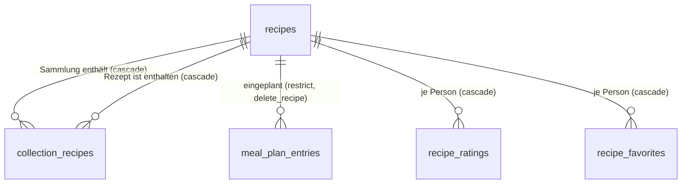
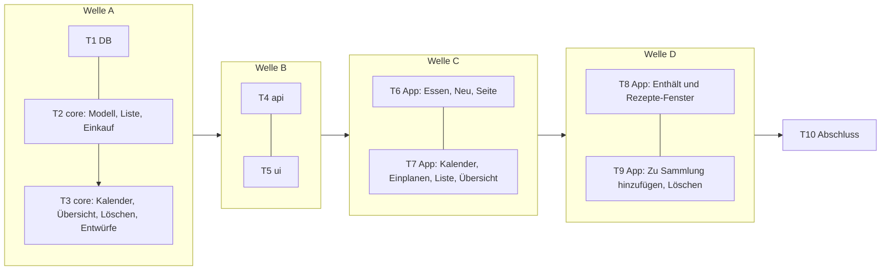

# 0009 — Plan

## Ansatz

Eine Sammlung ist eine Zeile in `recipes` mit der neuen, unveränderlichen Spalte `kind =
'collection'` (D14 A). Dazu kommt die neue, synchronisierte Tabelle `collection_recipes` für die
enthaltenen Rezepte. Beides steht direkt in der unveröffentlichten Grundlage
`20261121062348_recipes.sql` (ADR-0012). Alles, was eine Sammlung schon als Rezept kann, bleibt auf
dem vorhandenen Weg: Bewertung, Favorit, Foto, Suche, Einplanen, „Wie war's?“ und Löschen mit
„Rückgängig“. `delete_recipe` und `restore_recipe` nehmen dabei die Zeilen der enthaltenen Rezepte
mit.

Die Fachlogik liegt ganz in `packages/core`. Dazu gehört das Auflösen einer Sammlung, also
Portionen, Variante und Reihenfolge je enthaltenem Rezept. Ebenso das Skalieren und die Herkunft für
den Vorratscheck, die Ernährungsform, der Filter „Art“, die Kalender-Rolle „Sammlung“, die Folgen des
Löschens, die Entwürfe für „Enthält“ und „gekocht“ aus dem Kalender. `packages/api` bildet die
Tabelle ab und schickt jede Änderung als genau ein `apply_changes` oder eine RPC (ADR-0011).
`packages/ui` bekommt die Foto-Collage. In der App kommen dazu: die Seite der Sammlung (gleiche
Adresse `/rezept/[id]`), die Fenster „Rezepte zu …“ und „Zu Sammlung hinzufügen“, das Fenster „Neu“
mit Auswahl-Chips sowie die Erweiterungen in Kalender, Einplanen, Vorratscheck und „Übersicht“.
Betroffen: `supabase`, `core`, `api`, `ui`, `app`.

**Entscheidungen beim Planen** (Empfehlung des Plans, vom Eigentümer vorab freigegeben; was eine
Annahme ist, steht zusätzlich als `OFFEN` in den Offenen Fragen der Spec, Nummer 3 bis 8; Offene
Frage 1 und 2 gelten mit Annahme A):

- **E1 — Alles in der Grundlage der Rezepte (ADR-0012).**
  - `recipes.kind`, die Tabelle `collection_recipes`, ihre Trigger und die Erweiterung von
    `delete_recipe` und `restore_recipe` stehen in `20261121062348_recipes.sql`. Die Tabelle gehört
    fachlich zu den Rezepten und hängt nur von `recipes` ab. Eine eigene Datei wie
    `…062353_packing.sql` lohnt sich dafür nicht.
  - `apply_changes.sql` (Allowlist) und `sync_pull.sql` (Tabellenliste) werden direkt geändert.
  - Es gibt keinen Code zum Übernehmen alter Daten. Die Spalte hat den Standard `'recipe'`, und
    jede lokale Datenbank braucht einmal `pnpm db:reset`.
- **E2 — Die Art ist unveränderlich.**
  - `kind text not null default 'recipe'` mit Check `in ('recipe', 'collection')`.
  - `kind` steht im `insert`-Grant und in der `insert`-Allowlist von `recipes`, aber weder im
    `update`-Grant noch in `patch`. Ein Mitglied kann die Art also nie ändern: direkt ergibt das
    42501, über `apply_changes` `invalid_change`.
  - Zweite Linie für Wege mit `security definer` (etwa `merge_articles`): Der Trigger
    `recipes_kind_immutable` (vor `update of kind`) wirft `kind_immutable` (22023) für jede Rolle.
  - `restore_recipe` setzt `kind` aus dem Schnappschuss. Damit kommt eine Sammlung als Sammlung
    zurück.
- **E3 — Eine Sammlung hat die Rezeptfelder nicht, die Spec schließt sie aus.**
  - Check `recipes_kind_fields`: Bei `kind = 'collection'` gilt `course is null`,
    `total_minutes is null`, `cuisine is null`, `tags = '{}'`, `variants = '[]'`, `steps = '[]'`,
    `lead_time is null`, und keine Zutat hat ein `variantId`.
  - Bei `kind = 'recipe'` gilt `course is not null`. Dazu wird `recipes.course` nullbar; der
    Standard `'main'` bleibt für Rezepte.
  - In `core` wird `Recipe.course` zu `course?: Course`. Es fehlt nur bei Sammlungen; `mapping.ts`
    liest `null` als `undefined`.
  - Verworfen ist der Platzhalter `'main'` an Sammlungen: Er spart die Anpassung an etwa neun
    Stellen, hinterlässt aber einen falschen Wert, den jeder Filter ausschließen müsste. Der
    Gerichtart-Filter trifft eine Sammlung so von selbst nicht, ebenso Küche und Zeit (AC-019).
  - Destruktiv ist hier nichts: `not null` wird gelockert, und keine Zeile verliert Daten.
- **E4 — Tabelle `collection_recipes`** (Glossar „Enthaltenes Rezept“):
  - Spalten: `id`, `household_id`, `collection_id`, `recipe_id`, `servings integer null`
    (1–100; leer = wie die Sammlung), `variant_id text null` (1–64 Zeichen; leer =
    Standardvariante), `sort integer not null default 0`, `created_at`, `updated_at`.
  - Eindeutig sind `(household_id, id)` und `(household_id, collection_id, recipe_id)`: ein Rezept
    höchstens einmal je Sammlung (AC-010, Konflikttabelle).
  - Zusammengesetzte Fremdschlüssel `(household_id, collection_id)` und `(household_id, recipe_id)`
    → `recipes (household_id, id) on delete cascade`. Ein Rezept eines anderen Haushalts ergibt
    23503 (AC-011). Löschen von Sammlung oder Rezept löscht die Zeile, mit Grabstein über
    `attach_sync_triggers`.
  - Indizes: `(household_id, updated_at)` und `(household_id, recipe_id)` für die Rückwärtsfrage
    und den Fremdschlüssel. Die Sammlungsseite deckt der eindeutige Index ab.
  - Grants an `authenticated`: `select`, `delete`;
    `insert (id, household_id, collection_id, recipe_id, servings, variant_id, sort)`;
    `update (servings, variant_id, sort)`. `collection_id` und `recipe_id` sind also nicht änderbar.
    `anon` bekommt nichts. RLS kommt über `attach_household_policies`.
  - Trigger `collection_recipes_check` (vor `insert`, security invoker) liest beide Zeilen im
    Haushalt der neuen Zeile. Ist der Behälter keine Sammlung oder das enthaltene Rezept keine
    Rezept-Art, wirft er `collection_recipe_kind_invalid` (23514; AC-009). Fehlt eine Zeile (fremd
    oder gelöscht), lässt er den Fremdschlüssel mit 23503 entscheiden. Bei mehr als 50 Zeilen der
    Sammlung wirft er `too_many_collection_recipes` (23514; E15). Weil die Art unveränderlich ist
    und die Kennungen nicht änderbar sind, reicht die Prüfung beim Einfügen.
- **E5 — Auflösen einer Sammlung in `core`** (neu `collections.ts`):
  - `collectionContents(collection, collectionRecipes, recipesById)` liefert die enthaltenen
    Rezepte nach `sort`, bei Gleichstand nach `id`.
  - Je Zeile: Portionen = `servings ?? collection.servings`, sodass „übernimmt“ jeder Änderung der
    Sammlung folgt (AC-015). Variante = `variantId`, wenn das Rezept sie noch hat, sonst seine
    Standardvariante (Offene Frage 4 A).
  - Zeilen, deren Rezept lokal fehlt (auf einem anderen Gerät gerade gelöscht), fallen weg.
  - Texte: `collectionSummary` („für 6 · 2 Rezepte · 4 eigene Zutaten“; „1 Rezept“; Teile mit 0
    fallen weg), `collectionRecipeCountLabel` („2 Rezepte“; leer bei 0, AC-024) und die Zeile unter
    „Enthält“ („Grillgemüse · vegan · 8 Port.“; die Variante nur, wenn das Rezept Varianten hat und
    nicht die Standardvariante gewählt ist, AC-016).
- **E6 — Skalieren und Herkunft für den Vorratscheck** (`collectionContributions`, gleiche Regeln
  wie `contributionsFromEntry`):
  - Faktor = geplante Portionen ÷ Portionen der Sammlung. Geplante Portionen sind beim
    Planeintrag `entry.portions`, von der Seite die Portionen der Sammlung (Faktor 1).
  - **Eigene Zutaten** wie die Zutaten eines Rezepts ohne Varianten mit diesem Faktor: „Anzahl“
    bleibt 1×, „Rezeptmenge“ wird skaliert (Glossar „Einkaufsregel“).
  - **Je enthaltenem Rezept** ein gedachter Eintrag mit `portions = Portionen in der Sammlung ×
Faktor` und `variants = [{variantId, portions}]` bzw. `[]` ohne Varianten, durch
    `contributionsFromEntry`. Es gibt keine Aufteilung auf Varianten (REQ-005).
  - Gerundet wird erst am Ende nach den vorhandenen Regeln. Gebrochene Portionen sind zulässig,
    weil der gedachte Eintrag nie gespeichert wird.
  - Prüfung an den Zahlen der Spec: AC-014 hat Faktor 3/6, also Kartoffelsalat 3 von 4 Portionen
    (1,5 kg), Grillgemüse 4 von 4 (Zucchini 2×, Halloumi 1×) und Würstchen 6×. AC-025 hat Faktor 1,
    also 3 kg, Zucchini 4× und Würstchen 12×.
  - Herkunft: `source.recipeId` ist die Kennung der Sammlung, also das Gericht des Planeintrags.
    `entryId` ist wie bisher der Eintrag. `label` lautet „Grillabend“ bzw. „Grillabend ·
    Kartoffelsalat“, im Kalender mit Tag „Grillabend · Kartoffelsalat (Sa)“ (über `recipeSource`,
    Spec 0006). Zusammengeführt wird wie bisher (AC-026).
- **E7 — Einkaufsliste.**
  - `canPutOnList`, `listPickerWeek` und `listPickerPreselection` bekommen einen Kontext
    `RecipeBook = { recipesById, collectionRecipes }`. Eine Sammlung ist in Schritt 1 wählbar, wenn
    `collectionContributions` etwas liefert; sonst ist sie ausgeblendet wie ein Rezept ohne Zutaten
    (REQ-008).
  - In Schritt 1 lautet der Eintrag „■ Grillabend (2 Rezepte)“, mit der vorhandenen Vorauswahl D21
    (AC-027).
  - `pantryCheckRows` verzweigt nach Art, für Planeinträge wie für `PantryRecipe`. Die Seite der
    Sammlung übergibt `{ recipeId, portions: collection.servings }`.
  - „Rezept wählen …“ im Vorratscheck findet Sammlungen mit (Offene Frage 6 A). Das kostet nichts
    extra, weil `pantryCheckRows` verzweigt.
  - „Auf die Liste“ auf der Seite ist ausgegraut. Ohne enthaltene Rezepte und ohne eigene Zutaten
    lautet der Hinweis „Noch nichts enthalten“ (AC-028). Mit Inhalt, aber nichts zu kaufen, gilt
    derselbe Hinweis wie auf der Rezeptseite (`canPutCollectionOnList`).
- **E8 — Kalender und Einplanen.**
  - Der Planeintrag ist `kind: 'recipe'` mit `recipe_id` der Sammlung. An `meal_plan_entries`
    ändert sich nichts.
  - `splitForEaters` gibt für eine Sammlung `{ portions: Esser + Gäste, variants: [] }` zurück. Das
    Einplanen-Fenster zeigt für Sammlungen den Abschnitt „Variante“ nicht (AC-016).
  - `entryKindRole(entry, recipesById)` gibt für einen Eintrag einer Sammlung `'collection'`
    zurück, also Farbe und Symbol `layers`. Das betrifft alle Aufrufer: `calendar-parts.tsx`,
    `overview.dayDots` und die Leiste der Woche.
  - `entryTitle` bleibt der Titel. Die Kalenderzeile hängt „· 2 Rezepte“ an
    (`collectionRecipeCountLabel`), ohne Zahl bei 0 (AC-024).
  - Reihenfolge in der Tageszeit ohne Änderung: Eine Sammlung ist `kind 'recipe'`, also Rang 1 und
    dann `sort`. Ein Test hält AC-023 fest.
  - Hinzufügen-Fenster: neuer Tab „Sammlungen“ zwischen „Rezepte“ und „Restaurants“. „Rezepte“
    zeigt nur die Art „Rezept“, „Alle“ beide, Sammlungen mit Kennzeichen (Offene Frage 6 A).
  - Neu anlegen: Im Tab „Sammlungen“ steht „„Sommerfest“ als Sammlung anlegen“. Unter „Alle“ wird
    die Sammelzeile zu „+ als Sammlung · Restaurant · Aktivität“. `createAndPlanRecipe` bekommt
    `kind`, und Sammlung und Eintrag gehen in einem Aufruf (AC-021).
  - Reste: `leftoverCandidates` lässt Einträge von Sammlungen aus (Glossar „Reste“: „Reste von …
    Sammlungen gibt es nicht“).
- **E9 — „Essen → Rezepte“.**
  - `RecipeListFilter` bekommt `kind?: 'recipe' | 'collection'`. Der Abschnitt „Art“ im
    Filterfeld bietet „Rezepte“ und „Sammlungen“, genau einer oder keiner (AC-018). Die Art steht
    auch als entfernbarer Chip in `activeFilterChips`.
  - Gerichtart, Küche und Zeit treffen keine Sammlung, weil die Felder fehlen (E3).
  - Favoriten, Bewertung und „Lange nicht gekocht“ gelten unverändert. „Lange nicht gekocht“ nutzt
    dabei E10.
  - Ernährung und „Passt für alle“ laufen über `collectionDiet`: `combineDiets` über die eigenen
    Zutaten und jedes enthaltene Rezept in seiner gewählten Variante (`deriveRecipeDiet`). Eine
    Sammlung passt nur, wenn alles passt (AC-020). Eine leere Sammlung ist „unbekannt“, wie ein
    Rezept ohne Zutaten.
  - `RecipeListContext` bekommt `collectionRecipes` und `recipesById`.
  - Die Suche bleibt `searchRecipes` und findet Sammlungen über den Titel (unscharf, „grilabend“,
    AC-018), wie Rezepte auch über die eigenen Zutaten.
  - Zähler: „24 Rezepte · 2 Sammlungen“, nur Sammlungen „2 Sammlungen“, ohne Sammlungen wie bisher
    „24 Rezepte“ (Offene Frage 8 A).
- **E10 — „Gekocht“ aus dem Kalender (Offene Frage 2 A und Offene Frage 3 A).**
  - Bisher setzt nichts außer Seed und Starter-Rezepten `last_cooked_on` und `cooked_count`.
    „Gilt als gekocht“ aus AC-031 braucht deshalb eine Regel. Neu in `core` ist
    `cookingHistory(entries, collectionRecipes, today)`.
  - Gekocht ist jeder Eintrag mit Tag bis einschließlich heute ohne „nicht gekocht“, wie
    `visitsOf` für Restaurants und Aktivitäten (Spec 0011). Er zählt für sein Rezept, und bei einer
    Sammlung auch für jedes Rezept, das sie heute enthält.
  - `withCookingHistory(recipes, history)` ergibt `lastCookedOn = max(gespeichert, Kalender)` und
    `cookedCount = gespeichert + Kalender`. Die gespeicherten Werte bleiben die Vorgeschichte aus
    Seed und Starter-Rezepten.
  - Angewendet wird das in der Liste „Essen“ für Sortierung und Schnell-Chip. Es gibt keine
    Spalte, keinen Trigger und keinen Server-Weg; offline wird es gleich gerechnet.
  - „Nicht gemacht“ in „Wie war's?“ nimmt den Eintrag heraus.
- **E11 — Löschen (Offene Frage 1 A).**
  - `delete_recipe` sperrt in dieser Reihenfolge `for update`: Rezept, Planeinträge, dann alle
    Zeilen von `collection_recipes` mit `collection_id = p` oder `recipe_id = p`, dann die Reste
    ohne Rezept.
  - Der Schnappschuss bekommt den Schlüssel `collection_recipes` mit diesen Zeilen vollständig. Die
    Kaskade löscht sie mit Grabsteinen.
  - Rückgabe: `{"converted": n, "removed": m, "collections": k}`, dabei ist `k` die Zahl der
    Sammlungen, aus denen das Rezept entfernt wurde.
  - Ein gleichzeitiges Hineinlegen wartet am Fremdschlüssel auf die Sperre des Rezepts und
    scheitert danach mit 23503 (Konflikttabelle). Die App zeigt dann „Hat nicht geklappt – bitte
    noch einmal versuchen“ (ADR-0011).
  - `restore_recipe` fügt die Zeilen nach dem Rezept wieder ein (`on conflict do nothing`), aber
    nur die, deren andere Seite im Haushalt noch existiert. Ist die Sammlung inzwischen gelöscht,
    fehlt die Zeile still. Portionen, Variante und Reihenfolge kommen mit (AC-032, AC-033).
  - Der Prüf-Trigger läuft auch hier. Hätte eine Sammlung inzwischen 50 Rezepte, scheitert
    „Rückgängig“ ganz (Risiko-Tabelle).
  - Lokal nimmt `recipeDeletionEffect` zusätzlich `removedCollectionRecipeIds` mit; der
    Fake-Transport bildet das nach.
  - Hinweis: `recipeDeletedLabel(title, collections)` ergibt „Kartoffelsalat gelöscht · auch aus 2
    Sammlungen entfernt“ („aus 1 Sammlung“), gezählt aus dem Cache. Eine Sammlung selbst heißt
    „Grillabend gelöscht“.
  - Planeinträge einer gelöschten Sammlung behandelt die vorhandene Regel (Freitext bis heute,
    Spec 0008, E3).
- **E12 — Schreibwege** (je Aktion ein Aufruf, ganz oder gar nicht):

  | Aktion                                                | Weg                                                                                            | Offline  |
  | ----------------------------------------------------- | ---------------------------------------------------------------------------------------------- | -------- |
  | Sammlung anlegen (Fenster „Neu“)                      | `apply_changes`: `recipes` einfügen mit `kind`                                                 | gesperrt |
  | „+ Neue Sammlung“ im Fenster „Zu Sammlung hinzufügen“ | `apply_changes`: Sammlung + eine Zeile `collection_recipes`                                    | gesperrt |
  | Rezept über „Zu Sammlung hinzufügen“                  | `apply_changes`: eine Zeile einfügen, `sort` = Ende                                            | gesperrt |
  | „n Rezepte übernehmen“                                | `apply_changes`: n Zeilen einfügen, `servings` leer, `variant_id` leer                         | gesperrt |
  | „„…“ als neues Rezept“ im Fenster                     | sofort `createRecipe` (AC-007: das Rezept gibt es, bevor man übernimmt)                        | gesperrt |
  | „Enthält“ bearbeiten → „Fertig“                       | `apply_changes` (Diff): Patches `servings`/`variant_id`/`sort`, Löschungen (höchstens 20, E15) | gesperrt |
  | Kopf, eigene Zutaten, Notizen → „Fertig“              | `saveRecipeSection` wie beim Rezept (Spec 0008, E7), nur die Spalten des Abschnitts            | gesperrt |
  | Einplanen, im Kalender anlegen und einplanen          | `addPlanEntry` / `createAndPlanRecipe` mit `kind`                                              | gesperrt |
  | Auf die Liste                                         | `add_shopping_contributions` (vorhanden)                                                       | gesperrt |
  | Bewerten, Favorit                                     | `set_recipe_rating`, `set_recipe_favorite` (vorhanden)                                         | gesperrt |
  | Sammlung oder Rezept löschen / Rückgängig             | `delete_recipe` / `restore_recipe` (E11)                                                       | gesperrt |

  Ablehnungen nach ADR-0011 mit „Hat nicht geklappt – bitte noch einmal versuchen“: 23505 (zwei
  Geräte legen dasselbe Rezept hinein), `row_not_found` (Portionen eines inzwischen entfernten
  Rezepts), 23503 (Rezept inzwischen gelöscht) und `too_many_collection_recipes`. Die Anzeige
  springt zurück; nach dem nächsten Pull zeigt das Fenster „schon enthalten“.

- **E13 — Seite der Sammlung.**
  - Gleiche Adresse `/rezept/[id]`. `RecipeDetail` verzweigt nach `kind` auf das neue
    `CollectionDetail`.
  - Kopf mit Titel, Kennzeichen „Sammlung“, Zeile aus E5, `MemberRatings`, „Einplanen“ und „Auf die
    Liste“. Bearbeiten im Kopf: Titel, Beschreibung, Portionen; keine Zeit.
  - Abschnitte „Enthält“, „Eigene Zutaten“ (der Abschnitt „Zutaten“ ohne „+ Variante“ und ohne
    „Variante“ im ⋯ der Zeile, AC-012) und „Notizen“.
  - Es gibt keine „Einordnung“, keine „Zubereitung“, kein „Kochen“ und keinen Assistenten.
  - ⋯: „Foto ändern“, „Foto entfernen“ (bei eigenem Foto), „Löschen“; kein „Zu Sammlung
    hinzufügen“ (AC-009).
  - Zweispaltig ab Breakpoint `desktop`, wie die Rezeptseite (Spec 0008, E12): links „Enthält“,
    rechts „Eigene Zutaten“ und „Notizen“. Tablet einspaltig wie dort.
  - Ein Tipp auf ein enthaltenes Rezept öffnet dessen Rezeptseite (AC-004).
  - `/rezept/[id]/kochen` mit der Kennung einer Sammlung leitet auf die Seite der Sammlung um.
- **E14 — Foto und Kachel.**
  - `core.coverPhotos(recipe, contents)` liefert für ein Rezept oder eine Sammlung mit eigenem
    Foto genau das. Sonst bei einer Sammlung die Fotos der ersten bis zu vier enthaltenen Rezepte
    mit Foto, in ihrer Reihenfolge, und ohne jedes Foto nichts.
  - Neu in `packages/ui` ist `PhotoCollage`: 1 Foto ganz, 2 nebeneinander, 3 bis 4 im 2×2-Raster,
    ohne Foto der Platzhalter mit `KIND_ICONS.collection` (`layers`).
  - Die App baut daraus `RecipeCover` für Kachel, Seite, Karte „Heute geplant“ und „Wie war's?“.
  - Die Kachel zeigt das Kennzeichen „Sammlung“ und „2 Rezepte“ (AC-018). Hochladen geht über den
    vorhandenen Pfad `<household>/recipes/<id>/…` (AC-005).
- **E15 — Grenzen (Offene Frage 5 A).**
  - Höchstens 50 enthaltene Rezepte je Sammlung, geprüft in `core` und im Trigger. Die Meldung
    lautet „Höchstens 50 Rezepte je Sammlung“; das Fenster sperrt weiteres Ankreuzen.
  - Portionen 1–100 („1 bis 100 Portionen“, AC-017, wie Spec 0008, E8).
  - „Fertig“ bei „Enthält“ entfernt höchstens 20 Rezepte auf einmal (Grenze von `apply_changes`),
    sonst „Höchstens 20 Rezepte auf einmal entfernen“.
  - Für Titel, Beschreibung, Notizen und eigene Zutaten gelten die Grenzen der Rezepte (E8 aus
    Spec 0008).
- **E16 — Fenster.**
  - **„Neu“:** Das bisherige `NewRecipeSheet` heißt im Titel „Neu“ und hat `ChoiceChips`
    „Rezept · Sammlung“, vorgewählt nach dem Menüeintrag (AC-001, AC-002). Das Feld „Zutaten
    einfügen“ gibt es nur bei „Rezept“; die Spec nennt für die Sammlung nur Chips und Titel.
    „Titel fehlt“ wie bisher (AC-003). Die Test-IDs `new-recipe-*` bleiben.
  - **„Rezepte zu „Grillabend““** (groß, 90 % Höhe):
    - Suche über die Art „Rezept“ mit `searchRecipes`. Mehrfachauswahl, mit Leertaste umschaltbar.
    - Schon enthaltene Rezepte stehen mit „schon enthalten“ und sind nicht wählbar (AC-010).
    - Darunter `SearchOrCreate` mit „„…“ als neues Rezept“ (AC-007).
    - Fuß „n Rezepte übernehmen“ (ausgegraut bei 0).
  - **„Zu Sammlung hinzufügen“** (klein):
    - Alle Sammlungen A–Z (`localeCompare('de')`). Sammlungen, die das Rezept schon enthalten,
      stehen mit „enthält es schon“ und sind nicht wählbar.
    - „+ Neue Sammlung“ zeigt ein Titelfeld im Fenster und legt Sammlung und Zeile in einem Aufruf
      an.
    - Danach erscheint der Hinweis „Zu „Grillabend“ hinzugefügt“ (AC-008).
  - Unter Android schließt die Zurück-Taste das Fenster (`onRequestClose`, wie Spec 0008, E16).
- **E17 — Übersicht (Spec 0011, AC-012, AC-015, AC-024).**
  - Die Karte in „Heute geplant“ und die Zeile in „Wie war's?“ bekommen das Kennzeichen „Sammlung“
    (Symbol `layers`) und `RecipeCover`.
  - `RecapItem.kind` wird um `'collection'` erweitert. Bewertet wird weiter über `rateRecipe`.
  - Die enthaltenen Rezepte erscheinen dort nicht wegen der Sammlung, weil `recapItems` je Ziel
    fragt (AC-030).
  - „Für morgen“ zeigt den Vorlauf enthaltener Rezepte nicht (Offene Frage 7 A); das ist für das
    Abschluss-Review vorgemerkt.
- **E18 — Kein ADR, keine neue Abhängigkeit.** Das Modell ist im UI-Konzept (D14, D15)
  entschieden. Schreib- und Leseweg folgen ADR-0008 und ADR-0011, und es gibt keine neue
  Offline-Aktion. Alles baut auf vorhandenen Bausteinen auf (`ChoiceChips`, `SearchOrCreate`,
  `ReorderList`, `EditableSection`, `Sheet`).

## Datenbank und Sync

Umsetzung mit dem `db-change`-Skill und `supabase-postgres-best-practices`, direkt in den
Grundlagen-Dateien (ADR-0012, E1). Danach `pnpm db:reset`, `pnpm db:types` und (nach dem Seed in
Task 4) `pnpm db:seed:gen`.

**Destruktiv, ausdrücklich:** nichts. `recipes.course` verliert `not null`, und das neue Check
`recipes_kind_fields` verlangt `course` für Rezepte (E3). Das ist nur zulässig, weil die Grundlage
noch nicht ausgeliefert ist.

| Datei                                         | Änderung                                                                                                                                                                                                                                                                                                                                                                                                                                                                                                                                              |
| --------------------------------------------- | ----------------------------------------------------------------------------------------------------------------------------------------------------------------------------------------------------------------------------------------------------------------------------------------------------------------------------------------------------------------------------------------------------------------------------------------------------------------------------------------------------------------------------------------------------- |
| `20261121062348_recipes.sql`                  | `recipes.kind` (E2), `course` nullbar, Check `recipes_kind_fields` (E3), `kind` im `insert`-Grant, Trigger `recipes_kind_immutable`; Tabelle `public.collection_recipes` (E4) mit Grants, `attach_household_policies`, `attach_sync_triggers` und Trigger `collection_recipes_check` (`private.check_collection_recipe()`, security invoker, `search_path = ''`); `delete_recipe` (Sperre, Schnappschuss `collection_recipes`, Rückgabe `collections`) und `restore_recipe` (`kind` in der Spaltenliste, Zeilen zurück, E11); Kopfkommentar der Datei |
| `20261121062357_apply_changes.sql`            | Allowlist `recipes.insert` um `"kind"`; neu `"collection_recipes": {"insert": ["id", "household_id", "collection_id", "recipe_id", "servings", "variant_id", "sort"], "patch": ["servings", "variant_id", "sort"], "delete": true}`; Kopfkommentar                                                                                                                                                                                                                                                                                                    |
| `20261121062359_sync_pull.sql`                | `c_tables` um `'collection_recipes'` direkt nach `'recipe_ratings'`                                                                                                                                                                                                                                                                                                                                                                                                                                                                                   |
| `packages/api/src/db/types.gen.ts`            | neu erzeugt (`pnpm db:types`), nie von Hand                                                                                                                                                                                                                                                                                                                                                                                                                                                                                                           |
| `supabase/seed.sql` (erzeugt), `seed/demo.ts` | Sammlung „Grillabend“ für 6 mit „Nudelsalat“ und „Gemischter Salat“ und den eigenen Zutaten Bratwurst (12, Rezeptmenge), Grillkohle, Bier und Grillanzünder (Anzahl; fehlende Artikel aus dem Starter-Katalog); eingeplant am kommenden Samstag, Abend, und einmal vorgestern (für „Wie war's?“); eine leere Sammlung „Sommerfest“ (AC-024/AC-028 im Klick-Durchlauf). Die genaue Wahl steht unter „Entscheidungen beim Bauen“                                                                                                                        |

**Regeln von `check_collection_recipe`** (vor `insert` je Zeile):

- Die Sammlung (`household_id = new.household_id and id = new.collection_id`) und das Rezept
  werden gelesen. Fehlt eine, gibt der Trigger `new` zurück, und der Fremdschlüssel scheitert mit 23503. Er verrät also nichts über fremde Zeilen.
- Ist `kind` der Sammlung ≠ `'collection'` oder `kind` des Rezepts ≠ `'recipe'`, ergibt das
  `collection_recipe_kind_invalid` (23514). Das deckt auch `collection_id = recipe_id` ab.
- Hat die Sammlung schon 50 Zeilen, ergibt das `too_many_collection_recipes` (23514). Zwei
  gleichzeitige Aufrufe können zusammen knapp darüber kommen; das ist hingenommen, weil die
  Grenze vor Fehlern schützt und nicht vor Mitgliedern (wie die Grenzen von `apply_changes`).

**Sync und Cache:**

- `collection_recipes` kommt in `sync_pull` und in `packages/api/src/db/tables.ts`
  (`ID_TABLES`, `WRITABLE_COLUMNS`). `recipes.kind` steht nur unter „insert“.
- `db/mapping.ts` bildet `CollectionRecipe ↔ Zeile` ab sowie `Recipe.kind` und `course` mit
  `null` ↔ `undefined`.
- `changes.ts` setzt in `TABLE_ORDER` `collection_recipes` direkt nach `recipes`, sodass eine neue
  Sammlung vor ihren Zeilen eingefügt wird.
- `transport-fake.ts`: `CASCADES` `recipes` → `collection_recipes` über `collection_id` und
  `recipe_id`; `REFERENCES`; Art-Prüfung, Unveränderlichkeit, Grenze 50 und E11 wie auf dem
  Server.
- `store.ts`: `HouseholdData.collectionRecipes: CollectionRecipe[]`.
- Neue Tabelle und neues Feld ändern die Form des Caches: `CACHE_VERSION` 6 → 7. Hat Spec 0013
  ihn vorher erhöht, gilt der nächste freie Wert. Warteschlange, Haushalts- und Marktwahl bleiben
  beim Neuladen erhalten.
- `docs/architecture/sync.md` bekommt den „Nachtrag Spec 0009“ (Task 10).

## Risiken und Gegenmaßnahmen

Kritische Pfade: eine neue Tabelle mit Mandantengrenze (RLS, Grants, zusammengesetzte
Fremdschlüssel), eine Änderung am Rezept-Modell (unveränderliche Art), Löschen und Wiederherstellen
über die `security definer`-Funktionen `delete_recipe` und `restore_recipe`, der Delta-Sync (neue
Tabelle, Cache-Version) und die Grundlagen-Migration.

| Was könnte schiefgehen                                                                                   | Gegenmaßnahme                                                                                                                                             | Getestet durch                                                                                                                                      |
| -------------------------------------------------------------------------------------------------------- | --------------------------------------------------------------------------------------------------------------------------------------------------------- | --------------------------------------------------------------------------------------------------------------------------------------------------- |
| Mitglied eines fremden Haushalts liest, was „Grillabend“ enthält, oder ändert und löscht Zeilen          | RLS mit vier Policies (`attach_household_policies`); `apply_changes` nur im Haushalt des Aufrufs                                                          | pgTAP `collections.test.sql`: `tests.tenant_isolation('collection_recipes')`; fremdes Mitglied sieht 0 Zeilen, `update`/`delete` treffen 0 (AC-011) |
| Fremdes Mitglied legt „Pizza“ in „Grillabend“, oder ein eigenes Mitglied legt ein fremdes Rezept hinein  | zusammengesetzte Fremdschlüssel `(household_id, collection_id/recipe_id)`; `apply_changes` erzwingt `household_id`                                        | pgTAP 23503 direkt und über `apply_changes`, beide Richtungen (AC-011)                                                                              |
| Abgemeldeter Aufruf liest oder schreibt                                                                  | kein Grant an `anon`                                                                                                                                      | pgTAP `anon` → 42501 für `select`/`insert`/`update`/`delete`; `schema_lint.test.sql`                                                                |
| Zeile wird in einen anderen Haushalt oder an eine andere Sammlung verschoben                             | kein `update`-Grant auf `household_id`, `collection_id`, `recipe_id`; nicht in `patch`                                                                    | pgTAP 42501 direkt, `invalid_change` über `apply_changes`; `tenant_isolation` (Haushalt nicht änderbar)                                             |
| Sammlung in Sammlung, Rezept als Behälter, Sammlung enthält sich selbst                                  | Trigger `collection_recipes_check` (E4); D15                                                                                                              | pgTAP `collection_recipe_kind_invalid` für alle drei, direkt und über `apply_changes` (AC-009)                                                      |
| Art wird nachträglich geändert (Rezept wird Sammlung und unterläuft so die Prüfung)                      | kein `update`-Grant, nicht in `patch`, Trigger `recipes_kind_immutable` für jede Rolle (E2)                                                               | pgTAP: direkt 42501, `apply_changes` `invalid_change`, als Superuser `kind_immutable`                                                               |
| Sammlung mit Zubereitung, Varianten, Küche oder Zeit (am Client vorbei)                                  | Check `recipes_kind_fields` (E3)                                                                                                                          | pgTAP 23514 je Feld; Zutat mit `variantId` in einer Sammlung → 23514; Rezept ohne `course` → 23514                                                  |
| Ein Rezept zweimal in derselben Sammlung (zwei Geräte gleichzeitig)                                      | eindeutiger Index `(household_id, collection_id, recipe_id)`; App: allgemeiner Hinweis, nach dem Pull „schon enthalten“                                   | pgTAP 23505; api-Test `rejectedMessage` (AC-010, Konflikttabelle)                                                                                   |
| Riesige Sammlung durch Fehler im Client                                                                  | Grenze 50 im Trigger und in `core`, 200 Operationen je Aufruf                                                                                             | pgTAP 51. Zeile → `too_many_collection_recipes`; core-Test der Grenze                                                                               |
| Löschen eines enthaltenen Rezepts lässt Zeilen stehen, oder andere Geräte sehen sie weiter               | Kaskade mit Grabsteinen über `attach_sync_triggers`                                                                                                       | pgTAP: Grabsteine für beide Zeilen (AC-033); Integrationstest mit zwei Konten                                                                       |
| Löschen einer Sammlung nimmt die enthaltenen Rezepte mit                                                 | Fremdschlüssel auf `collection_recipes`, nicht auf `recipes`                                                                                              | pgTAP AC-032: „Kartoffelsalat“ und „Grillgemüse“ unverändert, inklusive `updated_at`                                                                |
| „Rückgängig“ stellt die Zeilen falsch, doppelt oder in einem fremden Haushalt her                        | Schnappschuss nur auf dem Server; `restore_recipe` nur im Haushalt des Schnappschusses, nur, wo die andere Seite noch existiert, `on conflict do nothing` | pgTAP: Portionen, Variante und Reihenfolge zurück; Sammlung inzwischen gelöscht → Zeile fehlt, Rest zurück; zweiter Aufruf `recipe_not_restorable`  |
| „Rückgängig“ scheitert an der Grenze 50                                                                  | ganz oder gar nicht, allgemeiner Hinweis, das Rezept bleibt gelöscht (bewusst hingenommen, kommt praktisch nicht vor)                                     | pgTAP: Sammlung inzwischen mit 50 Zeilen → Fehler, nichts halb                                                                                      |
| Hineinlegen während des Löschens                                                                         | Sperr-Reihenfolge Rezept → Planeinträge → `collection_recipes` → Reste (E11); Fremdschlüssel wartet und scheitert                                         | pgTAP: Einfügen nach dem Löschen → 23503; api-Test: Ablehnung springt zurück mit Hinweis                                                            |
| `delete_recipe` verrät über `collections` Sammlungen eines anderen Haushalts                             | gezählt wird nur im Haushalt des Rezepts                                                                                                                  | pgTAP: fremde Sammlung mit gleicher Kennung unmöglich (Fremdschlüssel), Zahl je Haushalt geprüft                                                    |
| Schnappschuss mit Inhalten bleibt liegen                                                                 | vorhandene Aufbewahrung 1 Stunde, `purge-recipe-deletions`                                                                                                | vorhandene pgTAP-Fälle                                                                                                                              |
| Delta-Sync verpasst Änderungen der neuen Tabelle                                                         | `updated_at` per Trigger, Lösch-Trigger, Eintrag in `sync_pull` und `tables.ts`                                                                           | pgTAP `sync_pull.test.sql` (Tabelle und Grabsteine); api `mapping.test.ts`; Integrationstest                                                        |
| Alter Cache ohne `kind` und ohne `collectionRecipes`                                                     | `CACHE_VERSION` + 1, Voll-Load                                                                                                                            | api `backend.test.ts` (Version, Neuladen behält Warteschlange)                                                                                      |
| Diff schickt `kind` als Patch oder Felder, die eine Sammlung nicht haben darf                            | `WRITABLE_COLUMNS` ohne `kind` für Patches; `core` baut Sammlungs-Patches ohne Zeit und Einordnung                                                        | api `mapping.test.ts`/`changes.test.ts`; Fake lehnt wie der Server ab                                                                               |
| Falsche Mengen auf der Liste (Skalierung, Rundung, Variante)                                             | reine Rechnung in `core` mit den Zahlen der Spec (E6)                                                                                                     | core `collections.test.ts` AC-014, AC-016, AC-025, AC-026                                                                                           |
| Offline wird geschrieben                                                                                 | Befehle werfen `OfflineError`; Knöpfe und Stifte ausgegraut mit Hinweis                                                                                   | api-Tests `OfflineError` je Befehl; Klick-Durchlauf offline                                                                                         |
| Fremde Sammlung über die Adresse `/rezept/[id]`                                                          | RLS beim Lesen; „Dieses Rezept gibt es nicht mehr“                                                                                                        | Klick-Durchlauf mit einer Kennung aus dem zweiten Testhaushalt                                                                                      |
| Grundlage bearbeiten verschiebt Verhalten (Tests, die Rezepte ohne `course` oder per Superuser einfügen) | volle pgTAP-Suite, `pnpm test:integration`                                                                                                                | `pnpm exec supabase test db`                                                                                                                        |

## Aufgaben

Jede Aufgabe: Test rot (Ausgabe nach `tmp/0009/red-<task>.txt`) → Implementierung → grün → Gate →
Commit mit `Spec: 0009`.

**Gate je Aufgabe:**

- immer `pnpm format:check && pnpm check`;
- dazu `pnpm db:reset && pnpm exec supabase test db`, wenn `supabase/` berührt ist;
- `pnpm e2e:dev` grün (die App startet ohne Fehler in der Konsole).

Keine volle E2E-Suite; sie läuft einmal am Ende aller Wellen. Jede App-Aufgabe macht einen
Klick-Durchlauf bei 390 und 1440 px gegen den lokalen Stack (Belege in `tmp/0009/`). Sie trägt ihre
E2E-Brüche in `tmp/brief/e2e-impact.md` ein (Abschnitt „Spec 0009“, erwartete Brüche siehe unten).

**Voraussetzung:** Die offene Arbeit von Spec 0012 im Arbeitsbaum ist committet (Stand 21.11.2026:
`today-screen.tsx`, `today-packing.tsx`, `packages/ui/src/check*.ts(x)`, `choice.tsx`,
`controls.tsx`, `reorder-list.tsx`, Showroom, `DESIGN.md`, `smoke.spec.ts`). Die
Datenbank-Aufgaben von 0009 und 0013 laufen nacheinander (siehe „Überschneidungen“).

**Reihenfolge und Parallelität** (höchstens zwei Bau-Agenten gleichzeitig, nie dieselbe Datei):

- **Welle A: T1 ‖ T2, danach T3** (derselbe core-Agent). Disjunkt: `supabase/**` und
  `types.gen.ts` gegen `packages/core/src/**`. Nur T1 schreibt `types.gen.ts`.
- **Welle B: T4 ‖ T5.** Disjunkt: `packages/api/**`, `supabase/seed.sql` gegen `packages/ui/**`,
  `docs/design/DESIGN.md`, `features/showroom/*`.
- **Welle C: T6 ‖ T7.**
  - T6 hat `features/recipes/*` (ohne `sections/*`) und `(essen)/*`. T6 liefert `RecipeCover`
    (`features/recipes/recipe-cover.tsx`) als ersten Commit; T7 nutzt ihn erst danach.
  - T7 hat `features/meal-plan/*`, `features/calendar/*`, `features/shopping/list-picker.tsx` und
    `pantry-check-sheet.tsx`, `features/today/today-meals.tsx` und `today-recap.tsx`.
  - `e2e/dev/smoke.spec.ts` ergänzt zuerst T6, danach T7.
- **Welle D: T8 ‖ T9.**
  - T8 hat `features/recipes/sections/*`, `collection-detail.tsx` und neu
    `collection-recipes-sheet.tsx`.
  - T9 hat neu `add-to-collection-sheet.tsx`, `recipe-actions.tsx`, `recipe-detail.tsx` und die
    Lösch-Hinweise.

### Task 1 — Datenbank: Art, `collection_recipes`, Löschen und Wiederherstellen (pgTAP zuerst)

- **Deckt ab:** AC-009 (Server), AC-010 (Server), AC-011, AC-032, AC-033 (Server), Konflikttabelle,
  E1 bis E4, E11
- **Berührt:**
  - Migrationen: `supabase/migrations/20261121062348_recipes.sql`,
    `20261121062357_apply_changes.sql`, `20261121062359_sync_pull.sql`.
  - Neu `supabase/tests/collections.test.sql`.
  - Angepasst: `recipe_deletion.test.sql` (Fälle mit Sammlungen), `apply_changes.test.sql`
    (Allowlist `kind`, `collection_recipes`), `sync_pull.test.sql` (Tabellenliste) und
    `schema_lint.test.sql` (neue Trigger-Funktion, falls die Datei Funktionen namentlich führt).
  - Dazu jede Testdatei, die Rezepte per Superuser mit `course = null` oder ohne Spaltenliste
    einfügt.
  - `packages/api/src/db/types.gen.ts` (erzeugt).
- **Test (pgTAP, zuerst rot; je Mitglied, Mitglied eines fremden Haushalts, `anon`):**
  - **Art:**
    - Standard `'recipe'`; `'other'` → 23514.
    - `update kind` als Mitglied → 42501; `apply_changes`-Patch auf `kind` → `invalid_change`;
      als Superuser → `kind_immutable`.
    - Sammlung mit `course`, `total_minutes`, `cuisine`, Schlagwort, Variante, Schritt oder
      `lead_time` → 23514 je Feld. Eigene Zutat mit `variantId` → 23514. Rezept mit
      `course = null` → 23514.
  - **`collection_recipes`:**
    - `tests.tenant_isolation`. `updated_at` steigt bei jedem Update. Löschen schreibt einen
      Grabstein, den nur der eigene Haushalt liest.
    - AC-009: Sammlung als enthaltenes Rezept, Rezept als Behälter, Sammlung in sich selbst →
      `collection_recipe_kind_invalid`, direkt und über `apply_changes`.
    - AC-010: dasselbe Rezept zweimal → 23505.
    - AC-011: „Pizza“ von „WG“ in „Grillabend“ → 23503, in beiden Richtungen und über
      `apply_changes`. „WG“ liest 0 Zeilen; `update` und `delete` treffen 0.
    - `anon` → 42501. `update` von `collection_id`, `recipe_id` oder `household_id` → 42501.
    - `servings` 0 und 101, `variant_id` leer und 65 Zeichen → 23514. 51. Zeile →
      `too_many_collection_recipes`.
    - Sammlung + Zeile in einem `apply_changes` gelingt; ein ungültiges Element am Ende speichert
      nichts.
  - **Löschen:**
    - AC-032: `delete_recipe` einer Sammlung löscht ihre Zeilen mit Grabsteinen, die enthaltenen
      Rezepte sind unverändert. `restore_recipe` bringt die Sammlung (`kind = 'collection'`) mit
      allen Zeilen, Portionen, Varianten und `sort` zurück.
    - AC-033: Ein Rezept in zwei Sammlungen löschen ergibt `collections = 2`, beide Zeilen haben
      Grabsteine. Rückgängig bringt beide zurück.
    - Sammlung inzwischen gelöscht → ihre Zeile fehlt, der Rest kommt zurück.
    - Sammlung inzwischen mit 50 Zeilen → Fehler, nichts halb.
    - Einfügen auf ein gelöschtes Rezept → 23503.
  - **Sync:** `sync_pull` liefert `collection_recipes` und ihre Grabsteine.
- **Status:** offen

### Task 2 — core: Modell, Auflösen, Liste „Essen“, Einkauf

- **Deckt ab:** AC-004 (Zeile), AC-006, AC-014 bis AC-016, AC-018 bis AC-020, AC-024 (Text),
  AC-025 bis AC-028, E3, E5 bis E7, E9, E14, E15
- **Berührt:**
  - `packages/core/src/types.ts`: `RecipeKind`, `Recipe.kind`, `course?`, neu `CollectionRecipe`.
  - Neu `collections.ts` mit Test: `collectionContents`, `collectionSummary`,
    `collectionRecipeCountLabel`, `collectionContentLabel`, `collectionDiet`,
    `collectionFitsPreference`, `collectionContributions`, `canPutCollectionOnList`, `coverPhotos`
    und `COLLECTION_LIMITS` (50, 20).
  - `diet.ts` (Einstieg für Sammlungen) und `recipes.ts` (`filterRecipes` mit Kontext für
    Sammlungen).
  - `recipe-list.ts`: `kind` im Filter, Chip „Art“, `RecipeListContext` erweitert, Zähler aus E9.
  - `shopping-picker.ts` (`RecipeBook`, Eintrag „■ Grillabend (2 Rezepte)“ über
    `listPickerEntryLabel`), `shopping-list.ts` (`recipeSource` mit enthaltenem Rezept für die
    Herkunft).
  - `test-fixtures.ts` (`kind: 'recipe'`), `index.ts`.
  - Jede Stelle mit `recipe.course` (etwa neun) prüft `undefined`.
- **Test (zuerst rot)** mit dem Haushalt der Spec (Kartoffelsalat, Grillgemüse mit Varianten,
  Tzatziki):
  - AC-014: Mengen und Pantry-Zeile. AC-025: Faktor 1 und die Herkunft je Zeile. AC-016: „vegan“
    ohne Halloumi. AC-026: Zusammenführen mit „von Hand 500 g“.
  - AC-015: „übernimmt“ folgt 10 Portionen. AC-006: neue Zeilen „· 6 Port.“.
  - AC-018: Filter „Sammlungen“ und „grilabend“. AC-019: „< 30 Min“ und Küche ohne Sammlung.
    AC-020: „Mezze-Abend“ vegetarisch, nicht vegan, „Grillabend“ keins von beiden.
  - AC-024: keine Zahl bei 0. AC-028: `canPutCollectionOnList` falsch, Hinweis „Noch nichts
    enthalten“. AC-027: Vorauswahl und Ausblenden in Schritt 1.
  - Randfälle: Variante fehlt im Rezept → Standard (Offene Frage 4); lokal fehlendes Rezept fällt
    weg; leere Sammlung „unbekannt“; `coverPhotos` mit 0, 1, 3 und 5 Fotos und mit eigenem Foto;
    Grenzen 50/20.
- **Status:** gebaut, nicht committet (rot: `tmp/0009/red-t2.txt`, `red-t3.txt`)

### Task 3 — core: Kalender, Übersicht, Löschen, „gekocht“, Entwürfe

- **Voraussetzung:** T2 (derselbe Agent, nacheinander).
- **Deckt ab:** AC-001 bis AC-003 (Regeln), AC-012, AC-013, AC-017, AC-021 bis AC-023, AC-029,
  AC-030, AC-031, AC-032, AC-033 (Wirkung und Hinweis), E8, E10, E11, E13, E16, E17; Spec 0011
  AC-012, AC-015 („Grillabend“), AC-024
- **Berührt:**
  - `calendar.ts` (`entryKindRole` mit `recipesById`), `overview.ts` (`dayDots`).
  - `meal-plan.ts` (`leftoverCandidates` ohne Sammlungen), `recap.ts` (`kind: 'collection'`).
  - Neu `cooking-history.ts` mit Test (`cookingHistory`, `withCookingHistory`).
  - `recipe-deletion.ts` (`removedCollectionRecipeIds`, `recipeDeletedLabel(title, collections)`).
  - `recipe-editor.ts`:
    - Kopf einer Sammlung ohne Zeit.
    - Zutaten einer Sammlung ohne Varianten: `validateSectionDraft` meldet eine Zeile mit
      Variante, `sectionPatch` sendet nie `variants`, `steps`, `total_minutes`.
  - Neu `collection-editor.ts` mit Test:
    - Entwurf „Enthält“: `contentsDraft`, `moveContent`, `removeContent`, `setContentServings`
      („übernimmt“ = leer), `setContentVariant`, `validateContentsDraft` („1 bis 100 Portionen“,
      höchstens 20 entfernt).
    - `contentsChanges(before, draft)` → Zeilen-Operationen mit neuem `sort` nur für verschobene
      Zeilen.
    - Fenster: `collectionChoices(recipeId, collections, rows)` (A–Z, „enthält es schon“) und
      `recipePickerRows(collection, recipes, rows, query, articlesById)` („schon enthalten“,
      Grenze 50).
    - `newEntryKind`-Regeln des Fensters „Neu“.
  - `index.ts`.
- **Test (zuerst rot):**
  - Kalender: AC-022/AC-024 (Rolle `collection`, Zeile „Grillabend · 2 Rezepte“ bzw. ohne Zahl),
    AC-023 (Reihenfolge „Bouldern, Lasagne, Grillabend, Trattoria Da Enzo“).
  - Übersicht: Spec 0011 AC-015 mit „Grillabend“ an zweiter Stelle; AC-030/Spec 0011 AC-024
    (Sammlung als Ganzes, enthaltene Rezepte nicht wegen dieses Eintrags).
  - Gekocht: AC-031 („Kartoffelsalat“ ab 21.11. nicht mehr unter „Lange nicht gekocht“; „Nicht
    gemacht“ nimmt das zurück; zukünftige und vorgemerkte zählen nicht; gespeicherter Wert plus
    Kalender).
  - Löschen: AC-033 (Hinweis „… auch aus 2 Sammlungen entfernt“, Zeilen lokal weg), AC-032
    („Grillabend gelöscht“).
  - Entwürfe: AC-012 (kein Feld „Variante“), AC-013 (orange Zeile wie Spec 0007), AC-015/AC-017
    (Kopf: 10 übernommen, 0 → „1 bis 100 Portionen“).
  - Reste ohne Sammlungen; `contentsChanges` (nur geänderte Spalten, Löschungen, Reihenfolge);
    AC-008/AC-010 (`collectionChoices`, `recipePickerRows`).
- **Status:** gebaut, nicht committet (rot: `tmp/0009/red-t2.txt`, `red-t3.txt`)

### Task 4 — api: Abbildung, Sync, Befehle, Fake, Seed

- **Voraussetzung:** T1, T2, T3.
- **Deckt ab:** AC-001 bis AC-011, AC-014 bis AC-017, AC-021, AC-025 bis AC-029, AC-032, AC-033
  (Befehle), Konflikttabelle, E12
- **Berührt:**
  - `packages/api/src/db/tables.ts`, `db/mapping.ts`, `store.ts` (`collectionRecipes`),
    `backend.ts` (`CACHE_VERSION`), `changes.ts` (`TABLE_ORDER`), `queries.ts`
    (`useCollectionRecipes`, `useCollectionContents(id)`).
  - Neu `commands-collections.ts`: `createCollection({ title })`,
    `addRecipesToCollection(collectionId, recipeIds)`,
    `addRecipeToCollection(recipeId, target: { collectionId } | { newTitle })` und
    `saveCollectionContents(collectionId, draft)`.
  - `commands-recipes.ts`: `createRecipe` mit `kind`; `deleteRecipe` mit lokalen Zeilen und der
    Zahl für den Hinweis; `saveRecipeSection` mit den Regeln für Sammlungen.
  - `commands-plan.ts`: `splitForEaters` und `createAndPlanRecipe` mit `kind`.
  - `commands-shopping.ts`: `pantryCheckRows` verzweigt nach Art.
  - `transport-fake.ts` (E4, E11, Grenzen), `seed/demo.ts`, `supabase/seed.sql` (`pnpm
db:seed:gen`), `index.ts`.
  - Tests daneben: neu `commands-collections.backend.test.ts`, neu
    `collections.integration.test.ts`; `commands-recipes.backend.test.ts`,
    `commands-shopping.backend.test.ts`, `commands-plan.backend.test.ts`, `transport-fake.test.ts`,
    `mapping.test.ts`, `backend.test.ts` und `seed/demo.test.ts`.
  - Zod-Schemas, die ein `Recipe` beschreiben (KI-Vertrag, Starter), bekommen `kind` mit dem
    Standard `'recipe'`, falls es sie gibt.
- **Test (zuerst rot, gegen den Fake):**
  - Jeder Befehl schickt genau einen Aufruf: AC-006 (zwei Zeilen), AC-008 („+ Neue Sammlung“ =
    Sammlung + Zeile), AC-021 (Sammlung + Planeintrag), AC-015/AC-016 (nur geänderte Spalten).
  - AC-025: `pantryCheckRows([], [{recipeId: grillabend, portions: 6}])` mit Herkunft je Zeile;
    AC-027 aus dem Kalender mit Tag.
  - Konflikte: 23505, `row_not_found` und 23503 springen zurück mit „Hat nicht geklappt – bitte
    noch einmal versuchen“.
  - AC-032/AC-033: lokal sofort, „Rückgängig“ über `restore_recipe`.
  - Offline: `OfflineError` je Befehl.
  - `CACHE_VERSION` neu; `mapping` schreibt `kind` nie als Patch.
  - Integration mit zwei Konten gegen die lokale Datenbank: Enrico legt „Grillabend“ mit einem
    Rezept an, Nadjas Gerät sieht den Inhalt nach dem Pull, das Konto „WG“ sieht nichts (AC-011).
    Enrico löscht das Rezept, Nadjas Gerät sieht es aus der Sammlung verschwinden, „Rückgängig“
    bringt es zurück (AC-033).
- **Status:** gebaut, nicht committet (rot: `tmp/0009/red-t4.txt`)

### Task 5 — ui: Foto-Collage

- **Voraussetzung:** keine (parallel zu T4).
- **Deckt ab:** AC-004, AC-005 (Darstellung), E14
- **Berührt:**
  - `packages/ui/src/display.tsx` oder neu `collage.tsx`: `PhotoCollage` mit 1/2/3–4 Fotos und
    Platzhalter `layers`. Die reine Rechnung der Kacheln steht in neu `collage-layout.ts` mit Test.
  - `index.ts`, `docs/design/DESIGN.md` (Collage, Kennzeichen „Sammlung“).
  - Showroom (`showroom-patterns.tsx`) mit Kachel und Seite in hell und dunkel.
  - Falls die Mehrfachauswahl in `lists.tsx` noch keinen Zustand „nicht wählbar mit Grund“ hat,
    kommt er hier dazu (Texte vom Aufrufer).
- **Test (zuerst rot):** `collageLayout(0…5)` ergibt Platzhalter, ganz, zwei Spalten, 2×2 und
  höchstens vier. Der Showroom wird bei 390 und 1440 px angesehen.
- **Status:** gebaut, nicht committet (rot: `tmp/0009/red-t5.txt`)

### Task 6 — App: „Essen“, Fenster „Neu“, Seite der Sammlung (lesen und Kopf)

- **Voraussetzung:** T4, T5. Parallel zu T7.
- **Deckt ab:** AC-001 bis AC-005, AC-017, AC-018 bis AC-020 (Bildschirm), AC-022 (Einplanen von
  der Seite), AC-025, AC-028, AC-029, Plattformen
- **Berührt:** in `apps/app/src/features/recipes/`:
  - neu `recipe-cover.tsx` (`RecipeCover`, erster Commit);
  - `recipes-screen.tsx` („+“-Menü „Rezept · Sammlung · Restaurant · Starter-Rezepte“, Zähler,
    `withCookingHistory`);
  - `recipe-grid.tsx` (Kennzeichen, „2 Rezepte“, Collage);
  - `recipe-filter-panel.tsx` (Abschnitt „Art“);
  - `new-recipe-sheet.tsx` (Titel „Neu“, Chips, E16);
  - `recipe-detail.tsx` (Verzweigung nach `kind`);
  - neu `collection-detail.tsx` (Kopf, „Enthält“ lesend mit Tipp auf die Rezeptseite, „Eigene
    Zutaten“ und „Notizen“ lesend, „Einplanen“, „Auf die Liste“, zweispaltig ab Desktop, ⋯ ohne
    „Zu Sammlung hinzufügen“);
  - `cooking-screen.tsx` (Umleitung bei Sammlung);
  - `e2e/dev/smoke.spec.ts` (Seite einer Sammlung öffnen).
- **Test:** Regeln in T2/T3. Klick-Durchlauf:
  - AC-001 bis AC-003, AC-004/AC-005 mit eigenem Foto.
  - AC-018 bis AC-020 mit dem Seed und zwei Test-Sammlungen.
  - AC-022 (Hinweis „Eingeplant: Sa Abend · Ansehen“), AC-025 und AC-028.
  - AC-029 mit zwei Browsern.
  - Offline: alle Stifte und Knöpfe ausgegraut.
  - Fremde Kennung in der Adresse.
- **Status:** offen

### Task 7 — App: Kalender, Einplanen, Vorratscheck, Übersicht

- **Voraussetzung:** T4, T5; `RecipeCover` aus T6. Parallel zu T6.
- **Deckt ab:** AC-014, AC-016 (Einplanen ohne „Variante“), AC-021 bis AC-024, AC-027, AC-030;
  Spec 0011 AC-012, AC-015, AC-024
- **Berührt:**
  - `features/meal-plan/add-entry-sheet.tsx` (Tab „Sammlungen“, Anlegen als Sammlung).
  - `plan-recipe-sheet.tsx` und `plan-fields.tsx` (kein `SplitFields` bei Sammlungen).
  - `labels.ts` (Zeile mit Zahl der Rezepte).
  - `features/calendar/calendar-parts.tsx`, `calendar-data.ts`, `week-view.tsx`,
    `month-view.tsx`.
  - `features/shopping/list-picker.tsx` (Eintrag „■ Grillabend (2 Rezepte)“) und
    `pantry-check-sheet.tsx` (Kennzeichen bei „Rezept wählen …“).
  - `features/today/today-meals.tsx` (Kennzeichen, Cover) und `today-recap.tsx` (Kennzeichen,
    Cover, `rateRecipe` für `collection`).
  - `e2e/dev/smoke.spec.ts` (Tab „Sammlungen“ öffnen, nach T6).
- **Test:** Regeln in T2/T3. Klick-Durchlauf:
  - AC-021 („Sommerfest“ im Tab anlegen), AC-022 bis AC-024.
  - AC-027 mit dem Seed-Eintrag und AC-014 (Mengen im Vorratscheck).
  - AC-030 und Spec 0011 AC-012 und AC-015 mit dem Seed-Eintrag von vorgestern.
  - Offline: Einplanen ausgegraut.
- **Status:** offen

### Task 8 — App: „Enthält“ bearbeiten und Fenster „Rezepte zu …“, eigene Zutaten

- **Voraussetzung:** T6 (dieselbe Seite). Parallel zu T9.
- **Deckt ab:** AC-006, AC-007, AC-010 (Fenster), AC-012, AC-013, AC-015, AC-016, AC-017,
  Konflikttabelle, Plattformen (Leertaste, „Nach oben/unten“, Zurück-Taste)
- **Berührt:** in `apps/app/src/features/recipes/`:
  - neu `sections/contents-section.tsx` (`ReorderList` mit Portionen „übernimmt / n“, Variante je
    Rezept, Entfernen und „Nach oben/unten“ im ⋯; „+ Rezept hinzufügen“);
  - `sections/head-section.tsx` (Sammlung ohne Zeit);
  - `sections/ingredients-section.tsx` (`variants={false}`: ohne „+ Variante“ und Feld
    „Variante“);
  - `sections/use-section-editor.ts` (Abschnitt `contents` mit eigenem Speichern über
    `saveCollectionContents`);
  - neu `collection-recipes-sheet.tsx` (E16);
  - `collection-detail.tsx` (bindet die Abschnitte ein);
  - `e2e/dev/smoke.spec.ts` (Abschnitt „Enthält“ öffnen und mit „Fertig“ schließen).
- **Test:** Regeln in T3/T4. Klick-Durchlauf:
  - AC-006, AC-007, AC-010, AC-012 (Block der Spec), AC-013 (Holzspieße), AC-015 bis AC-017.
  - Zwei Browser fügen dasselbe Rezept hinzu (Konflikttabelle).
  - Entfernen und Portionen gleichzeitig.
  - Tastatur.
  - Offline.
- **Status:** offen

### Task 9 — App: „Zu Sammlung hinzufügen“ und Lösch-Hinweise

- **Voraussetzung:** T6. Parallel zu T8.
- **Deckt ab:** AC-008, AC-009 (Oberfläche), AC-010 (Fenster der Rezeptseite), AC-032, AC-033
  (Bildschirm)
- **Berührt:** `apps/app/src/features/recipes/`:
  - neu `add-to-collection-sheet.tsx`;
  - `recipe-actions.tsx` (⋯ „Zu Sammlung hinzufügen“ nur bei der Art „Rezept“);
  - `recipe-detail.tsx` (Lösch-Hinweis mit `recipeDeletedLabel(title, n)`);
  - `collection-detail.tsx`: nur der Aufruf des Lösch-Hinweises. Er kommt nach T8 dazu oder in
    Absprache als eigener Commit, weil T8 dieselbe Datei hat.
- **Test:** Regeln in T3/T4. Klick-Durchlauf:
  - AC-008 mit beiden Wegen (vorhandene Sammlung, „+ Neue Sammlung“).
  - AC-009 und AC-010.
  - AC-032 und AC-033 mit „Rückgängig“, auch mit eigenem Foto der Sammlung.
  - Offline.
- **Status:** offen

### Task 10 — Abschluss: Doku, Sicherheit, Nachweis

- **Deckt ab:** Rückverfolgbarkeit, kritischer Pfad
- **Berührt:**
  - `docs/architecture/sync.md` („Nachtrag Spec 0009“: neue Tabelle, unveränderliche Art, Felder
    einer Sammlung, Löschen und Rückgängig mit Inhalten, Cache-Version).
  - `.agents/glossary.md`:
    - „Sammlung“, „Enthaltenes Rezept“ und „Rezept“ ohne „vorläufig“, mit `RecipeKind`;
    - „Zuletzt gekocht“ aus dem Kalender (E10) als Eintrag oder Satz bei „Rezept“, über den
      `glossary`-Skill.
  - Spec-Hinweise: Spec 0008 AC-003 („geändert durch Spec 0009, AC-001“), Spec 0010 AC-021
    („geändert durch Spec 0009, AC-021“) und Spec 0011 (Rückverfolgbarkeit von AC-012, AC-015 und
    AC-024 nachgetragen, Plan-Notiz erledigt).
  - Rückverfolgbarkeit in `spec.md`, `tmp/brief/e2e-impact.md` und dieser Nachweis.
- **Test:**
  - `pnpm format:check && pnpm check && pnpm build:web`, `pnpm db:reset && pnpm exec supabase test
db`, `pnpm test:integration`.
  - `/security-check` auf den Diff von T1, T4 und T9 (Fokus: Grants, Fremdschlüssel, Trigger,
    definer-Funktionen, Schnappschuss, Allowlist). Befunde werden behoben oder hier festgehalten.
  - `spec-auditor`.
  - `/ui-verify` und `impeccable` gesammelt am Ende aller Wellen; bis dahin gelten die
    Klick-Durchläufe.
- **Status:** offen

## Erwartete E2E-Brüche (für `tmp/brief/e2e-impact.md`)

Nicht reparieren, nur festhalten; die volle Suite läuft am Ende aller Wellen.

- **`rundgang-essen.spec.ts`:**
  - Das „+“-Menü (`recipe-new`) hat einen Eintrag mehr.
  - Das Fenster heißt „Neu“ statt „Neues Rezept“ und hat Chips.
  - Der Zähler kann „· 1 Sammlung“ tragen (Seed).
  - Die Sortierung „Zuletzt gekocht“ und „Lange nicht gekocht“ rechnen jetzt mit dem Kalender
    (E10), also verschiebt sich die Reihenfolge der Seed-Rezepte.
- **`rundgang-plan.spec.ts`:**
  - Im Hinzufügen-Fenster gibt es den Tab „Sammlungen“.
  - Die Sammelzeile unter „Alle“ heißt „+ als Sammlung · Restaurant · Aktivität“.
  - Der Seed-Eintrag „Grillabend“ steht am Samstagabend.
- **`rundgang-liste.spec.ts`:** Schritt 1 kann „■ Grillabend (2 Rezepte)“ zeigen und vorauswählen
  (Seed); die Mengen im Vorratscheck ändern sich entsprechend.
- **Übersicht (Rundgang aus Spec 0011):** „Wie war's?“ und „Heute geplant“ können „Grillabend“
  zeigen (Seed, vorgestern bzw. Samstag).
- **`rundgang-backend-sync.spec.ts`:** Der Cache lädt nach dem Versionswechsel einmal voll.

## Überschneidungen mit anderen Specs

- **Spec 0013 (Benachrichtigungen, wird parallel geplant, Welle 5):**
  - **Grundlagen-Dateien:** Beide ändern `20261121062357_apply_changes.sql` (hier `recipes.kind`
    und `collection_recipes`; dort die Reservierungs-Spalten von `meal_plan_entries` und die neue
    Tabelle der Einstellungen) und `20261121062359_sync_pull.sql` (je eine Tabelle in
    `c_tables`).
  - Vermutlich gemeinsam: `apply_changes.test.sql`, `sync_pull.test.sql`, `schema_lint.test.sql`
    (0013 bringt `security definer`-Funktionen und `pg_cron`/`pg_net`) und
    `recipe_deletion.test.sql`, falls 0013 Planeinträge in Löschfällen braucht.
  - `20261121062348_recipes.sql` ändert nur diese Spec. `…062352_activities_and_meal_plan.sql`,
    `…062344_identity.sql` (Zeitzone) und `…062351_chores.sql` ändert nur 0013.
  - **Regel:** Die Datenbank-Aufgaben beider Specs laufen nacheinander, nicht gleichzeitig. Wer
    zweit einspielt, setzt seine Zeilen auf den Stand des anderen.
  - **`types.gen.ts`** und **`supabase/seed.sql`:** Wer zuletzt einspielt, erzeugt sie neu
    (`pnpm db:types`, `pnpm db:seed:gen`), nie von Hand mischen.
  - **`CACHE_VERSION`** in `backend.ts`: Beide erhöhen ihn. Wer zuerst einspielt, nimmt 7, der
    andere den nächsten freien Wert; `backend.test.ts` prüft die Zahl.
  - **`db/tables.ts`, `db/mapping.ts`, `store.ts`, `changes.ts` (`TABLE_ORDER`),
    `transport-fake.ts`, `queries.ts`, `core/src/types.ts`, `core/src/index.ts`,
    `api/src/index.ts`:** beide fügen hinzu; nacheinander committen, beim Zusammenführen beide
    Einträge behalten.
  - **App:**
    - `features/today/today-meals.tsx` (hier Kennzeichen und Cover der Karte, dort die
      Reservierungszeit an der Restaurant-Karte) und `features/meal-plan/entry-sheet.tsx` (dort
      „Reserviert um“; hier keine Änderung geplant).
    - `today-meals.tsx` gehört in Welle C zu T7. 0013 arbeitet an der Datei nicht zur selben Zeit.
  - **Tagesüberblick (0013, REQ-005):** Die Funktion auf dem Server liest Planeinträge und
    Rezepttitel. Eine Sammlung erscheint dort ohne Zutun wie ein Rezept („Grillabend (Abend)“), weil
    sie eine Zeile in `recipes` ist.
    - `recipes.lead_time` ist bei Sammlungen immer leer (E3). „Vorbereitung für morgen“ nennt also
      keine enthaltenen Rezepte (Offene Frage 7 A).
    - Will 0013 das anders, liest sie `collection_recipes` und braucht dafür `kind`.
  - **ADR-Nummer:** Diese Spec belegt keine. 0013 nimmt die nächste freie (ADR-0014).
  - **Doku:** `sync.md` (je ein eigener Nachtrag), `.agents/glossary.md` und
    `tmp/brief/e2e-impact.md` (je ein eigener Abschnitt). `AGENTS.md` (Regel 5) ändert nur 0013.
- **Spec 0012 (Reisetaschen, im Abschluss):**
  - Die uncommittete Arbeit im Arbeitsbaum muss vor Welle A committet sein (siehe Aufgaben).
  - `CACHE_VERSION` steht seit 0012 auf 6.
  - `today-screen.tsx` ändert diese Spec nicht.
- **Spec 0008 (umgesetzt):** übernimmt Rezeptseite, Abschnitte (`use-section-editor.ts`,
  `EditableSection`), Filtermodell, `delete_recipe`/`restore_recipe` und `PlanRecipeSheet`. Erweitert
  werden `recipe-editor.ts` (Sammlung ohne Zeit und Varianten), `recipe-deletion.ts` und die beiden
  RPCs; AC-003 dort ändert AC-001 hier.
- **Spec 0011 (umgesetzt):** `recap.ts`, `today-meals.tsx`, `today-recap.tsx` und `overview.ts`
  werden erweitert. AC-012, AC-015 („Grillabend“) und AC-024 dort werden mit T3/T7 geprüft.
- **Spec 0010 (umgesetzt):** `add-entry-sheet.tsx`, `calendar-parts.tsx` und `entryKindRole`
  werden erweitert. AC-021 dort ändert AC-021 hier.
- **Spec 0006 (umgesetzt):** `pantryCheckRows`, `PantryCheckSheet` und der Picker bekommen die
  Verzweigung, die dort schon angekündigt ist („Was Spec 0009 ergänzt“).
- **Spec 0007 (umgesetzt):** eigene Zutaten nutzen Zutat-Fenster, Einfügen und
  `classifyIngredientLines` unverändert (AC-013).

## Bewusst nicht Teil dieses Plans

- Vorlauf enthaltener Rezepte in „Für morgen“ und im Tagesüberblick (Offene Frage 7 A).
- Ein Knopf „gekocht“ im Kochmodus; „gekocht“ kommt aus dem Kalender (E10).
- Sammlung in Sammlung, Umwandeln zwischen Rezept und Sammlung, Zubereitung, Varianten und Kochmodus
  der Sammlung (Nicht-Ziele der Spec).
- Ein Hinweis an der Sammlung für Mitglieder, die nicht selbst gelöscht haben (Offene Frage 1 A).
- Aufräumen der Variantenwahl, wenn im Rezept eine Variante entfernt wird (Offene Frage 4 A).
- Die volle E2E-Suite, `/ui-verify` und die `impeccable`-Kritik laufen am Ende aller Wellen.

## Entscheidungen beim Bauen

Werden von den Bau-Agenten hier ergänzt (Empfehlung umsetzen, festhalten), je Aufgabe ein
Abschnitt „Entscheidungen beim Bauen (Bereich, Tn, Datum)“.

- _T1 (Datenbank, 21.11.2026):_
  - Der Standard `course = 'main'` bleibt für Rezepte. Eine Sammlung wird deshalb ausdrücklich mit
    `course: null` eingefügt; ohne diesen Wert scheitert sie an `recipes_kind_fields` (23514). Das
    ist ein Vertrag für T4 (`createRecipe`/`createCollection`, Fake).
  - `recipes_kind_fields` prüft unbekannte Arten nicht mit (`else true`); die lehnt
    `recipes_kind_valid` ab. Eine eigene Zutat mit `"variantId": null` gilt nicht als Variante.
  - `recipes_kind_immutable` wirft nur, wenn sich der Wert wirklich ändert.
  - Der eindeutige Schlüssel heißt `collection_recipes_recipe_once`. Fehlernamen wie im Plan:
    `collection_recipe_kind_invalid`, `too_many_collection_recipes` (beide 23514), `kind_immutable`
    (22023).
  - Schnappschuss-Schlüssel `collection_recipes` (Zeilen vollständig, nach `id`). `collections` zählt
    die Zeilen mit `recipe_id` = gelöschtes Rezept im Haushalt (bei einer Sammlung 0).
  - `restore_recipe` fügt die Zeilen nach Bewertungen und Favoriten ein (`on conflict do nothing`
    für beide eindeutigen Schlüssel).
  - `schema_lint.test.sql` bleibt unverändert: Er führt keine Trigger-Funktionen namentlich, und
    `check_collection_recipe` ist an niemanden freigegeben. Die Allowlist-Fälle stehen in
    `apply_changes.test.sql`, alles Übrige in `collections.test.sql`.
  - Seed unverändert (Sammlungen kommen mit T4).
- _T2/T3 (core, 21.11.2026):_
  - `diet.ts` bleibt unverändert. Der Einstieg nach Art ist `dishFitsPreference` in
    `collections.ts`, weil `diet.ts` sonst `collections.ts` importieren müsste (Zyklus).
    `shopping.ts` holt `defaultVariantId` dafür direkt aus `recipe-variants.ts`.
  - `contentsChanges(draft)` statt `(before, draft)`: Der Entwurf trägt wie die Abschnitte des
    Rezepts seinen Stand beim Öffnen (`base`).
  - Neues `sort` = Position, nur wenn sich die Reihenfolge geändert hat, und nur für Zeilen, deren
    `sort` von der Position abweicht (wie `packing.ts`, `areas.ts`). Nur Entfernen schickt kein
    `sort`.
  - Die Regeln des Fensters „Neu“ sind `NEW_ENTRY_KINDS`, `newEntryTakesIngredients`,
    `newEntryTitleProblem` und `newRecipe` (Rezept mit `course = 'main'`, Sammlung ohne).
  - `HeadDraft` und `IngredientsDraft` tragen `kind`. Kopf einer Sammlung prüft und sendet keine
    Zeit; Zutaten einer Sammlung melden „Eine Sammlung hat keine Varianten“.
    `sectionDraft(sammlung, 'classification')` wirft.
  - Ein mitgebrachtes Foto (`photo`) zählt bei `coverPhotos` wie ein eigenes.
  - Zusätzlich für T4 und die App: `contentsInBook`, `collectionEntryLabel`,
    `collectionListHint`, `newCollectionRecipes`, `takeOverLabel`, `addedToCollectionLabel`,
    `COLLECTION_FULL`, `RECIPE_KINDS`, `toggleRecipeKind`, `recipeListCountLabel`,
    `listPickerEntryLabel` (auch als `ListPickerEntry.label`).
- _T4 (api, 21.11.2026):_
  - **Seed:** „Grillabend“ (`rec-grillabend`, für 6, Favorit von Enrico) enthält „Nudelsalat“
    (übernimmt, Standardvariante, `sort` 0) und „Gemischter Salat“ (eigene 8 Portionen, `sort`
    1). Eigene Zutaten: Bratwurst „12“ (Rezeptmenge), Grillkohle „1 Sack“, Bier „1 Kasten“ und
    Grillanzünder (alle Anzahl). „Grillanzünder“ fehlt im Starter-Katalog; der Seed legt ihn als
    Artikel des Haushalts an (Bereich „Sonstiges“, Ernährung unbekannt), der Katalog bleibt
    unverändert. Eingeplant am kommenden Samstag (am Samstag selbst: heute), Abend, für Enrico,
    Nadja und 1 Gast (3 Portionen, Koch Enrico), und vorgestern Abend neben der Shakshuka (2
    Portionen). „Sommerfest“ (`rec-sommerfest`, für 6) ist leer. `seed-sql.ts` schreibt den Tag
    des Samstags-Eintrags als Wochentag-Ausdruck (`NEXT_SATURDAY_ENTRY_IDS`), damit `seed.sql`
    für jeden Tag gleich bleibt.
  - `createRecipe` nimmt `kind` und baut über core `newRecipe`/`newEntryTitleProblem`;
    `createCollection` ist `createRecipe` mit `kind: 'collection'`.
  - `addRecipeToCollection` gibt `{ collectionId, title }` zurück (für `addedToCollectionLabel`),
    `addRecipesToCollection` die Zahl der neuen Zeilen (0 sendet nichts).
    `saveCollectionContents` gibt wie `saveRecipeSection` `{ confirmed }` zurück, damit der
    Abschnitt bei einer Ablehnung mit seinem Entwurf wieder aufgeht.
  - `RecipeDeletion.collections` trägt die Zahl für `recipeDeletedLabel` (aus dem Cache).
  - `saveRecipeSection` lehnt bei einer Sammlung „Einordnung“ und „Zubereitung“ ab und einen
    Entwurf der anderen Art („Der Abschnitt passt nicht zur Art“).
  - `splitForEaters` einer Sammlung: Esser + Gäste, keine Varianten, `misfitMemberIds` aus
    `collectionDiet`.
  - Neu `useRecipeBook()` (stabiles `RecipeBook` für Filter, Picker, Ernährung) neben
    `useCollectionRecipes` und `useCollectionContents(id)`.
  - `CACHE_VERSION` 7 (0013 hatte ihn noch nicht erhöht).
  - KI-Kontext: Suchindex und Assistent markieren Sammlungen mit `kind: 'collection'`; Rezepte
    tragen kein `kind`.
  - Integrationstest: Es gibt nur zwei lokale Testkonten, beide in beiden Haushalten. Das
    fremde Mitglied („WG“) prüft pgTAP; der Integrationstest prüft den anderen Haushalt, eine
    fremde Haushalts-Kennung und einen abgemeldeten Client.
  - App nur Compile-Fixes (Kalender-Rolle, Reste, Filter-Kontext, Picker-Kontext, Lösch-Hinweis,
    „Einordnung“ ohne Gerichtart) und in `today-recap.tsx` Kennzeichen „Sammlung“ plus Bewerten
    über `rateRecipe` (sonst ginge die Bewertung an `rateActivity`).
- _T5 (ui, 21.11.2026):_
  - `PhotoCollage` steht in `display.tsx` neben `Photo` und nimmt dessen Größen (`width`,
    `height`, `aspectRatio`, `radius`, `alt`, `testID`) plus `sources` in ihrer Reihenfolge. Die
    Rechnung steht in `collage-layout.ts` (`collageLayout`, `collageInsets`).
  - Drei Fotos: Das erste füllt die linke Spalte über die volle Höhe, die beiden anderen stehen
    rechts übereinander. So bleibt das 2×2-Raster ohne leere Zelle, und das erste Rezept ist am
    größten. Zwischen den Fotos liegt eine 2-px-Fuge in `surface`.
  - Ohne Foto zeigt `PhotoCollage` den Platzhalter `KIND_ICONS.collection`; `placeholderIcon`
    ändert ihn (für Rezepte). Mit einem Foto ist es `Photo`.
  - `MediaCard` bekommt `images` (Collage an Stelle von `image`, für Kachel und Vorschaubild).
    Das Kennzeichen „Sammlung“ ist das vorhandene `badge` mit `KIND_ICONS.collection`.
  - Mehrfachauswahl: `lists.tsx` hatte nur `CheckRow` (abgehakt = durchgestrichen, nur das
    Kästchen schaltet). Neu ist `SelectRow` (`title`, `subtitle`, `selected`, `onToggle`,
    `disabled`, `hint`): Die ganze Zeile ist ein Ankreuzfeld, Tipp oder Leertaste schaltet um,
    der Grund steht unter dem Titel und wird angesagt. Dafür hat `ListRow` jetzt `checked`
    (Rolle `checkbox`, Leertaste im Web) und `hint`; `Checkbox` teilt sein Aussehen mit dem neuen
    `CheckboxMark`.
  - Showroom „Muster“: Blöcke „Foto-Collage“ (0, 1, 2, 3, 5 Fotos, Kachel, Vorschaubild, Seite)
    und „Mehrfachauswahl“; angesehen bei 390 und 1440 px, hell und dunkel (`tmp/0009/t5/`).
- _T6:_ …
- _T7 (App: Kalender, Einplanen, Vorratscheck, Übersicht, 21.11.2026):_
  - Neu in `core`: `entryLineLabel(entry, title, book)` (Kalenderzeile „Grillabend · 2 Rezepte“)
    und `planCandidates(recipes, kind, query, articlesById)` (Tabs des Hinzufügen-Fensters, Offene
    Frage 6 A). `useCalendarData` hat statt `titleOf` jetzt `lineTitleOf`.
  - „Neu anlegen als Sammlung“ geht wie „als Rezept“ über das Formular mit Titel und Portionen
    („Neue Sammlung“, Standard 2 Portionen wie beim Rezept). Das Titelfeld zeigt weiter den
    Platzhalter „z. B. Linsen-Dal“ aus `recipe-form.tsx` (Datei von T6, nicht angefasst).
  - Einplanen einer Sammlung: `SplitFields` bleibt, weil Portionen und „Passt nicht für …“ auch
    für Sammlungen gelten; die Zeile mit der Aufteilung fehlt von selbst (`variants: []`). Es gibt
    im Fenster keinen eigenen Abschnitt „Variante“.
  - Eintrag-Fenster: der Knopf heißt bei einer Sammlung „Sammlung öffnen“.
  - Schritt 1 und „Rezept wählen …“: Kennzeichen ist das Symbol `layers` hinter dem Ankreuzfeld
    bzw. vorn in der Zeile. Eine Sammlung mit Inhalt, aber nichts zu kaufen, heißt wie ein Rezept
    „Noch keine Zutaten“, eine leere „Noch nichts enthalten“.
  - Übersicht: `RecipeCover` aus T6 gab es noch nicht. Karte und „Wie war's?“ zeigen über
    `today/recipe-cover.ts` (`useCoverImage`) ein Foto: das eigene oder das erste enthaltene Rezept
    mit Foto (`coverPhotos`), sonst den Platzhalter `layers`. Auf `RecipeCover` umstellen, sobald
    T6 es liefert.
  - Offline ist „+ Hinzufügen“ im Kalender schon ganz ausgegraut (vorhanden); das deckt das
    Einplanen und Anlegen von Sammlungen ab.
- _T8/T9:_ …

## Nachweis

Wird am Ende ausgefüllt.

- [ ] Alle AC haben einen Test, der rot war und jetzt grün ist, oder einen Klick-Beleg
      (spec-auditor)
- [ ] `pnpm format:check && pnpm check && pnpm build:web` grün
- [ ] `pnpm db:reset` und `pnpm exec supabase test db` grün
- [ ] `pnpm test:integration` grün (Sammlung mit zwei Konten, fremder Haushalt, Löschen und
      Rückgängig)
- [ ] `pnpm e2e:dev` grün
- [ ] `/ui-verify` gelaufen, Befunde behoben oder begründet (Endwelle)
- [ ] `/security-check` gelaufen (T1, T4, T9)
- [ ] Offline-Verhalten wie in der Spec beschrieben geprüft
- [ ] Glossar, `sync.md`, Hinweise in Spec 0008/0010/0011 und Rückverfolgbarkeitstabelle aktuell
