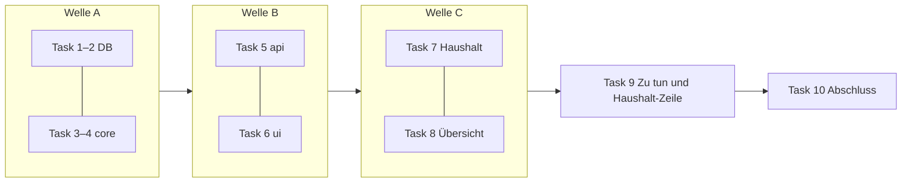

# 0011 — Plan

## Ansatz

Die „Übersicht“ bekommt einen gezeigten Tag als Zustand der Seite. Kopf, Wochenleiste, Geplant,
„Für morgen“, „Wie war's?“ und „Zu tun“ rechnen alles aus diesem Tag. Die Regeln liegen in
`packages/core`: Titel und Wochen-Blättern, die Abwesenheitszeile, die Aufgaben des Tags
(heute fällig, sonst die Haushalt-Zeile aus Spec 0010), die Auswahl für „Wie war's?“, die
Gliederung des Verlaufs und die Termin-Rechnung für „bei Bedarf“, Rhythmus-Wechsel, Nachtragen
und Entfernen. In `supabase` ändern sich drei Dinge in der unveröffentlichten Grundlage
(ADR-0012): Bewertungen werden `numeric(2,1)` in halben Schritten, der Rhythmus `asNeeded` kommt
dazu, und Erledigungen entstehen nur noch über eine Funktion mit Bedingung, die sich den Stand
davor merkt. `packages/api` bekommt die Befehle dafür. `packages/ui` bekommt den Sterne-Baustein
mit halben Sternen, `set`/`settle` am Sammel-Fenster und das Layout „Liste und Detail“. Die App
baut daraus den Haushalt (`features/chores/*`) und die „Übersicht“ (`features/today/*`) neu.
Betroffen: `supabase`, `core`, `api`, `ui`, `app`.

**Entscheidungen beim Planen** (Empfehlung des Plans, vom Eigentümer vorab freigegeben; was eine
Annahme ist, steht zusätzlich als `OFFEN` in den Offenen Fragen der Spec):

1. **Grundlage statt expand/contract (ADR-0012).** Es ist nichts ausgeliefert, und es gibt keine
   echten Bewertungen. Darum ändert der Plan `stars` direkt in den Grundlagen-Migrationen von
   `smallint` auf `numeric(2,1)`, ohne zweite Spalte und ohne Code zum Übernehmen alter Werte. So
   wurden auch die Befunde aus Spec 0006 behoben (Commit 23137d3). AC-025 wird mit den
   Seed-Bewertungen geprüft: ganze Werte bleiben gleich. Die Spec-Zeile „Erweitern → umziehen →
   aufräumen“ gilt damit nicht (Offene Frage 5). So steht es auch in
   `.claude/rules/30-database.md`: Bis zur ersten Auslieferung ändert man die Grundlage direkt.
2. **„spontan“ entfällt ganz.** Es gibt keine alten „spontan“-Einträge, denn der einzige steht im
   Seed. `chore_events.kind` erlaubt deshalb nur noch `done` und `skipped`, und `logSpontaneous`
   fällt weg. Damit entfallen der zweite Teil von AC-045 und das Symbol „spontan“ in AC-058
   (Offene Frage 6). Der KI-Befehl `logSpontaneous` bleibt im Vertrag der Edge-Funktion, weil die
   KI ausgeblendet ist (Spec 0005) und ein neuer Vertrag die Edge-Funktion mitziehen würde. `api`
   bildet ihn auf „Was anderes erledigt?“ ab.
3. **Erledigungen nur über eine Funktion mit Bedingung.** `private.complete_chore` läuft mit
   `security definer` und ist nur als Domänen-Operation `complete_chore` in `apply_changes`
   erreichbar. Das folgt dem Muster von `add_contributions`: eine Transaktion, eine öffentliche
   RPC. Sie sperrt die Aufgabe und bucht nur, wenn nächster Termin, letzte Erledigung und
   Zuständige noch dem Stand entsprechen, den das Gerät gesehen hat. Andernfalls lehnt sie mit
   `already_done` ab (mit wer und wann, AC-031) oder mit `chore_changed`. Nächster Termin und
   nächste Person rechnet weiter `core`; die Datenbank prüft nur die Grenzen (ADR-0011:
   Fachlogik an einer Stelle). „Überspringen“ läuft über denselben Weg mit `kind = 'skipped'`.
   Eine neue Aufgabe aus „Was anderes erledigt?“ geht als `insert` plus `complete_chore` in einen
   Aufruf.
4. **Der Stand davor liegt an der Erledigung.** Neue Spalten: `prev_next_due_on`,
   `prev_last_done_on`, `prev_next_assignee_id` (zusammengesetzter Fremdschlüssel, `on delete set
null`) und `prev_recorded`. Nur `complete_chore` setzt sie, und zwar aus der gesperrten Zeile;
   das Gerät hat weder Grants noch Allowlist-Spalten dafür. `chore_events` verliert die Grants
   `insert` und `delete`, übrig bleiben `select` und `update (chore_id, done_by)`. Entfernen geht
   über die Domänen-Operation `remove_chore_event` (`private.remove_chore_event`,
   `security definer`).
5. **„Jüngste Erledigung“ heißt: zuletzt gebucht** (`created_at`, dann `id`), nicht „jüngster
   Tag“. Nur so ist der gemerkte Stand davor eine saubere Kette (LIFO): Wer erst „heute“ und dann
   „gestern“ nachträgt, nimmt beim Entfernen zuerst „gestern“ zurück. Entfernt wird mit
   Wiederherstellen nur, wenn die Aufgabe noch existiert und `prev_recorded` gesetzt ist. Eine
   einmalige Aufgabe ist nach dem Erledigen gelöscht (wie gebaut), ihr Eintrag verschwindet beim
   Entfernen nur (Offene Frage 9).
6. **„Erledigt von“ ändern verschiebt die Zuständigkeit nur beim jüngsten Eintrag** (`done`) einer
   Aufgabe. Bei älteren Einträgen ändert sich nur der Avatar. Heute rechnet
   `reassignChoreEvent` bei jedem Eintrag neu, das korrigiert der Plan (AC-059, Offene Frage 9).
7. **Bewertet ist, was am Tag des Eintrags oder später gesetzt wurde** (Offene Frage 1 A). Dafür
   kommt der Zeitpunkt der eigenen Bewertung in den Cache, als `ratedAt` aus `updated_at` der
   Bewertungszeile. Wer denselben Wert noch einmal bestätigt, hat auch bewertet. Die
   Bewertungs-RPCs schreiben deshalb immer, und `updated_at` steigt (bisher: nur bei anderem Wert;
   Offene Frage 7).
8. **Gespeichert wird beim Schließen des Sammel-Fensters**, für Haken wie für Sterne: je Zeile ein
   Aufruf mit dem Endwert (AC-019, AC-029). Beim Verlassen der Seite, also auch beim Tab-Wechsel,
   schließt die App das Fenster sofort (`useFocusEffect` → `settle`, AC-030).
9. **Der Server nimmt Erledigungstage von heute − 3 bis heute + 1 an** (Server-Datum). Die
   Oberfläche bietet nur heute, gestern und vorgestern. Der Puffer fängt Zeitzonen ab
   (Offene Frage 10).
10. **Rhythmus wechseln und anlegen rechnen gleich** (Offene Frage 4 A). Eine Funktion
    `firstDueOn` in `core` gilt für beides. Bei festem Rhythmus ist das der nächste passende Tag
    ab heute, ab morgen, wenn die Aufgabe heute schon erledigt ist. Bei flexiblem Rhythmus zählt
    er ab der letzten Erledigung, ohne Erledigung ab heute. „Bei Bedarf“ hat keinen Termin.
    „Monatlich am 1.“, am 20. angelegt, ist damit am 1. des Folgemonats fällig statt heute
    (Offene Frage 11).
11. **Aufgabe löschen mit „Rückgängig“** fügt die Aufgabe mit derselben Id wieder ein und
    verknüpft ihre Verlaufseinträge wieder (`chore_id` steht in der Allowlist für `patch`). Ohne
    „Rückgängig“ bleiben die Einträge mit Titel und leerem Verweis stehen (AC-053).
12. **Der Kalender öffnet sich über `/kalender?tag=JJJJ-MM-TT`** in der Ansicht „Woche“ mit diesem
    Tag. Der Wert wird mit Zod geprüft, ein ungültiger wird ignoriert (AC-004, AC-011, AC-013).
13. **Ohne „Wer isst mit?“** (leere Liste) fragt „Wie war's?“ alle Mitglieder (Offene Frage 8).
    Steht dasselbe Rezept, Restaurant oder dieselbe Aktivität mehrmals in den drei Tagen, erscheint
    es einmal, am jüngsten Tag. „Nicht gemacht“ markiert diesen jüngsten Planeintrag.
14. **„Bei Bedarf“-Aufgaben zählen nicht** zu „n weitere Aufgaben später – alle ansehen“, weil sie
    nie fällig werden (eigener Topf `asNeeded` in `choreBucket`).

## Datenbank und Sync

Umsetzung mit dem `db-change`-Skill, direkt in den Grundlagen-Dateien (ADR-0012). Code zum
Übernehmen alter Daten gibt es nicht. Jede lokale Datenbank braucht danach einmal `pnpm db:reset`.

**Destruktiv, ausdrücklich:** `stars` wechselt den Typ, `chore_events.kind = 'spontaneous'` fällt
weg, und Mitglieder verlieren `insert` und `delete` auf `chore_events`. Das ist nur zulässig, weil
die Grundlage noch nicht ausgeliefert ist.

| Datei                                              | Änderung                                                                                                                                                                                                                                                                                                                                                                                                                                                                                                                      |
| -------------------------------------------------- | ----------------------------------------------------------------------------------------------------------------------------------------------------------------------------------------------------------------------------------------------------------------------------------------------------------------------------------------------------------------------------------------------------------------------------------------------------------------------------------------------------------------------------- |
| `20261121062348_recipes.sql`                       | `recipe_ratings.stars numeric(2,1)`, Check `stars between 0.5 and 5 and stars * 2 = trunc(stars * 2)`; `set_recipe_rating(uuid, numeric)` prüft den **ungerundeten** Wert vor dem Speichern (sonst würde `numeric(2,1)` 4,25 still auf 4,3 runden), schreibt immer (kein `where … is distinct from`)                                                                                                                                                                                                                          |
| `20261121062349_restaurants_absences_feedback.sql` | dasselbe für `restaurant_ratings` / `set_restaurant_rating`                                                                                                                                                                                                                                                                                                                                                                                                                                                                   |
| `20261121062352_activities_and_meal_plan.sql`      | dasselbe für `activity_ratings` / `set_activity_rating`                                                                                                                                                                                                                                                                                                                                                                                                                                                                       |
| `20261121062351_chores.sql`                        | `recurrence ->> 'type'` zusätzlich `asNeeded`; Check `chores_as_needed_never_due` (bei `asNeeded` ist `next_due_on` null); `chore_events.kind in ('done','skipped')`; die vier `prev_*`-Spalten; Grants `chore_events`: `select`, `update (chore_id, done_by)`; `private.complete_chore(p_household_id, p_op jsonb)` und `private.remove_chore_event(p_household_id, p_event_id)` (beide `security definer`, `search_path = ''`, Mitgliedschaft geprüft, fremde Kennung = `chore_not_found` / `chore_event_not_found`, P0002) |
| `20261121062357_apply_changes.sql`                 | Allowlist `chore_events`: `insert: []`, `patch: ["chore_id","done_by"]`, `delete: false`; Domänen-Operationen `complete_chore` (1 Operation) und `remove_chore_event` (1 Operation, 1 Löschung)                                                                                                                                                                                                                                                                                                                               |
| `supabase/seed.sql` (erzeugt), `seed/demo.ts`      | Seed-Eintrag „Keller aufgeräumt · spontan“ wird eine normale Erledigung einer vorhandenen Aufgabe; Seed-Erledigungen bekommen `prev_recorded = false`                                                                                                                                                                                                                                                                                                                                                                         |

**Regeln von `complete_chore`** (Eingabe je Operation: `chore_id`, `event_id`, `kind`,
`done_on`, `done_by`, `seen` = {`next_due_on`, `last_done_on`, `next_assignee_id`},
`next_due_on`, `next_assignee_id`):

- Die Aufgabe des Haushalts wird mit `for update` gesperrt. Weicht `seen` vom Stand ab, wird
  nichts geschrieben. Gibt es eine `done`-Erledigung derselben Aufgabe am selben `done_on` →
  `already_done` (P0001, `detail` = `{"done_by": …, "done_at": …}`), sonst `chore_changed`
  (P0001).
- Ungültig (22023 `invalid_change`): `kind` nicht `done`/`skipped`, `done_on` außerhalb heute − 3
  … heute + 1, `next_due_on` nicht nach `done_on`, `next_due_on` gesetzt bei `asNeeded`. Ein
  `done_by` außerhalb des Haushalts scheitert am Fremdschlüssel (23503).
- Der Titel des Eintrags kommt aus der Aufgabe, nicht vom Gerät. `prev_*` kommt aus der gesperrten
  Zeile, `prev_recorded = true`.
- `done` setzt `last_done_on = greatest(last_done_on, done_on)`, `next_due_on` und
  `next_assignee_id`. `skipped` setzt nur `next_due_on`. `done` bei `once` löscht die Aufgabe,
  wie heute; der Grabstein entsteht über den vorhandenen Lösch-Trigger.

**Regeln von `remove_chore_event`:** Eintrag und Aufgabe werden gesperrt. Ist der Eintrag der
zuletzt gebuchte mit `prev_recorded` seiner noch vorhandenen Aufgabe, kommen `next_due_on`,
`last_done_on` und `next_assignee_id` aus `prev_*` zurück. Danach wird der Eintrag gelöscht. Der
Grabstein geht an alle Geräte. Bei gleichzeitigem Ändern und Entfernen gewinnt das Entfernen
(Konflikttabelle der Spec): Eine spätere Änderung trifft keine Zeile mehr (`row_not_found`).

**Sync und Cache:** Keine neue Tabelle, die Registrierung bleibt. `mapping.ts` liest `prev_*` als
`ChoreEvent.previous`, `created_at` als `ChoreEvent.createdAt` und `updated_at` der
Bewertungszeilen als `ratedAt`. Nichts davon wird zurückgeschrieben (Liste der Normalisierungen
in `mapping.ts`). Der Cache ändert damit seine Form: `CACHE_VERSION` 3 → 4. Warteschlange,
Haushalts- und Marktwahl bleiben beim Wechsel erhalten (Spec 0006). Die Typen kommen neu aus
`pnpm db:types`. `docs/architecture/sync.md` bekommt einen „Nachtrag Spec 0011“.

**Zwischenstand:** Zwischen Task 2 und Task 5 lehnt der Server das alte `completeChore` ab, denn
es schickt `insert` auf `chore_events`. Abhaken in der laufenden Dev-App scheitert in dieser Zeit
mit dem Hinweis „Hat nicht geklappt – bitte noch einmal versuchen“. Die Gates (Anzeige, Smoke)
bleiben grün. Task 5 schließt die Lücke; vorher wird nichts an andere übergeben.

## Risiken und Gegenmaßnahmen

Kritische Pfade: Migrationen (Grundlage), RLS und Grants, Löschen von Aufgaben und
Verlaufseinträgen, Schreibweg über `apply_changes`.

| Was könnte schiefgehen                                                                                   | Gegenmaßnahme                                                                                                                                                                    | Getestet durch                                                                                                                                       |
| -------------------------------------------------------------------------------------------------------- | -------------------------------------------------------------------------------------------------------------------------------------------------------------------------------- | ---------------------------------------------------------------------------------------------------------------------------------------------------- |
| Mitglied eines fremden Haushalts bucht, entfernt oder liest Erledigungen                                 | `apply_changes` prüft die Mitgliedschaft (`not_member`); beide private Funktionen suchen nur im Haushalt des Aufrufs (`chore_not_found` / `chore_event_not_found`); RLS `select` | pgTAP `chore_rpcs.test.sql` „foreign household …“ (AC-055)                                                                                           |
| Abgemeldeter Aufruf schreibt oder liest                                                                  | kein Grant an `anon`; `execute` der privaten Funktionen nur für `authenticated`                                                                                                  | pgTAP „anon …“ (42501) je Operation, `schema_lint.test.sql`                                                                                          |
| Gerät fälscht den „Stand davor“ und setzt beim Entfernen einen beliebigen Termin                         | `prev_*` ohne Grant und nicht in der Allowlist; gesetzt nur aus der gesperrten Zeile                                                                                             | pgTAP: direkter `insert`/`update` auf `prev_*` → 42501; `apply_changes` mit `prev_*` → `invalid_change`                                              |
| Mitglied legt Erledigungen am Weg vorbei an (direkt oder per `apply_changes`-`insert`)                   | `insert` auf `chore_events` entzogen, Allowlist `insert: []`                                                                                                                     | pgTAP eigener Haushalt: direkter `insert` → 42501, Operation → `invalid_change`                                                                      |
| Zwei Personen haken gleichzeitig ab: doppelte Erledigung, Termin rückt zweimal                           | Zeilensperre und Vergleich mit `seen`; die zweite Buchung schreibt nichts                                                                                                        | pgTAP AC-031: zweiter Aufruf → `already_done` mit `done_by`, genau ein Eintrag, Termin einmal weiter; api-Test Hinweis „Nadja war schneller (10:02)“ |
| Ungültige Bewertung (4,3 · 4,25 · 0 · 5,5 · −1 · NaN)                                                    | Prüfung in der RPC vor jeder Rundung, dazu Check an der Spalte; `core.isHalfStar` vor dem Senden                                                                                 | pgTAP `half_star_ratings.test.sql` (AC-026), core-Test                                                                                               |
| Enrico ändert Nadjas Bewertung                                                                           | keine Schreib-Grants auf `*_ratings`; RPC schreibt nur `auth.uid()`                                                                                                              | pgTAP AC-027: direkter `update` → 42501; RPC ändert nur die eigene Zeile                                                                             |
| Ungültige Erledigung (Tag weit weg, Termin vor dem Tag, `asNeeded` mit Termin, Person nicht im Haushalt) | Prüfungen in `complete_chore`, Check `chores_as_needed_never_due`, Fremdschlüssel                                                                                                | pgTAP „invalid …“ je Fall (22023 / 23514 / 23503)                                                                                                    |
| Entfernen eines älteren Eintrags stellt einen falschen Termin her                                        | Wiederherstellen nur beim zuletzt gebuchten Eintrag (LIFO)                                                                                                                       | pgTAP AC-060 (beide Fälle); core `removalOutcome`                                                                                                    |
| Aufgabe löschen nimmt den Verlauf mit                                                                    | Fremdschlüssel `on delete set null (chore_id)` bleibt; „Rückgängig“ verknüpft wieder                                                                                             | pgTAP AC-053 (Einträge bleiben, Grabstein); api-Test Rückgängig                                                                                      |
| Bearbeiten einer inzwischen gelöschten Aufgabe legt sie neu an                                           | `patch` ohne Zeile → `row_not_found`, die Anzeige springt zurück                                                                                                                 | pgTAP AC-054; api-Test Hinweis                                                                                                                       |
| Ein Diff schickt `prev_*`, `createdAt` oder `ratedAt` mit, und der ganze Aufruf scheitert                | `mapping.ts` schreibt diese Felder nie zurück; Diff-Test                                                                                                                         | api `mapping.test.ts` „never writes …“                                                                                                               |
| Alter Cache ohne die neuen Felder                                                                        | `CACHE_VERSION` 4, voller Neuladen; Warteschlange bleibt                                                                                                                         | api `backend.test.ts`                                                                                                                                |
| Offline wird geschrieben                                                                                 | Haken, Sterne, „Nicht gemacht“, „Als erledigt eintragen“, Bearbeiten, Löschen und Verlauf gesperrt mit Hinweis; Befehle werfen `OfflineError`                                    | api-Tests `OfflineError`; Klick-Durchlauf offline (AC-023, AC-034, AC-042, AC-061)                                                                   |
| Netz bricht im Sammel-Fenster ab                                                                         | Buchen scheitert, die Überlagerung fällt heraus, die Zeile steht wieder offen, mit Hinweis                                                                                       | api-Test (abgelehnte Buchung), Klick-Durchlauf (AC-034)                                                                                              |
| Die App wird im Fenster beendet                                                                          | Es wird nichts gebucht, nach dem Start ist die Zeile wieder offen. Bewusst hingenommen, Verlassen der Seite bucht sofort                                                         | —                                                                                                                                                    |

## Aufgaben

Jede Aufgabe ist einzeln abschließbar: Test rot → Implementierung → Test grün → Gate → Commit mit
`Spec: 0011`. **Gate je Aufgabe:** `pnpm format:check && pnpm check`; dazu
`pnpm db:reset && pnpm exec supabase test db`, wenn `supabase` berührt ist; dazu `pnpm e2e:dev`
grün, die App startet ohne Fehler in der Konsole. Die volle e2e-Suite läuft erst am Ende aller
Wellen. Jede App-Aufgabe trägt ihre e2e-Brüche in `tmp/brief/e2e-impact.md` ein (Abschnitt
„Spec 0011“, erwartete Brüche siehe unten).

**Reihenfolge und Parallelität** (höchstens zwei Bau-Agenten gleichzeitig, auf getrennten
Dateien):

In Welle A macht Task 1 seinen ersten Commit (Seed ohne „spontan“) vor allem anderen. Task 3
berührt `seed/demo.ts` nicht.

### Task 1 — Datenbank: Bewertungen in halben Schritten (Agent DB, Welle A)

- **Deckt ab:** AC-025, AC-026, AC-027; Grundlage für AC-017 und AC-020
- **Berührt:** `supabase/migrations/20261121062348_recipes.sql`,
  `20261121062349_restaurants_absences_feedback.sql`, `20261121062352_activities_and_meal_plan.sql`,
  neu `supabase/tests/half_star_ratings.test.sql`, `supabase/tests/domain_rpcs.test.sql`,
  `supabase/tests/activities.test.sql`, `packages/api/src/seed/demo.ts` (nur der Eintrag „Keller
  aufgeräumt“), `supabase/seed.sql` (`pnpm db:seed:gen`), `packages/api/src/db/types.gen.ts`
  (`pnpm db:types`)
- **Test (pgTAP, zuerst rot):** 4,5 und 0,5 werden gespeichert; ganze Seed-Werte lesen sich
  unverändert (4 = 4,0; AC-025); 4,3 · 4,25 · 0 · 5,5 · −1 · `'NaN'` → `invalid_stars`, alter Wert
  bleibt (AC-026); derselbe Wert noch einmal erhöht `updated_at`; Enrico kann Nadjas Zeile weder
  direkt noch über die RPC ändern; fremdes Mitglied → `recipe_not_found` /
  `restaurant_not_found` / `activity_not_found`; `anon` → 42501 (AC-027).
- **Status:** offen

### Task 2 — Datenbank: Rhythmus „bei Bedarf“, Erledigen mit Bedingung, Entfernen (Agent DB, Welle A)

- **Deckt ab:** AC-031, AC-036 bis AC-040 (Server-Seite), AC-043, AC-044, AC-045 (erster Teil),
  AC-053, AC-054, AC-055, AC-059, AC-060
- **Berührt:** `supabase/migrations/20261121062351_chores.sql`, `20261121062357_apply_changes.sql`,
  neu `supabase/tests/chore_rpcs.test.sql`, `supabase/tests/domain_isolation.test.sql`,
  `apply_changes.test.sql`, `domain_references.test.sql`, `sync_pull.test.sql`,
  `schema_lint.test.sql` (die zwei privaten Funktionen in die geprüfte Liste), `types.gen.ts`,
  `docs/architecture/sync.md` (Nachtrag 0011)
- **Test (pgTAP, zuerst rot):** Buchen setzt Termin, Person und `last_done_on = greatest(…)`,
  `prev_*` stammt aus der Zeile; nachgetragenes „gestern“ setzt `last_done_on` nicht zurück;
  zweite Buchung mit altem `seen` → `already_done` mit Nadja und Zeit, ein Eintrag (AC-031);
  geänderter Termin ohne Erledigung → `chore_changed`; `asNeeded` mit Termin → 23514, Erledigen
  lässt den Termin leer (AC-043, AC-044); Wechsel auf `asNeeded` behält die Einträge (AC-045);
  `kind = 'spontaneous'` → 23514; `once` wird beim Erledigen gelöscht; Löschen einer Aufgabe
  lässt die Einträge mit Titel stehen, mit Grabstein (AC-053); `patch` einer gelöschten
  Aufgabe → `row_not_found` (AC-054); `done_by` per `patch` (AC-059); `remove_chore_event` beim
  zuletzt gebuchten Eintrag stellt Termin und Person her, beim älteren nicht (AC-060).
  Negativ: fremder Haushalt und `anon` je Operation (AC-055); direkter `insert`/`delete` und
  `update` auf `prev_*` auch im eigenen Haushalt → 42501; `apply_changes`-`insert` auf
  `chore_events` → `invalid_change`; Tag außerhalb heute − 3 … + 1, Termin nicht nach dem Tag,
  falsches `kind` → 22023; Person außerhalb des Haushalts → 23503; mehr als 20 Löschungen →
  `too_many_changes`.
- **Status:** offen

### Task 3 — core: Aufgaben-Regeln (Agent core, Welle A)

- **Deckt ab:** AC-036 bis AC-040, AC-043, AC-044, AC-049, AC-051, AC-052, AC-059, AC-060
  (Client-Seite)
- **Berührt:** `packages/core/src/types.ts` (`Recurrence` + `asNeeded`; `ChoreEvent.createdAt?`,
  `ChoreEvent.previous?`; `ratedAt?` an `Recipe`, `Restaurant`, `Activity`; das Entfernen von
  `'spontaneous'` macht Task 5), `chores.ts`, `chores.test.ts`, `household-row.ts`,
  `household-row.test.ts`, neu `ratings.ts`, `ratings.test.ts`, `index.ts`; für den Typecheck
  minimal `packages/api/src/commands-chores.ts` (importiert `firstDueOn` aus `core` statt der
  eigenen Kopie)
- **Test (zuerst rot):** `choreBucket` → `asNeeded`, `recurrenceLabel` „bei Bedarf“,
  `nextDueAfter` ohne Termin (AC-043, AC-044); `firstDueOn` (AC-051: Fr → „wöchentlich montags“
  = Mo 23.11.; nie erledigt, „monatlich am 1.“ = Di 1.12.; heute erledigt → ab morgen);
  `completionOutcome` für „etwa alle 14 Tage“ heute/gestern (AC-036: 4.12., AC-038: 3.12.),
  fester Rhythmus früh erledigt (AC-037: 27.11.), neue geplante Aufgabe „abwechselnd“ (AC-040:
  4.12., Nadja); `assigneeAfterAssignmentChange`; `latestBookedEvent` nach `createdAt`;
  `reassignOutcome` nur beim jüngsten (AC-059); `removalOutcome` (AC-060, beide Fälle);
  `validateChoreDraft` „Titel fehlt“ (AC-052); `doneOnChoices` heute/gestern/vorgestern;
  `seasonMonths("April", "September")` und über den Jahreswechsel, `seasonLabel`;
  `fasterNotice("Nadja", "…T10:02…")` = „Nadja war schneller (10:02)“; `householdRow` zeigt
  `asNeeded` nie (AC-043); `isHalfStar`, `formatStars(4.5)` = „4,5“, `ratedOnOrAfter`.
- **Status:** offen

### Task 4 — core: Übersicht, „Wie war's?“ und Verlauf (Agent core, Welle A)

- **Deckt ab:** AC-001 bis AC-003, AC-005 bis AC-007, AC-011, AC-013 bis AC-016, AC-020 bis
  AC-022, AC-032, AC-056 bis AC-058, AC-062
- **Berührt:** neu `packages/core/src/overview.ts`, `overview.test.ts`, `recap.ts`, `recap.test.ts`,
  `chore-history.ts`, `chore-history.test.ts`, `index.ts`; `.agents/glossary.md` (Erledigung ohne
  „spontan“; `ChoreEvent.previous`; `asNeeded` nicht mehr vorläufig)
- **Test (zuerst rot):** `overviewTitle`: „Freitag, 20. November“, „Morgen, Samstag 21. November“, „Gestern, …“, in einem anderen Jahr mit Jahreszahl (AC-001, AC-002); Blättern
  behält den Wochentag (AC-003: KW 49 Fr 4.12., dann KW 46 Fr 13.11.); `weekNav` „Diese Woche ·
  KW 47“ oder Knopf „Heute“ (AC-002, AC-062); Abschnittstitel „Heute geplant“ / „Geplant am
  Samstag“ / „Zu tun am Samstag“ / „Erledigt am Mittwoch“; `absenceLine` mit und ohne Notiz,
  endet nach dem letzten Tag (AC-007); Punkte je Tag über `dayKinds` (AC-005); Kachel: erster
  Eintrag und „+2“ (AC-006); „Alle n ›“ erst ab vier Einträgen (AC-011); `choresOfDay`: heute
  fällig (bisherige Auswahl aus `today-chores.tsx`, unverändert), künftig geplant und vergangen
  erledigt aus `householdRow` (AC-032), `asNeeded` nie; `recapItems`: drei Tage zurück, alle
  Arten außer Freitext und Resten, ohne „nicht gekocht“, nur wer unter „Wer isst mit?“ steht
  (leer = alle), bewertet ab dem Tag des Eintrags oder später, Vorbelegung mit der alten
  Bewertung, je Ziel einmal am jüngsten Tag, Reihenfolge jüngster Tag zuerst und innerhalb des
  Tags nach Tageszeit (AC-015, AC-016, AC-020, AC-021); `historyGroups`: Monate, Wochen auf den
  Monat beschnitten („KW 44 · 1. Nov“, „KW 44 · 26.–31. Okt“), keine leeren Wochen, Jahreszahl
  nur für andere Jahre, Zeile „Fr 20.“ (AC-056 bis AC-058).
- **Status:** offen

### Task 5 — api: Befehle, Abbildung, Cache (Agent api, Welle B)

- **Deckt ab:** AC-017, AC-019 bis AC-021, AC-024 bis AC-031, AC-034, AC-036 bis AC-045, AC-050
  bis AC-055, AC-059, AC-060
- **Berührt:** `packages/api/src/commands-chores.ts` (`completeChore(choreId, { doneOn?, doneBy? })`
  und `skipChore` über `complete_chore`; `logDone` für eine vorhandene oder eine neue Aufgabe,
  `asNeeded` oder mit Angaben; `updateChore` mit neuem Termin bei neuem Rhythmus; `deleteChore`
  mit Rückgängig samt neuer Verknüpfung; `reassignChoreEvent` nach `reassignOutcome`;
  `removeChoreEvent`; `createChore` über `core.firstDueOn`; `logSpontaneous` entfällt),
  `commands-recipes.ts`, `commands-restaurants.ts`, `commands-activities.ts` (halbe Schritte,
  Ablehnung statt Runden, `ratedAt` in der Überlagerung), `store.ts` (`CommitSpec` „rpc“ mit
  `rejectedMessage`), `backend.ts` (`CACHE_VERSION` 4; Text aus `rejectedMessage` an
  `onWriteRejected`), `transport.ts`, `transport-supabase.ts` (`numeric`, Fehler `already_done`
  mit `detail`), `transport-fake.ts` (neue Domänen-Operationen, Grants und Prüfungen wie in
  pgTAP), `db/mapping.ts`, `assistant.ts` (`logSpontaneous` → `logDone`), `index.ts`,
  `seed/demo.ts` (Aufgabe „Fenster Küche“ bei Bedarf, Verlauf über zwei Monate und einen
  Jahreswechsel für den Klick-Durchlauf), `supabase/seed.sql` (neu erzeugt);
  `packages/core/src/types.ts` (`'spontaneous'` entfernen); minimal für den Typecheck:
  `apps/app/src/features/chores/spontaneous-sheet.tsx` (ruft `logDone`) und `chore-labels.ts`
  (Fall `spontaneous` weg)
- **Test (zuerst rot):** `*.backend.test.ts` gegen den Fake: Buchen schickt genau eine
  `apply_changes` mit `complete_chore` und dem gesehenen Stand; `already_done` springt zurück
  mit „Nadja war schneller (10:02)“ (AC-031); abgelehnt → „Hat nicht geklappt …“ (AC-034);
  `logDone` mit Treffer, gestern und neuer Aufgabe in einem Aufruf (AC-036 bis AC-040, AC-044);
  `updateChore` (AC-050, AC-051), leerer Titel schreibt nichts (AC-052), gelöschte Aufgabe →
  Hinweis (AC-054); `deleteChore` + Rückgängig verknüpft wieder (AC-053); `reassignChoreEvent`
  (AC-059); `removeChoreEvent` (AC-060); Bewertungen 4,5 und Ablehnung von 4,3 ohne Senden
  (AC-017, AC-026), Nadja sieht 4,5; „Nicht gemacht“ (AC-021); jeder Befehl offline →
  `OfflineError`; `mapping.test.ts` Hin- und Rückweg mit `asNeeded`, `previous`, `ratedAt`, und
  der Diff schreibt `prev_*`/`ratedAt` nie; `backend.test.ts` Version 4 behält die
  Warteschlange.
- **Status:** erledigt (nicht committet), Entscheidungen siehe „Entscheidungen beim Bauen (api)“

### Task 6 — ui: halbe Sterne, Sammel-Fenster, Liste und Detail (Agent ui, Welle B)

- **Deckt ab:** AC-017 bis AC-019 (Bedienung), AC-047 (Layout), Barrierefreiheit der Plattformen
- **Berührt:** `packages/ui/src/controls.tsx` (`Stars`: Hälften, Vorfüllen beim Darüberfahren im
  Web, Ziehen mit dem Finger, `adjustable` in 0,5-Schritten, „4,5 von 5 Sternen“; Test-IDs
  `<id>-<n>` bleiben = voller Stern, neu `<id>-<n>-half`), neu `star-value.ts` +
  `star-value.test.ts`, `check.tsx` (`set(item, checked)` und `settle()` an
  `CheckWindowState`), `check-window.test.ts`, neu `list-detail.tsx`, `index.ts` (Export
  `ListDetail`, erst nachdem die Änderung aus Spec 0006 an `index.ts` committet ist),
  `docs/design/DESIGN.md` (Sterne, Liste und Detail)
- **Test (zuerst rot):** `starValueAt`: linke Hälfte des fünften Sterns = 4,5, rechte des vierten
  = 4 (AC-017, AC-020); Vorschau beim Darüberfahren und zurück beim Verlassen (AC-018);
  Tastaturschritte 0,5 mit Grenzen 0,5…5, Ansage „4,5 von 5 Sternen“; `set` hält die Zeile und
  startet die Uhr neu, ohne umzuschalten (AC-019); `settle` schließt sofort (AC-030).
- **Status:** erledigt (nicht committet), Entscheidungen siehe „Entscheidungen beim Bauen (ui)“

### Task 7 — App: Haushalt (Agent Haushalt, Welle C)

- **Deckt ab:** AC-033, AC-035 bis AC-042 (Fenster), AC-043, AC-045 bis AC-061
- **Berührt:** `apps/app/src/features/chores/*`: `chores-screen.tsx` (Ansichts-Tabs, eine
  Inhaltsbreite, `ListDetail` am Desktop für „Alle“ und „Verlauf“, „Anstehend“ mit
  Sammel-Fenster und `settle` beim Verlassen), `chore-sheet.tsx` (Ansicht + Bearbeiten im selben
  Fenster `m`, Desktop rechte Spalte, Löschen mit Rückgängig), `new-chore-sheet.tsx` → gemeinsames
  Formular für Neu und Bearbeiten mit „Bei Bedarf“ und Saison, `chore-history.tsx` (gegliedert,
  klebende Monatsüberschriften), neu `history-event-sheet.tsx` („Erledigt von“, „Eintrag
  entfernen“), neu `done-sheet.tsx` („Was hast du erledigt?“, großes Fenster, `SearchOrCreate`
  mit Bremse und „Mehr Angaben ▸“, „Erledigt von“, „heute ▾“) statt `spontaneous-sheet.tsx`
  (gelöscht), neu `chore-check-list.tsx` (Zeilen mit Sammel-Fenster, auch für die Übersicht),
  `chore-row.tsx`, `chore-labels.ts`
- **Test:** Logik in Task 3 bis 5. Hier: `pnpm e2e:dev` und ein kurzer Klick-Durchlauf bei 390 und
  1440 px gegen den lokalen Stack. Abhaken und Zurücknehmen im Fenster, Tab-Wechsel bucht sofort,
  „fenster“ suchen, neu „bei Bedarf“, „Fenster Kuche“ → „Meinst du …“, Bearbeiten und Rhythmus,
  leerer Titel, Löschen + Rückgängig, Verlauf mit Jahreszahl, Eintrag umbuchen und entfernen,
  offline gesperrt mit Hinweis. Belege in `tmp/0011/`.
- **Status:** offen

### Task 8 — App: Übersicht mit Tagesauswahl, Geplant und „Wie war's?“ (Agent Übersicht, Welle C)

- **Deckt ab:** AC-001 bis AC-024, AC-062
- **Berührt:** `apps/app/src/features/today/today-screen.tsx` (gezeigter Tag als Zustand der Seite,
  Reihenfolge Handy und Desktop 1,6 : 1), `week-strip.tsx` (oben, Punkte, Streifen, Kacheln am
  Desktop), `today-meals.tsx` (gezeigter Tag, waagerecht wischbar mit fester Kartenhöhe, Raster
  16:10, „Alle n ›“, „Nichts geplant“), neu `today-header.tsx`, `today-recap.tsx`,
  `today-absence.tsx`; `apps/app/src/features/calendar/calendar-screen.tsx` (Parameter `tag`);
  **nicht** `today-shopping.tsx` (gehört zu Spec 0006) und **nicht** `today-chores.tsx` (Task 9)
- **Test:** Logik in Task 4 bis 6. Hier: `pnpm e2e:dev` und ein Klick-Durchlauf. Blättern ‹ ›,
  „Heute“, Samstag wählen, Kalender-Symbol und „Alle 5 ›“ öffnen die richtige Woche, Abwesenheit,
  Karte öffnen und zurück (Tag bleibt), „Wie war's?“ halbe Sterne mit Wegleiten nach 2 s,
  „Nicht gemacht“, offline ausgegraut, anderer Tag ohne „Wie war's?“.
- **Status:** offen

### Task 9 — App: „Zu tun“ am gezeigten Tag und Haushalt-Zeile (nach Task 7 und 8)

- **Deckt ab:** AC-028 bis AC-032, AC-034, AC-035 (Einstieg auf der Übersicht), AC-043
- **Berührt:** `apps/app/src/features/today/today-chores.tsx` (`choresOfDay`, `chore-check-list`,
  `done-sheet`, andere Tage nur zur Ansicht, „Erledigt am …“, kein Rückgängig-Hinweis),
  `apps/app/src/features/calendar/calendar-parts.tsx` (`completeChore` mit neuer Rückmeldung,
  `settle` beim Verlassen)
- **Test:** `pnpm e2e:dev`, Klick-Durchlauf: AC-029 in Zeitlupe (0 s / 0,8 s / 1,5 s / 3,5 s), Tab
  „Essen“ im Fenster bucht sofort, zwei Browser für „Nadja war schneller“, Netz weg im Fenster,
  Samstag ohne Haken, Mittwoch „Erledigt am Mittwoch“.
- **Status:** offen

### Task 10 — Abschluss

- **Deckt ab:** alle AC (Nachweis)
- **Berührt:** `docs/specs/0011-heute-haushalt/plan.md` (Nachweis), Rückverfolgbarkeitstabelle der
  Spec, `tmp/brief/e2e-impact.md`
- **Test:** `pnpm format:check && pnpm check && pnpm build:web`, `pnpm db:reset && pnpm exec
supabase test db`, `pnpm test:integration`, `/security-check` auf den Diff von Task 1, 2 und 5
  (Befunde beheben oder hier eintragen), `spec-auditor`, `/ui-verify` (390, 768, 1440 px, hell und
  dunkel), `impeccable`-Kritik der Übersicht und des Haushalts, `review-animations` für Wegleiten
  und Sterne.
- **Status:** offen

## Erwartete e2e-Brüche (für `tmp/brief/e2e-impact.md`)

- **rundgang-haushalt:** Abhaken blendet erst nach 2 s aus, nicht sofort; den Hinweis „Erledigt
  von dir · Nadja“ gibt es nicht mehr. `today-spontaneous`, `chores-spontaneous-*` und
  `chores-spontaneous-sheet` werden ersetzt durch das Fenster `chore-done-sheet` (Suche
  `chore-done-search-input`, Treffer `-hit-<id>`, neu `-create-…`, `chore-done-by-<id>`,
  `chore-done-day`, `chore-done-save`). Der Verlauf ist gegliedert (`history-year-*`,
  `history-month-*`, `history-week-*`); `history-<id>` bleibt, die Zeile zeigt „Fr 20.“ statt
  „· heute“. Der Seed-Eintrag „Keller aufgeräumt · spontan“ ist weg.
- **Übersicht (rundgang-shell, rundgang-essen):** Die Wochenleiste steht oben und wählt einen Tag,
  statt die Woche zu öffnen. `recap`/`recap-stars` werden zu `today-recap` mit
  `recap-<entryId>-stars` und `recap-<entryId>-not-done`. „Wie war's?“ fragt drei Tage und alle
  Arten ab.
- **Sterne (rundgang-essen, -restaurants, -aktivitaeten):** `<id>-<n>` setzt weiter einen vollen
  Stern; neu ist `<id>-<n>-half`. Angezeigte Werte können halb sein.
- **Kalender:** Neu ist der Einstieg `/kalender?tag=…` von der Übersicht.

## Überschneidungen mit anderen Specs

- **Spec 0006 (läuft gerade, zwei Agenten in `features/shopping/*` und `today-shopping.tsx`):**
  Dieser Plan berührt keine dieser Dateien. `today-screen.tsx` bindet `TodayShopping` weiter
  unverändert ein. Task 6 wartet mit `packages/ui/src/index.ts`, bis die offene 0006-Änderung
  dort committet ist; `lists.tsx` und `swipe-row.tsx` fasst er nicht an. `recipe-detail.tsx` (in
  Arbeit bei 0006) bleibt unberührt: Die halben Sterne kommen dort über den Baustein `Stars` an.
- **Spec 0007 (wird parallel geplant), erwartete Reibung:**
  - `20261121062357_apply_changes.sql` (Allowlist: hier `chore_events`, dort vermutlich
    `articles`/`areas`/`stores`). Die DB-Aufgaben beider Specs laufen **nacheinander**, nicht
    gleichzeitig.
  - `20261121062348_recipes.sql`, falls 0007 die Zutaten oder Rezepte berührt. Hier ändern sich
    nur `recipe_ratings` und `set_recipe_rating`.
  - `packages/api/src/db/types.gen.ts`: Wer zuletzt einspielt, erzeugt die Datei neu, statt
    zusammenzuführen.
  - `CACHE_VERSION` in `backend.ts`: beide erhöhen ihn; wer zuletzt einspielt, nimmt den nächsten
    freien Wert.
  - `packages/core/src/types.ts`, `index.ts`, `db/mapping.ts`, `transport*.ts`, `seed/demo.ts`
    und `supabase/seed.sql` (neu erzeugen statt zusammenführen).
  - **„Liste und Detail“** (`packages/ui/src/list-detail.tsx`) braucht auch 0007 („Artikel
    bearbeiten“ in der rechten Spalte). Wer zuerst baut, legt den Baustein an, der andere nutzt
    ihn.
  - `SearchOrCreate` nutzen beide nur, ohne den Baustein zu ändern.
- **Spec 0010:** `household-row.ts`, `calendar-parts.tsx` und `calendar-screen.tsx` werden
  weiterverwendet und nur erweitert (`asNeeded`, neue `completeChore`-Rückmeldung, Parameter
  `tag`).
- **Spec 0008 (Welle 4):** nutzt den hier gebauten Sterne-Baustein (Spec 0008, REQ-011).
- **Spec 0009:** Die Art „Sammlung“ fehlt noch. `recapItems` und die Karten behandeln Sammlungen,
  sobald sie Rezepte sind; AC-012, AC-024 und die Zeile „Grillabend“ in AC-015 werden erst mit
  0009 geprüft.

## Bewusst nicht Teil dieses Plans

- Uhrzeiten und Erinnerungen an Aufgaben (Spec 0013), die Karte „Reisetasche“ (Spec 0012),
  „Abgeben“, „Neu verteilen“, Unteraufgaben, Filter im Verlauf.
- Ein neuer Name für den KI-Befehl `logSpontaneous` im Vertrag der Edge-Funktion (Entscheidung 2).
- Die volle e2e-Suite: Sie läuft einmal am Ende aller Wellen, die Brüche stehen oben.
- AC-012, AC-024 und „Grillabend“ in AC-015 (prüfbar ab Spec 0009).
- Der zweite Teil von AC-045 und das Symbol „spontan“ in AC-058 entfallen (Entscheidung 2).

## Nachweis

Wird am Ende ausgefüllt.

- [ ] Alle AC haben einen Test, der rot war und jetzt grün ist (spec-auditor)
- [ ] `pnpm format:check && pnpm check && pnpm build:web` grün
- [ ] `pnpm exec supabase test db` grün
- [ ] `/ui-verify` gelaufen, Befunde behoben oder begründet
- [ ] `/security-check` gelaufen (Task 1, 2, 5)
- [ ] Offline-Verhalten wie in der Spec beschrieben geprüft
- [ ] Glossar und Rückverfolgbarkeitstabelle aktuell

## Entscheidungen beim Bauen (core, Tasks 3–4, 21.11.2026)

Mit der Empfehlung entschieden (Enrico hat vorab freigegeben):

1. Eine flexible Aufgabe, die nie erledigt wurde, ist ab heute fällig. „Alle n Monate“ zählt ab der
   letzten Erledigung, aber nie vor heute.
2. AC-003: drei Tipps auf ‹ führen von KW 49 nach KW 46 (Spec-Text korrigiert, vorher „fünfmal“).
3. Abwesenheitszeile: „Enrico und Vera sind abwesend …“, für den ganzen Haushalt „Alle …“.
4. Die Punkte der Wochenleiste kommen nur aus Planeinträgen, nicht aus Aufgaben.
5. „Morgen, …“ und „Gestern, …“ zeigen nie eine Jahreszahl; andere Tage nur, wenn das Jahr nicht
   das aktuelle ist.
6. Ein Nachtrag für einen früheren Tag zieht das Intervall einer flexiblen Aufgabe nicht zurück.
7. Ein noch nicht bestätigter Eintrag (ohne `createdAt`) gilt als zuletzt gebucht.
8. „Wie war's?“: Ist der jüngste Eintrag „Nicht gemacht“, erscheint ein älterer Eintrag desselben
   Ziels aus den drei Tagen.
9. Saison-Eingabe als Monatszahlen 1–12.

## Entscheidungen beim Bauen (Datenbank, Tasks 1–2, 21.11.2026)

Aus dem Plan abgeleitet, ohne neue Frage:

1. **Form der Domänen-Operationen:** `{"kind": "complete_chore", "completion": {…}}` mit den
   Feldern aus „Regeln von `complete_chore`“, weil `kind` schon die Operation benennt; dazu
   `{"kind": "remove_chore_event", "id": …}` wie bei `delete`. `complete_chore` lehnt unbekannte
   Felder ab (auch `title` und `prev_*`) und verlangt `event_id`, `done_by` und `seen`.
2. **Rückgaben:** `complete_chore` gibt `{"event_id"}` zurück, `remove_chore_event`
   `{"restored": true|false}`, beides in `results` von `apply_changes`.
3. **Entfernen bei inzwischen „bei Bedarf“:** Ist die Aufgabe beim Entfernen schon „bei Bedarf“,
   bleibt `next_due_on` leer, statt den gemerkten Termin herzustellen (sonst schlüge
   `chores_as_needed_never_due` fehl). `last_done_on` und Person kommen wie geplant zurück.
4. **Seed:** Aus „Keller aufgeräumt · spontan“ wird eine Erledigung von „Pflanzen gießen“ durch
   Enrico vor 9 Tagen (`ev-2` bleibt als Kennung). Seed-Erledigungen haben
   `prev_recorded = false` über den Spalten-Standard.
5. **Bewertungen:** Die RPCs nehmen `numeric` ohne Genauigkeit und lehnen auch `NaN` und
   `Infinity` ab.

## Entscheidungen beim Bauen (api, Task 5, 21.11.2026)

Aus Plan, ADR-0011 und dem Code abgeleitet, ohne neue Frage:

1. **Ein Aufruf je Befehl.** `completeChore`, `skipChore` und `logDone` schicken genau ein
   `apply_changes` mit `complete_chore` und dem gesehenen Stand; „Was anderes erledigt?“ ohne
   Treffer schickt davor das `insert` der neuen Aufgabe in ihrem Stand vor der Erledigung. Der
   Server-Hinweis bei `already_done` ist `fasterNotice` mit dem Namen aus den Mitgliedern
   („Jemand war schneller“, wenn die Person unbekannt ist), alles andere der allgemeine Hinweis.
2. **„Rückgängig“ einer Erledigung** (für die heutigen Aufrufer mit `snapshot`) schickt
   `remove_chore_event`; bei einer erledigten einmaligen Aufgabe davor das `insert` der Aufgabe,
   bei einer neuen Aufgabe danach ihr `delete`.
3. **„Rückgängig“ von „Eintrag entfernen“** bucht den Eintrag mit derselben Id über
   `complete_chore` neu. Das geht nur, wenn das Entfernen den Stand davor hergestellt hat und der
   Tag heute, gestern oder vorgestern ist; `removeChoreEvent` meldet das als `undoable`. Sonst
   gibt es kein „Rückgängig“ (die Datenbank kann einen Eintrag nicht anders wieder anlegen).
4. **Aufgabe löschen** läuft als eigener Schreibweg (`delete` der Aufgabe); die Anzeige leert die
   Verweise sofort. „Rückgängig“ fügt die Aufgabe ein und verknüpft ihre Einträge in einem Aufruf.
   Bei mehr als 199 Einträgen überschreitet das die Grenze von 200 Operationen und scheitert mit
   Hinweis.
5. **Tage:** Die Befehle nehmen nur heute, gestern und vorgestern an (`doneOnChoices`) und werfen
   sonst, bevor etwas gesendet wird.
6. **Bewertungen:** Ein ungültiger Wert wirft vor dem Senden (`INVALID_STARS`), statt zu runden
   oder zu begrenzen. `ratedAt` steht in der Überlagerung als `updated_at` der eigenen
   Bewertungszeile und kommt nach dem Abgleich vom Server.
7. **Neue Aufgabe aus „Was anderes erledigt?“** ohne „Mehr Angaben“: „bei Bedarf“, „egal wer“,
   1 Punkt. Der KI-Befehl `logSpontaneous` macht genau das.
8. **Cache-Version 5**, weil Spec 0007 die 4 schon belegt hat.
9. **Seed:** neue Aufgabe „Fenster Küche“ (bei Bedarf, zwei Einträge), Verlaufseinträge vor 20,
   25, 45, 63 und 400 Tagen. 400 Tage liegen immer in einem anderen Jahr (Jahreswechsel, AC-057).

## Entscheidungen beim Bauen (ui, Task 6, 21.11.2026)

Aus Plan, `AGENTS.md` und dem Code abgeleitet, ohne neue Frage:

1. **„Liste und Detail“ gab es schon** (`list-detail.tsx`, Spec 0007, samt Export). Der Baustein
   deckt AC-047 unverändert ab (Platzhalter „Wähl eine Aufgabe aus“ über `placeholder`); Task 6
   ändert ihn nicht. `index.ts` bleibt unberührt, weil `Stars`, `useCheckWindow` und ihre Typen
   schon exportiert sind.
2. **Die Regeln der Sterne liegen rein in `star-value.ts`** (`starValueAt`, `starFill`,
   `starPointer`, `stepStars`, `starsLabel`) und sind in Node getestet. `ui` importiert nichts
   aus `core`; die Grenzen 0,5 und 5 und das Komma stehen deshalb dort noch einmal.
3. **Bedienung:** Jede Sternhälfte ist eine eigene Trefferfläche. `<id>-<n>` ist die rechte Hälfte
   samt Lücke dahinter (voller Stern), `<id>-<n>-half` die linke. Ein Tipp setzt den Wert der
   Hälfte, Ziehen rechnet ab dort mit dem Finger weiter, Loslassen setzt. Übernimmt die Liste das
   Ziehen (Scrollen), wird nichts gesetzt. Darüberfahren füllt nur vor; Verlassen zeigt wieder den
   gespeicherten Wert. Derselbe Wert noch einmal ruft `onChange` trotzdem auf (Entscheidung 7).
4. **Tastatur und Screenreader:** ein einstellbares Element (`adjustable`, im Web `slider`) mit
   `aria-valuetext` „4,5 von 5 Sternen“. Pfeiltasten in 0,5-Schritten, Pos1 = 0,5, Ende = 5;
   unbewertet startet ein Schritt nach oben bei 0,5, einer nach unten bleibt unbewertet. Jeder
   Schritt ruft `onChange`; in „Wie war's?“ sammelt das Fenster die Schritte (`set`).
5. **Neue Props an `Stars`:** `disabled` + `hint` (ausgegraut mit Begründung, AC-023) und `label`
   (Name des einstellbaren Elements, z. B. „Deine Bewertung“; ohne `label` bleibt der Wert der
   Name, wie bisher). Ohne `onChange` bleibt es eine reine Anzeige mit `aria-label`
   „4 von 5 Sternen“.
6. **`set` und `settle`** kommen über die reine Funktion `checkWindowActions` in
   `check-window.ts` an `CheckWindowState`. `set` läuft wie ein Tipp durch `onToggle` und
   `announce`, schaltet aber nicht um. Die App ruft `settle` aus `useFocusEffect` (Entscheidung 8).
