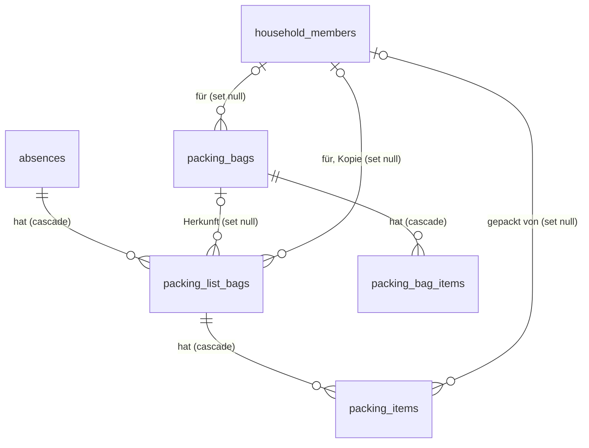
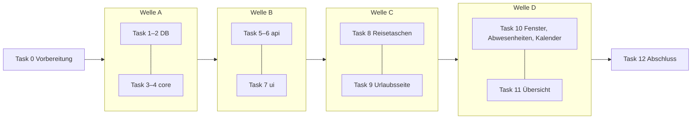

# 0012 — Plan

## Ansatz

Reisetaschen, die Taschen einer Packliste und die Packstücke beider kommen als vier neue,
synchronisierte Tabellen in eine neue Datei der unveröffentlichten Grundlage
(`20261121062353_packing.sql`, ADR-0012). Alles außer dem Packen läuft über `apply_changes`
(ADR-0011): Die App rechnet in `packages/core` aus, welche Zeilen entstehen (Abwesenheit mit
Packliste, Tasche hinzufügen, Packstück ergänzen, Duplizieren), und schickt sie als einen Aufruf in
einer Transaktion. Der Server rechnet „je Tag“ selbst nach (Trigger) und lässt Mitglieder die
Gepackt-Spalten nicht schreiben. Packen geht über eine eigene RPC mit „Abhaken gewinnt“ und, auch
ohne Netz, über die Laden-Warteschlange (neuer ADR-0013). „Alles einpacken“ und „Für die Rückreise
zurücksetzen“ legen je Packstück einen Eintrag an, die App bündelt sie zu einem Aufruf.
`packages/ui` bekommt das Taschen-Symbol und eine aufklappbare Gruppe für „Gepackt (n)“. Die App
baut „Verwalten → Reisetaschen“, die Urlaubsseite und erweitert Abwesenheit-Fenster, Seite
„Abwesenheiten“, Kalender und „Übersicht“. Betroffen: `supabase`, `core`, `api`, `ui`, `app`.

**Entscheidungen beim Planen** (Empfehlung des Plans, vom Eigentümer vorab freigegeben; was eine
Annahme ist, steht zusätzlich als `OFFEN` in den Offenen Fragen der Spec):

1. **Neue Datei in der Grundlage statt Flicken-Migration (ADR-0012).** Es ist nichts ausgeliefert.
   Die vier Tabellen, ihre Trigger und die zwei neuen Funktionen stehen in
   `supabase/migrations/20261121062353_packing.sql`, einer Datei für den neuen Bereich zwischen
   `…062352_activities_and_meal_plan.sql` und `…062354_shopping.sql`. Der Zeitstempel wird von Hand
   vergeben, damit die Datei vor `apply_changes` und `sync_pull` liegt; sie hängt nur von
   `absences` und `household_members` ab. `apply_changes.sql` und `sync_pull.sql` werden direkt
   geändert. Alles ist additiv; es gibt keine destruktive Änderung und keine Daten zu übernehmen.
2. **Vierte Tabelle „Tasche der Packliste“ (`packing_list_bags`)** statt Taschen-Name und Mitglied
   als Kopie an jedem Packstück (Offene Frage 5). Eine Zeile je angehängter Tasche: Abwesenheit,
   Herkunftstasche (wird beim Löschen der Vorlage leer), Name und Mitglied als Kopie, Reihenfolge.
   Packstücke zeigen darauf. Gründe: „Aus der Packliste entfernen“ ist das Löschen einer Zeile (der
   Rest geht per Fremdschlüssel mit, statt bis zu 100 Löschungen gegen die Grenze von 20 je Aufruf);
   die Reihenfolge der Abschnitte ist ein Feld; ein Abschnitt bleibt auch ohne Packstücke stehen
   (mit „+ Packstück“); zwei Taschen gleichen Namens (eine gelöschte, eine neue) bleiben getrennt.
   Die Spec-Daten nennen dieselben Angaben, nur an anderer Stelle.
3. **„Je Tag“ rechnet der Server.** `packing_items.per_day` hält die Anzahl je Tag, `quantity` die
   ausgerechnete Anzahl. Ein Trigger vor dem Einfügen setzt `quantity = least(per_day × Tage, 9999)`
   (Tage = `to_on − from_on + 1`), egal was das Gerät schickt. Ändern sich Von oder Bis einer
   Abwesenheit oder zieht eine Tasche zu einer anderen Abwesenheit, rechnet ein Trigger alle
   **offenen** „je Tag“-Packstücke neu; gepackte bleiben (AC-037). Ein später wieder ausgepacktes
   Stück behält seine Anzahl bis zur nächsten Änderung der Dauer. `core.packQuantity` rechnet
   dasselbe für die sofortige Anzeige.
4. **Packen über eine eigene RPC, offline über die Laden-Warteschlange (ADR-0013, Entwurf in
   diesem Plan).** `set_packing_items_packed(p_household_id, p_changes)` nimmt 1 bis 200 Änderungen
   `{item_id, packed, seen_pack_seq}` und wendet je Packstück die Regel des Einkaufspostens an
   (`pack_seq` statt `check_seq`). Ein Packstück, das fehlt oder zu einem anderen Haushalt gehört,
   wird übersprungen, ohne Fehler (AC-024, AC-040). Die Warteschlange bekommt die Eintragsart
   `pack` je Packstück; Hin- und Hertippen fasst `enqueue` wie bei `check` zusammen. Der Sender
   schickt eine zusammenhängende Folge von `pack`-Einträgen desselben Haushalts als einen Aufruf.
5. **Gespeichert wird sofort beim Tipp** (Offene Frage 3 A): Jeder Haken geht sofort in die
   Warteschlange, das Sammel-Fenster regelt nur die Anzeige (wie bei Einkaufsposten, Spec 0006). Das
   „Rückgängig“ nach „Alles einpacken“ legt die Gegen-Einträge für genau die eben gepackten Stücke an
   und geht deshalb auch offline (AC-026, AC-027).
6. **Gepackt-Spalten schreibt nur der Server.** `packed`, `packed_at`, `packed_by` und `pack_seq`
   haben kein Grant und stehen nicht in der Allowlist. Ein Trigger setzt sie bei einem Einfügen
   durch `authenticated` auf „offen“ (zweite Verteidigungslinie wie bei `shopping_items`).
   „Rückgängig“ nach dem Entfernen eines Packstücks oder einer Tasche stellt den Stand über die neue
   Domänen-Operation `restore_packing_items` in `apply_changes` wieder her (`security definer`,
   Werte begrenzt wie `restore_cleared_items`: `packed_at ≤ now()`, `packed_by` muss Mitglied
   sein, `pack_seq` 0 bis 999000).
7. **Löschen eines Elternteils schickt nur dessen Löschung.** Abwesenheit, Reisetasche und Tasche
   der Packliste nehmen ihre Kinder per `on delete cascade` mit; jede Kind-Zeile bekommt über den
   vorhandenen Trigger ihren Grabstein. `packages/api/src/changes.ts` lässt deshalb im Modus „send“
   die Löschungen von Kind-Zeilen weg, deren Eltern-Zeile im selben Diff gelöscht wird (Tabelle
   `CASCADE_CHILDREN` in `db/tables.ts`, dieselbe wie `CASCADES` im Fake). Die Grenze von
   20 Löschungen je Aufruf bleibt unverändert.
8. **Abwesenheit bearbeiten nach D23, Packliste zieht mit** (Offene Frage 4 A). `planAbsenceWrite`
   verwendet Zeilen weiter, auch wenn sich die Person ändert (`member_id` wird gepatcht), und
   bevorzugt dabei die Zeile mit Packliste. So behält „Enrico allein → ganzer Haushalt → nur
   Nadja“ dieselbe Abwesenheit und dieselbe Packliste (AC-039). Fallen mehrere Zeilen zu einer
   zusammen, ziehen ihre Taschen per Patch `packing_list_bags.absence_id` zur verbliebenen Zeile, im
   selben Aufruf vor dem Löschen (Patches laufen vor Löschungen). Wird eine Zeile ersatzlos entfernt
   und hat sie eine Packliste, nennt der Dialog sie („Die Packliste von Enrico mit 21 Packstücken
   wird mit gelöscht.“). Beim Aufteilen (nur ab drei Mitgliedern) ziehen Taschen „für“ eine Person
   zu deren Zeile, die übrigen bleiben bei der weiterverwendeten Zeile.
9. **Mehrere Einzel-Abwesenheiten aus einem Speichern** (Offene Frage 2 A, nur ab drei
   Mitgliedern): Eine Tasche „für“ eine gewählte Person geht nur in deren Packliste, jede andere
   Tasche in jede Packliste. Ein Streifen mit mehreren Abwesenheiten öffnet eine Urlaubsseite mit
   ihren Packlisten untereinander, je mit Avatar.
10. **Reisetaschen im Abwesenheit-Fenster nur beim Eintragen.** Beim Bearbeiten (✎ auf der
    Urlaubsseite) fehlt der Abschnitt; Taschen kommen dort über „+ Reisetasche hinzufügen“ dazu. So
    gibt es genau einen Weg zum Ergänzen einer bestehenden Packliste.
11. **Reihenfolge:** Reisetaschen haben `sort` in der Reihenfolge des Anlegens (eine Kopie steht
    am Ende); die Spec verlangt kein Sortieren der Taschen selbst. Packstücke einer Reisetasche
    sortiert man mit `ReorderList` (Spec 0007) und `core.moveInOrder`; gespeichert wird `sort` je
    Zeile, gleiche Werte ordnet die Kennung. Zwei gleichzeitige Umsortierungen können sich mischen,
    ergeben aber immer eine gültige Reihenfolge (Abweichung von „die Reihenfolge gilt als ein Feld“,
    Offene Frage 6). Packstücke einer Packliste stehen in der Reihenfolge der Vorlage, Ergänztes am
    Ende der Tasche; in der Packliste wird nicht sortiert.
12. **„Zuletzt benutzt“ (AC-012)** leitet `core` aus dem Cache ab: das späteste `from_on` einer
    Abwesenheit, an der eine Tasche der Packliste mit dieser `bag_id` hängt; nie benutzte Taschen
    folgen in der Reihenfolge der Seite „Reisetaschen“. Kein neues Feld.
13. **Grenzen:** Name einer Reisetasche 1 bis 60 Zeichen (ohne Leerzeichen am Rand), eindeutig über
    `lower(name)` je Haushalt; Name eines Packstücks 1 bis 120 Zeichen; feste Anzahl und Anzahl je
    Tag 1 bis 99; ausgerechnete Anzahl höchstens 9999. Eine Reisetasche hat höchstens 100
    Packstücke (Prüfung in `core`, Eingabe meldet „Höchstens 100 Packstücke je Reisetasche“). Ein
    Speichern, das mehr als 190 Zeilen schreiben würde, sperrt `core` vorher mit „Zu viele
    Packstücke auf einmal – bitte weniger Reisetaschen wählen“; die Grenze von 200 Operationen in
    `apply_changes` bleibt die Absicherung.
14. **Adressen:** `/reisetaschen` (Liste, am Desktop Liste und Detail), `/reisetasche/[id]`
    (Handy), `/kalender/urlaub/[id]` (Urlaubsseite einer Abwesenheit; ihr Streifen bestimmt, welche
    Abwesenheiten die Seite zeigt). `[id]` wird mit Zod als UUID geprüft; eine unbekannte oder
    inzwischen gelöschte Abwesenheit zeigt „Diese Abwesenheit gibt es nicht mehr“ mit Zurück.
15. **Karte auf der „Übersicht“ (D33):** erscheint, wenn die Woche des gezeigten Tags (Mo–So) einen
    Tag der Abwesenheit enthält oder `from_on − gezeigter Tag` 1 bis 7 Tage ist; nur für
    Abwesenheiten mit mindestens einer Tasche. „beginnt in n Tagen“ zählt auf der Karte ab dem
    gezeigten Tag (AC-042), auf der Urlaubsseite ab heute (AC-016). Texte: „beginnt in n Tagen“,
    „beginnt morgen“, „beginnt heute“, während der Abwesenheit „läuft bis Do 7.1.“, danach „vorbei“
    (Offene Frage 6).
16. **Abwesenheit mit Packliste löschen:** Dialog „Die Packliste mit 30 Packstücken wird mit
    gelöscht.“ statt „Rückgängig“, auf der Urlaubsseite wie auf der Seite „Abwesenheiten“; ohne
    Packliste bleibt es bei 5 s „Rückgängig“ (AC-038).
17. **Reisetasche löschen mit „Rückgängig“ (AC-009):** gesendet wird nur das Löschen der Tasche;
    die Packstücke der Vorlage gehen per Fremdschlüssel mit, `packing_list_bags.bag_id` wird leer.
    „Rückgängig“ fügt Tasche und Packstücke mit denselben Kennungen wieder ein und verknüpft die
    Taschen der Packlisten neu (`bag_id` in der Allowlist für `patch`), in einem Aufruf.
18. **„Auch in der Reisetasche ‚Strand‘ speichern“** gibt es nur, solange die Herkunftstasche
    existiert; das Packstück kommt dann zusätzlich ans Ende der Vorlage, im selben Aufruf (AC-032).
19. **Vorschläge beim Tippen (AC-005):** Namen aus allen anderen Reisetaschen des Haushalts,
    verglichen mit `normalizeText`, zuerst Treffer am Wortanfang, dann enthaltene; ohne Namen, die
    in dieser Tasche schon stehen; höchstens fünf. Eine Zeile „2 Badehose“ liest
    `core.parsePackingLine` (führende ganze Zahl 1 bis 99, optional mit „x“ oder „ד).
20. **Wer den Haushalt verlässt:** `packing_bags.member_id`, `packing_list_bags.member_id` und
    `packing_items.packed_by` werden leer (`on delete set null (…)`); die Tasche gilt dann für alle.
    Die eigenen Abwesenheiten dieser Person gehen wie bisher mit (Spec 0010), ihre Packlisten mit
    ihnen.

## Datenbank und Sync

Umsetzung mit dem `db-change`-Skill, in der Grundlage (ADR-0012). Kein Code zum Übernehmen alter
Daten. Jede lokale Datenbank braucht danach einmal `pnpm db:reset`. **Alles additiv**, keine
destruktive Änderung.

| Datei                                         | Änderung                                                                                                                                                                                                                                                                                                                                                                                                                                                                                               |
| --------------------------------------------- | ------------------------------------------------------------------------------------------------------------------------------------------------------------------------------------------------------------------------------------------------------------------------------------------------------------------------------------------------------------------------------------------------------------------------------------------------------------------------------------------------------ |
| neu `20261121062353_packing.sql`              | vier Tabellen (unten), je `attach_household_policies` und `attach_sync_triggers`; Trigger `packing_items_before_insert` (offen erzwingen, „je Tag“ ausrechnen), `absences_recalc_packing` (nach Ändern von `from_on`/`to_on`), `packing_list_bags_recalc` (nach Ändern von `absence_id`) über `private.recalc_packing_quantities(absence_id)` (`security definer`); `private.set_packing_items_packed` + `public.set_packing_items_packed`; `private.restore_packing_items` (nur über `apply_changes`) |
| `20261121062357_apply_changes.sql`            | Allowlist für die vier Tabellen (unten); Domänen-Operation `{"kind": "restore_packing_items", "items": […]}`, zählt als ihre Elemente                                                                                                                                                                                                                                                                                                                                                                  |
| `20261121062359_sync_pull.sql`                | `c_tables` um `packing_bags`, `packing_bag_items`, `packing_list_bags`, `packing_items`                                                                                                                                                                                                                                                                                                                                                                                                                |
| `supabase/seed.sql` (erzeugt), `seed/demo.ts` | Reisetaschen „Strand“ (12, darunter „T-Shirts · 1 je Tag“), „Wintersport“ (18), „Kulturbeutel“ (9, für Nadja), „Technik“ (6); Abwesenheit „Urlaub Mallorca“ (ganzer Haushalt, in 12 Tagen, 7 Tage) mit „Strand“ und „Kulturbeutel“, einige gepackt; „Dienstreise Hamburg“ (Nadja) ohne Packliste                                                                                                                                                                                                       |

**Tabellen** (alle mit `id`, `household_id` → `households on delete cascade`, `created_at`,
`updated_at`, `unique (household_id, id)`, Index `(household_id, updated_at)`, Index je
Fremdschlüssel; nichts für `anon`):

| Tabelle             | Spalten                                                                                                                                                                                                                                                                                                             | Fremdschlüssel (zusammengesetzt mit `household_id`)                                                                                              | Grants an `authenticated`                                                                                                        |
| ------------------- | ------------------------------------------------------------------------------------------------------------------------------------------------------------------------------------------------------------------------------------------------------------------------------------------------------------------- | ------------------------------------------------------------------------------------------------------------------------------------------------ | -------------------------------------------------------------------------------------------------------------------------------- |
| `packing_bags`      | `name text` (1–60, `= btrim(name)`), `member_id uuid null`, `sort integer not null default 0`; eindeutig `(household_id, lower(name))`                                                                                                                                                                              | `member_id` → `household_members on delete set null (member_id)`                                                                                 | `select`, `delete`; `insert (id, household_id, name, member_id, sort)`; `update (name, member_id, sort)`                         |
| `packing_bag_items` | `bag_id uuid not null`, `name text` (1–120, getrimmt), `quantity smallint null` (1–99), `per_day boolean not null default false`, Check `not per_day or quantity is not null`, `sort integer`                                                                                                                       | `bag_id` → `packing_bags on delete cascade`                                                                                                      | `select`, `delete`; `insert (id, household_id, bag_id, name, quantity, per_day, sort)`; `update (name, quantity, per_day, sort)` |
| `packing_list_bags` | `absence_id uuid not null`, `bag_id uuid null`, `name text` (1–60, Kopie), `member_id uuid null` (Kopie), `sort integer`; eindeutig `(household_id, absence_id, bag_id) where bag_id is not null`                                                                                                                   | `absence_id` → `absences on delete cascade`; `bag_id` → `packing_bags on delete set null (bag_id)`; `member_id` → `household_members … set null` | `select`, `delete`; `insert (id, household_id, absence_id, bag_id, name, member_id, sort)`; `update (absence_id, bag_id, sort)`  |
| `packing_items`     | `list_bag_id uuid not null`, `name text` (1–120), `quantity integer null` (1–9999), `per_day smallint null` (1–99), Check `per_day is null or quantity is not null`, `packed boolean not null default false`, `packed_at`, `packed_by uuid null`, `pack_seq integer not null default 0` (0–1000000), `sort integer` | `list_bag_id` → `packing_list_bags on delete cascade`; `packed_by` → `household_members on delete set null (packed_by)`                          | `select`, `delete`; `insert (id, household_id, list_bag_id, name, quantity, per_day, sort)`; kein `update`                       |

**Allowlist in `apply_changes`:** `packing_bags` insert/patch wie die Grants, `delete: true`;
`packing_bag_items` ebenso; `packing_list_bags` insert wie die Grants, `patch: ["absence_id",
"bag_id", "sort"]`, `delete: true`; `packing_items` insert wie die Grants, `patch: []` (jeder Patch
→ `invalid_change`), `delete: true`.

**Regeln von `set_packing_items_packed(p_household_id uuid, p_changes jsonb)`** (`security
definer`, `search_path = ''`):

- `auth.uid()` leer → `not_authenticated` (42501); kein Mitglied von `p_household_id` →
  `not_member` (42501).
- `p_changes` ist ein Array mit 1 bis 200 Objekten `{item_id, packed, seen_pack_seq}`, jedes mit
  genau diesen Schlüsseln, `packed` boolesch, `seen_pack_seq` ganze Zahl ≥ 0, keine Kennung doppelt;
  sonst `invalid_change` (22023), über 200 `too_many_changes` (22023).
- Gesperrt werden die gefundenen Packstücke des Haushalts `for update`, **sortiert nach `id`**
  (zwei gleichzeitige Aufrufe blockieren sich nicht gegenseitig). Je Packstück die Regeltabelle aus
  ADR-0013: Packen setzt `packed`, `packed_at = now()`, `packed_by = auth.uid()`,
  `pack_seq + 1`; Zurücknehmen nur bei `pack_seq = seen_pack_seq`. Unbekannte oder fremde
  Kennungen werden übersprungen.
- Rückgabe: Array `{item_id, packed, pack_seq}` der gefundenen Packstücke.

**Regeln von `restore_packing_items`** (Domänen-Operation, `private`, `security definer`): je
Element `id`, `list_bag_id`, `name`, `quantity`, `per_day`, `sort`, `packed`, `packed_at`,
`packed_by`, `pack_seq`, keine anderen Schlüssel; einfaches `insert` in `p_household_id` (eine
vorhandene Kennung → 23505); `packed_at` höchstens `now()` und leer, wenn nicht gepackt;
`packed_by` leer, wenn nicht gepackt; `pack_seq` auf 0 bis 999000 begrenzt; `quantity` bei „je
Tag“ rechnet der Einfüge-Trigger neu. Eine fremde `list_bag_id` scheitert am Fremdschlüssel
(23503).

**Sync und Cache:** Die vier Tabellen kommen in `sync_pull`, in `packages/api/src/db/tables.ts`
(`ID_TABLES`, `WRITABLE_COLUMNS`, neu `CASCADE_CHILDREN`, `NO_UPDATE` für `packing_items`) und in
`db/mapping.ts` (`HouseholdData` um `packingBags`, `packingBagItems`, `packingListBags`,
`packingItems`). `packed*` und `pack_seq` liest das Gerät, schreibt sie aber nie (Liste der
Normalisierungen in `mapping.ts`). Neue Tabellen ändern die Form des Caches: `CACHE_VERSION`
5 → 6 (Spec 0008 erhöht ihn nicht; hat ihn bis dahin etwas anderes erhöht, der nächste freie Wert).
Warteschlange, Haushalts- und Marktwahl bleiben beim Wechsel erhalten; eine gespeicherte
Warteschlange ohne `pack`-Einträge liest sich unverändert. Die Typen kommen neu aus
`pnpm db:types`. `docs/architecture/sync.md` bekommt den „Nachtrag Spec 0012“ (Task 2 und 5).

**Schreibwege je Aktion** (eine RPC, eine Transaktion):

| Aktion                                                 | Weg                                                                                                                                  | Offline  |
| ------------------------------------------------------ | ------------------------------------------------------------------------------------------------------------------------------------ | -------- |
| Reisetasche anlegen, ändern, sortieren                 | `apply_changes` (Diff)                                                                                                               | gesperrt |
| Reisetasche duplizieren                                | `apply_changes`: Tasche + Packstücke einfügen                                                                                        | gesperrt |
| Reisetasche löschen / Rückgängig                       | `apply_changes`: Löschen der Tasche / Einfügen von Tasche und Packstücken + Patch `bag_id` der Taschen der Packlisten                | gesperrt |
| Abwesenheit mit Packliste speichern                    | `apply_changes`: Abwesenheit(en) + Taschen der Packliste + Packstücke einfügen                                                       | gesperrt |
| Abwesenheit bearbeiten (Dauer, Personen)               | `apply_changes`: Patch der Abwesenheit, Patch `packing_list_bags.absence_id`, Löschen ersetzter Zeilen; „je Tag“ rechnet der Trigger | gesperrt |
| Abwesenheit löschen                                    | `apply_changes`: Löschen der Abwesenheit(en), Kinder per Fremdschlüssel                                                              | gesperrt |
| „+ Reisetasche hinzufügen“                             | `apply_changes`: Tasche der Packliste + Packstücke einfügen                                                                          | gesperrt |
| „+ Packstück“ (auch in die Vorlage)                    | `apply_changes`: Packstück einfügen (+ Packstück der Reisetasche)                                                                    | gesperrt |
| Packstück / Tasche entfernen / Rückgängig              | `apply_changes`: Löschen / Einfügen der Tasche + `restore_packing_items`                                                             | gesperrt |
| Packen, „Alles einpacken“ (+ Rückgängig), Zurücksetzen | Laden-Warteschlange → `set_packing_items_packed`, eine zusammenhängende Folge je Aufruf                                              | **geht** |

## Risiken und Gegenmaßnahmen

Kritische Pfade: neue Offline-Aktion in der Laden-Warteschlange, vier neue Tabellen mit
Mandantengrenze (RLS, Grants), Grundlagen-Migration, `security definer`-Funktionen, Löschen
(Abwesenheit samt Packliste, Reisetasche, Tasche der Packliste).

| Was könnte schiefgehen                                                                                       | Gegenmaßnahme                                                                                                                                | Getestet durch                                                                                                                   |
| ------------------------------------------------------------------------------------------------------------ | -------------------------------------------------------------------------------------------------------------------------------------------- | -------------------------------------------------------------------------------------------------------------------------------- |
| Mitglied eines fremden Haushalts liest, ändert, legt an oder löscht Reisetaschen oder Packlisten             | RLS mit vier Policies je Tabelle (`attach_household_policies`), `apply_changes` prüft die Mitgliedschaft                                     | pgTAP `packing_tables.test.sql` über `tests.tenant_isolation` je Tabelle (AC-010)                                                |
| Fremdes Mitglied verweist auf Abwesenheit, Reisetasche, Tasche oder Mitglied von „Enrico & Nadja“            | zusammengesetzte Fremdschlüssel `(household_id, x_id)`                                                                                       | pgTAP 23503 je Verweis, direkt und über `apply_changes` (AC-010)                                                                 |
| Abgemeldeter Aufruf liest oder schreibt                                                                      | kein Grant an `anon`; `execute` nur für `authenticated`; `not_authenticated` in der RPC                                                      | pgTAP `anon` → 42501 je Tabelle und Funktion; `schema_lint.test.sql`                                                             |
| Fremdes Mitglied packt oder entpackt über die RPC (Kennung erraten oder aus einem Log)                       | RPC sucht nur im Haushalt des Aufrufs, nach Mitgliedschaft; fremde Kennung wird übersprungen, ohne zu verraten, ob es sie gibt               | pgTAP AC-025: fremder Haushalt `not_member`, eigener Haushalt mit fremder Kennung → leeres Ergebnis, Zeile unverändert           |
| Mitglied setzt „gepackt“ am Weg vorbei (direkter `update`/`insert`, `apply_changes`-Insert mit `packed`)     | kein Grant auf `packed*`/`pack_seq`, nicht in der Allowlist, Einfüge-Trigger erzwingt „offen“                                                | pgTAP: direkter `update` → 42501; Insert mit `packed` → 42501; `apply_changes` mit `packed` → `invalid_change`                   |
| `restore_packing_items` wird zum Fälschen benutzt (Zeit in der Zukunft, fremde Person, riesiger Zähler)      | `packed_at ≤ now()`, `packed_by` per Fremdschlüssel nur Mitglied, `pack_seq` begrenzt, Elemente zählen als Operationen                       | pgTAP je Fall; mehr als 200 → `too_many_changes`                                                                                 |
| „Abhaken gewinnt“ falsch: Zurücksetzen offline nimmt einen inzwischen neu gepackten Haken weg                | Vergleich mit `pack_seq`, Zeilensperre                                                                                                       | pgTAP Regeltabelle (AC-023, AC-030); core `store-queue.test.ts`; Integrationstest mit zwei Geräten                               |
| Zwei Geräte senden gleichzeitig Sammel-Aktionen und blockieren sich                                          | Sperren in fester Reihenfolge (`order by id`)                                                                                                | pgTAP: Aufruf mit Kennungen in umgekehrter Reihenfolge sperrt sortiert (Prüfung der Funktion); Transport wiederholt 40P01 einmal |
| Offline gepacktes Packstück ist inzwischen entfernt, die Tasche oder die Abwesenheit gelöscht                | RPC überspringt fehlende Zeilen; der Eintrag gilt als bestätigt und blockiert die Warteschlange nie                                          | pgTAP AC-024, AC-040; api-Test „pack after delete“                                                                               |
| Die Warteschlange bündelt Einträge zweier Haushalte oder über die Grenze                                     | Folge nur bis zum ersten Eintrag eines anderen Haushalts, anderer Art oder 200 Einträgen                                                     | core `packBatch`-Tests; api `backend.test.ts`                                                                                    |
| Gespeicherte Warteschlange eines älteren Stands oder manipulierter Gerätespeicher                            | `StoreQueueEntrySchema` um `pack` erweitert, `parseStoredQueue` verwirft Unlesbares und meldet es                                            | core `store-queue.test.ts` (alte Einträge lesen sich, kaputte `pack`-Einträge werden verworfen)                                  |
| „Je Tag“ falsch nach Änderung der Dauer, oder gepackte Stücke werden mitgerechnet                            | Trigger rechnet nur offene „je Tag“-Packstücke der betroffenen Abwesenheit                                                                   | pgTAP AC-037; core `packQuantity`                                                                                                |
| Der Trigger mit `security definer` ändert Zeilen eines fremden Haushalts                                     | Er läuft nur nach einer Änderung, die RLS schon erlaubt hat, und ändert nur Packstücke dieser Abwesenheit                                    | pgTAP: fremdes Mitglied ändert die Dauer → 0 Zeilen, Anzahlen unverändert (AC-041)                                               |
| Riesige Anzahl durch lange Abwesenheit                                                                       | `least(…, 9999)`, Check an der Spalte                                                                                                        | pgTAP: 365 Tage × 99 = 9999                                                                                                      |
| Abwesenheit löschen: Packliste bleibt auf anderen Geräten stehen                                             | Kaskade erzeugt Grabsteine für jede Kind-Zeile                                                                                               | pgTAP: Löschen der Abwesenheit → Grabsteine für Taschen der Packliste und Packstücke (AC-038)                                    |
| Der Diff schickt beim Löschen einer Abwesenheit mit 30 Packstücken 31 Löschungen und scheitert an der Grenze | `CASCADE_CHILDREN`: Kind-Löschungen eines gelöschten Elternteils werden nicht gesendet                                                       | api `changes.test.ts` (neu oder in `backend.test.ts`): nur die Abwesenheit wird gesendet                                         |
| Bearbeiten der Personen verliert still die Packliste                                                         | `planAbsenceWrite` verwendet die Zeile mit Packliste weiter; Taschen ziehen per Patch mit; ersatzlos entfallende Packlisten nennt der Dialog | core `absences.test.ts` AC-039; api-Test Speichern sendet Patch vor Löschung                                                     |
| Reisetasche löschen nimmt Packlisten mit                                                                     | `bag_id … on delete set null (bag_id)`; Packstücke der Packliste hängen an `packing_list_bags`, nicht an der Vorlage                         | pgTAP AC-009: 4 von 9 gepackt bleiben                                                                                            |
| Mitglied verlässt den Haushalt, Verweise zeigen ins Leere                                                    | `on delete set null (…)` für „für“ und „gepackt von“                                                                                         | pgTAP: Mitglied entfernen → Verweise leer, Zeilen bleiben                                                                        |
| Doppelter Name einer Reisetasche durch zwei Geräte gleichzeitig                                              | eindeutiger Index `(household_id, lower(name))`; die App prüft vorher im Cache und zeigt bei 23505 „Gibt es schon: …“                        | pgTAP AC-007; api-Test `rejectedMessage`                                                                                         |
| Ein Diff schickt `packed*` oder `pack_seq` mit, und der ganze Aufruf scheitert                               | `mapping.ts` schreibt diese Felder nie zurück                                                                                                | api `mapping.test.ts` „never writes …“                                                                                           |
| Offline wird anderes als Packen geschrieben                                                                  | Befehle werfen `OfflineError`; Knöpfe ausgegraut mit Hinweis                                                                                 | api-Tests `OfflineError` je Befehl; Klick-Durchlauf offline (AC-036)                                                             |
| Abmelden mit ungesendeten Haken                                                                              | Cache und Warteschlange werden gelöscht (bestehend); bewusst hingenommen                                                                     | api `backend.test.ts` (bestehend)                                                                                                |
| Personenbezogene Daten (wer gepackt hat, für wen die Tasche ist) gelangen in Logs                            | Sender protokolliert nur den Fehlercode, nie Zeilen                                                                                          | Review im `/security-check`                                                                                                      |

## Aufgaben

Jede Aufgabe ist einzeln abschließbar: Test rot → Implementierung → Test grün → Gate → Commit mit
`Spec: 0012`. **Gate je Aufgabe:** `pnpm format:check && pnpm check`; dazu
`pnpm db:reset && pnpm exec supabase test db`, wenn `supabase` berührt ist; dazu `pnpm e2e:dev`
grün, die App startet ohne Fehler in der Konsole. Die volle e2e-Suite läuft erst am Ende aller
Wellen. Jede App-Aufgabe trägt ihre e2e-Brüche in `tmp/brief/e2e-impact.md` ein (Abschnitt
„Spec 0012“, erwartete Brüche siehe unten). Belege des Klick-Durchlaufs in `tmp/0012/`.

**Reihenfolge und Parallelität** (höchstens zwei Bau-Agenten gleichzeitig, auf getrennten
Dateien):

In Welle A schreibt nur Task 1 `types.gen.ts`; core berührt weder `supabase` noch `packages/api`.
In Welle B berührt Task 7 nur `packages/ui` und `docs/design/DESIGN.md`.

### Task 0 — Vorbereitung: ADR-0013 und Regeln (Lead, vor Welle A)

- **Deckt ab:** Voraussetzung der Spec („Nachtrag zu ADR-0008“), Offene Frage 1
- **Berührt:** `docs/adr/0013-packen-ohne-netz.md` (Entwurf liegt vor; Status → `angenommen`,
  Freigabe D34), `docs/adr/README.md` (Status), `.claude/rules/31-sync.md` (Zeile „Offline writes
  exist only in store mode …“ um „packing / unpacking a packing item, also ‚Alles einpacken‘ and
  ‚Für die Rückreise zurücksetzen‘ (ADR-0013)“), `AGENTS.md` Regel 4 („except four store-mode
  actions (ADR-0008 addendum)“ → „except the store-mode actions and packing (ADR-0008 addendum,
  ADR-0013)“), `docs/architecture/sync.md` (Tabelle „Ziel“: Packen ohne Netz)
- **Test:** keiner (Dokumentation); `pnpm format:check`
- **Status:** erledigt (21.11.2026)

**Text des Nachtrags** (steht vollständig in ADR-0013; hier die Kurzform für `sync.md`):

> **Packen ohne Netz (ADR-0013, Spec 0012).** „Gepackt / nicht gepackt“ ist eine weitere Aktion
> der Laden-Warteschlange mit der Regel „Abhaken gewinnt“ über `pack_seq`. „Alles einpacken“ und
> „Für die Rückreise zurücksetzen“ legen je Packstück einen Eintrag an; eine zusammenhängende Folge
> eines Haushalts geht als ein Aufruf `set_packing_items_packed(household_id, changes)` in einer
> Transaktion an den Server. Fehlende Packstücke werden übersprungen. Hinzufügen und Entfernen von
> Packstücken und Taschen bleiben online.

### Task 1 — Datenbank: Tabellen, RLS, Grants, Trigger, Sync (Agent DB, Welle A)

- **Deckt ab:** AC-006, AC-007, AC-009, AC-010, AC-011 (Anzahl), AC-014, AC-037, AC-038
  (Kaskade), AC-041 (Server-Seite)
- **Berührt:** neu `supabase/migrations/20261121062353_packing.sql` (Tabellen, Policies, Grants,
  Einfüge-Trigger, Neuberechnung „je Tag“), `20261121062359_sync_pull.sql`, neu
  `supabase/tests/packing_tables.test.sql`, `sync_pull.test.sql` (Tabellenliste),
  `schema_lint.test.sql` (die `security definer`-Funktion `recalc_packing_quantities` in die
  geprüfte Liste, falls die Datei Funktionen namentlich führt), `packages/api/src/db/types.gen.ts`
  (`pnpm db:types`)
- **Test (pgTAP, zuerst rot):** je Tabelle `tests.tenant_isolation` (Mitglied darf, fremdes
  Mitglied sieht nichts und kann nichts, `anon` nichts, `household_id` lässt sich nicht ändern);
  `updated_at` steigt bei jedem Update; Löschen schreibt Grabsteine, die nur der eigene Haushalt
  liest; `strand` neben `Strand` → 23505 (AC-007); leerer Name, 61 Zeichen, Leerzeichen am Rand →
  23514; Anzahl 0, 100, „je Tag“ ohne Anzahl → 23514; fremde Abwesenheit, Reisetasche, Tasche,
  Mitglied → 23503 (AC-010); dieselbe Tasche zweimal an derselben Abwesenheit → 23505; Einfügen
  mit `quantity = 3, per_day = 1` an einer 7-Tage-Abwesenheit ergibt 7 (AC-011), an 4 Tagen 4
  (AC-014); Ende vom 7. auf den 5. ändern → offene „je Tag“ 5, gepackte bleiben 7, feste
  unverändert (AC-037); 365 Tage × 99 = 9999; fremdes Mitglied ändert die Dauer → keine Zeile,
  Anzahlen unverändert (AC-041); Abwesenheit löschen löscht Taschen der Packliste und Packstücke
  mit Grabsteinen, Reisetaschen bleiben (AC-038); Reisetasche löschen → `bag_id` leer, Packliste
  unverändert mit 4 von 9 gepackt (AC-009); Mitglied entfernen → `member_id`/`packed_by` leer;
  direkter `update`/`insert` auf `packed*`/`pack_seq` → 42501; Insert durch `authenticated` mit
  allen erlaubten Spalten startet offen; `sync_pull` liefert die vier Tabellen und ihre Grabsteine.
- **Status:** offen

### Task 2 — Datenbank: Pack-RPC, Wiederherstellen, `apply_changes` (Agent DB, Welle A, nach Task 1)

- **Deckt ab:** AC-015, AC-022 bis AC-025, AC-026, AC-027, AC-028, AC-030, AC-034 und AC-035
  (Rückgängig mit gepacktem Stand), AC-040 (Server-Seite)
- **Berührt:** `20261121062353_packing.sql` (`private.`/`public.set_packing_items_packed`,
  `private.restore_packing_items`), `20261121062357_apply_changes.sql` (Allowlist,
  Domänen-Operation, Zählung), neu `supabase/tests/packing_rpcs.test.sql`, `apply_changes.test.sql`
  (Allowlist der neuen Tabellen), `schema_lint.test.sql`, `types.gen.ts`,
  `docs/architecture/sync.md` (Nachtrag Spec 0012, Datenbank-Teil: Tabellen, RPC, Regeln,
  Grenzen, Kaskaden)
- **Test (pgTAP, zuerst rot):** Regeltabelle aus ADR-0013 Zeile für Zeile (AC-023: Zurücknehmen
  mit altem `pack_seq` bleibt gepackt); `packed_by = auth.uid()`, `packed_at = now()`; Folge mit
  sieben Packstücken in einem Aufruf (AC-026); Zurücksetzen von 30 mit einem inzwischen neu
  gepackten → 29 offen (AC-030); entferntes Packstück und gelöschte Abwesenheit → übersprungen,
  keine Ausnahme (AC-024, AC-040); fremder Haushalt → `not_member`; eigener Haushalt mit fremder
  Kennung → leer, fremde Zeile unverändert; `anon` → 42501 (AC-025); kaputte Eingabe (kein Array,
  leeres Array, unbekannter Schlüssel, `packed` als Text, negativer Zähler, doppelte Kennung) →
  22023; 201 Änderungen → `too_many_changes`. `apply_changes`: Abwesenheit + Tasche der Packliste +
  21 Packstücke in einem Aufruf (AC-011); ein ungültiges Packstück am Ende → nichts davon gespeichert
  (AC-015); Patch auf `packing_items` → `invalid_change`; Insert mit `packed` → `invalid_change`;
  `restore_packing_items` stellt „gepackt von Nadja, um …“ her, `packed_at` in der Zukunft wird
  `now()`, `packed_by` außerhalb des Haushalts → 23503, mehr als 200 → `too_many_changes`.
- **Status:** offen

### Task 3 — core: Regeln für Reisetaschen und Packlisten (Agent core, Welle A)

- **Deckt ab:** AC-001 bis AC-005, AC-007, AC-008, AC-011 bis AC-014, AC-016, AC-017, AC-019,
  AC-033, AC-037 bis AC-039, AC-042 bis AC-046 (Logik)
- **Berührt:** `packages/core/src/types.ts` (`PackingBag`, `PackingBagItem`, `PackingListBag`,
  `PackingItem`), neu `packing.ts` + `packing.test.ts`, `absences.ts` + `absences.test.ts`
  (`planAbsenceWrite` mit Weiterverwenden über die Person hinweg und Umzug der Taschen),
  `test-fixtures.ts`, `index.ts`, `.agents/glossary.md` (neu „Tasche der Packliste“
  `PackingListBag`, `packing_list_bags`; „Urlaubsseite“ als eigener Eintrag; „Packliste“,
  „Packstück“ und „Reisetasche“ nicht mehr vorläufig; „Laden-Warteschlange“ mit `pack`)
- **Test (zuerst rot):** `parsePackingLine("2 Badehose")` = Badehose, 2; „Sonnenbrille“ ohne
  Anzahl; leer = nichts (AC-003); „2× Badehose“, „100 Socken“ (Name „100 Socken“); `validateBagName`
  „Name fehlt“, „Gibt es schon: Strand“ bei „strand“ (AC-007); `packingItemLabel` „Badehose 2ד,
  „T-Shirts · 1 je Tag“ (AC-003, AC-004); `bagSummary` „12 Packstücke“, „1 Packstück“ (AC-001);
  `packingNameSuggestions("Sonn")` = „Sonnencreme“ aus „Wintersport“, nicht aus der eigenen Tasche
  (AC-005); `copyName("Strand")` = „Strand (Kopie)“, dann „Strand (Kopie 2)“ (AC-008);
  `duplicateBag` behält Anzahlen und Reihenfolge; `absenceDays("2027-01-01", "2027-01-07")` = 7,
  `packQuantity` (AC-011, AC-014); `planPackingLists` legt für „Strand“ + „Kulturbeutel (N)“ an
  einem Haushalts-Urlaub 21 Packstücke in zwei Taschen an, „T-Shirts“ 7× (AC-011), bei mehreren
  Einzel-Abwesenheiten nach Entscheidung 9, `saveLabel` „Speichern · 21 Packstücke“ / „Speichern“
  (AC-011, AC-012), Grenze 190 Zeilen (Entscheidung 13); `bagChipOrder`: „Technik“ vor „Strand“,
  nie benutzte nach Seitenreihenfolge, keine gewählt (AC-012); `findBagByName` für „+ Neue“ mit
  vorhandenem Namen (AC-013); `packingProgress` „12 von 30 gepackt“ und „1 von 3 gepackt“ (zählt
  Packstücke, AC-016, AC-017); `packingSections` mit Zähler „Strand 4/9“, offene in
  Vorlagen-Reihenfolge, „Gepackt (n)“ am Ende (AC-016, AC-020); `tripHeader` „(E)(N) · Fr 1.1. – Do
  7.1. · 7 Tage“, `startsInLabel` „beginnt in 12 Tagen“ / morgen / heute / „läuft bis …“ / „vorbei“
  (AC-016); `addableBags` ohne die schon angehängten (AC-033); `recalcPerDay` offen 5×, gepackt 7×,
  fest unverändert (AC-037); `absenceDeleteDialog` „Die Packliste mit 30 Packstücken wird mit
  gelöscht.“, ohne Packliste kein Dialog (AC-038); `planAbsenceWrite`: Enrico allein → ganzer
  Haushalt patcht `member_id` derselben Zeile, dann nur Nadja ebenso (AC-039); zwei Zeilen → eine:
  Taschen der entfallenden Zeile ziehen um; ersatzlos entfallende Zeile mit Packliste wird
  gemeldet; `packingCards`: AC-042 (16.11. keine, 23.11. „beginnt in 7 Tagen“), AC-043 (KW 49 ja,
  KW 50 nein), AC-044 („alles gepackt ✓“), AC-045 (zwei Karten, keine für „Dienstreise Hamburg“);
  `stripeHasPackingList` (AC-046).
- **Status:** offen

### Task 4 — core: Packen in der Laden-Warteschlange (Agent core, Welle A, nach Task 3)

- **Deckt ab:** AC-020 bis AC-024, AC-026, AC-027, AC-028, AC-030 (Logik auf dem Gerät)
- **Berührt:** `packages/core/src/store-queue.ts` + `store-queue.test.ts` (Eintragsart
  `{kind: 'pack', householdId, itemId, packed, seenPackSeq}`; `enqueue` fasst wie `check`
  zusammen; `queueEffect` setzt `packed` sowie `packed_at`/`packed_by` leer beim Zurücknehmen;
  neu `packBatch(queue)` = die zusammenhängende Folge am Anfang, höchstens 200, ein Haushalt), neu
  `packing-actions.ts` + Test (`packAllEntries`, `resetEntries`, `undoPackAll`: welche Packstücke
  einen Eintrag bekommen)
- **Test (zuerst rot):** Packen und wieder Auspacken vor dem Senden → nichts in der Warteschlange
  (AC-021); fünf Haken offline → fünf Einträge, sichtbar gepackt über `applyQueue`, nach
  `parseStoredQueue` noch da (AC-022); „Alles einpacken“ bei 7 offenen und 2 gepackten → genau 7
  Einträge, `undoPackAll` danach → leer, solange nichts gesendet ist, sonst 7 Gegen-Einträge mit dem
  bestätigten Zähler (AC-026, AC-027); Zurücksetzen bei 30 gepackten → 30 Einträge mit dem
  gesehenen `pack_seq` (AC-028, AC-030); `packBatch` hält bei `check`, `add` und einem anderen
  Haushalt an und schneidet bei 200; ein `pack`-Eintrag ohne Packstück im Cache ändert nichts
  (AC-024, AC-040); alte gespeicherte Warteschlange ohne `pack` liest sich unverändert, ein
  kaputter `pack`-Eintrag wird gezählt und verworfen.
- **Status:** offen

### Task 5 — api: Abbildung, Sync, Senden der Pack-Folgen, Fake (Agent api, Welle B)

- **Deckt ab:** AC-006, AC-022 bis AC-025, AC-030, AC-038, AC-040 (Weg zum Server)
- **Berührt:** `packages/api/src/db/tables.ts` (`ID_TABLES`, `WRITABLE_COLUMNS`,
  `CASCADE_CHILDREN`, `packing_items` ohne Patch), `db/mapping.ts` + `mapping.test.ts`,
  `changes.ts` (`TABLE_ORDER`: `packing_bags`, `packing_bag_items` nach `absences`, dann
  `packing_list_bags`, `packing_items`; Kind-Löschungen nach `CASCADE_CHILDREN` im Modus „send“
  weglassen), `store.ts` (`HouseholdData`, `StoreAction` um `pack`), `backend.ts`
  (`CACHE_VERSION` + 1, `knownPackSeq`, `enqueueStoreAction` füllt `seenPackSeq`, `sendEntry`
  schickt `packBatch` als einen Aufruf und schreibt die Zähler der Antwort in die folgenden
  Einträge), `transport.ts`, `transport-supabase.ts` (`setPackingItemsPacked`, Domänen-Operation
  `restore_packing_items`), `transport-fake.ts` (vier Tabellen, Grants, Allowlist, Kaskaden und
  `set null`, Einfüge-Trigger und Neuberechnung „je Tag“, RPC-Regeln wie pgTAP), `queries.ts`
  (`usePackingBags`, `usePackingList(absenceIds)`), `index.ts`, neu
  `packing.integration.test.ts`, `docs/architecture/sync.md` (Nachtrag Spec 0012, Geräte-Teil:
  Bündeln, Cache-Version, Kaskaden im Diff)
- **Test (zuerst rot):** `mapping.test.ts` Hin- und Rückweg der vier Tabellen, `packed*` und
  `pack_seq` werden nie geschrieben; Diff „Abwesenheit mit 30 Packstücken löschen“ schickt genau
  eine Löschung (AC-038); `backend.test.ts`: sieben `pack`-Einträge gehen als ein Aufruf, ein
  `check` dazwischen trennt; vorübergehender Fehler → alle sieben bleiben und werden wiederholt,
  `not_member` → verworfen und protokolliert ohne Zeilendaten; Antwort ohne Packstück (inzwischen
  gelöscht) → Eintrag erledigt, kein Hinweis (AC-024, AC-040); Cache-Version + 1 behält die
  Warteschlange; Fake und pgTAP stimmen in der Regeltabelle überein (gemeinsame Fälle). Integration
  (`pnpm test:integration`): zwei Geräte, Nadja offline packt fünf, wieder online → Enrico sieht
  fünf (AC-022); Abhaken gewinnt (AC-023); Zurücksetzen offline gegen neu Gepacktes (AC-030).
- **Status:** offen

### Task 6 — api: Befehle für Reisetaschen, Packlisten und Abwesenheiten, Seed (Agent api, Welle B, nach Task 5)

- **Deckt ab:** AC-001 bis AC-009, AC-011 bis AC-015, AC-026 bis AC-039 (Befehle)
- **Berührt:** neu `packages/api/src/commands-packing.ts` + `commands-packing.backend.test.ts`
  (`createPackingBag`, `renamePackingBag`, `setPackingBagMember`, `duplicatePackingBag`,
  `deletePackingBag` mit Rückgängig samt neuer Verknüpfung, `addPackingBagItem`,
  `updatePackingBagItem`, `movePackingBagItem`, `removePackingBagItem`, `addBagToPackingList`,
  `removeBagFromPackingList` mit Rückgängig über `restore_packing_items`, `addPackingItem` mit
  `alsoInBag`, `removePackingItem` mit Rückgängig, `setPacked`, `packAll` mit Rückgängig,
  `resetPackingList`), `commands-household.ts` (`saveAbsences` mit `bagIds` und Umzug der Taschen
  nach `planAbsenceWrite`; `removeAbsences` nach Entscheidung 7), `commands-household.backend.test.ts`,
  `index.ts`, `seed/demo.ts`, `seed/demo.test.ts`, `supabase/seed.sql` (`pnpm db:seed:gen`)
- **Test (zuerst rot, gegen den Fake):** jeder Befehl schickt genau einen Aufruf;
  `saveAbsences` mit „Strand“ und „Kulturbeutel“ legt Abwesenheit und 21 Packstücke an, „T-Shirts“
  7× (AC-011), ohne Tasche keine Packliste (AC-012); getrennte Abwesenheiten 4× und 7× (AC-014);
  abgelehnt → nichts sichtbar, „Hat nicht geklappt – bitte noch einmal versuchen“ (AC-015);
  Personen ändern behält die Packliste (AC-039); Ende ändern zeigt sofort 5×, gepackte 7× (AC-037);
  Reisetasche „strand“ → `rejectedMessage` „Gibt es schon: Strand“, leer → nichts gesendet (AC-007);
  Duplizieren (AC-008); Löschen + Rückgängig verknüpft wieder, Packliste unverändert (AC-009);
  Sortieren (AC-006); `addPackingItem` mit und ohne `alsoInBag` (AC-031, AC-032);
  `addBagToPackingList` „Socken“ 7× (AC-033); Tasche entfernen + Rückgängig stellt 2 gepackte wieder
  her (AC-034); Packstück entfernen + Rückgängig (AC-035); `packAll` + Rückgängig nur die 7, auch
  offline (AC-026, AC-027); `resetPackingList` (AC-028); jeder Befehl außer `setPacked`, `packAll`,
  dessen Rückgängig und `resetPackingList` wirft offline `OfflineError` (AC-036); `removeAbsences`
  einer Abwesenheit mit Packliste sendet eine Löschung, und die Packliste verschwindet sofort
  (AC-038). Seed: `demo.test.ts` prüft die neuen Reisetaschen und „Urlaub Mallorca“.
- **Status:** offen

### Task 7 — ui: Taschen-Symbol und aufklappbare Gruppe (Agent ui, Welle B)

- **Deckt ab:** AC-020, AC-021 („Gepackt (n)“ eingeklappt, aufklappbar), AC-046 (Symbol),
  Barrierefreiheit der Plattformen
- **Berührt:** `packages/ui/src/icons.ts` (`luggage` aus `lucide-react-native`, schon
  Abhängigkeit), neu `packages/ui/src/disclosure.tsx` (`Disclosure`: Kopfzeile mit Text und
  Zähler, eingeklappt als Standard, `accessibilityState.expanded`, Animation über
  `RowTransition`, mit „Bewegung reduzieren“ nur ein-/ausblenden), `index.ts`,
  `docs/design/DESIGN.md` (Abschnitt „Aufklappbare Gruppe“, Taschen-Symbol am Streifen); die Gruppe
  „Erledigt (n)“ der Liste bleibt unverändert (keine Änderung an `features/shopping/*`)
- **Test (zuerst rot):** reine Funktion `disclosureLabel("Gepackt", 4, expanded)` für die Ansage
  „Gepackt, 4, eingeklappt“; Zustand ein- und ausklappen ohne Netz und ohne Uhr.
- **Status:** offen

### Task 8 — App: Verwalten → Reisetaschen (Agent Reisetaschen, Welle C)

- **Deckt ab:** AC-001 bis AC-009
- **Berührt:** neu `apps/app/src/app/(tabs)/(reisetaschen)/_layout.tsx`, `reisetaschen.tsx`,
  `reisetasche/[id].tsx`; neu `apps/app/src/features/packing/packing-bags-screen.tsx` (Liste,
  Desktop Liste und Detail mit `ListDetail`), `packing-bag-detail.tsx` (Name ✎, „für“ als
  `ChoiceChips`, `ReorderList` mit „Nach oben“/„Nach unten“, Eingabezeile mit Enter und Vorschlägen,
  Antippen öffnet Anzahl und „je Tag“, ⋯ Duplizieren / Löschen mit 5 s „Rückgängig“),
  `packing-labels.ts`; `apps/app/src/features/manage/manage-entries.ts` (Eintrag „Reisetaschen“ im
  Block „Planen“ zwischen „Aktivitäten“ und „Abwesenheiten“, Symbol `luggage`, `route:
'(reisetaschen)'`)
- **Test:** Logik in Task 3 und 6. Hier: `pnpm e2e:dev` und ein Klick-Durchlauf bei 390 und 1440 px:
  Liste mit Seed (AC-001), leerer Haushalt „Test“ (AC-002), „2 Badehose“ + Enter (AC-003), „je Tag“
  (AC-004), „Sonn“ → „Sonnencreme“ (AC-005), Ziehen und Pfeile, zweiter Browser sieht die
  Reihenfolge (AC-006), „strand“ und leerer Name (AC-007), Duplizieren (AC-008), Löschen +
  Rückgängig (AC-009), offline ausgegraut mit Hinweis.
- **Status:** offen

### Task 9 — App: Urlaubsseite mit Packliste (Agent Urlaubsseite, Welle C)

- **Deckt ab:** AC-016 bis AC-036, AC-038 (Löschen von der Urlaubsseite)
- **Berührt:** neu `apps/app/src/app/(tabs)/kalender/urlaub/[id].tsx` (dünn, Zod-Prüfung der
  Kennung); neu `apps/app/src/features/packing/trip-screen.tsx` (Kopf, Fortschritt mit
  `ProgressBar`, ✎ öffnet `AbsenceSheet` im Bearbeiten-Modus, ⋯ „Für die Rückreise zurücksetzen“
  mit Dialog und „Abwesenheit löschen“ mit Dialog; Desktop Spalten nebeneinander),
  `trip-section.tsx` (Abschnitt je Tasche mit Zähler und Avatar, `useCheckWindow`, `Disclosure`
  „Gepackt (n)“, ⋯ „Alles einpacken“ mit 5 s „Rückgängig“ und „Aus der Packliste entfernen“ mit 5 s
  „Rückgängig“, „+ Packstück“ mit „auch in der Reisetasche ‚…‘ speichern“, Wischen nach links
  entfernt am Handy, ⋯ → „Entfernen“ am Desktop), `add-bag-sheet.tsx` („+ Reisetasche
  hinzufügen“), `packing-labels.ts` (gemeinsam mit Task 8: Task 8 legt die Datei an, Task 9 ergänzt
  nur eigene Exporte am Ende; bei Konflikt gewinnt die Fassung von Task 8, Task 9 hängt an)
- **Test:** Logik in Task 3 bis 7. Hier: `pnpm e2e:dev` und ein Klick-Durchlauf über
  `/kalender/urlaub/<Seed-Id>`: Aufbau Handy und Desktop (AC-016, AC-018), „Noch keine Packliste“
  bei „Dienstreise Hamburg“ (AC-019), Haken → durchgestrichen, nach 2 s in „Gepackt (4)“, Zähler und
  Fortschritt (AC-020), zurücknehmen (AC-021), offline fünf packen, neu laden, online → zweiter
  Browser sieht sie (AC-022), „Alles einpacken“ + Rückgängig (AC-026), Zurücksetzen und Abbrechen
  (AC-028, AC-029), „Schnorchel“ mit und ohne Vorlage (AC-031, AC-032), „Kleidung“ hinzufügen
  (AC-033), Tasche entfernen + Rückgängig (AC-034), Wischen + Rückgängig (AC-035), offline
  ausgegraut, Haken gehen (AC-036), Löschen mit Dialog (AC-038), Screenreader-Ansage „Badehose
  gepackt“, „Bewegung reduzieren“.
- **Status:** offen

### Task 10 — App: Abwesenheit-Fenster, Seite „Abwesenheiten“, Kalender (Agent Abwesenheit, Welle D)

- **Deckt ab:** AC-011 bis AC-015, AC-016 (Einstieg über Streifen und Zeile), AC-037, AC-038
  (Seite „Abwesenheiten“), AC-039, AC-046
- **Berührt:** `apps/app/src/features/absences/absence-sheet.tsx` (Abschnitt „Reisetaschen
  (optional)“ nur beim Eintragen, Chips nach `bagChipOrder`, „+ Neue“, Knopftext `saveLabel`,
  Dialog bei ersatzlos entfallender Packliste), neu `absence-bag-chips.tsx`,
  `absences-screen.tsx` (Tipp öffnet die Urlaubsseite; Löschen mit Packliste über den Dialog,
  sonst 5 s „Rückgängig“), `apps/app/src/features/calendar/calendar-screen.tsx` (Tipp auf einen
  Streifen öffnet die Urlaubsseite statt des Fensters), `calendar-data.ts` (Streifen mit
  `hasPackingList`), `calendar-parts.tsx`, `week-view.tsx`, `month-view.tsx` (Taschen-Symbol am
  Streifen, Ansage „mit Packliste“)
- **Test:** Logik in Task 3 und 6. Hier: `pnpm e2e:dev` und ein Klick-Durchlauf: „Speichern · 21
  Packstücke“ und Packliste mit Nadjas Avatar (AC-011), Reihenfolge der Chips, ohne Wahl „Speichern“
  (AC-012), „+ Neue“ mit neuem und vorhandenem Namen (AC-013), zwei getrennte Abwesenheiten (AC-014),
  Server-Fehler (Fake über „Offline simulieren“ während des Speicherns, AC-015), Dauer ändern
  (AC-037), Löschen auf „Abwesenheiten“ mit und ohne Packliste (AC-038), Personen ändern (AC-039),
  Streifen mit und ohne Symbol, Tipp öffnet die Urlaubsseite (AC-046), offline ausgegraut.
- **Status:** offen

### Task 11 — App: Karte „Reisetasche“ auf der Übersicht (Agent Übersicht, Welle D)

- **Deckt ab:** AC-042 bis AC-045
- **Berührt:** neu `apps/app/src/features/today/today-packing.tsx` (eine Karte je Packliste nach
  `packingCards`, Balken, „12/30 gepackt ›“ oder „alles gepackt ✓“, zweite Zeile `startsInLabel`,
  Tipp öffnet die Urlaubsseite), `today-screen.tsx` (Karte unten nach „Einkauf“, Handy und
  Desktop); **nicht** `today-shopping.tsx`
- **Test:** Logik in Task 3. Hier: `pnpm e2e:dev` und ein Klick-Durchlauf mit dem Seed: blättern
  bis eine Woche vor dem Urlaub (AC-042), Urlaubswoche und Woche danach (AC-043), alles gepackt und
  Tipp (AC-044), zwei Karten und keine für „Dienstreise Hamburg“ (AC-045, Testdaten im lokalen
  Haushalt angelegt), offline sichtbar.
- **Status:** offen

### Task 12 — Abschluss

- **Deckt ab:** alle AC (Nachweis)
- **Berührt:** `docs/specs/0012-reisetaschen/plan.md` (Nachweis), Rückverfolgbarkeitstabelle und
  Abschnitt „Daten“ der Spec, `docs/specs/0010-kalender-abwesenheiten/spec.md` (Hinweis bei
  AC-032, AC-037, AC-038: ersetzt durch Spec 0012), `tmp/brief/e2e-impact.md`
- **Test:** `pnpm format:check && pnpm check && pnpm build:web`, `pnpm db:reset && pnpm exec
supabase test db`, `pnpm test:integration`, `/security-check` auf den Diff von Task 1, 2, 4, 5
  und 6 (Befunde beheben oder hier eintragen), `spec-auditor`, `/ui-verify` (390, 768, 1440 px, hell
  und dunkel) für Reisetaschen, Urlaubsseite, Abwesenheit-Fenster und Übersicht-Karte,
  `impeccable`-Kritik der Urlaubsseite und der Reisetaschen, `review-animations` für Wegleiten nach
  „Gepackt (n)“ und das Aufklappen, Offline-Durchlauf in der PWA (Neuladen ohne Netz, AC-022).
- **Status:** offen

## Erwartete e2e-Brüche (für `tmp/brief/e2e-impact.md`)

- **Kalender und Abwesenheiten (rundgang aus Spec 0010):** Ein Tipp auf einen Streifen oder auf
  eine Zeile in „Abwesenheiten“ öffnet die Urlaubsseite (`/kalender/urlaub/<id>`, Test-ID
  `trip-screen`), nicht mehr das Fenster „Abwesenheit bearbeiten“; Bearbeiten über `trip-edit`.
  Löschen einer Abwesenheit mit Packliste zeigt einen Dialog (`absence-delete-dialog`) statt des
  Hinweises mit „Rückgängig“. Streifen mit Packliste tragen `stripe-<key>-bag`.
- **Abwesenheit-Fenster:** neuer Abschnitt `absence-bags` mit Chips `absence-bag-<id>` und
  `absence-bag-new`; der Knopf `absence-save` trägt „Speichern · n Packstücke“, sobald eine Tasche
  gewählt ist.
- **Verwalten (rundgang-shell):** neuer Eintrag `manage-entry-packing-bags` bzw.
  `nav-manage-packing-bags` zwischen „Aktivitäten“ und „Abwesenheiten“.
- **Übersicht:** unten nach „Einkauf“ können Karten `today-packing-<absenceId>` stehen; der Seed hat
  „Urlaub Mallorca“ in 12 Tagen, die Karte erscheint also erst in der Woche davor.
- **Seed:** neue Reisetaschen und zwei Abwesenheiten; Rundgänge, die „keine Abwesenheit“ erwarten,
  sehen jetzt „Dienstreise Hamburg“ und „Urlaub Mallorca“ (Daten relativ zum Zurücksetzen).

## Überschneidungen mit anderen Specs

- **Spec 0008 (wird parallel geplant):** Ihr Plan ändert die Grundlage für Rezepte
  (`20261121062348_recipes.sql`: Löschen nur über eine RPC, Allowlist `recipes` `"delete": false`),
  aber keine Tabelle, keinen Sync und nicht `CACHE_VERSION`. Erwartete Reibung:
  - `supabase/migrations/20261121062357_apply_changes.sql` (dort Allowlist `recipes`, hier vier neue
    Tabellen und `restore_packing_items`) sowie `apply_changes.test.sql` und `schema_lint.test.sql`
    (definer-Liste): DB-Aufgaben beider Specs laufen **nacheinander**, nicht gleichzeitig; wer
    zweit einspielt, setzt seine Zeilen auf den Stand des anderen. `20261121062359_sync_pull.sql`
    und die neue Datei `…062353_packing.sql` ändert nur diese Spec.
  - `packages/api/src/db/types.gen.ts`: wer zuletzt einspielt, erzeugt die Datei neu (`pnpm
db:types`), statt zusammenzuführen. Ebenso `supabase/seed.sql` (`pnpm db:seed:gen`); 0008
    ändert den Seed laut Plan nicht.
  - `CACHE_VERSION` in `backend.ts`: nur diese Spec erhöht ihn (5 → 6). Hat ihn bis dahin eine
    andere Änderung erhöht, nimmt Task 5 den nächsten freien Wert.
  - Laden-Warteschlange (`store-queue.ts`, `backend.ts`) ändert nur diese Spec.
  - `packages/api/src/seed/demo.ts`, `transport-fake.ts` (`CASCADES`, `REFERENCES`), `changes.ts`
    (`TABLE_ORDER`), `db/tables.ts`, `db/mapping.ts`, `store.ts` (`HouseholdData`),
    `packages/core/src/types.ts` und `index.ts`: nur Ergänzungen an getrennten Stellen; beim
    Zusammenführen beide behalten.
  - ADR-Nummer: Dieser Plan belegt **ADR-0013**. Braucht Spec 0008 einen ADR, nimmt sie 0014.
  - `docs/architecture/sync.md`: je ein eigener Nachtrag am Ende.
- **Offene Arbeit im Arbeitsbaum (Stand 21.11.2026, Folgearbeit Spec 0011):** Es gibt
  uncommittete Änderungen an `20261121062357_apply_changes.sql` (Zählung von `complete_chore` als
  Löschung), `20261121062351_chores.sql`, `transport-fake.ts` und `docs/architecture/sync.md`.
  Welle A startet erst, wenn sie committet sind; Task 2 und Task 5 bauen auf diesem Stand auf.
- **Spec 0010:** `absences.ts` (`planAbsenceWrite` verwendet Zeilen über die Person hinweg weiter;
  sichtbares Verhalten von Spec 0010 bleibt, nur Kennungen bleiben stabiler), `absence-sheet.tsx`,
  `absences-screen.tsx`, `calendar-*.tsx` und `*-view.tsx` werden erweitert. AC-016 ersetzt dort
  AC-032 und den letzten Schritt von AC-038, AC-038 ändert dort AC-037 (Task 12 vermerkt das).
- **Spec 0011:** `today-screen.tsx` bekommt die Karte unten; `today-shopping.tsx` bleibt unberührt.
- **Spec 0005:** `manage-entries.ts` bekommt den Eintrag „Reisetaschen“ (Spec 0005, Offene Frage 1
  A: erst mit seiner Seite).
- **Spec 0013:** keine Erinnerung an Packlisten (Nicht-Ziel); Benachrichtigungen lesen Abwesenheiten
  wie bisher.

## Bewusst nicht Teil dieses Plans

- Sortieren der Reisetaschen selbst und Sortieren in der Packliste (kein AC; Entscheidung 11).
- Umbenennen und Anzahl ändern einzelner Packstücke in der Packliste (Nicht-Ziel); daher kein
  `update`-Grant auf `packing_items`.
- Offline ergänzen oder entfernen (D34); Erinnerungen an Packlisten (Nicht-Ziel, Spec 0013).
- Die volle e2e-Suite: Sie läuft einmal am Ende aller Wellen, die Brüche stehen oben.
- Die Gruppe „Erledigt (n)“ der Einkaufsliste auf den neuen Baustein `Disclosure` umstellen (eigene
  Aufräum-Änderung ohne Verhaltensänderung, später).

## Nachweis

Wird am Ende ausgefüllt.

- [ ] Alle AC haben einen Test, der rot war und jetzt grün ist (spec-auditor)
- [ ] `pnpm format:check && pnpm check && pnpm build:web` grün
- [ ] `pnpm exec supabase test db` grün
- [ ] `pnpm test:integration` grün (Packen mit zwei Geräten)
- [ ] `/ui-verify` gelaufen, Befunde behoben oder begründet
- [ ] `/security-check` gelaufen (Task 1, 2, 4, 5, 6)
- [ ] Offline-Verhalten wie in der Spec beschrieben geprüft (Packen, Alles einpacken, Zurücksetzen,
      PWA neu laden)
- [ ] ADR-0013 angenommen, `31-sync.md`, `AGENTS.md`, `sync.md` nachgezogen
- [ ] Glossar und Rückverfolgbarkeitstabelle aktuell
