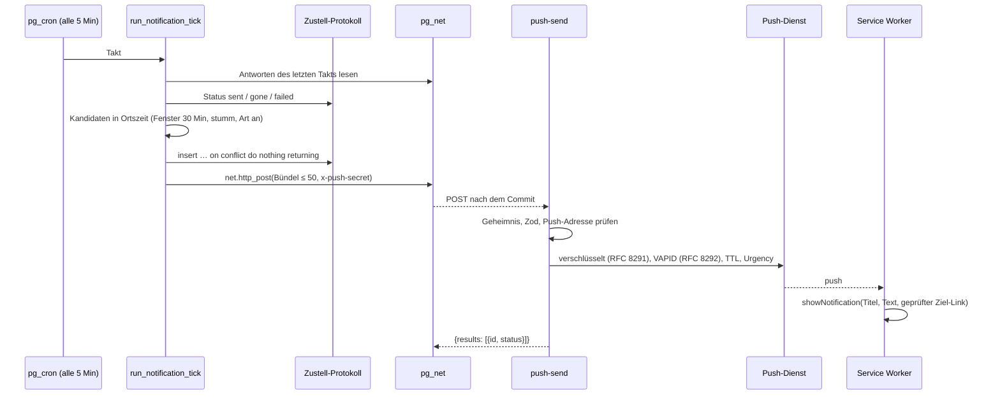
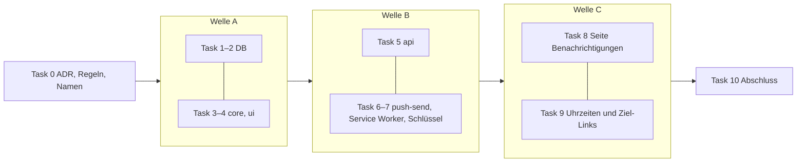

# 0013 — Plan

## Ansatz

Die Datenbank plant, eine Edge Function stellt zu (ADR-0014, Entwurf in diesem Plan; D40 A). Drei
neue Spalten (Zeitzone am Haushalt, Uhrzeit an der Aufgabe, Reservierung am Restaurant-Eintrag)
und die synchronisierte Tabelle `notification_settings` kommen in die unveröffentlichte Grundlage
(ADR-0012). Push-Abos und Zustell-Protokoll liegen im Schema `private`, ohne Grants, nur über
`security definer`-RPCs bzw. den Zeitplaner erreichbar. `pg_cron` ruft alle 5 Minuten
`private.run_notification_tick()` auf; die Funktion sucht fällige Nachrichten in der Ortszeit des
Haushalts, schreibt sie mit eindeutigem Schlüssel je Gerät ins Protokoll und gibt sie gebündelt
per `pg_net` an `push-send`. `push-send` prüft das geteilte Geheimnis, verschlüsselt nach RFC 8291,
signiert mit VAPID und hat weder Datenbankzugang noch `service_role`. Der Service Worker der PWA
zeigt die Nachricht und öffnet beim Tipp eine geprüfte Seite. `packages/core` bekommt die reinen
Regeln der Seite (Texte, Uhrzeiten, Geräte-Zustand, Ziel-Links), `packages/api` Abbildung,
Befehle, RPCs und das Abmelden des Geräts, `packages/ui` ein Uhrzeit-Feld, die App die Seite
„Benachrichtigungen“, die Felder „Uhrzeit“ und „Reserviert um“ sowie die Ziel-Links. Betroffen:
`supabase` (Migrationen, Tests, Function, `config.toml`), `core`, `api`, `ui`, `app`,
`apps/app/scripts`, `scripts`.

**Entscheidungen beim Planen** (Empfehlung des Plans, vom Eigentümer vorab freigegeben; was eine
Annahme ist, steht zusätzlich als `OFFEN` in den Offenen Fragen der Spec, Nr. 4 bis 8):

1. **Neue Datei in der Grundlage, Spalten in ihren Bereichsdateien (ADR-0012).** Es ist nichts
   ausgeliefert. `households.timezone` kommt in `…062344_identity.sql`, `chores.due_time` in
   `…062351_chores.sql`, die Reservierung in `…062352_activities_and_meal_plan.sql`. Neu ist
   `supabase/migrations/20261121062355_notifications.sql` (zwischen `…062354_shopping.sql` und
   `…062356_shopping_rpcs.sql`, Zeitstempel von Hand) mit `pg_net`, Einstellungen, Push-Abos,
   Protokoll, Zeitplaner, RPCs und Cron-Jobs. `apply_changes.sql` und `sync_pull.sql` werden
   direkt geändert. Alles additiv, keine destruktive Änderung, keine Daten zu übernehmen. **Diese
   Spec muss vor dem ersten `supabase db push` der Spec 0014 fertig sein**; danach ginge das nur
   noch mit neuen Migrationen.
2. **Push-Abos und Protokoll im Schema `private`** (`private.push_subscriptions`,
   `private.notification_deliveries`) statt in `public` ohne Grants. So stehen sie nicht einmal in
   der API und nicht in `types.gen.ts`; RLS ist trotzdem an (ohne Policies), für den Fall, dass
   jemand das Schema später freigibt. Vorbild: `private.recipe_deletions`, `ai_usage`.
3. **Einstellungen als Zeile je Mitglied, angelegt vom Server.** Ein Trigger nach dem Einfügen in
   `household_members` legt die Zeile mit den Standardwerten an (D36: nur Aufgaben und
   Reservierung an). Die Standardwerte stehen damit an genau einer Stelle (Spaltendefaults); App
   und Zeitplaner lesen immer eine Zeile. Mitglieder dürfen nur ihre eigene Zeile lesen und die
   Einstellungs-Spalten ändern; kein `insert`, kein `delete`. Wer den Haushalt verlässt, verliert
   die Zeile per Fremdschlüssel (`on delete cascade`), mit Grabstein.
4. **Uhrzeiten in 5-Minuten-Schritten** (Offene Frage 5 A). Einstellungen, Aufgabe und
   Reservierung speichern `time` mit Minute durch 5 teilbar, Sekunde 0 (Check
   `private.is_five_minute_time`). Der Takt läuft zur vollen 5. Minute, eine Nachricht kommt also
   in dem Takt, der ihre Uhrzeit erreicht (AC-015: 7:25 nichts, 7:30 ja).
5. **Fälligkeits-Fenster:** Ein Takt sendet, was `due_at ≤ jetzt` und `due_at > jetzt − 30 Min`
   ist und für dieses Gerät noch nicht im Protokoll steht. Damit gelten AC-031 und AC-034, und ein
   Gerät, das um 7:32 dazukommt, bekommt den Überblick von 7:30 noch im nächsten Takt.
6. **Eindeutige Schlüssel** (`dedupe_key`, eindeutig zusammen mit dem Push-Abo):
   `daily:<household>:<profile>:<datum>`, `eve:<household>:<profile>:<datum>`,
   `chore:<chore_id>:<datum>`, `reservation:<entry_id>:<datum>:<uhrzeit>`, `test:<uuid>`. Die
   Uhrzeit der Einstellung steht nicht im Schlüssel (AC-032: neue Uhrzeit, kein zweiter Überblick);
   die Uhrzeit der Reservierung schon: Wird die Reservierung nach der Erinnerung verlegt, kommt
   eine neue Erinnerung (Offene Frage 7 A).
7. **Höchstens einmal** (Offene Frage 6 A): Eine Zeile im Protokoll wird vor dem Senden
   geschrieben; scheitert der Aufruf oder antwortet der Push-Dienst mit einem Fehler, wird das
   vermerkt (`failed`), nicht wiederholt. Zwei Takte, die sich überlappen, schließt eine
   Transaktions-Sperre (`pg_try_advisory_xact_lock`) aus; der zweite tut nichts.
8. **Stumm bei Abwesenheit** (Offene Frage 4 A): Eine Person bekommt nichts, wenn sie (oder der
   ganze Haushalt) am **Sendetag** oder am **Tag, um den es geht**, abwesend ist. Damit gilt AC-020
   (Vorabend vor dem Urlaub) und AC-035 (während des Urlaubs) mit einer Regel.
9. **Wer betroffen ist (D39, Offene Frage 3 A):**
   - Essen (Rezept, Sammlung, Reste, Freitext, Restaurant): wer in `eater_ids` steht; leere Liste
     heißt alle (wie `core/recap.ts`). „du kochst“ bei `cook_id = Person`.
   - Aktivitäten (Überblick und Vorabend): alle Mitglieder, die nicht stumm sind (REQ-006).
   - Aufgaben: `fixed` → `coalesce(next_assignee_id, memberId)`; `rotating` → `next_assignee_id`,
     ohne ihn alle der Rotation; `anyone` und `together` → alle Mitglieder (wie `choreMemberIds`).
   - Vorbereitung für morgen: der Koch des morgigen Rezept-Eintrags, ohne Koch alle, die mitessen;
     nur der Vorlauf (`lead_time`) des eingeplanten Rezepts selbst, wie die „Übersicht“
     (`today-meals.tsx`).
   - Reservierung: wer mitisst.
10. **„Fällig“ wie `core`:** Überblick-Teil „Aufgaben“ = `dueChores` (überfällig, heute fällig,
    flexibel ab 80 %), ohne pausierte (`active_months`) und ohne „bei Bedarf“. Erinnerung zur
    Uhrzeit nur bei `next_due_on = heute` und `due_time` gesetzt, nie „bei Bedarf“, nie pausiert.
    Erledigt oder übersprungen schiebt `next_due_on` weiter, damit entfällt die Erinnerung von
    selbst (AC-025). Die Regeln stehen damit in SQL **und** in `core`; Gleichlauf sichern die Tests
    in `notification_parity.test.sql` mit denselben benannten Fällen wie `overview.test.ts`
    (`dueChores`) und `chores.test.ts` (`choreMemberIds`). Die Konstante 0,8 steht in SQL mit
    Verweis auf `FLEXIBLE_DUE_FROM`.
11. **Texte** (Titel immer „Housekeeping“, wie die Skizze im Konzept 3.14; Uhrzeiten `H:MM`):
    - Überblick: `Heute: ` + Einträge des Tages nach Mahlzeit-Reihenfolge und `sort` (Aktivitäten
      und Essen gemischt), dann Aufgaben (überfällig zuerst), dann `Für morgen: <Vorlauf>`, alles
      mit `·` getrennt. Formen: `Lasagne (Abend, du kochst)`, `Bouldern (Vormittag)`,
      `Eislaufen (Hohenschönhausen, Vormittag)`, `Reste: Lasagne (Mittag)`,
      `Trattoria Da Enzo (Abend, 19:30)`, `Bad putzen (du)`, `Blumen gießen`,
      `Müll rausbringen (du, 19:00)`, `Fenster Wohnzimmer (du, überfällig)` (Offene Frage 8 A).
    - Vorabend: `Morgen: Eislaufen (Hohenschönhausen), Vormittag · Kino, Abend` (AC-019, AC-021).
    - Aufgabe: `Müll rausbringen · 19:00 · du bist dran`; bei `anyone`/`together` ohne „du bist
      dran“ (AC-024).
    - Reservierung: `Trattoria Da Enzo um 19:30 · in 2 Stunden · Route ›`; „in 30 Minuten“, „in 1
      Stunde“, „in n Stunden“; „· Route ›“ nur, wenn das Restaurant einen Ort hat (Karten-Link oder
      Adresse).
    - Probe: `Probe: So sehen deine Benachrichtigungen aus.` (AC-009).
    - Text höchstens 400 Zeichen; was darüber geht, endet mit ` · …`.
12. **Ziel-Links** (geprüft im Service Worker und in der App, sonst `/`; AC-037, AC-038):
    `/?haushalt=<id>` (Überblick → „Übersicht“), `/haushalt?aufgabe=<id>&haushalt=<id>`,
    `/kalender?tag=<JJJJ-MM-TT>&eintrag=<id>&haushalt=<id>` (Reservierung; Vorabend mit genau einer
    Aktivität), `/kalender?tag=<JJJJ-MM-TT>&haushalt=<id>` (Vorabend mit mehreren),
    `/einstellungen/benachrichtigungen` (Probe). Ist `haushalt` ein eigener Haushalt und nicht der
    gewählte, wechselt die App zu ihm; sonst bleibt sie, wo sie ist. Unbekannte Aufgabe oder
    Eintrag: die Seite öffnet ohne Fenster.
13. **Frist beim Push-Dienst (Offene Frage 1 A):** `TTL` = Sekunden bis Mitternacht des Sendetags
    (Überblick, Vorabend, Aufgabe) bzw. bis zur Reservierungsuhrzeit, mindestens 60. `Urgency:
high` für Aufgabe und Reservierung, sonst `normal`.
14. **Erinnern-Werte (Offene Frage 2 A):** `remind_minutes_before` ∈ {30, 60, 120, 180, 240},
    Standard 120, Auswahl über den vorhandenen `Menu`-Baustein („Erinnern 2 h vorher ▾“).
15. **Reservierung nur bei Restaurant-Einträgen:** Check `reserved_at is null or kind =
'restaurant'` an `meal_plan_entries` (AC-030, 23514). `remind_minutes_before` ist `not null
default 120` an jeder Zeile und wirkt nur mit `reserved_at`.
16. **Zeitzone:** `households.timezone text not null default 'Europe/Berlin'`, ohne Grant zum
    Schreiben (Nicht-Ziel: keine Einstellung). Der Takt nimmt nur Haushalte, deren Zone in
    `pg_timezone_names` steht; ein ungültiger Wert legt also nie den ganzen Takt lahm. Uhrzeiten
    zwischen 2:00 und 3:00 am Tag der Zeitumstellung verschieben sich um eine Stunde (hingenommen).
17. **„Auf diesem Gerät“ aus behält das Abo** (Offene Frage 8 A): Der Schalter setzt `enabled`,
    das Gerät bleibt in „Deine Geräte“ mit „aus“. „Entfernen“ und Abmelden löschen das Abo.
18. **Gerät erkennt sich über die Push-Adresse.** Die App merkt sich auf dem Gerät `push.wanted`
    und die zuletzt angemeldete Push-Adresse (Geräte-Einstellung, nicht synchronisiert, beim
    Abmelden gelöscht). `list_push_subscriptions(p_current_endpoint)` liefert `is_current`, aber nie
    eine Push-Adresse oder Schlüssel. Beim Öffnen mit Netz entscheidet `core.deviceAction`:
    neue Adresse oder anderer VAPID-Schlüssel bei erteilter Erlaubnis → neu anmelden (AC-039);
    gleiche Adresse, Server kennt sie nicht mehr (anderswo entfernt) → Gerät vergisst sich
    (AC-041); „nicht erreichbar“ → neu anmelden; Erlaubnis entzogen → vergessen. Nie eine Frage
    nach der Erlaubnis beim Start (AC-003).
19. **Eine Push-Adresse gehört dem, der sie zuletzt anmeldet** (Offene Frage 8 A). Meldet sich auf
    einem Browser eine andere Person an (die vorige hat sich ohne Netz abgemeldet), zieht das Abo
    zur neuen Person um. Die Adresse ist nur dem Browser bekannt; ohne sie lässt sich nichts
    umhängen.
20. **Grenzen:** höchstens 10 Push-Abos je Person (`too_many_devices`); „Probe senden“ höchstens 3
    in 10 Minuten (`rate_limited`); Gerätename 1 bis 60 Zeichen; Push-Adresse höchstens 1024
    Zeichen, `https://` und ein bekannter Push-Dienst (`fcm.googleapis.com`,
    `updates.push.services.mozilla.com`, `web.push.apple.com`, `*.notify.windows.com`); `p256dh`
    base64url mit 65 Byte, `auth` base64url mit 16 Byte; `push-send` nimmt höchstens 50 Nachrichten
    und 128 KB je Aufruf.
21. **Web-Push-Verschlüsselung selbst auf WebCrypto** (`_shared/web-push.ts`, etwa 200 Zeilen:
    ECDH P-256, HKDF-SHA-256, AES-128-GCM, ES256-JWT) statt einer Bibliothek. Begründung
    (`10-security.md`, neue Abhängigkeit): läuft gleich in Deno und in vitest unter Node 24, kein
    neues Paket, und RFC 8291 Anhang A sowie RFC 8292 liefern prüfbare Testvektoren. Ausweg, falls
    der Testvektor nicht in einem Tag grün wird: `jsr:@negrel/webpush` (Deno, WebCrypto), mit
    Begründung im Commit.
22. **Übergabe Datenbank → `push-send`:** Vault-Einträge `push_send_url` und `push_send_secret`.
    Fehlen sie, plant der Takt nichts, schreibt nichts ins Protokoll und meldet `raise warning
'push_not_configured'`; „Probe senden“ antwortet mit `push_not_configured`. Kopfzeile
    `x-push-secret`, `verify_jwt = false` wie bei den anderen Functions. Lokal zeigt
    `push_send_url` auf das Kong-Gateway im Docker-Netz
    (`http://supabase_kong_housekeeping-app:8000/functions/v1/push-send`; beim Bau prüfen, sonst
    `http://host.docker.internal:54321/…`).
23. **Antworten im nächsten Takt:** `push-send` antwortet `{results: [{id, status}]}` (nur
    Protokoll-Kennung und HTTP-Status des Push-Dienstes, nie Adresse oder Inhalt).
    `private.collect_push_responses()` liest `net._http_response` zu den offenen Kennungen: 2xx →
    `sent` und `last_success_at`; 404/410 → `gone`, Abo `gone_at = now()` (AC-039); sonst `failed`
    und `failure_count + 1`; ohne Antwort nach 1 Stunde → `failed`.
24. **Service Worker nur im Export.** Push-Empfang und Tipp stehen in `sw-template.js`; der
    Entwicklungsserver hat keinen Service Worker. Lokal geprüft wird deshalb im gebauten Export auf
    `http://127.0.0.1:8790` (`e2e/serve.mjs`); im Entwicklungsserver zeigt „Dieses Gerät“ nur dort
    den Hinweis „Im Entwicklungsserver gibt es keine Benachrichtigungen“ (`__DEV__`). Eine
    ungültige Nachricht zeigt trotzdem eine Benachrichtigung („Öffne die App, um mehr zu sehen.“),
    weil Browser stumme Push-Nachrichten mit dem Entzug der Erlaubnis bestrafen.
25. **Seite „Benachrichtigungen“:** `/einstellungen/benachrichtigungen`. Am Handy eine eigene Seite
    mit „‹ Einstellungen“; ab Tablet-Breite `ListDetail` mit der Liste der Einstellungen links
    (Profil, Darstellung, KI, Benachrichtigungen, Abmelden) und dem gewählten Abschnitt rechts
    (AC-002; ersetzt die heutigen zwei Spalten). Je Art ein `SwitchRow` mit Untertitel; „›“ öffnet
    ein Fenster mit `TimeField` und beim Überblick den Teilen als Chips (mindestens ein Teil; der
    letzte lässt sich nicht abwählen). Gehört jemand zu mehreren Haushalten, steht der Name im
    Abschnittstitel („Was und wann · Enrico & Nadja · gilt für alle Geräte“; Offene Frage 3 e).
26. **Erlaubnis nur auf Tipp** (AC-003, AC-007): Einschalten von „Auf diesem Gerät
    benachrichtigen“, einer Art oder Setzen einer Uhrzeit (Aufgabe, Reservierung) ruft
    `ensureDevicePush()`. Die Erlaubnis wird als **erster** Schritt im Tipp-Handler erfragt (Safari
    verlangt eine Nutzer-Geste), erst danach kommen Netzaufrufe. Die Einstellung selbst wird auch
    gespeichert, wenn der Browser ablehnt; „Dieses Gerät“ zeigt dann „nicht erlaubt“.
27. **Uhrzeit eintippen statt Rad:** `TimeField` in `packages/ui` ist ein Textfeld mit ✕
    (Tastatur und Screenreader ohne Sonderbau, auf allen Plattformen gleich). `core.parseTimeInput`
    liest „19“, „1930“, „19:30“, „7.30“; „19:03“ → „Bitte in 5-Minuten-Schritten“, „25:00“ →
    „Keine gültige Uhrzeit“.
28. **Abmelden meldet das Gerät ab** (AC-042): `createAuthController` bekommt `beforeSignOut`
    (höchstens 3 s). Die App ruft dort `subscription.unsubscribe()` im Browser (geht auch ohne
    Netz) und mit Netz `unregister_push_subscription`. Ohne Netz bleibt die Zeile, bis der
    Push-Dienst 404/410 meldet (Tabelle „Offline und Konflikte“ der Spec).

## Datenbank und Sync

Umsetzung mit dem `db-change`-Skill und `supabase-postgres-best-practices`, in der Grundlage
(ADR-0012). Kein Code zum Übernehmen alter Daten; jede lokale Datenbank braucht danach einmal
`pnpm db:reset`. **Alles additiv**, keine destruktive Änderung.

| Datei                                         | Änderung                                                                                                                                                                                                                             |
| --------------------------------------------- | ------------------------------------------------------------------------------------------------------------------------------------------------------------------------------------------------------------------------------------ |
| `20261121062344_identity.sql`                 | `households.timezone` (Standard „Europe/Berlin“, Länge 1–64, kein Grant zum Schreiben)                                                                                                                                               |
| `20261121062351_chores.sql`                   | `chores.due_time time null` mit Check `private.is_five_minute_time`; Grants `insert`/`update` um `due_time`                                                                                                                          |
| `20261121062352_activities_and_meal_plan.sql` | `meal_plan_entries.reserved_at time null` (5-Minuten-Check), `remind_minutes_before smallint not null default 120` (∈ 30, 60, 120, 180, 240), Check `meal_plan_entries_reservation_only_restaurant`; Grants um beide Spalten         |
| neu `20261121062355_notifications.sql`        | `create extension pg_net`; `notification_settings`; Trigger an `household_members`; Push-Abos, Protokoll, Zeitplaner, RPCs, Cron-Jobs                                                                                                |
| `20261121062343_foundation.sql`               | `private.is_five_minute_time(time)` (`immutable`), weil Spalten in `identity`/`chores`/`meal_plan` es früher brauchen                                                                                                                |
| `20261121062357_apply_changes.sql`            | Allowlist: `chores` `due_time` in `insert`/`patch`; `meal_plan_entries` `reserved_at`, `remind_minutes_before` in `insert`/`patch`; `notification_settings` `insert: []`, `patch` = die sieben Einstellungs-Spalten, `delete: false` |
| `20261121062359_sync_pull.sql`                | `c_tables` um `notification_settings`                                                                                                                                                                                                |
| `supabase/seed.sql` (erzeugt), `seed/demo.ts` | „Müll rausbringen“ mit 19:00; ein Restaurant-Eintrag „Trattoria Da Enzo“ übermorgen abends mit Reservierung 19:30; Einstellungen kommen vom Trigger                                                                                  |

**`public.notification_settings`** (haushaltsbezogen, synchronisiert, nur das Mitglied selbst):

| Spalte                          | Typ und Regel                                                                                         |
| ------------------------------- | ----------------------------------------------------------------------------------------------------- |
| `id`, `household_id`            | wie jede Tabelle; `unique (household_id, id)`, Index `(household_id, updated_at)`                     |
| `member_id`                     | `uuid not null`, `(household_id, member_id)` → `household_members on delete cascade`; eindeutig       |
| `daily_summary_enabled`         | `boolean not null default false`                                                                      |
| `daily_summary_at`              | `time not null default '07:30'`, 5-Minuten-Check                                                      |
| `daily_summary_parts`           | `text[] not null default '{meals,activities,chores,prep}'`, 1–4 Werte aus genau diesen, ohne Doppelte |
| `activities_eve_enabled`        | `boolean not null default false`                                                                      |
| `activities_eve_at`             | `time not null default '19:00'`, 5-Minuten-Check                                                      |
| `chore_reminders_enabled`       | `boolean not null default true`                                                                       |
| `reservation_reminders_enabled` | `boolean not null default true`                                                                       |
| `created_at`, `updated_at`      | wie jede Tabelle, `attach_sync_triggers`                                                              |

- **RLS** (eigene Policies statt `attach_household_policies`): `select` und `update` nur bei
  `household_id in (select private.my_household_ids()) and member_id = (select auth.uid())`;
  keine Policy für `insert` und `delete`. **Grants:** `select`; `update` nur der sieben
  Einstellungs-Spalten. `anon` nichts.
- **Trigger** `household_members_create_notification_settings` (nach `insert`, `security definer`,
  `search_path = ''`): legt die Zeile an, `on conflict do nothing`.

**`private.push_subscriptions`** (gehört einer Person, nicht synchronisiert): `id uuid`,
`profile_id uuid not null → profiles on delete cascade` (Index), `endpoint text not null unique`
(Check `private.is_push_endpoint`), `p256dh text`, `auth text` (Format-Checks), `device_label text`
(1–60), `enabled boolean not null default true`, `gone_at timestamptz`, `last_success_at
timestamptz`, `failure_count integer not null default 0`, `created_at`, `updated_at`. RLS an, keine
Policy, kein Grant.

**`private.notification_deliveries`** (gehört dem Server): `id bigint generated always as
identity`, `dedupe_key text not null` (≤ 200), `subscription_id uuid not null →
private.push_subscriptions on delete cascade`, `profile_id uuid not null`, `household_id uuid null
→ households on delete cascade`, `kind text` (`daily_summary`, `activities_eve`,
`chore_reminder`, `reservation_reminder`, `test`), `due_at timestamptz`, `status text`
(`pending`, `sent`, `failed`, `gone`), `request_id bigint`, `http_status smallint`, `created_at`,
`updated_at`; `unique (dedupe_key, subscription_id)`, Index `(request_id) where status =
'pending'`, Index `(created_at)`. **Kein Inhalt gespeichert** (Titel und Text entstehen im Takt und
gehen nur an `push-send`). RLS an, keine Policy, kein Grant.

**Funktionen** (alle `search_path = ''`, voll qualifiziert; `execute` von `public` entzogen):

| Funktion                                                                                     | Art                                 | Zweck                                                                                                                                                                      |
| -------------------------------------------------------------------------------------------- | ----------------------------------- | -------------------------------------------------------------------------------------------------------------------------------------------------------------------------- |
| `private.is_push_endpoint(text)`                                                             | `immutable`                         | `https://` + bekannter Push-Dienst, kein Port, keine Anmeldedaten, Länge ≤ 1024                                                                                            |
| `private.is_silent(household, profile, day)`                                                 | `stable`                            | eigene oder Haushalts-Abwesenheit an diesem Tag                                                                                                                            |
| `private.chore_due_state(chores, day)`                                                       | `stable`                            | `overdue` / `today` / `flexible_due` / leer, wie `dueChores`                                                                                                               |
| `private.chore_assignees(chores)`                                                            | `stable`                            | `uuid[]` der Zuständigen, leer = alle Mitglieder, wie `choreMemberIds`                                                                                                     |
| `private.daily_summary_candidates(p_now)` … `private.reservation_reminder_candidates(p_now)` | `stable`                            | je Art: `household_id, profile_id, kind, dedupe_key, due_at, expires_at, title, body, url`; nur Mitglieder, Art an, nicht stumm, im 30-Minuten-Fenster                     |
| `private.notification_candidates(p_now)`                                                     | `stable`                            | Vereinigung der vier; **die Stelle, die pgTAP mit fester Uhrzeit prüft**                                                                                                   |
| `private.collect_push_responses()`                                                           | `volatile`                          | Entscheidung 23                                                                                                                                                            |
| `private.run_notification_tick(p_now timestamptz default now())`                             | `security definer`, nur für Cron    | Sperre, Vault lesen, Antworten auswerten, Kandidaten × aktive Abos ins Protokoll (`on conflict do nothing returning`), Bündel zu ≤ 50 per `net.http_post` (Zeitlimit 20 s) |
| `private.purge_notification_deliveries()`                                                    | `security definer`, nur für Cron    | Protokoll älter als 30 Tage, Abos seit 30 Tagen `gone`                                                                                                                     |
| `public.register_push_subscription(p_endpoint, p_p256dh, p_auth, p_device_label)` → `uuid`   | `security definer`, `authenticated` | Prüfen (`invalid_subscription` 22023), Grenze (`too_many_devices` 22023), Upsert nach Adresse für `auth.uid()`, `enabled`, `gone_at` leer                                  |
| `public.set_push_subscription_enabled(p_endpoint, p_enabled)`                                | ebenso                              | nur eigenes Abo; unbekannt → `not_found` (P0002)                                                                                                                           |
| `public.unregister_push_subscription(p_endpoint)`                                            | ebenso                              | eigenes Abo löschen; fehlt es, kein Fehler                                                                                                                                 |
| `public.remove_push_subscription(p_id)` → `boolean`                                          | ebenso                              | eigenes Abo löschen; fremde Kennung → `false`, ohne zu verraten, ob es sie gibt                                                                                            |
| `public.list_push_subscriptions(p_current_endpoint text default null)`                       | ebenso                              | `id, device_label, status (active/off/unreachable), is_current, created_at, last_success_at` der eigenen Abos; **nie** Adresse oder Schlüssel                              |
| `public.send_test_push(p_endpoint)`                                                          | ebenso                              | nur eigenes, aktives Abo; Grenze (`rate_limited` 22023); Vault fehlt → `push_not_configured`; sofort `net.http_post` für genau dieses Abo                                  |

Alle RPCs: `auth.uid()` leer → `not_authenticated` (42501). `execute` nur für `authenticated`.
`list_push_subscriptions` liefert Zeilen aus einer `security definer`-Funktion; das ist kein
Sync-Weg (nur eigene Zeilen, nur online, nicht im Cache) und wird im `/security-check` so geprüft.

**Cron-Jobs:** `notification-tick` `*/5 * * * *` → `select private.run_notification_tick()`;
`purge-notification-deliveries` `35 3 * * *`.

**Sync und Cache:** `notification_settings` kommt in `sync_pull` (RLS liefert jedem nur die eigene
Zeile; der Grabstein beim Austritt ist für den Haushalt sichtbar und enthält nur die Kennung),
`packages/api/src/db/tables.ts` (`ID_TABLES`, `WRITABLE_COLUMNS` nur Patch, kein Insert, kein
Delete) und `db/mapping.ts` (`HouseholdData.notificationSettings`, `Chore.dueTime`,
`MealPlanEntry.reservedAt`/`remindMinutesBefore`; `households.timezone` wird gelesen, nie
geschrieben). Neue Tabelle und Spalten ändern die Form des Caches: `CACHE_VERSION` 6 → 7 (hat ihn
Spec 0009 bis dahin erhöht, der nächste freie Wert). Push-Abos und Protokoll kommen nie in den
Cache. `docs/architecture/sync.md` bekommt den „Nachtrag Spec 0013“ (Task 2 und Task 5).

**Schreibwege je Aktion:**

| Aktion                         | Weg                                                                             | Offline                        |
| ------------------------------ | ------------------------------------------------------------------------------- | ------------------------------ |
| Art an/aus, Uhrzeit, Teile     | `apply_changes`: Patch der eigenen `notification_settings`-Zeile                | gesperrt                       |
| Uhrzeit an der Aufgabe         | `apply_changes`: Patch `chores.due_time` (wie „Aufgabe bearbeiten“, Spec 0011)  | gesperrt                       |
| Reserviert um, Erinnern        | `apply_changes`: Patch `meal_plan_entries.reserved_at`, `remind_minutes_before` | gesperrt                       |
| Dieses Gerät an / aus          | `register_push_subscription` / `set_push_subscription_enabled`                  | gesperrt                       |
| Probe senden                   | `send_test_push`                                                                | gesperrt                       |
| Deine Geräte lesen / Entfernen | `list_push_subscriptions` / `remove_push_subscription`                          | Hinweis statt Liste / gesperrt |
| Abmelden                       | Browser `unsubscribe()` + mit Netz `unregister_push_subscription`               | Browser-Teil geht              |

## Risiken und Gegenmaßnahmen

Kritische Pfade: neue personenbezogene Tabellen mit eigener Zugriffsregel (nicht Haushalt,
sondern Person), eine von außen erreichbare Edge Function, ausgehende Aufrufe an Adressen aus
Nutzereingaben, Zeitplaner mit `security definer` über alle Haushalte, `pg_net`, Vault und neue
Secrets, Grundlagen-Migration, Löschen (Abos, Protokoll, Einstellungen beim Austritt), Abmelden.

### Bedrohungsmodell

| Wert                        | Wo                                               | Wer darf                                        | Schaden bei Verlust                                                                      |
| --------------------------- | ------------------------------------------------ | ----------------------------------------------- | ---------------------------------------------------------------------------------------- |
| Privater VAPID-Schlüssel    | Secret der Function                              | nur `push-send`                                 | mit bekannten Push-Adressen beliebige Nachrichten an unsere Geräte (Phishing)            |
| Geteiltes Geheimnis         | Vault + Secret der Function                      | Zeitplaner, `send_test_push`, `push-send`       | `push-send` als Sender missbrauchen (an bekannte Push-Dienste, mit unserem VAPID)        |
| Push-Adressen und Schlüssel | `private.push_subscriptions`, Bündel an `pg_net` | die Person über RPCs (ohne Adresse), Zeitplaner | Ziel für fremde Nachrichten (braucht zusätzlich den privaten Schlüssel), personenbezogen |
| Tagesablauf (Texte)         | entsteht im Takt, Push-Dienste (verschlüsselt)   | die betroffene Person                           | wer wann wo ist                                                                          |
| Einstellungen               | `notification_settings`                          | das Mitglied selbst                             | Gewohnheiten (wann jemand aufsteht)                                                      |

**Vertrauensgrenzen:** Gerät ↔ PostgREST (RLS, RPCs) · Datenbank ↔ `push-send` (`pg_net`,
Geheimnis) · Internet ↔ `push-send` (öffentliche Adresse) · `push-send` ↔ Push-Dienste
(ausgehend) · Push-Dienst ↔ Service Worker (Inhalt und Ziel-Link) · Build ↔ App-Bundle (nur der
öffentliche Schlüssel).

**Angreifer:** Mitglied desselben Haushalts (Nadja gegen Enricos Abos und Einstellungen),
Mitglied eines fremden Haushalts, abgemeldeter Aufruf, beliebiger Aufrufer von `push-send` aus dem
Internet, manipulierte Nachricht oder Ziel-Link, ein Fehler im Zeitplaner (Flut, falsche Person).

| Was könnte schiefgehen                                                                                  | Gegenmaßnahme                                                                                                                                                          | Getestet durch                                                                                                                                                                                |
| ------------------------------------------------------------------------------------------------------- | ---------------------------------------------------------------------------------------------------------------------------------------------------------------------- | --------------------------------------------------------------------------------------------------------------------------------------------------------------------------------------------- |
| Nadja liest oder ändert Enricos Einstellungen (AC-013)                                                  | Policies mit `member_id = auth.uid()`; kein `insert`/`delete`                                                                                                          | pgTAP `notification_settings.test.sql`: Nadja sieht 0 Zeilen von Enrico, `update` ändert 0 Zeilen; `sync_pull` als Nadja ohne Enricos Zeile                                                   |
| Fremdes Mitglied oder `anon` liest Einstellungen                                                        | RLS, kein Grant an `anon`                                                                                                                                              | pgTAP: fremdes Mitglied 0 Zeilen, `anon` 42501                                                                                                                                                |
| Mitglied verschiebt seine Einstellungen in einen anderen Haushalt oder zu einer anderen Person          | kein Grant auf `household_id`, `member_id`                                                                                                                             | pgTAP: `update` dieser Spalten → 42501; `apply_changes`-Patch → `invalid_change`                                                                                                              |
| Nadja liest, ändert, entfernt oder sendet an Enricos Push-Abos (AC-043)                                 | Tabellen in `private` ohne Grants; RPCs filtern nach `auth.uid()`, fremde Kennung → `false`, keine Adresse in Antworten                                                | pgTAP `push_subscriptions.test.sql`: direkter Zugriff 42501; `remove` fremde Kennung → `false`, Zeile bleibt; `set_…_enabled`/`send_test_push` mit fremder Adresse → `not_found`              |
| Abgemeldeter Aufruf legt Abo an, liest Einstellungen oder löst „Probe“ aus (AC-043)                     | `execute` nur `authenticated`; `not_authenticated` in jeder RPC                                                                                                        | pgTAP als `anon` je RPC → 42501                                                                                                                                                               |
| SSRF: Abo mit `http://127.0.0.1:54321/x` oder internem Host lässt `push-send` interne Adressen aufrufen | `private.is_push_endpoint` beim Anlegen **und** dieselbe Liste in `push-send` vor jedem `fetch`; `redirect: 'manual'`; Zeitlimit                                       | pgTAP AC-044 (drei Fälle); vitest `push-endpoint.test.ts` und `handler.test.ts`: abgelehnte Adresse → kein `fetch`, Status `rejected`                                                         |
| Mitglied ruft `net.http_post` oder liest den Vault direkt (SSRF, Geheimnis)                             | kein `usage` auf `net`/`vault` für `anon`/`authenticated`; falls Supabase es gewährt, entzieht die Migration es                                                        | pgTAP: `has_function_privilege('authenticated', 'net.http_post(…)', 'execute')` falsch; `vault.decrypted_secrets` → 42501                                                                     |
| Mitglied ruft den Zeitplaner, liest das Protokoll (AC-046)                                              | Schema `private` nicht freigegeben, `execute` entzogen                                                                                                                 | pgTAP als `authenticated` und `anon`: `run_notification_tick`, `notification_candidates`, Protokoll → 42501; `schema_lint`                                                                    |
| Gefälschter Aufruf von `push-send` (AC-045)                                                             | Geheimnis zeitkonstant verglichen; fehlt `PUSH_SEND_SECRET`, antwortet sie 500; nur `POST`; Größe ≤ 128 KB; Zod                                                        | vitest `handler.test.ts`: ohne/falsch → 401, ungültig → 400, `GET` → 405, zu groß → 413, jeweils kein `fetch`; Smoke gegen den lokalen Stack                                                  |
| `push-send` liest doch `service_role` oder die Datenbank (AC-046)                                       | Function bekommt `env` über `deps`; nur vier Namen erlaubt                                                                                                             | vitest `no-db-access.test.ts`: Quellen von `push-send` und ihren Importen ohne `SUPABASE_SERVICE_ROLE_KEY`, `SUPABASE_DB_URL`, `supabase-js`, `createClient`, `Deno.env` außerhalb `index.ts` |
| Privater Schlüssel oder Geheimnis im App-Bundle (AC-046)                                                | nur `EXPO_PUBLIC_VAPID_PUBLIC_KEY` hat den Präfix; `check-web-export` sucht die Werte von `VAPID_PRIVATE_KEY` und `PUSH_SEND_SECRET` (falls in der Umgebung) im Export | `check-web-export.test.mjs`: Export mit dem Wert → Fehler; Ausgabe nennt den Namen, nie den Wert                                                                                              |
| Secret in Logs (Function, `pg_net`, App)                                                                | keine Ausgabe von Adressen, Schlüsseln, Inhalten; Fehler nur mit Code                                                                                                  | vitest: `console` beobachtet, enthält weder Adresse noch Text; Review im `/security-check`                                                                                                    |
| Doppelte Nachricht (zweiter Takt, überlappende Takte, neue Uhrzeit) (AC-032)                            | `unique (dedupe_key, subscription_id)`, Transaktions-Sperre, Schlüssel ohne Uhrzeit der Einstellung                                                                    | pgTAP: Takt zweimal mit derselben Zeit → eine Zeile je Gerät; Uhrzeit 7:30 → 8:00 um 7:45 → kein zweiter Kandidat                                                                             |
| Flut: Fehler im Zeitplaner schickt jeden Takt dieselbe Nachricht                                        | derselbe eindeutige Schlüssel; höchstens 50 je Bündel, Bündel nur für neu eingefügte Zeilen                                                                            | pgTAP: drei Takte im Fenster → eine Zeile je Gerät und Schlüssel                                                                                                                              |
| Falsche Person bekommt eine Nachricht (D39)                                                             | Regeln aus Entscheidung 9 in SQL; Gleichlauf mit `core`                                                                                                                | pgTAP AC-016, AC-020, AC-023, AC-024, AC-026, AC-028; `notification_parity.test.sql`                                                                                                          |
| Nachricht während Abwesenheit oder nach dem Austritt (AC-035, AC-036)                                   | `private.is_silent` an Sende- und Bezugstag; Empfänger nur über `household_members`; Einstellungen gehen mit                                                           | pgTAP AC-020, AC-026, AC-035 (Person und Haushalt), AC-036 (Abo der entfernten Person bleibt, keine Kandidaten)                                                                               |
| Zeitumstellung, Zeitzone falsch (AC-033)                                                                | Ortszeit + `at time zone` im Takt; ungültige Zone übersprungen                                                                                                         | pgTAP mit `p_now` 28.3.2027 05:30 UTC und 29.3.2027 05:30 UTC → je ein Kandidat um 7:30 Ortszeit; Haushalt mit ungültiger Zone stört andere nicht                                             |
| Zu spät Nachgeholtes nervt (AC-031, AC-034)                                                             | 30-Minuten-Fenster                                                                                                                                                     | pgTAP AC-031, AC-034                                                                                                                                                                          |
| Manipulierte Nachricht öffnet eine fremde oder schädliche Adresse (AC-038)                              | Ziel-Link im Service Worker gegen eine feste Liste geprüft (nur eigene Pfade), sonst `/`; App prüft Parameter mit Zod                                                  | `sw-push.test.mjs` (fremder Host, `javascript:`, `//evil`, unbekannter Pfad → `/`); core `parseNotificationTarget`-Tests                                                                      |
| Inhalt der Nachricht verrät mehr als nötig (AC-040)                                                     | Kandidaten bauen nur Titel, Text, Ziel-Link; keine E-Mail, keine Notizen von Rezept/Restaurant/Abwesenheit, keine fremde Kennung im Link                               | pgTAP AC-040: Text und Link je Art gegen eine Liste verbotener Felder (Notiz-Texte und E-Mail aus den Fixtures kommen nicht vor)                                                              |
| Abgelaufenes Abo bekommt weiter Nachrichten (AC-039)                                                    | 404/410 → `gone_at`; Takt nimmt nur Abos ohne `gone_at` und mit `enabled`                                                                                              | pgTAP mit eingefügter Zeile in `net._http_response` (Status 410) → Abo `unreachable`, nächster Takt ohne dieses Abo                                                                           |
| Viele Abos oder Proben als Belastung                                                                    | höchstens 10 Abos, 3 Proben in 10 Minuten                                                                                                                              | pgTAP: 11. Abo → `too_many_devices`; 4. Probe → `rate_limited`                                                                                                                                |
| Abmelden auf einem geteilten Gerät lässt Nachrichten weiterlaufen (AC-042)                              | `beforeSignOut`: Browser abmelden, mit Netz RPC                                                                                                                        | api `auth.test.ts`: Hook läuft vor dem Löschen, auch wenn er scheitert oder hängt (3 s); App-Durchlauf                                                                                        |
| Ein anderes Konto übernimmt eine fremde Push-Adresse                                                    | nur mit der Adresse möglich, die nur der Browser kennt und die keine RPC herausgibt; Umzug ist Absicht (Entscheidung 19)                                               | pgTAP: Umzug setzt Besitzer, alter Besitzer sieht das Abo nicht mehr; `list_push_subscriptions` enthält keine Adresse                                                                         |
| Ausgehende Aufrufe von `push-send` hängen oder werden umgeleitet                                        | `AbortSignal.timeout(10 s)`, `redirect: 'manual'`, höchstens 5 gleichzeitig                                                                                            | vitest mit hängendem `fetch`-Fake → Status `null`, Antwort kommt                                                                                                                              |
| Fehlende Secrets bleiben unbemerkt                                                                      | Takt meldet `push_not_configured` als Warnung und plant nichts; Function 500 mit Variablenname im Log; Seite zeigt Hinweis bei „Probe senden“                          | pgTAP ohne Vault-Einträge → keine Zeile im Protokoll; vitest ohne Variable → 500                                                                                                              |
| Benachrichtigung auf dem Sperrbildschirm zeigt den Tagesablauf Umstehenden                              | Inhalt minimal; Einstellungen je Art aus                                                                                                                               | hingenommen (Plattform-Einstellung des Geräts)                                                                                                                                                |
| Baseline wird nach dem ersten Produktions-Push noch geändert                                            | Reihenfolge: 0013 vor dem ersten `db push` (Spec 0014)                                                                                                                 | Abschluss-Check in Task 10                                                                                                                                                                    |
| Cron und `pg_net` laufen lokal anders als in der Cloud                                                  | Smoke gegen den lokalen Stack; erster Produktions-Test in Spec 0014                                                                                                    | Task 7 Smoke, Task 10 Durchlauf                                                                                                                                                               |

## Aufgaben

Jede Aufgabe ist einzeln abschließbar: Test rot → Implementierung → Test grün → Gate → Commit mit
`Spec: 0013`. **Gate je Aufgabe:** `pnpm format:check && pnpm check`; dazu
`pnpm db:reset && pnpm exec supabase test db`, wenn `supabase/migrations` oder `supabase/tests`
berührt sind; dazu `pnpm e2e:dev` grün, die App startet ohne Fehler in der Konsole. Die volle
e2e-Suite läuft erst am Ende aller Wellen. Jede App-Aufgabe trägt ihre e2e-Brüche in
`tmp/brief/e2e-impact.md` ein (Abschnitt „Spec 0013“, erwartete Brüche siehe unten). Belege in
`tmp/0013/`.

**Reihenfolge und Parallelität** (höchstens zwei Bau-Agenten gleichzeitig, auf getrennten
Dateien):

- Welle A: Agent DB berührt nur `supabase/migrations`, `supabase/tests`, `types.gen.ts`, den
  Datenbank-Teil von `sync.md`. Agent core/ui berührt nur `packages/core`, `packages/ui`,
  `docs/design/DESIGN.md`, `.agents/glossary.md`.
- Welle B: Agent api berührt `packages/api` und `supabase/seed.sql` (erzeugt). Agent Zustellung
  berührt `supabase/functions`, `supabase/config.toml`, `apps/app/scripts`, `scripts/push-keys*`,
  `scripts/db-reset.mjs`, `scripts/edge-smoke.mjs`.
- Welle C: Agent Seite berührt `features/settings`, neu `features/notifications`, die Routen unter
  `einstellungen`, `lib/settings*`, `app/_layout.tsx`, die Verdrahtung des Auth-Controllers in
  `apps/app/src/lib`, neu `e2e/dev/notifications.spec.ts`. Agent Uhrzeiten berührt
  `features/chores`, `features/meal-plan`, `features/calendar`, `features/today/today-meals.tsx`,
  neu `e2e/dev/times.spec.ts`. Den Schritt „Erlaubnis beim Setzen einer Uhrzeit“ (AC-007) macht
  Task 9 erst, wenn Task 8 `useDevicePush` committet hat.
- **Start:** Welle A beginnt, wenn die offenen Änderungen von Spec 0012 (Arbeitsbaum, Stand
  21.11.2026) committet sind. DB-Aufgaben von Spec 0009 und dieser Spec laufen nacheinander.

### Task 0 — Vorbereitung: ADR-0014, Regeln, Namen (Lead, vor Welle A)

- **Deckt ab:** Voraussetzungen 1 bis 3 der Spec
- **Berührt:** `docs/adr/0014-zustellung-von-benachrichtigungen.md` (Entwurf liegt vor; Status →
  `angenommen`, Freigabe D40 und Vorab-Freigabe des Plans), `docs/adr/README.md` (Status),
  `AGENTS.md` (Regel 4 und 5), `.claude/rules/30-database.md`, `.claude/rules/31-sync.md`,
  `.claude/rules/10-security.md`, `.env.example` (nur Namen), `docs/architecture/sync.md`
  (Tabelle „Ziel“), `README.md` nur falls es die Regeln wiederholt
- **Test:** keiner (Dokumentation); `pnpm format:check`; `AGENTS.md` bleibt unter 150 Zeilen
  (heute 134)
- **Status:** offen

**Text für `AGENTS.md`** (ersetzt Regel 4 und 5; Englisch wie die Datei):

> 4. **Read offline, write online.** The UI reads only from the local cache. Writes go to Supabase
>    and are disabled offline — except the store-mode actions and packing (ADR-0008 addendum,
>    ADR-0013). One read is online-only: the signed-in person's own push subscriptions ("Deine
>    Geräte", ADR-0014). See `docs/architecture/sync.md`.
> 5. **Every table is tenant-scoped and synced.** `household_id`, Row Level Security, explicit
>    grants, a pgTAP isolation test, server-set `updated_at` and a delete trigger — always together.
>    Use the `db-change` skill. Reviewed exceptions live in the `private` schema with RLS and no
>    grants, are never synced and are reached only through `security definer` functions:
>    per-person data (push subscriptions) and server-owned logs (notification deliveries,
>    ADR-0014).

**Text für `.claude/rules/30-database.md`**, unter „Every table“ als letzter Punkt:

> - **Exceptions (ADR-0014):** a table that belongs to a person or to the server, not to a
>   household (push subscriptions, notification deliveries), goes into the `private` schema with
>   RLS enabled, no policies and no grants. It is not synced, has no delete trigger, and is reached
>   only through `security definer` functions that filter by `auth.uid()` or run from `pg_cron`.
>   Its pgTAP test proves that `anon` and `authenticated` cannot touch it directly and that the
>   functions never return another person's rows.

und unter „Migrations“:

> - `pg_cron` jobs and `pg_net` calls are infrastructure: name them in the plan, keep secrets and
>   target URLs in the Supabase Vault, never in a migration, and test the function they call with
>   an injected time (`p_now`).

**Text für `.claude/rules/31-sync.md`**, nach „Reads come from the local cache.“:

> - **One online-only read:** the person's own push subscriptions ("Deine Geräte") come from
>   `list_push_subscriptions`, never from the cache, and show an offline hint without network
>   (ADR-0014). Push subscriptions and the delivery log are never synced. Notification settings
>   are a normal synced table, readable only by the member herself.

**Text für `.claude/rules/10-security.md`**, unter „Keys and secrets“:

> - The VAPID private key and the push shared secret exist only as Supabase Function secrets and
>   in the Vault (ADR-0014). Only the VAPID **public** key may be an `EXPO_PUBLIC_*` value. The
>   owner sets these values himself; agents never generate, print or read them.

**Namen in `.env.example`** (neuer Abschnitt „Web Push“, Werte leer): `EXPO_PUBLIC_VAPID_PUBLIC_KEY`
(öffentlich, im App-Build), `VAPID_PUBLIC_KEY`, `VAPID_PRIVATE_KEY`, `PUSH_SEND_SECRET` (nur für
`push-send` und den Vault; Kommentar: „erzeugt mit `node scripts/push-keys.mjs`, nie ausgeben“).
`VAPID_SUBJECT` steht lokal als nicht geheimer Wert in `config.toml`.

**Zeile für `sync.md`, Tabelle „Ziel“:** „Ohne Netz möglich: Benachrichtigungen empfangen (der
Server stellt zu)“ · „Braucht Netz: Benachrichtigungen einstellen, Geräte anmelden und ansehen“.

### Task 1 — Datenbank: Spalten, Einstellungen, Sync (Agent DB, Welle A)

- **Deckt ab:** AC-011 (Standard), AC-012 (Daten), AC-013, AC-022 (Spalte), AC-027 (Spalten),
  AC-029 (Werte), AC-030, AC-036 (Einstellungen gehen)
- **Berührt:** `…062343_foundation.sql` (`is_five_minute_time`), `…062344_identity.sql`,
  `…062351_chores.sql`, `…062352_activities_and_meal_plan.sql`, neu `…062355_notifications.sql`
  (Teil Einstellungen), `…062357_apply_changes.sql`, `…062359_sync_pull.sql`, neu
  `supabase/tests/notification_settings.test.sql`, `apply_changes.test.sql`,
  `domain_references.test.sql` bzw. `domain_isolation.test.sql` (neue Spalten), `sync_pull.test.sql`,
  `schema_lint.test.sql` (Trigger-Funktion in der Liste der `security definer`-Funktionen),
  `packages/api/src/db/types.gen.ts` (`pnpm db:types`)
- **Test (pgTAP, zuerst rot):** neues Mitglied → genau eine Zeile mit den Standardwerten (AC-011);
  Enrico ändert seine Zeile (`daily_summary_enabled`, 6:45, `{meals,chores}`), `updated_at` steigt
  (AC-012); Nadja sieht Enricos Zeile nicht, `update` trifft 0 Zeilen, `sync_pull` als Nadja ohne
  sie (AC-013); fremdes Mitglied 0 Zeilen, `anon` 42501; `insert`/`delete` durch `authenticated`
  → 42501; `household_id`/`member_id` ändern → 42501; Teile leer, doppelt, unbekannt → 23514;
  6:47 → 23514; Mitglied entfernen → Zeile weg, Grabstein im Haushalt; `chores.due_time` 19:00 ok,
  19:03 → 23514, über `apply_changes` gepatcht; Reservierung 19:30 an einem Restaurant-Eintrag ok,
  `remind_minutes_before` 90 → 23514, `reserved_at` an „Lasagne“ direkt und über `apply_changes`
  → 23514 (AC-030); `households.timezone` ist „Europe/Berlin“ und für Mitglieder nicht änderbar;
  `apply_changes` mit `notification_settings`-Insert oder -Delete → `invalid_change`.
- **Status:** offen

### Task 2 — Datenbank: Push-Abos, Protokoll, Zeitplaner, RPCs, Cron (Agent DB, Welle A, nach Task 1)

- **Deckt ab:** AC-008 bis AC-010 (Server), AC-014 bis AC-021, AC-023 bis AC-026, AC-028,
  AC-029, AC-031 bis AC-036, AC-039 (Server), AC-040, AC-041 (Server), AC-043, AC-044, AC-046
  (Datenbank-Teil)
- **Berührt:** `…062355_notifications.sql` (`pg_net`, Tabellen in `private`, Funktionen aus der
  Tabelle oben, Cron-Jobs, `revoke` auf `net`/`vault` falls nötig), neu
  `supabase/tests/push_subscriptions.test.sql`, `notification_scheduler.test.sql`,
  `notification_delivery.test.sql`, `notification_parity.test.sql`, `schema_lint.test.sql`,
  `supabase/tests/_helpers.psql` (Hilfen: Abo anlegen, Vault-Einträge setzen, `p_now` aus
  Ortszeit), `types.gen.ts`, `docs/architecture/sync.md` (Nachtrag Spec 0013, Datenbank-Teil:
  Tabellen, Takt, Schlüssel, Fenster, Antworten, Grenzen)
- **Test (pgTAP, zuerst rot; Beispieltag Freitag, 20.11.2026, Europe/Berlin):**
  - _Abos:_ anlegen, Liste ohne Adresse mit `is_current` (AC-004 Server); an/aus nur eigenes
    (AC-008); `remove` eigenes / fremdes → `false` (AC-041, AC-043); direkter Zugriff 42501,
    `anon` je RPC 42501 (AC-043); `http://127.0.0.1:54321/x`, `https://evil.example/x`,
    fehlerhafte Schlüssel → `invalid_subscription`, nichts gespeichert (AC-044); 11. Abo →
    `too_many_devices`; Umzug einer Adresse zur neuen Person.
  - _Probe:_ nur dieses Abo bekommt einen Eintrag und einen Aufruf in `net.http_request_queue`
    (AC-009); ausgeschaltetes Abo → `not_found` (AC-010 Server); 4. Probe in 10 Minuten →
    `rate_limited`; ohne Vault → `push_not_configured`.
  - _Kandidaten mit fester Uhrzeit:_ AC-014 (Art aus → nichts); AC-015 (Text genau wie in der
    Spec, 7:25 leer, 7:30 da); AC-016 (Nadja nur „Bouldern (Vormittag)“); AC-017 (nur Aufgaben,
    nichts fällig → nichts); AC-018 (überfällig im Überblick, keine eigene Erinnerung); AC-019,
    AC-020, AC-021 (eine Nachricht, keine ohne Aktivität); AC-023 (nur Enrico, Text);
    AC-024 (beide, ohne „du bist dran“); AC-025 (erledigt, ohne Uhrzeit, „bei Bedarf“ → nichts);
    AC-026 (fest zuständig und abwesend → niemand); AC-028 (beide / nur Enrico, Text mit „Route
    ›“); AC-029 (1 h → 18:30, „in 1 Stunde“); AC-031 (zu spät eingetragen → nichts); AC-033
    (Sommerzeit: 7:30 Ortszeit am 28. und 29.3.2027); AC-034 (Takt 9:00: kein Überblick, „Paket
    abholen“ ja); AC-035 (Person und ganzer Haushalt); AC-036 (entfernte Person: kein Kandidat,
    obwohl ihr Abo besteht); AC-040 (keine E-Mail, keine Notizen, keine fremde Kennung im Link);
    Ziel-Links je Art (Entscheidung 12); TTL je Art (Entscheidung 13).
  - _Takt:_ zweimal mit derselben Zeit → eine Zeile je Gerät (AC-032); Uhrzeit um 7:45 auf 8:00 →
    kein zweiter (AC-032); ein Bündel je 50; ausgeschaltetes und `gone`-Abo bekommen nichts
    (AC-008, AC-039); ohne Vault keine Zeile; überlappender Takt (Sperre gehalten) tut nichts.
  - _Antworten:_ eingefügte `net._http_response` mit `results` 201 → `sent`, `last_success_at`;
    410 → `gone`, Abo „nicht erreichbar“ (AC-039); 500 → `failed`; keine Antwort nach 1 h →
    `failed`.
  - _Rechte:_ `run_notification_tick`, `notification_candidates`, Protokoll als `authenticated`
    und `anon` → 42501 (AC-046); `net.http_post` und `vault.decrypted_secrets` nicht erreichbar;
    alle neuen `security definer`-Funktionen mit `search_path = ''` (`schema_lint`).
  - _Aufräumen:_ Protokoll älter als 30 Tage weg, jüngeres bleibt; Cron-Jobs eingetragen.
  - _Gleichlauf_ (`notification_parity.test.sql`): dieselben benannten Fälle wie `dueChores` in
    `overview.test.ts` und `choreMemberIds` in `chores.test.ts`, je Fall ein `is()`.
- **Status:** offen

### Task 3 — core: Regeln der Seite, Uhrzeiten, Geräte, Ziel-Links (Agent core/ui, Welle A)

- **Deckt ab:** AC-001 („2 an“), AC-003 bis AC-007 (Zustände), AC-011 (Untertitel), AC-022,
  AC-027, AC-029, AC-037, AC-038, AC-039 (Gerät), AC-041 (Gerät)
- **Berührt:** neu `packages/core/src/notifications.ts` + `notifications.test.ts`,
  `packages/core/src/types.ts` (`NotificationSettings` aus Zod-Schema, `Chore.dueTime`,
  `MealPlanEntry.reservedAt`, `remindMinutesBefore`), `household-row.ts` + Test (Uhrzeit an der
  Aufgabe), `test-fixtures.ts`, `index.ts`, `.agents/glossary.md` (Einträge „Tagesüberblick“,
  „Benachrichtigungs-Einstellungen“, „Push-Abo“, „Zustell-Protokoll“, „Zeitplaner“, „Reservierung“
  nicht mehr vorläufig, mit den endgültigen Namen; neu „Takt“, „Probe“, „Uhrzeit (Aufgabe)“
  `dueTime`, `due_time`)
- **Test (zuerst rot):** `enabledKindsLabel` „2 an“ bei den Standardwerten, „Alle aus“ (AC-001);
  `kindSubtitle` „7:30 · Essen · Aktivitäten · Aufgaben · Vorbereitung“, „19:00“, „2 h vorher, je
  Eintrag änderbar“ (AC-011); `parseTimeInput` und `formatTime` (Entscheidung 27); `REMIND_CHOICES`
  und `remindLabel` „30 Min vorher“, „1 h vorher“, „2 h vorher“ (AC-029); `withTime("Müll
rausbringen", "19:00")` = „Müll rausbringen · 19:00“, ohne Uhrzeit unverändert (AC-022, AC-025);
  `choreTimeHint(true/false)` (AC-022); `pushSupport` → `supported`, `ios-needs-home-screen`,
  `unsupported`, `dev-no-worker` (AC-006); `permissionStatus` „✓ erlaubt“, „nicht erlaubt“ mit
  Hinweis (AC-004, AC-005); `deviceLabel` für Mac/Chrome, Mac/Firefox, iPhone als App, Android,
  Windows/Edge, Rest „Browser“ (AC-004, AC-041); `deviceAction` mit allen Fällen aus
  Entscheidung 18, nie `request-permission` ohne Tipp (AC-003, AC-039, AC-041);
  `parseNotificationTarget` für jede Form aus Entscheidung 12, fremder Host, `javascript:`,
  `//evil`, unbekannter Pfad, kaputte Kennung → Übersicht (AC-037, AC-038); `householdRow` zeigt
  „Müll rausbringen · 19:00“ (AC-022).
- **Status:** offen

### Task 4 — ui: Uhrzeit-Feld (Agent core/ui, Welle A, nach Task 3)

- **Deckt ab:** AC-022, AC-027, AC-029 (Eingabe), Barrierefreiheit der Plattformen
- **Berührt:** neu `packages/ui/src/time-field.tsx` (`TimeField`: auf `TextField`, Ziffern-Tastatur,
  ✕ zum Leeren mit Beschriftung aus der Feature-Seite, Fehlertext, `accessibilityLabel`; keine
  eigene Logik, Lesen und Prüfen kommen über Props aus `core`), `index.ts`, falls nötig
  `SwitchRow` um einen Detail-Knopf „›“ (`onDetail`, eigener Knopf, nicht verschachtelt),
  `docs/design/DESIGN.md` (Abschnitt „Uhrzeit-Feld“, „Schalter mit Detail“)
- **Test (zuerst rot):** reine Funktion für die Ansage (`timeFieldA11yValue("19:00")` = „19:00“,
  leer = „keine Uhrzeit“); `SwitchRow`-Detail als eigener Knopf (Prüfung der Props-Logik ohne
  Rendering, wie `disclosure-state.test.ts`).
- **Status:** offen

### Task 5 — api: Abbildung, Befehle, Geräte-RPCs, Abmelden, Fake, Seed (Agent api, Welle B)

- **Deckt ab:** AC-004, AC-005, AC-008 bis AC-013, AC-022, AC-027, AC-029, AC-039, AC-041 bis
  AC-044 (Weg zum Server und zurück)
- **Berührt:** `packages/api/src/db/tables.ts`, `db/mapping.ts` + `mapping.test.ts`, `store.ts`
  (`HouseholdData.notificationSettings`), `backend.ts` (`CACHE_VERSION` + 1), `changes.ts`
  (`TABLE_ORDER` um `notification_settings`), `transport.ts`, `transport-supabase.ts` (sechs RPCs),
  `transport-fake.ts` (Tabelle und Spalten mit Checks, eigene-Zeile-Regel, Trigger beim Mitglied,
  RPC-Regeln und Grenzen wie pgTAP), neu `commands-notifications.ts` +
  `commands-notifications.backend.test.ts` (`updateNotificationSettings`, `registerDevicePush`,
  `setDevicePushEnabled`, `unregisterDevicePush`, `removePushDevice`, `listPushDevices`,
  `sendTestPush`), `commands-chores.ts` (`dueTime`), `commands-plan.ts` (`setReservation`), deren
  Tests, `queries.ts` (`useNotificationSettings`), `auth.ts` + `auth.test.ts` (`beforeSignOut`),
  `index.ts`, `seed/demo.ts`, `seed/demo.test.ts`, `supabase/seed.sql` (`pnpm db:seed:gen`), neu
  `notifications.integration.test.ts`, `docs/architecture/sync.md` (Nachtrag Spec 0013,
  Geräte-Teil: eigene Zeile im Cache, Online-Liste, Abmelden)
- **Test (zuerst rot, gegen den Fake):** Hin- und Rückweg der Einstellungen, `timezone` wird nie
  geschrieben; `updateNotificationSettings` schickt einen Patch mit nur den geänderten Feldern und
  ist sofort im Cache sichtbar (AC-012); offline → `OfflineError` je Befehl (REQ-001 bis REQ-004,
  REQ-010); `setReservation` an einem Rezept-Eintrag → abgelehnt mit „Hat nicht geklappt – bitte
  noch einmal versuchen“, nichts sichtbar (AC-030); `listPushDevices` liefert `isCurrent` und keine
  Adresse; `rejectedMessage` für `invalid_subscription` „Dieses Gerät konnte nicht angemeldet
  werden“ (AC-044), `too_many_devices` „Zu viele Geräte – entferne zuerst ein altes“,
  `rate_limited` „Bitte kurz warten und dann noch einmal“, `push_not_configured`
  „Benachrichtigungen sind auf dem Server noch nicht eingerichtet“; `beforeSignOut` läuft vor dem
  Löschen des Caches, ein Fehler oder Hängen (3 s, falsche Uhr) hält das Abmelden nicht auf
  (AC-042); Cache-Version + 1 behält Warteschlange und Haushaltswahl. Integration
  (`pnpm test:integration`): Enrico meldet ein Gerät an, Liste zeigt es; Nadja kann es nicht
  entfernen; abgemeldeter Client → Fehler; Einstellungen auf „Gerät“ 1 geändert, auf „Gerät“ 2
  nach dem Abgleich gleich (AC-012). Seed: `demo.test.ts` prüft Uhrzeit und Reservierung.
- **Status:** offen

### Task 6 — Edge Function `push-send` und Web-Push-Verschlüsselung (Agent Zustellung, Welle B)

- **Deckt ab:** AC-009 (Zustellung), AC-039 (Antwort 404/410), AC-040, AC-044 (zweite Prüfung),
  AC-045, AC-046 (Function-Teil)
- **Berührt:** neu `supabase/functions/push-send/{index.ts,handler.ts,handler.test.ts}`, neu
  `supabase/functions/push-send/no-db-access.test.ts`, neu `_shared/web-push.ts` +
  `web-push.test.ts`, neu `_shared/push-endpoint.ts` + `push-endpoint.test.ts`, `_shared/deps.ts`
  (falls die Abhängigkeiten dort zusammenkommen), `supabase/config.toml` (`[functions.push-send]`
  mit `verify_jwt = false` und `import_map`; `[edge_runtime.secrets]` `VAPID_PUBLIC_KEY`,
  `VAPID_PRIVATE_KEY`, `PUSH_SEND_SECRET` als `env(...)`, `VAPID_SUBJECT` als lokaler, nicht
  geheimer Wert), `supabase/functions/README.md` (Zeile in der Tabelle, „Environment“,
  Ausnahme: kein JWT, sondern Geheimnis; keine CORS-Antworten), `scripts/edge-smoke.mjs`
- **Test (zuerst rot, vitest ohne Netz):** RFC 8291 Anhang A: aus den Schlüsseln und dem Salz des
  Anhangs entsteht genau der Anhang-Text; RFC 8292: das JWT hat `aud` = Origin der Push-Adresse,
  `exp` ≤ 24 h, `sub` = `VAPID_SUBJECT` und lässt sich mit dem öffentlichen Schlüssel prüfen;
  Kopfzeilen `Authorization: vapid t=…, k=…`, `Content-Encoding: aes128gcm`, `TTL`, `Urgency`;
  Handler: ohne/falsches Geheimnis → 401, ungültiger Inhalt (Zod), mehr als 50 Nachrichten oder
  mehr als 128 KB → 400/413, `GET` → 405, jeweils kein `fetch` (AC-045); Adresse außerhalb der
  Liste → Status `rejected`, kein `fetch` (AC-044); Push-Dienst antwortet 201 / 404 / 410 / 500 →
  genau dieser Status je `id` (AC-039); hängender `fetch` → `null` nach Zeitlimit; Antwort enthält
  nur `id` und `status` (AC-040); `console` enthält weder Adresse, Schlüssel noch Text; fehlende
  Variable → 500 mit Name im Log. `no-db-access.test.ts` nach AC-046. Smoke (`node
scripts/edge-smoke.mjs`, lokaler Stack): ohne/falsch → 401, ungültig → 400, gültige Form mit
  einer erfundenen FCM-Adresse → 200 mit dem Status von FCM (ohne Ausgabe der Adresse).
- **Status:** offen

### Task 7 — Service Worker, Export-Prüfung, Schlüssel und lokaler Vault (Agent Zustellung, Welle B, nach Task 6)

- **Deckt ab:** AC-009 (Anzeige), AC-037, AC-038 (Service Worker), AC-046 (Bundle), „lokal in
  Desktop-Chrome prüfbar“ (Ziel der Spec)
- **Berührt:** `apps/app/scripts/sw-template.js` (`push`: JSON lesen, Form prüfen,
  `showNotification('Housekeeping', {body, icon: '/icons/icon-192.png', data: {url}})`, ungültig →
  allgemeine Nachricht; `notificationclick`: Ziel prüfen, offenes Fenster fokussieren und
  `postMessage({type: 'open', path})`, sonst `clients.openWindow(path)`; Hilfen `safeTarget` und
  `notificationFromPayload` als reine Funktionen), neu `apps/app/scripts/sw-push.test.mjs`
  (`node:test`, lädt die Datei mit `node:vm` und einem Fake-`self`), `apps/app/package.json`
  (`test` um die neue Datei), `check-web-export.mjs` + `check-web-export.test.mjs` (`sw.js` hat
  `push` und `notificationclick`; `EXPO_PUBLIC_VAPID_PUBLIC_KEY` gesetzt und base64url mit 65 Byte;
  die Werte von `VAPID_PRIVATE_KEY` und `PUSH_SEND_SECRET` kommen im Export nicht vor, wenn sie in
  der Umgebung stehen), `finish-web-export.mjs` (bricht ohne `EXPO_PUBLIC_VAPID_PUBLIC_KEY` ab, wie
  ohne Supabase-Adresse; CSP bleibt unverändert, `connect-src` braucht für Push nichts), neu
  `scripts/push-keys.mjs` + `scripts/push-keys.test.mjs` (erzeugt Schlüsselpaar und Geheimnis mit
  WebCrypto, schreibt nur fehlende Namen in `.env` oder mit `--out <datei>` in eine eigene Datei,
  gibt nie einen Wert aus), `scripts/db-reset.mjs` (nach dem Zurücksetzen: ist `PUSH_SEND_SECRET`
  gesetzt, legt es `push_send_secret` und `push_send_url` im lokalen Vault an, über `psql` mit
  `\getenv`, Ausgabe nur „gesetzt“ / „nicht gesetzt: lokal keine Benachrichtigungen“)
- **Test (zuerst rot):** `sw-push.test.mjs`: gültige Nachricht → Titel, Text, Link; kaputtes JSON →
  allgemeine Nachricht; `safeTarget` für jede Form aus Entscheidung 12 und die Angriffsfälle aus
  Task 3 (AC-038); `notificationclick` mit offenem Fenster → `postMessage`, ohne → `openWindow`;
  `check-web-export.test.mjs`: fehlender Push-Handler, fehlender oder kaputter öffentlicher
  Schlüssel, Export mit dem Wert des privaten Schlüssels → Fehler; `push-keys.test.mjs` in einem
  Ordner unter `tmp/`: schreibt vier Namen, überschreibt keinen vorhandenen, Ausgabe ohne Werte.
  Beleg: `pnpm db:reset` meldet „gesetzt“, ein Takt im lokalen Stack ruft `push-send` (Zeile in
  `cron.job_run_details` und `net._http_response`, Status 200).
- **Status:** offen

### Task 8 — App: Seite „Benachrichtigungen“, dieses Gerät, Abmelden, Tipp auf eine Nachricht (Agent Seite, Welle C)

- **Deckt ab:** AC-001 bis AC-013, AC-039 (Gerät meldet sich neu an), AC-041, AC-042, AC-037
  (Tipp-Verdrahtung)
- **Berührt:** Routen `apps/app/src/app/(tabs)/einstellungen.tsx` → `einstellungen/index.tsx` und
  neu `einstellungen/benachrichtigungen.tsx` (dünn), `features/settings/settings-screen.tsx`
  (Zeile „Benachrichtigungen · 2 an ›“, `ListDetail` ab Tablet-Breite), neu
  `features/notifications/` (`notifications-screen.tsx`, `device-section.tsx`,
  `kinds-section.tsx`, `kind-sheet.tsx`, `devices-section.tsx`, `use-device-push.ts`
  (`ensureDevicePush`, Zustand aus `core.deviceAction`), `web-push-platform.ts` (Browser-Zugriff:
  `serviceWorker.ready`, `pushManager`, `Notification.permission`; nativ „nicht unterstützt“),
  `use-notification-open.ts` (Nachricht `open` vom Service Worker → `parseNotificationTarget` →
  Router, Haushaltswechsel), `labels.ts`), `lib/settings` (Geräte-Zustand `push`), `app/_layout.tsx`
  (Abgleich des Geräts beim Start mit Netz, `use-notification-open`), Verdrahtung von
  `beforeSignOut` dort, wo der Auth-Controller entsteht, neu `e2e/dev/notifications.spec.ts`
- **Test (zuerst rot):** Logik liegt in `core` (Task 3); hier `pnpm e2e:dev` mit
  `notifications.spec.ts`: Zeile „Benachrichtigungen · 2 an“ und kein Eintrag unter „Verwalten“
  (AC-001); Desktop 1440 px Liste und Detail (AC-002); Standardwerte (AC-011); Tagesüberblick an,
  6:45, nur „Essen“ und „Aufgaben“ → nach Neuladen gleich (AC-012); Entwicklungsserver-Hinweis bei
  „Dieses Gerät“, „Probe senden“ ausgegraut mit „Erst auf diesem Gerät einschalten“ (AC-010);
  offline: Schalter ausgegraut mit Hinweis, „Deine Geräte“ mit „Offline – deine Geräte siehst du
  mit Netz“ (REQ-002, REQ-010); kein Erlaubnis-Dialog beim Durchklicken aller Bereiche (AC-003,
  Playwright meldet jede Anfrage). Der Rest (Erlaubnis, Probe, zwei Browser, Entfernen, Abmelden)
  im Durchlauf von Task 10.
- **Status:** offen

### Task 9 — App: Uhrzeit an der Aufgabe, Reservierung, Ziel-Seiten (Agent Uhrzeiten, Welle C)

- **Deckt ab:** AC-007 (Uhrzeit setzen), AC-022, AC-025 (Anzeige), AC-027, AC-029, AC-030 (UI),
  AC-037 (Ziel-Seiten öffnen)
- **Berührt:** `features/chores/chore-form.tsx`, `chore-sheet.tsx`, `new-chore-sheet.tsx`
  („Uhrzeit“ mit `TimeField`, ✕, Hinweis zur eigenen Einstellung), `chore-row.tsx`,
  `chore-labels.ts` („· 19:00“), `chores-screen.tsx` (Parameter `aufgabe` öffnet die Aufgabe),
  `features/calendar/calendar-screen.tsx` (Parameter `eintrag` öffnet den Eintrag, `haushalt`),
  `calendar-parts.tsx` und die Ansichten (Haushalt-Zeile mit Uhrzeit, Restaurant-Eintrag mit
  „19:30“), `features/meal-plan/entry-sheet.tsx` („Reserviert um“ und „Erinnern 2 h vorher ▾“ nur
  bei Restaurant-Einträgen), `features/today/today-meals.tsx` (Karte zeigt „19:30“), neu
  `e2e/dev/times.spec.ts`; zuletzt `ensureDevicePush` aus Task 8 beim Setzen einer Uhrzeit
- **Test (zuerst rot):** `pnpm e2e:dev` mit `times.spec.ts`: „Müll rausbringen“ bearbeiten, 19:00
  setzen → „Zu tun“ am Fälligkeitstag und die Haushalt-Zeile zeigen „Müll rausbringen · 19:00“,
  darunter der Hinweis (AC-022); ✕ entfernt die Uhrzeit (AC-025); Restaurant-Eintrag 19:30 →
  „Erinnern 2 h vorher“, Karte auf der „Übersicht“ und Eintrag im Kalender mit „19:30“ (AC-027);
  „1 h vorher“ wählen (AC-029); Rezept- und Aktivitäts-Eintrag ohne beide Felder (AC-030);
  `/haushalt?aufgabe=<seed-id>` öffnet die Aufgabe, `/kalender?tag=…&eintrag=<seed-id>` den Eintrag
  mit „Route“, unbekannte Kennung öffnet die Seite ohne Fenster (AC-037, AC-038); offline sind
  Uhrzeit und Reservierung ausgegraut mit Hinweis.
- **Status:** offen

### Task 10 — Abschluss (Lead)

- **Deckt ab:** alle AC (Nachweis)
- **Berührt:** `docs/specs/0013-benachrichtigungen/plan.md` (Nachweis), Rückverfolgbarkeit und
  Offene Fragen der Spec, `docs/specs/0002-restaurants/spec.md` (Hinweis beim Nicht-Ziel
  „Reservierungen“: geändert durch Spec 0013, REQ-008), `tmp/brief/e2e-impact.md`
- **Test:** `pnpm format:check && pnpm check && pnpm build:web`, `pnpm db:reset && pnpm exec
supabase test db`, `pnpm test:integration`, `node scripts/edge-smoke.mjs`, `/security-check` auf
  den Diff von Task 1, 2, 5, 6, 7 und 8 (Befunde beheben oder hier eintragen), `spec-auditor`,
  `/ui-verify` (390, 768, 1440 px, hell und dunkel) für Einstellungen, „Benachrichtigungen“,
  Aufgabe bearbeiten, Restaurant-Eintrag, `impeccable`-Kritik der Seite „Benachrichtigungen“.
  **Durchlauf im echten Browser** (Belege in `tmp/0013/`): Export bauen, `e2e/serve.mjs` auf
  `127.0.0.1:8790`, installiertes Google Chrome (Playwright `channel: 'chrome'`, Chromium ohne
  Google-Schlüssel kann kein FCM), zweites Chrome-Profil als zweites Gerät. Prüfen: Erlaubnis nur
  auf Tipp (AC-003, AC-007), erlaubt / blockiert (AC-004, AC-005), Probe nur auf diesem Profil
  (AC-009), dieses Gerät aus (AC-008), Gerät entfernen (AC-041), Abmelden mit und ohne Netz
  (AC-042), Tagesüberblick zur nächsten 5-Minuten-Marke (AC-012, AC-015), Erinnerung einer Aufgabe
  (AC-023), Tipp öffnet die Seite (AC-037). Firefox (AC-008, AC-009 mit zwei Browsern) prüft Enrico
  von Hand, falls Playwright-Firefox keine Push-Nachrichten empfängt. **Reihenfolge prüfen:** Spec
  0014 hat noch kein `supabase db push` gemacht.
- **Status:** offen

## Erwartete e2e-Brüche (für `tmp/brief/e2e-impact.md`)

- **Einstellungen (rundgang-shell aus Spec 0005):** Route `/einstellungen` bleibt, ist aber jetzt
  `einstellungen/index.tsx`; ab Tablet-Breite Liste und Detail statt zwei Spalten (Test-IDs
  `settings-profile`, `settings-…` bleiben, neu `settings-nav-<abschnitt>` und
  `settings-notifications-row`).
- **Haushalt (rundgang-haushalt):** „Aufgabe bearbeiten“ hat das Feld `chore-due-time`; „Müll
  rausbringen“ trägt im Seed „· 19:00“ in „Zu tun“ und in der Haushalt-Zeile.
- **Kalender und Übersicht (rundgang-plan, rundgang-restaurants):** Restaurant-Einträge haben
  `entry-reserved-at` und `entry-remind`; der Seed hat übermorgen „Trattoria Da Enzo“ mit 19:30,
  Karte und Eintrag zeigen die Uhrzeit.
- **Seed:** neue Uhrzeit und Reservierung; Rundgänge, die den genauen Text einer Aufgabe oder
  eines Restaurant-Eintrags erwarten, sehen die Uhrzeit.
- **Export:** `build:web` bricht ohne `EXPO_PUBLIC_VAPID_PUBLIC_KEY` ab; `e2e/global-setup.ts`
  braucht ihn in `.env` (siehe „Was Enrico einrichten muss“).

## Überschneidungen mit anderen Specs

- **Spec 0009 (wird parallel geplant):** Eine Sammlung ist ein Rezept der Art „Sammlung“; der Teil
  „Essen“ des Tagesüberblicks nennt sie deshalb ohne eigene Regel wie ein Rezept (Titel aus
  `recipes`). „Vorbereitung für morgen“ nimmt nur den Vorlauf des eingeplanten Rezepts selbst,
  nicht den der enthaltenen Rezepte (wie die „Übersicht“); ändert 0009 das auf der „Übersicht“,
  zieht `daily_summary_candidates` mit. Erwartete Reibung:
  - `supabase/migrations/20261121062357_apply_changes.sql` (beide Allowlists),
    `20261121062359_sync_pull.sql` (beide `c_tables`), `apply_changes.test.sql`,
    `sync_pull.test.sql`, `schema_lint.test.sql`: DB-Aufgaben beider Specs laufen
    **nacheinander**; wer zweit einspielt, setzt seine Zeilen auf den Stand des anderen. 0009
    ändert `…062348_recipes.sql`, diese Spec nicht.
  - `packages/api/src/db/types.gen.ts` und `supabase/seed.sql`: wer zuletzt einspielt, erzeugt neu
    (`pnpm db:types`, `pnpm db:seed:gen`), statt zusammenzuführen.
  - `CACHE_VERSION`: beide erhöhen; wer zweit kommt, nimmt den nächsten freien Wert.
  - `transport-fake.ts`, `db/tables.ts`, `db/mapping.ts`, `store.ts`, `changes.ts`
    (`TABLE_ORDER`), `packages/core/src/types.ts`, `index.ts`, `seed/demo.ts`,
    `.agents/glossary.md`: Ergänzungen an getrennten Stellen; beide behalten.
  - App: 0009 ändert `features/meal-plan/add-entry-sheet.tsx` (Tab „Sammlungen“) und vermutlich die
    Kalender-Ansichten (Farbrolle „Sammlung“); Task 9 ändert `entry-sheet.tsx` und dieselben
    Ansichten (Uhrzeit). Welle C dieser Spec startet erst, wenn die App-Aufgaben von 0009 an
    diesen Dateien committet sind, oder umgekehrt.
  - ADR-Nummer: Dieser Plan belegt **ADR-0014**. Braucht Spec 0009 einen ADR, nimmt sie 0015.
  - `docs/architecture/sync.md`: je ein eigener Nachtrag am Ende.
- **Spec 0014 (Betrieb, CI/CD, Release):** Produktions-Secrets und Vault-Einträge, Deploy von
  `push-send` (`verify_jwt = false`), `EXPO_PUBLIC_VAPID_PUBLIC_KEY` im Build der Web-App (Azure
  Static Web Apps, GitHub Actions), `VAPID_SUBJECT` = Produktions-Origin (https, keine E-Mail),
  erster Test auf iPhone (installierte PWA) und Android. **Diese Spec muss vor dem ersten
  `supabase db push` fertig sein** (Entscheidung 1). Der Smoke `scripts/edge-smoke.mjs` bekommt
  `push-send` (Task 6).
- **Spec 0012 (im Bau):** offene Änderungen im Arbeitsbaum (u. a. `today-screen.tsx`,
  `packages/ui/src/check*.ts`, `e2e/dev/smoke.spec.ts`) müssen vor Welle A committet sein. Keine
  Erinnerung an Packlisten (Nicht-Ziel); Abwesenheiten werden nur gelesen.
- **Spec 0011:** „Aufgabe bearbeiten“, „Zu tun“ und die Haushalt-Zeile bekommen die Uhrzeit; die
  Regeln „fällig“ und „wer ist dran“ stehen jetzt auch in SQL (Gleichlauf-Tests).
- **Spec 0010:** Fenster eines Kalendereintrags und Kalender-Ansichten werden erweitert, der
  Parameter `tag` um `eintrag` und `haushalt`.
- **Spec 0005:** persönliche Einstellungen werden ab Tablet-Breite zu Liste und Detail (AC-002).
- **Spec 0002:** Nicht-Ziel „Reservierungen“ ist durch REQ-008 geändert (Task 10 vermerkt das).

## Was Enrico einrichten muss

Agenten erzeugen, lesen und zeigen keine Schlüssel. Alle Werte setzt Enrico selbst.

**Lokal (vor dem Durchlauf in Task 10, besser vor Welle B):**

1. `node scripts/push-keys.mjs` (aus Task 7) einmal ausführen. Es schreibt
   `EXPO_PUBLIC_VAPID_PUBLIC_KEY`, `VAPID_PUBLIC_KEY`, `VAPID_PRIVATE_KEY` und `PUSH_SEND_SECRET` in
   `.env`, nur wenn sie fehlen, und zeigt keinen Wert.
2. Stack neu starten, damit die Function die Secrets bekommt:
   `set -a; . ./.env; set +a; pnpm exec supabase stop && pnpm exec supabase start`.
3. `pnpm db:reset` legt `push_send_secret` und `push_send_url` im lokalen Vault an.

**Produktion (mit Spec 0014):**

1. Ein **eigenes** Schlüsselpaar und Geheimnis für die Produktion:
   `node scripts/push-keys.mjs --out .env.production.push` (git-ignoriert über `.env.*`).
2. `VAPID_SUBJECT=https://<Produktions-Origin>` in dieselbe Datei eintragen.
3. Function-Secrets setzen: `pnpm exec supabase secrets set --env-file .env.production.push`
   (`VAPID_PUBLIC_KEY`, `VAPID_PRIVATE_KEY`, `PUSH_SEND_SECRET`, `VAPID_SUBJECT`;
   `EXPO_PUBLIC_VAPID_PUBLIC_KEY` stört dort nicht, gehört aber in den Build).
4. Vault im SQL-Editor des Projekts:
   `select vault.create_secret('<PUSH_SEND_SECRET>', 'push_send_secret');` und
   `select vault.create_secret('https://<projekt-ref>.supabase.co/functions/v1/push-send', 'push_send_url');`
5. `EXPO_PUBLIC_VAPID_PUBLIC_KEY` als Variable im Build der Web-App (GitHub Actions / Azure SWA).
6. `push-send` deployen (`verify_jwt = false`), danach „Probe senden“ auf Desktop-Chrome, dann auf
   dem iPhone (PWA über „Teilen → Zum Home-Bildschirm“, ab iOS 16.4) und auf Android.
7. Ein Wechsel des Schlüsselpaars macht alle Abos ungültig; die Geräte melden sich beim nächsten
   Öffnen neu an, wenn die Erlaubnis noch besteht (Entscheidung 18).

## Bewusst nicht Teil dieses Plans

- Native Push (Expo), E-Mail, SMS, Knöpfe in der Nachricht, weitere Arten aus F8 (Nicht-Ziele).
- Wiederholen fehlgeschlagener Zustellungen (Entscheidung 7); Statistik über Zustellungen in der
  Oberfläche.
- Reagieren auf `pushsubscriptionchange` im Service Worker: ohne Sitzung kann er sich nicht neu
  anmelden; das macht die App beim nächsten Öffnen (AC-039).
- Ein Service Worker im Entwicklungsserver (Entscheidung 24).
- Einstellbare Zeitzone (Nicht-Ziel); Uhrzeiten außerhalb von 5-Minuten-Schritten.
- Die volle e2e-Suite: Sie läuft einmal am Ende aller Wellen, die Brüche stehen oben.

## Nachweis

Wird am Ende ausgefüllt.

- [ ] Alle AC haben einen Test, der rot war und jetzt grün ist (spec-auditor)
- [ ] `pnpm format:check && pnpm check && pnpm build:web` grün
- [ ] `pnpm exec supabase test db` grün
- [ ] `pnpm test:integration` grün (Geräte und Einstellungen)
- [ ] `node scripts/edge-smoke.mjs` grün (`push-send`)
- [ ] `/ui-verify` gelaufen, Befunde behoben oder begründet
- [ ] `/security-check` gelaufen (Task 1, 2, 5, 6, 7, 8)
- [ ] Durchlauf in Google Chrome mit echter Push-Nachricht (Probe, Tagesüberblick, Aufgabe, Tipp)
- [ ] Offline-Verhalten wie in der Spec beschrieben geprüft (Seite, Abmelden ohne Netz)
- [ ] ADR-0014 angenommen, `AGENTS.md`, `30-database.md`, `31-sync.md`, `10-security.md`,
      `sync.md`, `.env.example` nachgezogen
- [ ] Spec 0014 hat noch kein `supabase db push` gemacht
- [ ] Glossar und Rückverfolgbarkeitstabelle aktuell

## Entscheidung des Leads zur Verschlüsselung (21.11.2026)

Abweichend vom Entwurf oben wird die Web-Push-Verschlüsselung (RFC 8291) und die VAPID-Signatur
(RFC 8292) **nicht selbst gebaut**, sondern mit einer gepflegten Bibliothek für Deno umgesetzt
(`jsr:@negrel/webpush`, Version beim Bau festnageln). Begründung: selbst gebaute Kryptografie ist
ein vermeidbares Risiko; die Bibliothek nutzt ebenfalls WebCrypto und ist klein. Die Testvektoren
aus RFC 8291/8292 bleiben als Tests gegen die Bibliothek erhalten. Neue Abhängigkeit: nur in
`supabase/functions/push-send`, nicht in der App.

Schlüssel: Agenten lesen `.env` nie. Das Erzeugen der lokalen Schlüssel (`scripts/push-keys.mjs`)
schreibt Werte, ohne sie auszugeben; ausgeführt wird es von Enrico oder einmalig vom Lead, ohne
Werte anzuzeigen.
