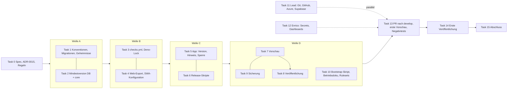

# 0014 — Plan

## Ansatz

Die Pipeline besteht aus wenigen GitHub-Workflows, die alle denselben wiederverwendbaren
Check-Workflow aufrufen: `checks.yml` läuft auf jeder PR, `preview.yml` nach jedem Zusammenführen
auf `develop`, `release.yml` nach jedem Zusammenführen auf `main`. Bauen und Ausliefern sind
getrennte Jobs: Jobs, die Code von Dritten ausführen (`pnpm install`, Expo-Export), haben keine
GitHub-Umgebung und damit kein Secret; Jobs mit Umgebung (`preview`, `production`, `backup`,
`restore-test`) installieren keine Pakete, sondern nutzen nur die Supabase-CLI, `az` und das
fertige Web-Artefakt. Azure-Zugänge laufen per OIDC über je eine verwaltete Identität, deren
föderierte Anmeldedaten an genau eine GitHub-Umgebung gebunden sind. Die Supabase-Konfiguration
der Cloud-Projekte steht in `supabase/config.toml` (Abschnitte `[remotes.*]`), die Prüfung nach
der Auslieferung fragt Produktion von außen ab. Sicherungen laufen nachts als GitHub Action in ein
Azure-Storage-Konto mit Unveränderlichkeit. In der App kommen nur Versionsanzeige,
Update-Hinweis und die Sperre unter der Mindestversion dazu. Betroffen: `.github`, `scripts`,
`apps/app` (Export, Hinweis, Einstellungen), `packages/core` (Versionslogik), `packages/api`
(Versions-Abfrage, Schreibsperre, Vorschau-Seed), `supabase` (eine Funktion in der Grundlage,
`config.toml`, Vorschau-Seed), neu `infra/` (Azure- und GitHub-Definitionen als JSON), Doku und
Agent-Einstellungen.

**Entscheidungen beim Planen** (Empfehlung des Plans, vom Eigentümer vorab freigegeben; was die
Spec ändert, setzt Task 0 dort um):

1. **Native Apps (REQ-008) wandern in die Spec „Native Apps: Anmeldung und Speicher“.** Die
   Android-App wäre bis dahin nicht nutzbar (keine native Anmeldung, kein dauerhafter Speicher,
   Spec-Nicht-Ziel), Offene Frage 4 (App-ID, für immer bindend) ist nicht beantwortet, und ein
   EAS-Token wäre ohne Nutzen das gefährlichste Secret der Pipeline (ein bösartiges
   Over-the-Air-Update erreicht alle Geräte). AC-047 bis AC-051 werden „verschoben“, AC-027,
   AC-029 und AC-061 verlieren den Android-Teil, die Variablen `ANDROID_ENABLED`/`IOS_ENABLED`
   und `EXPO_TOKEN` entfallen. Die Pipeline ist so gebaut, dass Bau- und Verteil-Jobs für native
   Apps später zwischen „Supabase prüfen“ und „Supabase ausliefern“ bzw. neben „Web ausliefern“
   einrasten, ohne den Ablauf zu ändern.
2. **Ein wiederverwendbarer Check-Workflow.** `checks.yml` hat die Auslöser `pull_request`,
   `workflow_call` und `workflow_dispatch`. Vorschau und Veröffentlichung rufen ihn als ersten Job
   auf und hängen alles Weitere mit `needs` daran. Damit gilt „rote Checks auf `develop`/`main`
   → nichts wird ausgeliefert“ (AC-028, AC-070) durch die Struktur, nicht durch eine Abfrage.
3. **Kein Secret in Jobs, die Pakete installieren.** Öffentliche Werte der Builds
   (Supabase-URL, Publishable Key, öffentlicher VAPID-Schlüssel, Web-Adresse) liegen als
   **Repository-Variablen** mit Präfix `PRODUCTION_` bzw. `PREVIEW_`; sie sind ohnehin im
   ausgelieferten Bundle sichtbar. Bau-Jobs nutzen keine Umgebung. Jobs mit Umgebung checken das
   Repo aus, installieren aber nichts (Supabase-CLI über `supabase/setup-cli`, `az` ist auf dem
   Runner, Node nur für die abhängigkeitsfreien Skripte unter `scripts/release` und
   `apps/app/scripts/check-web-export.mjs`).
4. **Kein Datenbank-Passwort in `production` und `preview`.** Die Supabase-CLI 3.2.0 arbeitet mit
   `--remote` ohne Passwort über das Zugangstoken (Recht `database_write`, laut
   `supabase db push --help`). Ein Secret weniger; der Runbook-Schritt 2.3 der Spec entfällt.
   Scheitert das in der Praxis (Spike in Task 11), kommt `SUPABASE_DB_PASSWORD` als Secret dazu.
5. **CLI-Schreibweise `--remote` statt `--linked`.** `--linked` ist in CLI 3.2.0 veraltet („will
   be removed in v4“). Alle Befehle in Plan, Spec-Runbook und Prüfungen nutzen `--remote`; der
   Check „Konventionen“ verbietet `db reset` mit `--remote`, `--linked` und `--db-url`.
6. **Cloud-Konfiguration über `[remotes.production]` und `[remotes.preview]`** in
   `supabase/config.toml`, mit `project_id = "env(SUPABASE_PROJECT_REF)"` und `env()` für Site-URL,
   Weiterleitungen und Google. Abweichend von lokal: E-Mail aus, `site_url` und
   `additional_redirect_urls` nur die Web-Adresse der Umgebung, `[db.ssl_enforcement]` an,
   `[api] schemas` unverändert `public` und `graphql_public`. `supabase config push --yes` setzt das
   bei jeder Auslieferung, `supabase config diff --exit-code` prüft es danach (AC-040). Die
   Projekt-Ref steht damit nicht im Repo. Spike in Task 7: Löst die CLI `env()` in `project_id`
   nicht auf, schreibt ein Schritt im Runner einen Abschnitt `[remotes.<umgebung>]` mit der Ref
   aus der Variable in die ausgecheckte Datei (nie committet).
7. **Vorschau frisch je Lauf:** `supabase db reset --remote --no-seed --yes` (die einzige erlaubte
   Stelle, AC-010), danach `supabase db query --remote -f supabase/preview-seed.sql`, danach die
   Einladungen aus `PREVIEW_INVITE_EMAILS` (Skript schreibt eine temporäre SQL-Datei in
   `$RUNNER_TEMP`, nie ins Log). `preview-seed.sql` erzeugt `pnpm db:seed:gen` aus denselben
   Demo-Haushalten wie `seed.sql`, aber ohne Testkonten: Die Demo-Mitglieder (Beispiel-Enrico,
   Beispiel-Nadja) sind Konten **ohne Passwort und ohne Identität** mit Adressen auf
   `@vorschau.invalid`; anmelden kann sich damit niemand, weil die Vorschau keine
   E-Mail-Anmeldung hat. So bleiben Mitesser, Koch, Zuständige und Bewertungen der Beispieldaten
   gültig (AC-014). Fotos im Vorschau-Bucket bleiben über Läufe hinweg liegen (verwaist,
   wegwerfbar; Free hat 1 GB).
8. **Push in der Vorschau aus.** Der Web-Build braucht einen gültigen öffentlichen VAPID-Schlüssel
   (`finish-web-export.mjs`); die Vorschau bekommt ein eigenes Schlüsselpaar, aber weder
   Function-Secrets noch Vault-Einträge. Der Takt meldet dort `push_not_configured`, sonst nichts.
   Echter Push wird in Produktion geprüft (offener Nachweis von Spec 0013).
9. **Mindestversion als SQL-Funktion `public.min_app_version()`** (Offene Frage 9 A): `language
sql stable`, gibt `text` im Format `JJJJ.M.N` zurück, `execute` für `anon` und
   `authenticated`. Keine Tabelle, also keine Ausnahme von Regel 5. Sie kommt in die unveröffentlichte
   Grundlage (`…062343_foundation.sql`, ADR-0012), Startwert `2026.1.1` (unter jeder echten
   Version). Eine Rückbau-Migration ersetzt sie mit `create or replace` und trägt den Kopf
   `-- contract: <Begründung>; min_app_version: <Version>`. Die App liest sie online beim Start und
   beim Zurückholen in den Vordergrund (zweite Online-Lesung neben „Deine Geräte“; ADR-0015 hält
   das fest, Regel 4 bekommt den Satz). Ohne Netz gilt der zuletzt gelesene Wert nicht als
   Sperre: offline läuft die App immer weiter (AC-023).
10. **Mindestversion beim Veröffentlichen:** Sie darf höchstens die zuletzt veröffentlichte
    Version sein (sonst würde die neue Version Geräte sperren, die erst noch aktualisieren
    müssen). `scripts/release/version.mjs` liest die letzte Definition von `min_app_version` aus
    den Migrationen und bricht sonst vor jeder Auslieferung ab (AC-026).
11. **Version `JJJJ.M.N` aus den Tags**, Monat in `Europe/Berlin`. Die erste Veröffentlichung im
    November 2026 heißt `2026.11.1`. Die Vorschau hat keine Versionsnummer:
    `/version.json` dort nennt `"version": "vorschau"` und den Commit. Lokal heißt die Version
    `dev`, der Hinweis ist dann aus.
12. **Änderungsliste aus den PR-Titeln über die GitHub-API:** Für die Commits seit dem letzten Tag
    holt `scripts/release/changelog.mjs` die zugehörigen PRs (`commits/{sha}/pulls`), nimmt
    Feature-PRs nach `develop` und Hotfix-PRs nach `main`, lässt Release-PRs (Kopf `develop`) und
    Rückführungen (Kopf `chore/rueckfuehrung-…`) weg. `feat` → „Neu“, `fix` → „Behoben“; `docs`,
    `refactor`, `test`, `chore` erscheinen nicht. Gibt es nichts Sichtbares, steht dort „Keine
    sichtbaren Änderungen“.
13. **Nur Doku → keine Veröffentlichung:** wenn alle Dateien seit dem letzten Tag unter `docs/`,
    `.agents/`, `.claude/` liegen oder auf `.md` enden (AC-020). Die Checks laufen trotzdem.
14. **Rückführung nach Hotfix ohne zusätzliches Token** (Offene Frage 20 A präzisiert): Der Job
    `rueckfuehrung` am Ende von `release.yml` legt mit `GITHUB_TOKEN` den Zweig
    `chore/rueckfuehrung-v<Version>` an, öffnet die PR nach `develop`, startet `checks.yml` per
    `workflow_dispatch` auf diesem Zweig (ein mit `GITHUB_TOKEN` geöffneter PR löst keine
    `pull_request`-Läufe aus, `workflow_dispatch` aber schon; die Check-Läufe hängen am selben
    Commit und erfüllen die Pflicht-Checks), wartet, führt mit `gh pr merge --merge` zusammen und
    startet danach `preview.yml` auf `develop` (ein Push durch `GITHUB_TOKEN` löst sonst keine
    Vorschau aus). Bei Konflikt (`mergeable = CONFLICTING`) bleibt die PR offen und der Job ist
    rot (AC-068). Braucht die Repo-Einstellung „Allow GitHub Actions to create and approve pull
    requests“. Fallback, falls die Pflicht-Checks so nicht erfüllt werden: eine eigene GitHub App
    (kostenlos) mit Token über `actions/create-github-app-token`.
15. **Zeitpläne laufen auf `develop`, Sicherungen auf `main`.** GitHub startet `schedule` nur auf
    dem Standard-Zweig (`develop`), die Umgebungen `backup` und `restore-test` erlauben aber nur
    `main`. `schedule.yml` (ohne Umgebung, Recht `actions: write`) startet deshalb `backup.yml`
    bzw. `restore-test.yml` per `workflow_dispatch` auf `main` und wartet mit
    `gh run watch --exit-status`. Scheitert der gestartete Lauf, ist der Zeitplan-Lauf rot, und
    GitHub benachrichtigt Enrico (der Autor des Zeitplans); ein von `github-actions` gestarteter
    Lauf allein würde niemanden benachrichtigen.
16. **Sicherung:** `supabase db dump --remote=<URL>` dreimal (Rollen, Schema, Daten mit
    `--use-copy --data-only`) über den **Session-Pooler** (GitHub-Runner haben kein IPv6, die
    direkte Datenbank-Adresse von Supabase Free ist nur IPv6) mit der lesenden Rolle
    `backup_reader` (Offene Frage 15 A); Fotos mit `aws s3 sync` über die S3-Schnittstelle von
    Supabase Storage (Offene Frage 18 A). Alles kommt in ein `tar.gz`, verschlüsselt mit `age`
    an den öffentlichen Schlüssel der Umgebung `backup`. Die Begleitdatei `manifest.json` nennt
    Zeilen je Tabelle (gezählt aus den `COPY`-Blöcken des Daten-Dumps), Anzahl der Fotodateien im
    Archiv und die SHA-256 des verschlüsselten Archivs; sie enthält keine Daten. Gezählt wird aus
    dem Archiv, nicht aus der laufenden Datenbank, damit der Wiederherstellungstest nicht an
    Schreibvorgängen zwischen Dump und Zählung scheitert.
17. **`age` statt `gpg`:** ein kleines Werkzeug mit einem Schlüsselformat, ohne Schlüsselbund und
    Vertrauensmodell; `age` und `age-keygen` gibt es als Ubuntu-Paket und per Homebrew.
18. **Ablage:** Container `backups`, Pfade `daily/<JJJJ-MM-TT>/<Lauf-ID>/`, am Monatsersten
    zusätzlich `monthly/<JJJJ-MM>/<Lauf-ID>/`, vor jeder Veröffentlichung `release/v<Version>/`.
    Zeitbasierte Unveränderlichkeit am Container (30 Tage), Lebenszyklus löscht `daily/` und
    `release/` nach 31 Tagen, `monthly/` nach 366 Tagen (AC-054). Die Richtlinie bleibt zunächst
    „unlocked“; nach dem ersten grünen Wiederherstellungstest sperrt der Lead sie („locked“,
    nicht mehr abschwächbar).
19. **Wiederherstellungstest im Runner:** `supabase db start` in einem leeren Arbeitsordner unter
    `$RUNNER_TEMP` (Postgres 17 mit den Supabase-Rollen und -Schemas, keine Migrationen), Einspielen
    nach der Supabase-Anleitung (Rollen, Schema, `session_replication_role = replica`, Daten),
    dann Vergleich mit `manifest.json` (AC-056). Zusätzlich: Die neueste tägliche Sicherung darf
    höchstens 36 Stunden alt sein, sonst rot („Sicherung zu alt“).
20. **Azure:** verwaltete Identitäten (user-assigned) mit föderierten Anmeldedaten, Subjekt
    `repo:enricogoerlitz/housekeeping-app:environment:<umgebung>`. Eigene Rollen statt
    „Contributor“: „Housekeeping SWA Deploy Token Reader“ (nur `staticSites/read` und
    `staticSites/listSecrets/action`, zugewiesen an genau eine Static Web App) und „Housekeeping
    Backup Writer“ (nur `blobs/write` und `blobs/add/action`, zugewiesen am Container). Der
    Wiederherstellungstest bekommt „Storage Blob Data Reader“ am Container. Der Web-Job holt das
    Deployment-Token zur Laufzeit (`az staticwebapp secrets list`), maskiert es und liefert mit
    `Azure/static-web-apps-deploy` das fertige `dist` aus (`skip_app_build: true`). Keine
    Vorschau-Umgebungen der SWAs (`stagingEnvironmentPolicy = Disabled`).
21. **West Europe erneut versuchen** (Follow-up): Der Lead legt die SWA „Vorschau“ zuerst in
    West Europe an. Klappt das, wird die leere SWA „Produktion“ vor der ersten Veröffentlichung
    in West Europe neu angelegt (heute gibt es weder Nutzer noch installierte PWAs, ein
    Adresswechsel kostet nichts). Klappt es nicht, bleiben beide in East US 2; das ist hinnehmbar,
    weil dort nur die App-Dateien liegen, und wird in der Spec (AC-034, Stand der Einrichtung)
    vermerkt.
22. **Prüfung nach der Auslieferung** (`scripts/release/verify.mjs`) fragt Produktion von außen ab:
    Kopfzeilen und Cache-Regeln (AC-035, AC-036), tiefe Links und 404 (AC-037),
    `/auth/v1/settings` (AC-041), jede Function ohne Berechtigung von der eigenen und einer fremden
    Herkunft (AC-044), Bucket (AC-046), `PGRST106` für `net` und GraphQL-Introspektion als `anon`
    (AC-073). Über `supabase db query --remote --read-only`: keine Konten auf `@example.com`,
    keine Seed-IDs (AC-042), Bucket-Einstellungen, und die Introspektion als `authenticated`
    (`set local role authenticated` mit dem Suchpfad der API), denn Produktion hat kein
    Mitglied, mit dessen Sitzung die Pipeline sich anmelden könnte. Dazu
    `supabase config diff --exit-code` (AC-040, AC-073 „Exposed schemas“).
23. **Alle Actions auf Commit-SHA festgelegt**, in allen Workflows (strenger als AC-062, und
    einfacher zu prüfen). Dependabot hält die SHAs aktuell.
24. **Geheimnis-Suche mit `gitleaks`** (Binary aus dem GitHub-Release, Version und SHA-256
    festgenagelt) über die Commits der PR, mit `--redact` (Datei und Zeile, nie der Wert) und
    `.gitleaks.toml` mit eigenen Regeln für `sb_secret_`, JWTs mit `"role":"service_role"`,
    Azure-Schlüssel und private Schlüssel. Zusätzlich schaltet der Lead GitHub Secret Scanning mit
    Push-Schutz an (öffentliches Repo, kostenlos).
25. **Prüfung der Migrationen ab dem ersten Tag:** Solange es keinen Tag `v*` gibt, dürfen die
    Dateien der Grundlage noch geändert werden (ADR-0012); der Check meldet das nur. Ab dem
    ersten Tag ist jede Änderung, Umbenennung oder Löschung einer Datei, die auf der Basis der PR
    liegt, rot (AC-009). Neue Migrationen mit `drop column`, `drop table` oder `rename` brauchen
    den Kopf `-- contract: …; min_app_version: …` und eine neue Definition von
    `public.min_app_version()`.
26. **Lock-Datei für `push-send`** (AC-074): `supabase/functions/push-send/deno.json` bekommt
    `"lock": { "path": "./deno.lock", "frozen": true }`. Die erste Lock-Datei erzeugt der Lead mit
    dem offiziellen Docker-Image von Deno in der Version, die das Edge-Runtime-Image der CLI
    nutzt (Task 3 liest sie ab und nagelt sie als `DENO_VERSION` im Workflow fest). Ausgeliefert
    wird mit Docker-Bündelung (ohne `--use-api`), damit `frozen` beim Deploy greift.
27. **Doku-PRs:** Ein Job „Änderungen“ ermittelt, ob die PR Code berührt. Die schweren Jobs haben
    `if: needs.changes.outputs.code == 'true'`; übersprungene Jobs gelten bei GitHub als erfüllte
    Pflicht-Checks (AC-011). „Konventionen“ und „Geheimnisse“ laufen immer.
28. **Rulesets ohne Umgehung** (`bypass_actors: []`) für `develop`, `main` und Tags `v*`;
    `develop` erlaubt Squash und Merge-Commit (Merge-Commit braucht nur die Rückführung), `main`
    nur Merge-Commit. Pflicht-Checks: `Konventionen`, `Geheimnisse`, `Migrationen`, `Prüfungen`,
    `Datenbank (pgTAP)`, `Deno-Lock`, `E2E`; „up to date“ wird nicht verlangt. Grenze: GitHub
    kann die vorgeschlagene Merge-Art nicht je Quellzweig festlegen; auf `develop` schlägt die
    Oberfläche die zuletzt gewählte Art vor (AC-003 gilt mit diesem Vorbehalt, Task 0 vermerkt
    ihn in der Spec).
29. **Neue Abhängigkeit `yaml`** (eemeli/yaml, ohne eigene Abhängigkeiten) nur als
    `devDependency` im Wurzel-Paket: Die Struktur-Tests der Workflows (`needs`-Reihenfolge,
    Umgebungen, SHA-Pins, Rechte) brauchen einen echten YAML-Parser; reguläre Ausdrücke wären
    unzuverlässig. Dazu `actionlint` (Docker-Image per Digest) im Job „Konventionen“.
30. **Einrichtungs-Skript für die erste Anmeldung** (AC-043): `scripts/prod-bootstrap.mjs`, läuft
    lokal bei Enrico mit verknüpfter CLI, fragt die Google-Adresse verdeckt ab, schreibt das SQL
    in eine temporäre Datei mit Rechten `0600`, ruft `supabase db query --remote -f` auf und löscht
    die Datei. Legt den Haushalt „Enrico & Nadja“ mit den Standard-Tageszeiten an (dieselben Werte
    wie `create_household`) und eine Einladung; ein zweiter Lauf findet Haushalt und Einladung und
    legt nichts an.
31. **Betriebsdoku in `docs/architecture/betrieb.md`:** Alltag (Feature, Freigabe, Hotfix,
    Rückführung mit Konflikt), Web erneut ausliefern, Wiederherstellen im Notfall, Schlüsselwechsel,
    Ablaufdaten der Tokens. Die Spec-Abschnitte „Runbook für Enrico“ verweisen dorthin.
32. **Reihenfolge:** Die erste Veröffentlichung läuft erst, wenn die volle e2e-Suite einmal grün ist
    (Abschluss aller Wellen) und alle Specs vor 0014 abgeschlossen sind; mit ihr endet die
    Ausnahme der Grundlage (ADR-0012).

**Offene Fragen der Spec nach diesem Plan:** 4 entfällt mit Entscheidung 1 (geht in die
Native-Spec); 5 entfällt (Repo ist öffentlich); 9 A wie Entscheidung 9; 12 A (10 €); 13 A (keine
Domain); 15 A mit Spike in Task 11, sonst B. Alle übrigen sind entschieden.

## Datenbank und Sync

- **Neu in der Grundlage** (`supabase/migrations/20261121062343_foundation.sql`, ADR-0012, letzte
  Änderung vor dem ersten `db push`): `create function public.min_app_version() returns text
language sql stable set search_path = '' as $$ select '2026.1.1'::text $$;` mit `revoke all
… from public; grant execute … to anon, authenticated;`. Kein `security definer` nötig, liest
  nichts. pgTAP `supabase/tests/app_version.test.sql`: `anon` und `authenticated` dürfen sie
  ausführen, der Wert passt auf `^\d{4}\.(1[0-2]|[1-9])\.[1-9]\d*$`.
- **Vorschau-Seed** `supabase/preview-seed.sql` (erzeugt, Kopf „do not edit“): wie `seed.sql`,
  aber Konten ohne `encrypted_password`, ohne `auth.identities`, Adressen
  `<slug>@vorschau.invalid`; keine Testkonten-Hinweise. Der Generator
  (`packages/api/src/seed/seed-sql.ts`) bekommt dafür eine Option; `seed.sql` bleibt
  bytegleich.
- **Lesende Rolle für die Sicherung** (nicht in Migrationen, weil sie ein Passwort hat und nur in
  Produktion existiert): Enrico führt im SQL-Editor aus:
  `create role backup_reader with login bypassrls password '<selbst gewählt>'; grant
pg_read_all_data to backup_reader;` Ob Supabase das erlaubt, prüft der Lead vorher in der
  Vorschau mit einer Rolle ohne Login (Task 11).
- **Sync:** keine Änderung an Tabellen, Cursor oder Cache-Version. Neu ist eine Online-Lesung
  (`min_app_version`) und die Versionsdatei. Ist die App unter der Mindestversion, sperrt
  `packages/api` Schreibbefehle wie offline und hält die Laden-Warteschlange an; Lesen und der
  Delta-Abgleich laufen weiter (AC-025). Die Warteschlange liegt außerhalb des Caches und
  übersteht Cache-Wechsel bereits (`backend.ts`, AC-024 wird mit einem benannten Test belegt).
- **Infrastruktur, die Migrationen nicht enthalten:** Vault-Einträge `push_send_secret` und
  `push_send_url` (Enrico, Produktion), Function-Secrets (Enrico für VAPID und Geheimnis, Pipeline
  für `ALLOWED_ORIGINS`), Rolle `backup_reader`, S3-Zugangsschlüssel. `db push` läuft immer mit
  `--skip-vault`, damit die Pipeline den Vault nie anfasst.

## Risiken und Gegenmaßnahmen

Kritische Pfade: Infrastruktur und Auslieferung, Auth-Konfiguration der Produktion, die erste
Migration in Produktion, Löschen (Aufbewahrung, `--prune` der Functions, Neuaufsetzen der Vorschau,
Neuanlage der SWA), alle Zugänge.

### Bedrohungsmodell

| Wert                                   | Wo                                                | Wer darf                                         | Schaden bei Verlust                                                                                                               |
| -------------------------------------- | ------------------------------------------------- | ------------------------------------------------ | --------------------------------------------------------------------------------------------------------------------------------- |
| Supabase-Token `production`            | Secret der Umgebung `production`                  | Jobs auf `main` mit Umgebung `production`        | Schema, Auth-Konfiguration und Functions der Produktion ändern                                                                    |
| Supabase-Token `preview`               | Secret der Umgebung `preview`                     | Jobs auf `develop` mit Umgebung `preview`        | Vorschau-Projekt (nur Beispieldaten)                                                                                              |
| Google-Client-Secret                   | Secrets `production`, `preview`; Supabase Auth    | `config push`                                    | fremde Anwendung gibt sich als „Housekeeping Web“ aus                                                                             |
| Deployment-Token der SWAs              | nur zur Laufzeit im Web-Job, maskiert             | Identität der jeweiligen Umgebung                | Web-App ersetzen (Phishing, Sitzungen abgreifen)                                                                                  |
| Azure-Identitäten                      | föderiert, kein Schlüssel                         | genau eine GitHub-Umgebung                       | je nach Rolle: Token einer SWA lesen, Sicherungen schreiben bzw. lesen                                                            |
| `BACKUP_DB_URL` (lesend, mit Passwort) | Secret `backup`                                   | Sicherungs-Job auf `main`                        | alle Daten lesen (auch Google-Adressen)                                                                                           |
| S3-Schlüssel Storage                   | Secrets `backup`                                  | Sicherungs-Job                                   | alle Fotos lesen, **auch schreiben und löschen** (S3-Schlüssel von Supabase gelten für alle Buckets, ein Nur-Lesen gibt es nicht) |
| Privater Sicherungsschlüssel           | Secret `restore-test`, Enricos Passwort-Manager   | Wiederherstellungstest                           | mit einer Sicherung alle Daten lesen                                                                                              |
| VAPID-Privatschlüssel, Push-Geheimnis  | nur Function-Secrets und Vault (Enrico setzt sie) | `push-send`, Zeitplaner                          | Nachrichten an unsere Geräte (Spec 0013)                                                                                          |
| Sicherungen                            | Azure Storage, privat, unveränderlich 30 Tage     | Sicherung schreibt, Test liest, Enrico per Login | Abfluss aller Daten (verschlüsselt); Löschen ist 30 Tage ausgeschlossen                                                           |

**Angreifer:** Code aus einer PR (auch aus einem Fork, das Repo ist öffentlich), eine
kompromittierte Action oder npm-Abhängigkeit, ein gestohlenes Token, ein Agent mit einem falschen
Befehl, ein Fehler im eigenen Workflow (Seed oder Reset in Produktion, zerstörerische Migration).

| Was könnte schiefgehen                                              | Gegenmaßnahme                                                                                                                                                                     | Getestet durch                                                                                                                                        |
| ------------------------------------------------------------------- | --------------------------------------------------------------------------------------------------------------------------------------------------------------------------------- | ----------------------------------------------------------------------------------------------------------------------------------------------------- |
| PR-Code liest Secrets von `preview` oder `production`               | Umgebungen nur für `develop` bzw. `main` (Branch-Policy); kein `pull_request_target`; Repo- und Workflow-Rechte standardmäßig `read`; Fork-PRs brauchen Freigabe                  | Negativtest Task 13 (Zweig `test/umgebung-negativ` verlangt `production` und `preview` → verweigert, AC-058, AC-071); `scripts/ci/workflows.test.mjs` |
| `develop` greift auf Produktion zu                                  | `production` nur `main`; Identität „Web Produktion“ nur mit Subjekt `environment:production`                                                                                      | Selbstprüfung in `preview.yml`: `az staticwebapp secrets list` auf die Produktions-SWA muss scheitern (AC-013)                                        |
| Vorschau-Code überschreibt die Produktion                           | zwei SWAs, zwei Identitäten, Rolle je SWA; zwei Supabase-Projekte mit eigenem Token                                                                                               | dieselbe Selbstprüfung; `verify.mjs` gegen die Vorschau: CSP nennt nur das Vorschau-Projekt (AC-013)                                                  |
| Direkter Push oder Löschen von `develop`/`main`, auch durch Enrico  | Rulesets ohne Umgehung: nur PR, kein Force-Push, kein Löschen                                                                                                                     | Negativtest Task 13: `git push origin HEAD:develop` und `HEAD:main` abgelehnt, `git push origin :develop` abgelehnt (AC-001)                          |
| PR nach `main` von einem Feature-Zweig                              | Check „Konventionen“ (Basis `main` → Kopf nur `develop` oder `hotfix/…`), Pflicht-Check                                                                                           | `scripts/ci/conventions.test.mjs` `AC-065`; Negativtest Task 13 (PR `test/…` → `main` rot, nicht zusammenführbar)                                     |
| Rückführung bleibt aus oder überschreibt `develop`                  | automatischer Job nach jeder Hotfix-Veröffentlichung; nur Merge-Commit, nie Force; bei Konflikt offen + roter Lauf                                                                | `scripts/ci/workflows.test.mjs` (Job nur bei Hotfix, `--merge`); Probelauf Task 13 mit einem Hotfix auf `main` (AC-067, AC-068)                       |
| Kompromittierte Action                                              | alle Actions per SHA; Dependabot-PRs mit Diff; Jobs mit Secrets führen keinen Paket-Code aus                                                                                      | `workflows.test.mjs` (`uses:` nur `@<40 hex>`, AC-062); Check „Konventionen“                                                                          |
| Kompromittierte npm-Abhängigkeit (Install-Skript)                   | Bau-Jobs ohne Umgebung, Token nur `contents: read`; pnpm führt Build-Skripte nur erlaubter Pakete aus                                                                             | `workflows.test.mjs`: kein Job mit `environment` ruft `pnpm install` auf                                                                              |
| Seed oder Reset gegen Produktion                                    | `db push` ohne `--include-seed`, Reset nur in `preview.yml`; Regel in `.claude/rules/10-security.md` (Reset und `migration repair` nur mit Grund im Plan); `[db.seed]` gilt lokal | `conventions.test.mjs` `AC-010`; `verify.mjs` (keine `@example.com`-Konten, keine Seed-IDs, AC-042)                                                   |
| Alte Migrationshistorie im Cloud-Projekt                            | Wächter in „Supabase prüfen“: ohne Tag muss die Remote-Historie leer sein, mit Tag ein Präfix der lokalen; nie `migration repair`                                                 | `scripts/release/supabase-guard.test.mjs`; Lead prüft vorab `migration list --remote` (Task 11)                                                       |
| Zerstörerische Migration                                            | Check „Migrationen“ (Kennzeichnung + Mindestversion); Sicherung vor jeder Migration; Vorschau spielt jede Migration vorher auf gehosteter Infrastruktur ein                       | `scripts/ci/migrations.test.mjs` `AC-009`; Ablauf AC-027                                                                                              |
| Mindestversion sperrt alle Geräte                                   | Wächter: Mindestversion ≤ zuletzt veröffentlichte Version                                                                                                                         | `scripts/release/version.test.mjs` `AC-026`                                                                                                           |
| Offene Weiterleitung über Platzhalter                               | nur `https://<Adresse>` und `https://<Adresse>/**` je Umgebung, kein `*` im Host, keine localhost-Einträge in der Cloud                                                           | `verify.mjs` liest `config diff`; Test der Remote-Abschnitte in `scripts/ci/supabase-config.test.mjs`                                                 |
| Abfluss von Sicherungen                                             | privat, kein Kontoschlüssel, keine öffentlichen Blobs, nur AAD; Inhalt mit `age` verschlüsselt                                                                                    | Negativtest Task 13: anonymer Abruf eines Blobs → Fehler (AC-053)                                                                                     |
| Löschen von Sicherungen                                             | Unveränderlichkeit 30 Tage am Container (später gesperrt); Rolle der Sicherung ohne `delete`                                                                                      | Selbstprüfung in `backup.yml`: Löschen des gerade geschriebenen Blobs muss scheitern (AC-053)                                                         |
| Fotos-Schlüssel (S3) kann auch löschen                              | nur in `backup`, nur `main`; Sync nur Richtung Runner (`s3 sync s3://… ./media`), nie umgekehrt                                                                                   | `workflows.test.mjs`: `aws s3` nur mit Quelle `s3://`                                                                                                 |
| Secrets in Logs                                                     | GitHub maskiert Secrets; Passwort aus `BACKUP_DB_URL` zusätzlich per `::add-mask::`; Deployment-Token maskiert; Skripte geben nur Namen und Zahlen aus; kein `set -x`             | `workflows.test.mjs` (kein `set -x`, kein `--debug`); Sichtprüfung der ersten Läufe (Task 13, 14)                                                     |
| Geheimnis landet im Bundle                                          | Bau-Jobs haben keine Secrets; Job „Pakete prüfen“ (Umgebung `production`) durchsucht das Artefakt nach Namen und **Werten** der Secrets, vor „Supabase ausliefern“                | `check-web-export.test.mjs` `AC-061`                                                                                                                  |
| Öffentlich erreichbare Vorschau                                     | nur Beispieldaten; Anmeldung nur mit Google und Einladung; keine Testkonten; `X-Robots-Tag: noindex`                                                                              | `verify.mjs` gegen die Vorschau; Negativtest AC-014 (Passwort-Anmeldung scheitert)                                                                    |
| Anmeldung offen vor der ersten Veröffentlichung                     | Enrico schaltet E-Mail im Cloud-Projekt sofort ab (C1); Google steht auf „Testen“ mit Testnutzern                                                                                 | `verify.mjs` nach der ersten Veröffentlichung (AC-041)                                                                                                |
| Supabase-Token zu mächtig                                           | eingeschränktes Token je Projekt mit genau den Rechten unten und Ablaufdatum; kein Test durch Löschen (siehe Bewusst nicht)                                                       | Task 13: Token `production` gegen das Vorschau-Projekt → abgelehnt (AC-060); Sichtprüfung der Rechte                                                  |
| Zeitpläne werden abgeschaltet (GitHub nach 60 Tagen ohne Aktivität) | Wiederherstellungstest prüft das Alter der neuesten Sicherung; GitHub schickt vorher eine E-Mail; Runbook „Workflow wieder aktivieren“                                            | `restore-test.yml` (Sicherung älter als 36 h → rot)                                                                                                   |
| Kosten                                                              | nur Free-Tarife; Storage-Konto mit Lebenszyklus; Budget 10 € mit E-Mail bei 80 % und 100 %                                                                                        | Task 11 (Budget angelegt), AC-063                                                                                                                     |
| Web-Auslieferung scheitert nach der Datenbank                       | expand → migrate → contract; Tag und Veröffentlichung erst nach grünem Web; „Re-run failed jobs“                                                                                  | `workflows.test.mjs` (`release` braucht `web-ausliefern`), AC-031                                                                                     |
| Zwei Auslieferungen gleichzeitig                                    | `concurrency: release`, `cancel-in-progress: false`; Änderungsliste immer ab dem letzten Tag                                                                                      | `workflows.test.mjs` (AC-032, AC-069)                                                                                                                 |
| Neuanlage der Produktions-SWA löscht etwas                          | nur vor der ersten Veröffentlichung und nur, wenn sie leer ist (`az staticwebapp environment list` ohne Inhalt)                                                                   | Task 11, Schritt B3                                                                                                                                   |

## Aufgaben

Jede Aufgabe ist einzeln abschließbar: Test rot → Implementierung → Test grün → Gate → Commit mit
`Spec: 0014`. **Gate je Aufgabe:** `pnpm format:check && pnpm check`; dazu
`pnpm db:reset && pnpm exec supabase test db`, wenn `supabase/` berührt ist; dazu `pnpm e2e:dev`,
wenn `apps/app/src` berührt ist; dazu `pnpm build:web` (mit den lokalen Werten aus `.env`), wenn
`apps/app/scripts` oder `apps/app/public` berührt sind. Workflows lassen sich lokal nicht
ausführen; ihr Gate sind `scripts/ci/workflows.test.mjs` und `actionlint`, die echte Probe folgt in
Task 13. Belege in `tmp/0014/`.

Gruppen: **(a)** Repo-Arbeit für Agenten (Tasks 1–10), **(b)** Schritte nach außen, die der Lead
ausführt (Tasks 11, 13, 14), **(c)** Schritte, die nur Enrico machen kann (Task 12, Liste im
Runbook).



- Höchstens zwei Bau-Agenten gleichzeitig, auf getrennten Dateien. **Agent CI** berührt `.github`,
  `scripts/ci`, `scripts/release`, `scripts/preview-*`, `.gitleaks.toml`, `supabase/config.toml`
  (nur `[remotes.*]`), `infra/`. **Agent App** berührt `packages/core`, `packages/api`,
  `apps/app`, `supabase/migrations`, `supabase/tests`, `supabase/preview-seed.sql`. **Agent
  Sicherung** (Task 9) berührt nur `scripts/backup`, `.github/workflows/{backup,restore-test,
schedule}.yml`, `infra/azure/backup-*`.
- Task 11 (Lead) und Task 12 (Enrico) laufen parallel zu den Wellen; Task 13 braucht beide.
- Alles entsteht auf dem Zweig `feat/0014-betrieb-ci-cd-release` (von `develop`, Task 11 B0).

### Task 0 — Spec, ADR-0015, Regeln, Glossar (Lead, vor Welle A)

- **Deckt ab:** Voraussetzungen 1 bis 3 der Spec, Entscheidungen 1, 4, 5, 9, 28
- **Berührt:**
  - `docs/specs/0014-betrieb-ci-cd-release/spec.md`: REQ-008 und AC-047 bis AC-051 „verschoben am
    21.11.2026 in die Spec ‚Native Apps: Anmeldung und Speicher‘“; AC-027 ohne „Android bauen“,
    AC-029 mit „Web bauen“ statt Android, AC-061 ohne Android-Bundle, AC-025 ohne „Aktualisieren
    (nativ)“; Diagramm „Pipeline“ ohne Android/iOS-Knoten (Hinweis auf spätere Jobs); Tabelle der
    Umgebungen ohne `EXPO_TOKEN` und ohne Datenbank-Passwort in `production`/`preview`; AC-003
    mit Vorbehalt „vorgeschlagene Art“; AC-010 mit `--remote`; Runbook 0.3, 2.3, 2.7
    (`--remote`), 5.3 (keine Schalter-Variablen), 6 und 7 als „mit der Native-Spec“; AC-073
    „als angemeldetes Mitglied“ über `db query` mit Rolle `authenticated` (Entscheidung 22);
    Offene Fragen 4, 5, 9, 12, 13, 15 wie oben; Rückverfolgbarkeit mit Task-Nummern.
  - `docs/adr/0015-auslieferung-und-betrieb.md` (mit dem `adr`-Skill): Azure Static Web Apps statt
    Cloudflare, zwei Umgebungen mit getrennten Projekten, Kalender-Version, Mindestversion als
    SQL-Funktion und zweite Online-Lesung, GitHub-Umgebungen und OIDC, Sicherung in Azure mit
    `age`, Native-Pipeline später. Status `angenommen` (Vorab-Freigabe).
  - `docs/adr/0007-hosting-und-kosten.md`: Nachtrag „Web-App: Azure Static Web Apps, siehe
    ADR-0015“; `docs/adr/README.md` (Zeile 0015).
  - `.agents/glossary.md`: Produktion, Vorschau, Veröffentlichung, Release-PR, Hotfix,
    Rückführung, App-Version, Mindestversion, Sicherung, Wiederherstellungstest (mit Bezeichnern
    `production`, `preview`, `min_app_version`, …).
  - `AGENTS.md` (unter 150 Zeilen): Git-Abschnitt (PRs zielen auf `develop`, Squash, Titel als
    Conventional Commit, `Spec: NNNN` in der Beschreibung, Hotfix von `main`, nie selbst nach
    `main`), Regel 4 um die Online-Lesung der Mindestversion ergänzt, Zeile „Infrastruktur“ in
    „Where things live“ (`infra/`, `docs/architecture/betrieb.md`), Befehle für Veröffentlichung
    und Wiederherstellung als Verweis auf `betrieb.md`.
  - `.claude/rules/31-sync.md` (Online-Lesung `min_app_version`), `.claude/rules/10-security.md`
    (Abschnitt „Cloud projects“, geändert am 21.11.2026 nach Entscheidung Enrico: Änderungen an
    Supabase und Azure laufen standardmäßig über Migrationen und die Pipeline; Agenten dürfen
    beide untersuchen und bei Bedarf direkt ändern, bevorzugt über Migrationen und vorbereitete
    Funktionen oder Skripte; nie Secrets ausgeben; nie `migration repair` oder einen Reset eines
    entfernten Projekts ohne einen im Plan genannten Grund).
  - Keine Sperrliste in `.claude/settings.json` (Entscheidung Enrico, 21.11.2026).
- **Test:** keiner (Dokumentation); `pnpm format:check`; `wc -l AGENTS.md` < 150
- **Status:** offen

### Task 1 — Checks „Konventionen“, „Migrationen“, „Geheimnisse“ als Skripte (Agent CI, Welle A)

- **Deckt ab:** AC-004, AC-005, AC-008, AC-009, AC-010, AC-062 (Pins), AC-065
- **Berührt:** neu `scripts/ci/conventions.mjs` + `.test.mjs`, `scripts/ci/migrations.mjs` +
  `.test.mjs`, `.gitleaks.toml`, `.github/pull_request_template.md`, `.github/dependabot.yml`,
  `package.json` (`test:scripts` um die neuen Tests)
- **Inhalt:**
  - `conventions.mjs` mit reinen Funktionen und einem CLI-Teil, der die PR aus dem Ereignis
    (`GITHUB_EVENT_PATH`) liest oder bei `workflow_dispatch` per `gh api` über den Zweig sucht.
    Titel: `^(feat|fix|refactor|test|docs|chore)(\([a-z0-9-]+\))?!?: \S`; Zweig:
    `^(feat|fix|refactor|test|docs|chore)/[a-z0-9][a-z0-9._-]*$`, dazu gültig `hotfix/<slug>`,
    `dependabot/…` und `develop` (nur als Kopf einer PR nach `main`). Basis `main`: Kopf nur
    `develop` oder `hotfix/…`, Meldung „Nach main nur von develop oder hotfix/…“. Beide Fehler
    werden zusammen gemeldet (AC-004). Verbotene Befehle in `.github/workflows/**`, `scripts/**`
    (ohne `scripts/ci/conventions*`), `package.json`: `supabase db reset` mit `--remote`,
    `--linked` oder `--db-url` (erlaubt nur in `.github/workflows/preview.yml`), `db push` mit
    `--include-seed`, `migration repair` (AC-010).
  - `migrations.mjs`: `git diff --name-status <basis>...HEAD -- supabase/migrations`; ohne Tag
    `v*` nur Hinweis, mit Tag rot bei `M`, `D`, `R` (AC-009); neue Dateien mit `drop column`,
    `drop table`, `rename` (außerhalb von Kommentaren) brauchen den Kopf
    `-- contract: <Begründung>; min_app_version: <Version>` und eine Definition von
    `public.min_app_version()` mit derselben Version.
  - `.gitleaks.toml`: Standardregeln plus `sb_secret_[A-Za-z0-9_-]{20,}`, JWT mit
    `service_role` im Payload, Azure-Storage-Schlüssel, `-----BEGIN … PRIVATE KEY-----`;
    Allowlist nur für den öffentlichen lokalen Publishable Key aus `.env.example` und `ci.yml`.
  - PR-Vorlage: `Spec: NNNN` oder „ohne Spec, weil …“, Abschnitt „Tests“, Checkliste kritischer
    Pfad (Bedrohungsmodell, Negativtests, `/security-check`) (AC-005).
  - Dependabot: `github-actions` wöchentlich, `target-branch: develop`, `commit-message.prefix:
chore`, `include: scope` (Titel „chore(deps): …“ besteht „Konventionen“).
- **Test:** `node --test scripts/ci/*.test.mjs`: `AC-004` (Titel und Zweig falsch → beide
  Meldungen; `dependabot/…`, `hotfix/x`, `develop` → `main` gültig), `AC-065`
  (`feat/0012-reisetaschen` → `main` rot, → `develop` grün), `AC-010` (je Variante rot, in
  `preview.yml` grün), `AC-009` (geänderte Datei mit und ohne Tag, `drop column` ohne Kopf),
  `AC-008` (gitleaks mit Testdatei im Temp-Repo: rot, Meldung ohne Wert; läuft nur, wenn
  `gitleaks` installiert ist, sonst übersprungen mit Hinweis; im Workflow immer)
- **Status:** offen

### Task 2 — Mindestversion in der Datenbank, Versionslogik in `core` (Agent App, Welle A)

- **Deckt ab:** AC-018 (Logik), AC-025, AC-026 (Logik)
- **Berührt:** `supabase/migrations/20261121062343_foundation.sql`, neu
  `supabase/tests/app_version.test.sql`, `packages/api/src/db/types.gen.ts` (`pnpm db:types`),
  neu `packages/core/src/app-version.ts` + `.test.ts`
- **Inhalt:** `parseAppVersion`, `compareAppVersions`, `nextAppVersion(tags, now)` (Monat in
  `Europe/Berlin`), `appVersionState({ own, latest, min })` → `aktuell` | `neu-verfuegbar` |
  `nicht-unterstuetzt` (`dev` und `vorschau` sind nie „nicht unterstützt“ und bekommen keinen
  Hinweis). Mit dem `db-change`-Skill (nur Funktion, keine Tabelle).
- **Test:** pgTAP (`anon`/`authenticated` dürfen ausführen, Format); Vitest `AC-018`
  (`2026.12.3` → `2026.12.4`, Januar → `2027.1.1`, Monatswechsel um Mitternacht Berliner Zeit),
  `AC-025` (unter der Mindestversion → `nicht-unterstuetzt`), ungültige Eingaben
- **Status:** offen

### Task 3 — Check-Workflow und Lock-Datei von `push-send` (Agent CI, Welle B, nach Task 1)

- **Deckt ab:** AC-002 (mit Rulesets), AC-006, AC-007, AC-011, AC-074, AC-062 (Struktur)
- **Berührt:** neu `.github/workflows/checks.yml`, `.github/workflows/ci.yml` (entfällt), neu
  `scripts/ci/workflows.test.mjs`, `supabase/functions/push-send/deno.json` (`lock`), neu
  `supabase/functions/push-send/deno.lock` (vom Lead erzeugt, siehe Runbook B6), Wurzel
  `package.json` (`yaml` als `devDependency`, `test:scripts`)
- **Jobs** (Namen = Pflicht-Checks): `Änderungen` (Code oder nur Doku), `Konventionen` (Skript aus
  Task 1, `actionlint`), `Geheimnisse` (`gitleaks git --redact --log-opts="<basis>..HEAD"`),
  `Migrationen`, `Prüfungen` (`pnpm format:check`, `pnpm check`, `pnpm build:web` mit lokalen
  Werten), `Datenbank (pgTAP)` (`supabase db start`, `supabase test db`), `Deno-Lock`
  (`denoland/setup-deno` mit `DENO_VERSION`, im Ordner `push-send`:
  `deno install --frozen --entrypoint index.ts`), `E2E` (`supabase start`, Playwright, `pnpm e2e`,
  `pnpm e2e:dev`). Wegwerf-VAPID-Werte je Lauf: `node scripts/push-keys.mjs --out
"$RUNNER_TEMP/push.env"`, Werte maskiert in `GITHUB_ENV`. `permissions: contents: read`;
  Checkout mit `fetch-depth: 0` und Tags (für Migrationen und Geheimnisse). Kein Job hat eine
  Umgebung (AC-006).
- **`workflows.test.mjs`** (wächst mit Task 7–9): jede `uses:` auf 40 Hex-Zeichen; kein
  `pull_request_target`; Standardrechte `contents: read`; kein Job mit `environment` führt
  `pnpm install` aus; `checks.yml` ohne `environment`; Jobnamen = Liste der Pflicht-Checks in
  `infra/github/ruleset-*.json`; kein `set -x`, kein `--debug`.
- **Test:** `workflows.test.mjs` rot gegen das alte `ci.yml` (Tag-Pins), grün danach;
  `actionlint` lokal per Docker; AC-007 und AC-011 prüft Task 13 an echten PRs
- **Status:** offen

### Task 4 — Web-Export für Static Web Apps (Agent App, Welle B, nach Task 2)

- **Deckt ab:** AC-023 (Teil), AC-035, AC-036, AC-037, AC-038, AC-061
- **Berührt:** neu `apps/app/public/staticwebapp.config.json`,
  `apps/app/scripts/finish-web-export.mjs`, `apps/app/scripts/check-web-export.mjs` + `.test.mjs`
- **Inhalt:**
  - `staticwebapp.config.json`: `globalHeaders` mit `Content-Security-Policy: frame-ancestors
'none'`, `X-Content-Type-Options: nosniff`, `Referrer-Policy:
strict-origin-when-cross-origin`, `Strict-Transport-Security: max-age=31536000;
includeSubDomains`, `X-Robots-Tag: noindex`; `routes` mit `Cache-Control: no-cache` für
    `/index.html`, `/sw.js`, `/register-sw.js`, `/version.json` und `public, max-age=31536000,
immutable` für `/_expo/static/*`; `navigationFallback` → `/index.html` mit `exclude`
    `/_expo/*`, `/assets/*`, `/icons/*` und Dateiendungen; `mimeTypes` für `.webmanifest`.
  - `finish-web-export.mjs` schreibt `dist/version.json` (`version` aus `EXPO_PUBLIC_APP_VERSION`,
    sonst `dev`; `commit` aus `GITHUB_SHA`, sonst `local`) und nimmt `version.json` und
    `staticwebapp.config.json` aus dem Precache (`globIgnores`).
  - `check-web-export.mjs`: Konfiguration vorhanden und vollständig (die Kopfzeilen oben, Regel für
    `/sw.js`, Fallback mit Ausnahme für `/_expo/*`); `version.json` vorhanden und nicht im
    Precache von `sw.js`; `EXPO_PUBLIC_DEV_LOGIN=1` mit nicht lokaler Supabase-Adresse → Abbruch;
    `connect-src` ohne `localhost`/`127.0.0.1`, wenn die Supabase-Adresse nicht lokal ist; neuer
    Modus `--scan <dir> --names <A,B,…>` für den Job „Pakete prüfen“ (Namen
    `sb_secret_`, `service_role`-JWT, `FOUNDRY_API_KEY`, `GOOGLE_CLIENT_SECRET` plus Werte der
    übergebenen Variablen; meldet nur Datei und Name). Findet die Suche `service_role` legitim in
    `supabase-js`, wird nach dem JWT-Muster gesucht statt nach dem Wort (im Test festhalten).
- **Test:** `check-web-export.test.mjs` `AC-038` (je Mangel eine Meldung), `AC-061` (Wert und
  Name im Bundle → Problem ohne Wert), `AC-023` (`version.json` im Precache → Problem),
  `AC-035`/`AC-036`/`AC-037` gegen die Konfiguration; `pnpm build:web` lokal grün
- **Status:** offen

### Task 5 — App: Version, „Neue Version verfügbar“, Sperre unter der Mindestversion (Agent App, Welle C, nach Task 2 und 4)

- **Deckt ab:** AC-021, AC-022, AC-023, AC-024, AC-025
- **Berührt:** neu `packages/api/src/app-version.ts` + `.test.ts` (holt `/version.json` mit
  `cache: 'no-store'` und `min_app_version` per RPC, nur online, beim Start und bei `foreground`),
  `packages/api/src/backend.ts` (Schreibsperre und angehaltene Warteschlange bei
  `nicht-unterstuetzt`), `packages/api/src/backend.test.ts` (`AC-024`), neu
  `apps/app/src/features/shell/update-banner.tsx`, Einbindung im Shell-Layout,
  `apps/app/src/features/settings/settings-screen.tsx` (Zeile „Version …“ ganz unten),
  `apps/app/src/lib/auth-config.ts` oder eine neue `lib/app-version.ts` (liest
  `EXPO_PUBLIC_APP_VERSION`), `.env.example` (Name, leer = `dev`), neu
  `e2e/rundgang-version.spec.ts`
- **Inhalt:** Hinweis „Neue Version verfügbar“ mit Knopf „Neu laden“ (`role="status"`,
  `aria-live="polite"`, per Tastatur erreichbar); „Neu laden“ ruft `registration.update()` und
  lädt neu. Unter der Mindestversion dauerhaft „Diese Version wird nicht mehr unterstützt“ mit
  „Neu laden“; Schreibaktionen zeigen den vorhandenen Hinweis wie offline. Offline: weder Hinweis
  noch Fehler (AC-023). Texte nach `docs/design/DESIGN.md`.
- **Test:** `app-version.test.ts` `AC-022` (neuere Version → Zustand), `AC-023` (offline → kein
  Abruf, kein Fehler), `AC-025` (Sperre: Befehl abgewiesen, Warteschlange nicht gesendet, nach
  Freigabe gesendet); `backend.test.ts` `AC-024` (drei Laden-Aktionen in der Warteschlange,
  neuer Backend-Start mit höherer `CACHE_VERSION` → alle drei gesendet; dieser Test belegt
  vorhandenes Verhalten und ist vermutlich sofort grün: rot zeigen durch kurzes Leeren der
  Warteschlange beim Cache-Wechsel, dann zurück); `e2e/rundgang-version.spec.ts` `AC-021`,
  `AC-022` (Export mit `EXPO_PUBLIC_APP_VERSION=2026.12.4`, dann `version.json` auf `2026.12.5`
  umschreiben, Seite in den Vordergrund → Hinweis); `/ui-verify` für Hinweis und Einstellungen
- **Status:** offen

### Task 6 — Release-Skripte: Version, Änderungsliste, Wächter, Prüfung (Agent CI, Welle C)

- **Deckt ab:** AC-018, AC-019, AC-020, AC-026, AC-033 (Wächter), AC-040 bis AC-046, AC-072
  (Änderungsliste), AC-073
- **Berührt:** neu `scripts/release/version.mjs`, `changelog.mjs`, `supabase-guard.mjs`,
  `verify.mjs`, je mit `.test.mjs`; `package.json` (`test:scripts`)
- **Inhalt:**
  - `version.mjs`: nächste Version aus `git tag -l 'v*'` (importiert `packages/core/src/app-version.ts`,
    wie `edge-smoke.mjs` den Vertrag aus `core` lädt); `docs-only` seit dem letzten Tag; letzte
    `min_app_version` aus den Migrationen ≤ zuletzt veröffentlichte Version, sonst
    „Mindestversion X ist noch nicht veröffentlicht“. Ausgaben als `GITHUB_OUTPUT`.
  - `changelog.mjs`: Entscheidung 12; Eingabe sind die PR-Daten (im Test feste Fixtures, im
    Workflow per `gh api`).
  - `supabase-guard.mjs`: liest `supabase migration list --remote --output-format json`; ohne Tag
    muss die Remote-Spalte leer sein, mit Tag ein Präfix der lokalen Dateien; sonst Abbruch mit
    Verweis auf Runbook B5 (nie `migration repair`). Format der JSON-Ausgabe im Spike Task 11
    festhalten.
  - `verify.mjs <web-origin> <supabase-url>`: Entscheidung 22; reine Auswertung je Prüfung
    (getestet mit Fixture-Antworten), Netzteil nur im Workflow. Meldet je Prüfung `ok`/`FEHLER`
    mit Grund, nie Werte aus Antworten.
- **Test:** `AC-018`, `AC-019` (Fixture #41 feat, #42 fix, #43 docs, #44 Release → nur #41 unter
  „Neu“, #42 unter „Behoben“), `AC-072` (Hotfix #45, #41 nicht dabei), `AC-020` (nur
  `docs/`, `.claude/`, `README.md` → keine Veröffentlichung; eine `.ts`-Datei → doch), `AC-026`,
  `AC-033` (Tag unter Mindestversion → Abbruch), Wächter (leer, Präfix, fremde Version),
  `verify` je AC mit Gut- und Schlecht-Fixture (`AC-035` fehlendes HSTS, `AC-037` 200 statt 404,
  `AC-041` `email: true`, `AC-044` 200 von fremder Herkunft, `AC-073` Typ `http_request_queue` in
  der Introspektion)
- **Status:** offen

### Task 7 — Vorschau: Seed, Cloud-Konfiguration, Einladungen, Workflow (Agent CI mit Agent App für den Seed, Welle D)

- **Deckt ab:** AC-013, AC-014, AC-015, AC-017, AC-069, AC-070, AC-071, AC-040 (Konfiguration)
- **Berührt:** `packages/api/src/seed/seed-sql.ts` + `.test.ts` (Option „ohne Testkonten“),
  `scripts/gen-seed.ts` (schreibt zusätzlich `supabase/preview-seed.sql`), neu
  `supabase/preview-seed.sql`, `supabase/config.toml` (`[remotes.production]`,
  `[remotes.preview]`), neu `scripts/ci/supabase-config.test.mjs`, neu `scripts/preview-invites.mjs`
  - `.test.mjs`, neu `scripts/ci/supabase-status.mjs` + `.test.mjs` (wertet die Antwort von
    `GET /v1/projects/{ref}` aus), neu `.github/workflows/preview.yml`, `scripts/ci/workflows.test.mjs`
- **Ablauf `preview.yml`** (`on: push: develop`, `workflow_dispatch`;
  `concurrency: { group: preview, cancel-in-progress: false }`): `checks` (Aufruf von
  `checks.yml`) → `web-bauen` (ohne Umgebung; `PREVIEW_*`-Variablen,
  `EXPO_PUBLIC_APP_VERSION=vorschau`; Artefakt `web-dist`) → `supabase-vorschau` (Umgebung
  `preview`): Projektstatus über die Management-API, bei `INACTIVE`/`PAUSED` rot mit „Keine
  Vorschau: Vorschau-Projekt pausiert – im Supabase-Dashboard fortsetzen“ (AC-017); `link`,
  `db reset --remote --no-seed --yes`, `db query --remote -f supabase/preview-seed.sql`,
  Einladungen, `config push --yes`, `functions deploy --prune --yes`, `secrets set
ALLOWED_ORIGINS=…` → `web-vorschau` (Umgebung `preview`): OIDC-Anmeldung, Selbstprüfung
  „kein Zugriff auf die Produktions-SWA“, Token holen und maskieren, ausliefern → `pruefen`:
  `verify.mjs` gegen die Vorschau, `version.json` nennt `github.sha` (AC-069).
- **Remote-Abschnitte:** Spike zuerst (Entscheidung 6): `supabase config diff --remote=<preview>`
  mit gesetzten Variablen zeigt nur die erwarteten Abweichungen. `supabase-config.test.mjs` prüft
  den Text: in beiden Abschnitten E-Mail aus, keine `localhost`-Adressen, `site_url` und
  Weiterleitungen nur aus `env()`, SSL an, Hook an.
- **Test:** `seed-sql.test.ts` (Vorschau-Seed ohne Passwort, ohne Identitäten, ohne
  `@example.com`; `seed.sql` unverändert), `preview-invites.test.mjs` (Liste mit Leerzeichen,
  ungültige Adresse → Abbruch ohne Adresse im Text), `supabase-status.test.mjs` `AC-017`
  (`ACTIVE_HEALTHY` → weiter, `INACTIVE`/`PAUSED` → Meldung aus AC-017), `workflows.test.mjs` (`preview` nur in
  `preview.yml`, alle Jobs `needs: checks`, `concurrency`), echte Läufe in Task 13
- **Status:** offen

### Task 8 — Veröffentlichung, erneute Web-Auslieferung, Rückführung (Agent CI, Welle D, nach Task 6 und 7)

- **Deckt ab:** AC-027 bis AC-033, AC-045, AC-064, AC-066 (Ablauf), AC-067, AC-068, AC-072
- **Berührt:** neu `.github/workflows/release.yml`, `.github/workflows/redeploy-web.yml`,
  `scripts/ci/workflows.test.mjs`
- **Ablauf `release.yml`** (`on: push: main`; `concurrency: { group: release,
cancel-in-progress: false }`; `permissions: contents: read`, nur die letzten Jobs mehr):
  1. `checks` (Aufruf von `checks.yml`).
  2. `version` (ohne Umgebung): `version.mjs` → `version`, `release` (falsch bei nur Doku →
     alles Weitere übersprungen), Abbruch bei Mindestversion (AC-026); `changelog.mjs` → Datei als
     Artefakt.
  3. Parallel: `web-bauen` (ohne Umgebung, `PRODUCTION_*`, `EXPO_PUBLIC_APP_VERSION`; Artefakt
     `web-dist` und `web-<version>.zip`) und `supabase-pruefen` (Umgebung `production`:
     `supabase-guard.mjs`, `db push --remote --dry-run --skip-vault`).
  4. `pakete-pruefen` (Umgebung `production`): `check-web-export.mjs --scan` mit den Werten von
     `SUPABASE_ACCESS_TOKEN` und `GOOGLE_CLIENT_SECRET` (AC-061).
  5. `sicherung` (ruft `backup.yml` mit `prefix: release/v<version>`; Umgebung `backup`).
  6. `supabase-ausliefern` (Umgebung `production`, `needs` 3–5): `db push --remote --skip-vault
--yes` (nennt die angewandten Migrationen), `config push --yes`, `functions deploy --prune
--yes`, `secrets set ALLOWED_ORIGINS=<PRODUCTION_WEB_ORIGIN>` (AC-045; nie `FOUNDRY_*`).
  7. `web-ausliefern` (Umgebung `production`, Name `Web ausliefern v<version>`,
     `environment.url` = Web-Adresse; AC-064).
  8. `pruefen` (Umgebung `production` für `db query --read-only` und `config diff`): `verify.mjs`.
  9. `veroeffentlichen` (`contents: write`): Tag `v<version>`, `gh release create` mit
     Änderungsliste und `web-<version>.zip`.
  10. `rueckfuehrung` (nur wenn der Merge-Commit zu einer PR mit Kopf `hotfix/…` gehört;
      `contents: write`, `pull-requests: write`, `actions: write`): Entscheidung 14.
- **`redeploy-web.yml`** (`workflow_dispatch`, Eingabe `tag`, nur auf `main`): lädt
  `web-<version>.zip` aus der Veröffentlichung, prüft Tag ≥ `min_app_version` der Produktion
  (RPC mit dem Publishable Key), liefert aus, `verify.mjs`; ändert nichts an Supabase (AC-033).
- **Test:** `workflows.test.mjs`: `supabase-ausliefern` braucht `web-bauen`, `supabase-pruefen`,
  `pakete-pruefen`, `sicherung` (AC-027, AC-029); `web-ausliefern` braucht `supabase-ausliefern`
  (AC-031); `veroeffentlichen` braucht `pruefen`; alle brauchen `checks` (AC-028); `release` nur
  bei `version.outputs.release == 'true'` (AC-020); `rueckfuehrung` nur bei Hotfix, merged mit
  `--merge`; `concurrency` (AC-032). Echte Läufe in Task 13 (Hotfix-Probe) und 14.
- **Status:** offen

### Task 9 — Sicherung und Wiederherstellungstest (Agent Sicherung, Welle D, parallel zu Task 7)

- **Deckt ab:** AC-052 bis AC-057, AC-064 (Meldung)
- **Berührt:** neu `scripts/backup/manifest.mjs` + `.test.mjs`, `scripts/backup/compare.mjs` +
  `.test.mjs`, `.github/workflows/backup.yml`, `restore-test.yml`, `schedule.yml`, neu
  `infra/azure/backup-lifecycle.json`, `infra/azure/role-backup-writer.json`,
  `infra/azure/role-swa-deploy-token.json`, `infra/azure/budget.json` (Platzhalter `{{SCOPE}}`,
  `{{EMAIL}}`, `{{START}}`), `scripts/ci/workflows.test.mjs`
- **Ablauf `backup.yml`** (`workflow_dispatch` und `workflow_call`, Eingabe `prefix`, Standard
  `daily/<Datum>`; Umgebung `backup`): Passwort aus `BACKUP_DB_URL` maskieren;
  `supabase db dump --remote="$BACKUP_DB_URL"` für Rollen, Schema, Daten; bei
  Verbindungsfehler rot mit „Datenbank nicht erreichbar“ (AC-055); `aws s3 sync
s3://household-media ./media --endpoint-url "$BACKUP_S3_ENDPOINT"`; `manifest.mjs`;
  `tar -czf` + `age -r "$BACKUP_AGE_RECIPIENT"`; OIDC-Anmeldung;
  `az storage blob upload --auth-mode login --overwrite false` nach `<prefix>/<Lauf-ID>/`, am
  Monatsersten zusätzlich `monthly/<JJJJ-MM>/<Lauf-ID>/`; Selbstprüfung „Löschen muss
  scheitern“ (AC-053); Arbeitsordner löschen. Nichts als Artefakt.
- **`restore-test.yml`** (`workflow_dispatch`; Umgebung `restore-test`): neueste Sicherung unter
  `daily/` suchen (älter als 36 h → rot), laden, SHA-256 gegen `manifest.json`, entschlüsseln,
  Entscheidung 19, `compare.mjs` (rot mit der ersten Abweichung, nur Tabellenname und Zahlen).
  Ausgaben von `psql` gehen nach `/dev/null`.
- **`schedule.yml`** (`schedule`: `17 2 * * *` Sicherung, `47 4 1 * *` Test; `permissions:
actions: write`): Entscheidung 15.
- **Test:** `manifest.test.mjs` (Zählen aus `COPY`-Blöcken, Fotos im Ordner, Prüfsumme),
  `compare.test.mjs` (`AC-056` gleich → grün, eine Tabelle weniger → erste Abweichung, kein
  Datenwert in der Meldung); `workflows.test.mjs` (Umgebungen, `aws s3` nur aus `s3://`, keine
  Artefakte, Upload mit `--overwrite false`); echte Läufe in Task 13 (gegen die Vorschau, siehe
  dort) und 14
- **Status:** offen

### Task 10 — Einrichtungs-Skript, Betriebsdoku, Rulesets als Datei (Agent CI, Welle D)

- **Deckt ab:** AC-043, AC-001, AC-066 (Definition), Runbook der Spec
- **Berührt:** neu `scripts/prod-bootstrap.mjs` + `.test.mjs`, neu
  `infra/github/ruleset-develop.json`, `ruleset-main.json`, `ruleset-tags.json`, neu
  `docs/architecture/betrieb.md`, `docs/architecture/overview.md` (Verweis)
- **Inhalt:** Skript nach Entscheidung 30 (SQL-Erzeugung als reine Funktion, Adresse mit Zod
  geprüft, nie ausgegeben). Rulesets nach Entscheidung 28. `betrieb.md` nach Entscheidung 31,
  mit den Befehlen aus dem Runbook unten (Abschnitt „Notfall“ ausführlich).
- **Test:** `prod-bootstrap.test.mjs` `AC-043` (SQL legt Haushalt und Einladung nur an, wenn sie
  fehlen; ungültige Adresse → Abbruch ohne Adresse im Text); `workflows.test.mjs` prüft, dass die
  Pflicht-Checks der Rulesets den Jobnamen in `checks.yml` entsprechen
- **Status:** offen

### Task 11 — Lead: Git, GitHub, Azure, Supabase einrichten (b, parallel zu den Wellen)

- **Deckt ab:** AC-034, AC-053, AC-054, AC-059, AC-063, Voraussetzungen für alle Läufe
- **Berührt:** nichts im Repo außer `supabase/functions/push-send/deno.lock` (B6) und dem
  Abschnitt „Entscheidungen beim Bauen“ dieses Plans
- **Schritte:** Runbook B0 bis B7. Ergebnisse (Region der SWAs, Format von `migration list`,
  Ausgang des Rollen-Spikes, Remote-Historie leer) hier eintragen, keine Ref und keine Adresse
  außer der Web-Adresse.
- **Status:** offen

### Task 12 — Enrico: Secrets, Dashboards, Google (c, parallel)

- **Deckt ab:** Voraussetzungen; AC-015, AC-041, AC-057, AC-060
- **Schritte:** Runbook C1 bis C11.
- **Status:** offen

### Task 13 — PR nach `develop`, erste Vorschau, Negativtests (b, nach Welle D, Task 11, Task 12)

- **Deckt ab:** AC-001 bis AC-011, AC-013 bis AC-015, AC-017, AC-058, AC-060, AC-062, AC-065,
  AC-067 bis AC-071, AC-074
- **Schritte:**
  1. PR `feat: Betrieb, CI/CD und Release` von `feat/0014-betrieb-ci-cd-release` nach `develop`;
     alle Pflicht-Checks laufen und sind grün (AC-006). Vorher Runbook B7 (Rulesets).
  2. Zusammenführen per Squash (AC-003). `preview.yml` läuft: Vorschau zeigt den Commit (AC-069),
     CSP nennt nur das Vorschau-Projekt (AC-013), Anmeldung mit `enrico.test@example.com` und
     Passwort scheitert (AC-014). Enrico meldet sich in der Vorschau mit Google an und sieht die
     Beispieldaten; ein Konto ohne Einladung wird abgewiesen (AC-015).
  3. Negativtests (Belege in `tmp/0014/`): Push direkt auf `develop`/`main` und Löschen abgelehnt
     (AC-001); Zweig `test/umgebung-negativ` mit einem Workflow, der `production` und `preview`
     verlangt → verweigert, danach Zweig löschen (AC-058, AC-071); PR von `test/…` nach `main`
     → „Konventionen“ rot (AC-065); PR mit Titel „Reisetaschen fertig“ vom Zweig `reisetaschen`
     → rot mit beiden Gründen (AC-004); PR mit einer Testdatei `sb_secret_…` → „Geheimnisse“ rot
     ohne Wert (AC-008); PR mit gebrochener Policy in `storage_policies` → „Datenbank (pgTAP)“ rot
     (AC-007); PR nur mit `docs/` → zusammenführbar (AC-011); PR mit geändertem `deno.lock` →
     „Deno-Lock“ rot (AC-074); Supabase-Token `production` gegen das Vorschau-Projekt →
     abgelehnt (AC-060); anonymer Abruf eines Sicherungs-Blobs → Fehler (AC-053). Die PRs werden
     danach geschlossen, nie zusammengeführt.
  4. Pausiertes Vorschau-Projekt (AC-017): belegt durch `supabase-status.test.mjs`; ergibt sich
     eine echte Pause, zusätzlich mit dem roten Lauf.
  5. Der Weg der Sicherung wird nicht gesondert geprobt: Die ersten Sicherungen (vor der Migration
     in Task 14 und die erste Nacht danach) laufen gegen die noch leere Produktion, also vor
     echten Daten.
- **Status:** offen

### Task 14 — Erste Veröffentlichung (b, nach Task 13, Freigabe durch Enrico)

- **Deckt ab:** AC-018 bis AC-020, AC-022, AC-027, AC-034 bis AC-046, AC-052, AC-056, AC-061,
  AC-064, AC-073
- **Schritte:**
  1. Vorher: Runbook B5 (Remote-Historie leer, `db push --dry-run` zeigt genau die 15 Dateien der
     Grundlage plus nichts anderes), volle e2e-Suite grün (Entscheidung 32), C1 bis C9 erledigt.
  2. Release-PR „chore: Veröffentlichung“ von `develop` nach `main`, nur „Create a merge commit“
     angeboten (AC-066), zusammenführen. `release.yml` läuft bis zur GitHub-Veröffentlichung
     `v2026.11.1` (AC-027, AC-064).
  3. **Damit endet die Ausnahme der Grundlage (ADR-0012).** Gleich danach: `.claude/rules/30-database.md`
     Absatz „Before the first production release“ auf „The baseline was released with
     v2026.11.1 on <Datum>“ umstellen; der Check „Migrationen“ ist ab dem Tag scharf.
  4. Enrico: C10 und C11 (Hook prüfen, Einrichtungs-Skript, erste Anmeldung, Nadja einladen, PWA
     auf dem iPhone, Probe-Push auf iPhone und Android: offener Nachweis von Spec 0013), AC-022,
     AC-039 auf dem iPhone.
  5. Erste nächtliche Sicherung abwarten, dann `restore-test.yml` per `workflow_dispatch`
     (AC-052, AC-056); danach Unveränderlichkeit sperren (Runbook B3, letzter Befehl).
- **Status:** offen

### Task 15 — Abschluss (Lead)

- **Deckt ab:** alle AC (Nachweis)
- **Berührt:** dieser Plan (Nachweis), Spec (Rückverfolgbarkeit, Stand der Einrichtung,
  Status), `tmp/brief/followups.md` (die drei Punkte für 0014 als erledigt markieren)
- **Test:** `pnpm format:check && pnpm check && pnpm build:web`; `pnpm db:reset && pnpm exec
supabase test db`; `/security-check` über alle Workflows, `scripts/ci`, `scripts/release`,
  `scripts/backup`, `scripts/prod-bootstrap.mjs`, `scripts/preview-invites.mjs`, `infra/`,
  `supabase/config.toml` (Befunde beheben oder hier eintragen); `spec-auditor`; `/ui-verify`
  für Hinweis und Einstellungen (390, 768, 1440 px, hell und dunkel)
- **Status:** offen

## Runbook: Einrichtung und erste Veröffentlichung

Stand 21.11.2026, CLI-Versionen: Supabase CLI 3.2.0, `gh` und `az` aktuell. Platzhalter:
`<SWA-Adresse>` (Produktion, steht in der Spec), `<Vorschau-Adresse>`, `<prod-ref>`,
`<preview-ref>` (nur lokal ablesen, nie notieren). `R=enricogoerlitz/housekeeping-app`,
`RG=rg-housekeeping-app-weu-prd`. Kein Befehl hier gibt ein Secret aus.

### (b) Lead

**B0 — Zweige** (vor Welle A; `main` ist Vorfahre des Arbeitszweigs, es gibt noch keine
Rulesets und keinen Release-Workflow, also löst nichts eine Auslieferung aus):

```sh
git switch main && git merge --ff-only feat/welle-2-liste-kalender && git push origin main
git push origin main:refs/heads/develop
gh repo edit "$R" --default-branch develop
git switch -c feat/0014-betrieb-ci-cd-release develop && git push -u origin feat/0014-betrieb-ci-cd-release
```

**B1 — Repo-Einstellungen:**

```sh
gh repo edit "$R" --enable-squash-merge --enable-merge-commit --enable-rebase-merge=false --delete-branch-on-merge
gh api -X PATCH "repos/$R" -f squash_merge_commit_title=PR_TITLE -f squash_merge_commit_message=PR_BODY \
  -f merge_commit_title=PR_TITLE -f merge_commit_message=PR_BODY
gh api -X PUT "repos/$R/actions/permissions/workflow" -f default_workflow_permissions=read -F can_approve_pull_request_reviews=true
gh api -X PUT "repos/$R/actions/permissions/fork-pr-contributor-approval" -f approval_policy=all_external_contributors
gh api -X PUT "repos/$R/vulnerability-alerts"
gh api -X PATCH "repos/$R" --input - <<'JSON'
{"security_and_analysis":{"secret_scanning":{"status":"enabled"},"secret_scanning_push_protection":{"status":"enabled"}}}
JSON
```

**B2 — Umgebungen** (Branch-Policies):

```sh
for env in preview production backup restore-test; do
  gh api -X PUT "repos/$R/environments/$env" --input - <<'JSON'
{"deployment_branch_policy":{"protected_branches":false,"custom_branch_policies":true}}
JSON
done
gh api -X POST "repos/$R/environments/preview/deployment-branch-policies" -f name=develop -f type=branch
for env in production backup restore-test; do
  gh api -X POST "repos/$R/environments/$env/deployment-branch-policies" -f name=main -f type=branch
done
```

**B3 — Azure** (Enrico ist mit `az` angemeldet; ausgeführt am 21.11.2026, die Befehle zeigen den
tatsächlichen Stand). West Europe hat am 21.11.2026 weder die Static Web App „Vorschau“ noch das
Storage-Konto angenommen: Beide SWAs liegen in East US 2 (nur App-Dateien), Storage-Konto und
Identitäten in Germany West Central (Entscheidung 21, Ausgang „klappt nicht“).

```sh
SUB=$(az account show --query id -o tsv); TENANT=$(az account show --query tenantId -o tsv)
SCOPE="/subscriptions/$SUB/resourceGroups/$RG"; mkdir -p tmp/azure

# Static Web Apps: West Europe am 21.11.2026 erneut abgelehnt, beide in East US 2
az staticwebapp create -n swa-housekeeping-app-preview -g "$RG" -l eastus2 --sku Free
# swa-housekeeping-app-prd besteht schon (East US 2, 20.11.2026) und bleibt.
for swa in swa-housekeeping-app-prd swa-housekeeping-app-preview; do
  az resource update -g "$RG" -n "$swa" --resource-type Microsoft.Web/staticSites \
    --set properties.stagingEnvironmentPolicy=Disabled
  az staticwebapp show -n "$swa" -g "$RG" --query "{name:name, location:location, host:defaultHostname}" -o table
done

# Storage-Konto für Sicherungen (West Europe abgelehnt, deshalb Germany West Central)
ST=sthousekeepingbkpger
az storage account create -n "$ST" -g "$RG" -l germanywestcentral --sku Standard_LRS --kind StorageV2 --access-tier Hot \
  --allow-blob-public-access false --allow-shared-key-access false --min-tls-version TLS1_2 --https-only true
az storage container-rm create --storage-account "$ST" -g "$RG" -n backups --public-access off
az storage container immutability-policy create --account-name "$ST" -g "$RG" -c backups --period 30 \
  --allow-protected-append-writes false
az storage account management-policy create --account-name "$ST" -g "$RG" --policy @infra/azure/backup-lifecycle.json
CONTAINER="$(az storage account show -n "$ST" -g "$RG" --query id -o tsv)/blobServices/default/containers/backups"

# Eigene Rollen (Vorlagen aus Task 9, Bereich eingesetzt in tmp/)
for role in role-swa-deploy-token role-backup-writer; do
  sed "s#{{SCOPE}}#$SCOPE#" "infra/azure/$role.json" > "tmp/azure/$role.json"
  az role definition create --role-definition "@tmp/azure/$role.json"
done

# Identitäten mit föderierten Anmeldedaten je Umgebung
ident() { az identity create -g "$RG" -n "$1" -l germanywestcentral -o none
  az identity federated-credential create -g "$RG" --identity-name "$1" -n "github-$2" \
    --issuer https://token.actions.githubusercontent.com \
    --subject "repo:$R:environment:$2" --audiences api://AzureADTokenExchange -o none; }
ident id-housekeeping-web-prd production
ident id-housekeeping-web-preview preview
ident id-housekeeping-backup backup
ident id-housekeeping-restore restore-test
pid() { az identity show -g "$RG" -n "$1" --query principalId -o tsv; }
assign() { az role assignment create --assignee-object-id "$(pid "$1")" --assignee-principal-type ServicePrincipal \
  --role "$2" --scope "$3" -o none; }
assign id-housekeeping-web-prd "Housekeeping SWA Deploy Token Reader" "$(az staticwebapp show -n swa-housekeeping-app-prd -g "$RG" --query id -o tsv)"
assign id-housekeeping-web-preview "Housekeeping SWA Deploy Token Reader" "$(az staticwebapp show -n swa-housekeeping-app-preview -g "$RG" --query id -o tsv)"
assign id-housekeeping-backup "Housekeeping Backup Writer" "$CONTAINER"
assign id-housekeeping-restore "Storage Blob Data Reader" "$CONTAINER"
# Enrico selbst darf Sicherungen lesen (Notfall)
az role assignment create --assignee "$(az ad signed-in-user show --query id -o tsv)" --role "Storage Blob Data Reader" --scope "$CONTAINER" -o none

# Budget 10 € im Monat, E-Mail bei 80 % und 100 % (Empfänger prüft Enrico, C11)
sed -e "s#{{EMAIL}}#$(az account show --query user.name -o tsv)#" -e "s#{{START}}#2026-12-01#" \
  infra/azure/budget.json > tmp/azure/budget.json
az rest --method put --body @tmp/azure/budget.json \
  --url "https://management.azure.com$SCOPE/providers/Microsoft.Consumption/budgets/budget-housekeeping-app?api-version=2023-05-01"

# Nach dem ersten grünen Wiederherstellungstest (Task 14): Unveränderlichkeit sperren
#   ETAG=$(az storage container immutability-policy show --account-name "$ST" -g "$RG" -c backups --query etag -o tsv)
#   az storage container immutability-policy lock --account-name "$ST" -g "$RG" -c backups --if-match "$ETAG"
```

**B4 — Variablen ohne Geheimnis** (Werte aus B3 und `supabase projects list`):

```sh
gh variable set AZURE_TENANT_ID --body "$TENANT"; gh variable set AZURE_SUBSCRIPTION_ID --body "$SUB"
cid() { az identity show -g "$RG" -n "$1" --query clientId -o tsv; }
gh variable set AZURE_CLIENT_ID --env production --body "$(cid id-housekeeping-web-prd)"
gh variable set AZURE_CLIENT_ID --env preview --body "$(cid id-housekeeping-web-preview)"
gh variable set AZURE_CLIENT_ID --env backup --body "$(cid id-housekeeping-backup)"
gh variable set AZURE_CLIENT_ID --env restore-test --body "$(cid id-housekeeping-restore)"
gh variable set SWA_NAME --env production --body swa-housekeeping-app-prd
gh variable set SWA_NAME --env preview --body swa-housekeeping-app-preview
gh variable set SWA_RESOURCE_GROUP --body "$RG"
gh variable set BACKUP_STORAGE_ACCOUNT --body "$ST"
gh variable set PRODUCTION_WEB_ORIGIN --body "https://$(az staticwebapp show -n swa-housekeeping-app-prd -g "$RG" --query defaultHostname -o tsv)"
gh variable set PREVIEW_WEB_ORIGIN --body "https://$(az staticwebapp show -n swa-housekeeping-app-preview -g "$RG" --query defaultHostname -o tsv)"
pnpm exec supabase projects list            # Refs ablesen, nicht notieren
gh variable set SUPABASE_PROJECT_REF --env production --body "<prod-ref>"
gh variable set SUPABASE_PROJECT_REF --env preview --body "<preview-ref>"   # nach C2
```

**B5 — Supabase prüfen, ohne etwas zu ändern** (mit Enricos angemeldeter CLI; fragt `link` nach
dem Datenbank-Passwort, übernimmt Enrico diesen Schritt):

```sh
pnpm exec supabase link --project-ref "<prod-ref>"
pnpm exec supabase migration list --remote                    # Spalte „Remote“ muss leer sein
pnpm exec supabase migration list --remote --output-format json > tmp/0014/migration-list.json  # Format für supabase-guard
pnpm exec supabase db push --remote --dry-run --skip-vault    # genau die 15 Dateien der Grundlage
pnpm exec supabase unlink
```

Steht in „Remote“ etwas: **nicht pushen**, Ausgabe in `tmp/0014/` sichern, Enrico fragen, ob das
Projekt leer neu aufgesetzt wird (es gibt vor v1 keine Daten). Nie `supabase migration repair`.

**B6 — Lock-Datei von `push-send`** (Task 3; Deno-Version aus dem Edge-Runtime-Image, z. B. über
`docker image ls | grep edge-runtime` und die Release-Notes des Images):

```sh
docker run --rm -v "$PWD/supabase/functions:/w" -w /w/push-send denoland/deno:<DENO_VERSION> \
  deno install --entrypoint index.ts
git add supabase/functions/push-send/deno.lock
```

**B6a — Spike lesende Rolle** (in der Vorschau, ohne Passwort, nach C2; entscheidet Offene
Frage 15):

```sh
pnpm exec supabase link --project-ref "<preview-ref>"
pnpm exec supabase db query --remote "create role backup_probe nologin bypassrls; grant pg_read_all_data to backup_probe;"
pnpm exec supabase db query --remote --read-only "set local role backup_probe; select count(*) from auth.users; select count(*) from storage.objects;"
pnpm exec supabase db query --remote "set local role backup_probe; update public.households set name = name where false;"  # muss „permission denied“ melden (AC-057)
pnpm exec supabase db query --remote "drop role backup_probe;"
pnpm exec supabase unlink
```

Scheitert `create role … bypassrls` oder `grant pg_read_all_data`, gilt Offene Frage 15 B (Benutzer
`postgres` in `BACKUP_DB_URL`); Ergebnis hier unter „Entscheidungen beim Bauen“.

**B7 — Rulesets** (direkt vor dem Zusammenführen der 0014-PR, wenn ihre Checks einmal grün waren):

```sh
for f in ruleset-develop ruleset-main ruleset-tags; do gh api -X POST "repos/$R/rulesets" --input "infra/github/$f.json"; done
gh api "repos/$R/rulesets" --jq '.[] | [.name, .enforcement] | @tsv'
```

### (c) Enrico

Geheime Werte gibst du selbst ein; `gh secret set NAME --env <umgebung>` fragt den Wert verdeckt
ab. Kein Agent liest oder sieht sie.

**C1 — Sofort, Produktionsprojekt** (Supabase-Dashboard): Authentication → Sign In / Providers →
**Email aus** (bis zur ersten Veröffentlichung wäre sonst eine Registrierung mit Passwort möglich;
die Datenbank ist leer, aber das Konto bliebe). Region Frankfurt und Tarif Free prüfen. Google
darf an oder aus sein; die Pipeline setzt es.

**C2 — Vorschau-Projekt:** neue Organisation (Free), darin Projekt `housekeeping-vorschau`, Region
Frankfurt. Hinweis: Damit sind beide kostenlosen Projekte belegt.

**C3 — Eingeschränkte Zugangstokens** (Account → Access Tokens, je eins für Produktion und
Vorschau, nur das jeweilige Projekt, Ablauf 90 Tage, im Kalender vormerken) mit den Rechten
`projects_read`, `project_admin_read`, `project_admin_write`, `database_read`, `database_write`,
`database_pooling_config_read`, `database_config_read`, `database_config_write`,
`database_ssl_config_read`, `database_ssl_config_write`, `database_network_restrictions_read`,
`infra_add_ons_read`, `auth_config_read`, `auth_config_write`, `data_api_config_read`,
`data_api_config_write`, `realtime_config_read`, `storage_config_read`, `storage_config_write`,
`edge_functions_read`, `edge_functions_write`, `edge_functions_secrets_write` (Liste aus
`supabase <befehl> --help`, CLI 3.2.0). Bietet das Dashboard kein auf ein Projekt beschränktes
Token, melde das; dann entscheiden wir neu (AC-060).

```sh
gh secret set SUPABASE_ACCESS_TOKEN --env production
gh secret set SUPABASE_ACCESS_TOKEN --env preview
```

**C4 — Öffentliche Werte der Projekte** (Project Settings → API Keys → „Publishable key“; den
„Secret key“ nirgends eintragen):

```sh
gh variable set PRODUCTION_SUPABASE_URL --body "https://<prod-ref>.supabase.co"
gh variable set PRODUCTION_SUPABASE_PUBLISHABLE_KEY --body "<publishable key Produktion>"
gh variable set PREVIEW_SUPABASE_URL --body "https://<preview-ref>.supabase.co"
gh variable set PREVIEW_SUPABASE_PUBLISHABLE_KEY --body "<publishable key Vorschau>"
```

**C5 — Google** (Cloud Console → Google Auth Platform → Clients → „Housekeeping Web“):
Autorisierte JavaScript-Quellen `https://<SWA-Adresse>` und `https://<Vorschau-Adresse>`
hinzufügen; Weiterleitungs-URIs: `https://<prod-ref>.supabase.co/auth/v1/callback` prüfen,
`https://<preview-ref>.supabase.co/auth/v1/callback` hinzufügen. Zielgruppe bleibt „Testen“ mit
deiner und Nadjas Adresse. Dann:

```sh
gh variable set GOOGLE_CLIENT_ID --env production --body "<Client-ID>"
gh variable set GOOGLE_CLIENT_ID --env preview --body "<Client-ID>"
gh secret set GOOGLE_CLIENT_SECRET --env production
gh secret set GOOGLE_CLIENT_SECRET --env preview
gh secret set PREVIEW_INVITE_EMAILS --env preview          # deine und Nadjas Google-Adresse, mit Komma
```

**C6 — Push in Produktion** (Spec 0013, Regel 10: nur Function-Secrets und Vault):

```sh
node scripts/push-keys.mjs --out .env.production.push
echo 'VAPID_SUBJECT=https://<SWA-Adresse>' >> .env.production.push
pnpm exec supabase link --project-ref "<prod-ref>"
pnpm exec supabase secrets set --env-file .env.production.push
grep '^EXPO_PUBLIC_VAPID_PUBLIC_KEY=' .env.production.push | cut -d= -f2- | gh variable set PRODUCTION_VAPID_PUBLIC_KEY
pnpm exec supabase unlink
```

Im SQL-Editor der Produktion (Wert von `PUSH_SEND_SECRET` aus der Datei einsetzen):
`select vault.create_secret('<PUSH_SEND_SECRET>', 'push_send_secret');` und
`select vault.create_secret('https://<prod-ref>.supabase.co/functions/v1/push-send', 'push_send_url');`
Die Datei danach in den Passwort-Manager und löschen.

**C7 — Öffentlicher VAPID-Schlüssel der Vorschau** (Push bleibt dort aus):

```sh
node scripts/push-keys.mjs --out .env.preview.push
grep '^EXPO_PUBLIC_VAPID_PUBLIC_KEY=' .env.preview.push | cut -d= -f2- | gh variable set PREVIEW_VAPID_PUBLIC_KEY
rm .env.preview.push
```

**C8 — Sicherung: Datenbank-Rolle, S3-Schlüssel, Verschlüsselung.** Im SQL-Editor der Produktion
(Passwort selbst wählen; nach B6a, sonst Variante B):
`create role backup_reader with login bypassrls password '<Passwort>'; grant pg_read_all_data to backup_reader;`
Unter Connect → „Session pooler“ die Verbindungs-URL kopieren, Benutzer durch
`backup_reader.<prod-ref>` und das Passwort ersetzen. Storage → Settings → S3 Connection →
„New access key“. Dann:

```sh
gh secret set BACKUP_DB_URL --env backup
gh secret set BACKUP_S3_ACCESS_KEY_ID --env backup
gh secret set BACKUP_S3_SECRET_ACCESS_KEY --env backup
gh variable set BACKUP_S3_ENDPOINT --env backup --body "https://<prod-ref>.storage.supabase.co/storage/v1/s3"
gh variable set BACKUP_S3_REGION --env backup --body "<Region aus S3 Connection>"
brew install age && age-keygen -o ~/housekeeping-backup.agekey   # gibt „Public key: age1…“ aus
gh variable set BACKUP_AGE_RECIPIENT --env backup --body "age1…"
gh secret set BACKUP_AGE_IDENTITY --env restore-test < ~/housekeeping-backup.agekey
```

Die Schlüsseldatei in den Passwort-Manager, dann vom Rechner löschen.

**C9 — GitHub:** Settings → Notifications → Actions: E-Mail bei fehlgeschlagenen Workflows an.
Dependabot-Alarme sind mit B1 an.

**C10 — Nach der ersten Veröffentlichung** (nur prüfen; die Pipeline setzt alles, Handänderungen
überschreibt die nächste Veröffentlichung): Authentication → URL Configuration (Site URL
`https://<SWA-Adresse>`, Redirect URLs nur `https://<SWA-Adresse>` und `https://<SWA-Adresse>/**`);
Providers (Google an, Skip nonce check aus, Email/Phone/Anonym aus, „Allow new users to sign up“
an); **Authentication → Hooks: „Before User Created“ → Postgres → `private.before_user_created_hook`,
aktiviert** — fehlt der Hook, hier von Hand setzen und dem Lead melden; Database → Settings →
„Enforce SSL“ an; API → „Exposed schemas“ genau `public`, `graphql_public`; Edge Functions genau
die fünf aus dem Repo.

**C11 — Erste Anmeldung und Geräte:**

```sh
pnpm exec supabase link --project-ref "<prod-ref>" && node scripts/prod-bootstrap.mjs && pnpm exec supabase unlink
```

Dann auf `https://<SWA-Adresse>` mit Google anmelden, Einladung annehmen, Nadja in der App
einladen; auf dem iPhone „Teilen → Zum Home-Bildschirm“, Benachrichtigungen erlauben, „Probe
senden“; dasselbe auf Android in Chrome. Den Empfänger des Azure-Budgets im Portal prüfen (Cost
Management → Budgets).

### Alltag und Notfall

Ausführlich in `docs/architecture/betrieb.md` (Task 10). Kurz:

- **Feature:** `git switch -c feat/NNNN-slug develop` → PR nach `develop` → Squash.
- **Freigabe:** `gh pr create --base main --head develop --title "chore: Veröffentlichung"` →
  „Create a merge commit“.
- **Hotfix:** `git switch -c hotfix/<slug> origin/main` → PR nach `main` mit `fix: …` → „Create a
  merge commit“; Rückführung läuft selbst. Bei Konflikt: `git switch chore/rueckfuehrung-v<Version>
&& git merge origin/develop`, lösen, pushen, PR mit „Create a merge commit“ zusammenführen.
- **Web erneut ausliefern:** `gh workflow run redeploy-web.yml --ref main -f tag=v<Version>`.
- **Notfall-Wiederherstellung** (nie automatisch, immer Enricos Entscheidung):

```sh
az storage blob list --account-name sthousekeepingbkpger -c backups --prefix daily/ --auth-mode login -o table
az storage blob download --account-name sthousekeepingbkpger -c backups --auth-mode login \
  -n "daily/<Datum>/<Lauf-ID>/backup.tar.gz.age" -f tmp/restore/backup.tar.gz.age
age -d -i <Schlüsseldatei aus dem Passwort-Manager> tmp/restore/backup.tar.gz.age | tar -xz -C tmp/restore
# zuerst lokal einspielen und prüfen (Befehle in betrieb.md), erst dann in ein neues Projekt
```

## Kosten (Stand 11/2026, vor jedem Kauf prüfen)

| Posten                                                                      | Erwartet im Monat                                    |
| --------------------------------------------------------------------------- | ---------------------------------------------------- |
| zwei Static Web Apps Free, zwei Supabase-Projekte Free, GitHub (öffentlich) | 0 €                                                  |
| Verwaltete Identitäten, eigene Rollen, Budget, OIDC                         | 0 €                                                  |
| Storage-Konto Hot LRS Germany West Central, etwa 45 Sicherungen à 20–200 MB | etwa 0,05–0,30 € (bei 1 GB Fotos je Sicherung ≈ 1 €) |
| Schreib- und Lesezugriffe, Abruf für den Test (unter den freien 100 GB)     | unter 0,01 €                                         |
| **Summe**                                                                   | **unter 0,50 €**, Budget-Alarm bei 8 € und 10 €      |

Wachsen die Fotos deutlich, ist der nächste Schritt eine Sicherung nur neuer Fotos statt aller je
Nacht (eigene Änderung, nicht in diesem Plan).

## Erwartete e2e-Brüche

- Keine erwarteten Brüche: Der Hinweis erscheint nur bei einer neueren Version (lokal `dev`), die
  Zeile „Version dev“ steht ganz unten in den Einstellungen. Neu ist `e2e/rundgang-version.spec.ts`.
- Der Check „E2E“ wird Pflicht; die volle Suite muss vor Task 13 einmal grün sein.

## Überschneidungen mit anderen Specs

- **0003:** offene Befunde E-Mail-Anmeldung (C1, Remote-Abschnitte, AC-041) und Seed/Reset gegen
  Produktion (Task 1, Task 0 Regel) werden hier geschlossen; Sprach-Kontingent bleibt mit der KI
  zurückgestellt.
- **0004:** Bucket-Einstellungen kommen aus der Migration, geprüft durch `verify.mjs` (AC-046).
- **0013:** öffentliche HTTPS-Adresse, Produktions-Secrets und Vault (C6), Lock-Datei (Task 3),
  freigegebene Schemas der Cloud (AC-073), echter Push auf iPhone und Android (C11) — schließt den
  offenen Nachweis von 0013.
- **Native Apps (neue Spec):** übernimmt REQ-008 mit AC-047 bis AC-051, `EXPO_TOKEN`, App-ID und
  Android-/iOS-Jobs.
- **Abschluss-Review Logik** (nach 0014): läuft gegen Produktion bzw. Vorschau.

## Bewusst nicht Teil dieses Plans

- Native Builds, EAS, Over-the-Air-Updates, TestFlight (Entscheidung 1).
- Eigene Domain, Supabase Pro, Uptime-Dienst, Fehler-Tracking (Nicht-Ziele der Spec).
- Ein Test, ob das Produktions-Token das Projekt löschen kann: Ein solcher Test würde bei Erfolg
  das Projekt löschen. Geprüft wird stattdessen, dass das Token ein anderes Projekt nicht ändern
  kann, und die Rechteliste von Hand.
- Lock-Dateien für die anderen Functions (`ai-*`, `speech-token`, `resolve-maps-link`): AC-074
  verlangt nur `push-send`; nachziehen, wenn die KI eingeschaltet wird.
- Sicherheits-Ratgeber von Supabase (`db advisors`) als Pflicht-Prüfung; kann später als Hinweis
  in `pruefen` dazukommen.
- Aufräumen verwaister Fotos in der Vorschau und in Produktion (Nicht-Ziel der Spec).
- Wiederherstellung in Produktion als Automatik (immer Enricos Entscheidung).

## Nachweis

Wird am Ende ausgefüllt.

- [ ] Alle AC haben einen Test, der rot war und jetzt grün ist, oder einen Beleg aus Task 13/14
      (spec-auditor)
- [ ] `pnpm format:check && pnpm check && pnpm build:web` grün
- [ ] `pnpm exec supabase test db` grün (`app_version.test.sql`)
- [ ] `/ui-verify` für Hinweis und Einstellungen
- [ ] `/security-check` über Workflows, Skripte, `infra/`, `config.toml`
- [ ] Negativtests aus Task 13 belegt (`tmp/0014/`)
- [ ] Erste Vorschau und erste Veröffentlichung grün, `verify.mjs` grün
- [ ] Erste Sicherung und Wiederherstellungstest grün, Unveränderlichkeit gesperrt
- [ ] Regel `30-database.md` nach der ersten Veröffentlichung umgestellt (ADR-0012)
- [ ] Offline-Verhalten (AC-023, AC-039) auf dem iPhone geprüft
- [ ] Glossar, ADR-0015 und Rückverfolgbarkeitstabelle aktuell

## Entscheidungen beim Bauen (Tasks 7–8, 21.11.2026)

1. Spike Entscheidung 6: `env()` in `[remotes.*].project_id` ist mit CLI 3.2.0 nicht nutzbar (Abschnitt
   wird nach der wörtlichen Ref gewählt; fehlende Variable bricht lokale Befehle). Umgesetzt ist die
   Ausweichlösung: Platzhalter-Refs in `config.toml`, `scripts/ci/supabase-remote.mjs` setzt im Runner
   die echte Ref nach Prüfung gegen `<ENV>_SUPABASE_URL` und entfernt den anderen Abschnitt.
2. Kein `supabase link`; alle Befehle mit `--remote="$SUPABASE_PROJECT_REF"` (Test erzwingt das).
3. `sicherung` läuft nach `pakete-pruefen` (keine unveränderliche Sicherung für einen roten Build).
4. `preview-seed.sql` wird von `gen-seed.ts` erzeugt und in `pnpm check` per `--check` verglichen.
5. Hotfix-Erkennung in `scripts/release/hand-back.mjs`; Zweig und PR per `gh api`.
6. Selbstprüfung der Vorschau-Identität gegen `swa-housekeeping-app-prd` (fester Name).
7. Vorschau-Konten: `@vorschau.invalid`, kein Passwort, keine Identität, nicht bestätigt.
8. `Azure/static-web-apps-deploy` auf den Kopf von `v1` gepinnt (keine Tags upstream).
9. `release.yml` hat `workflow_dispatch` mit `erzwingen` (Veröffentlichung ohne Code-Änderung, z. B.
   nach einer Notfall-Wiederherstellung mit neuem Projekt).
