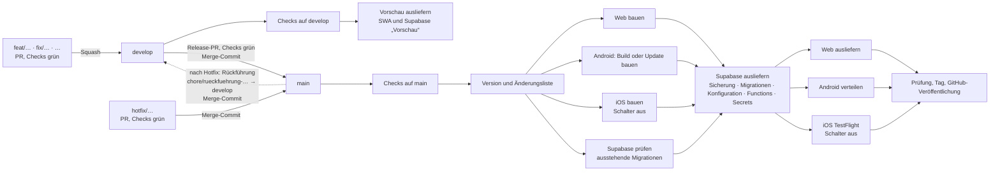

# 0014 — Betrieb: Branching, CI/CD und Release

## Problem

Die App läuft bisher nur auf Enricos Rechner. Enrico und Nadja können sie weder auf dem iPhone als
PWA noch auf dem Android-Handy nutzen, Benachrichtigungen (Spec 0013) erreichen kein Handy, und
niemand sichert die Daten. Jede Änderung müsste von Hand ausgeliefert werden: Dabei passen
Datenbank und App leicht nicht zusammen, Testdaten geraten in die echte Datenbank, oder eine kaputte
Version lässt beide im Laden ohne Liste stehen. Wer eine alte Version offen hat, merkt nicht, dass
es eine neue gibt.

## Ziel

- Jede Änderung kommt über einen kurzen Zweig und eine PR in den Sammelzweig `develop`. Vor dem
  Zusammenführen ist sichtbar, ob alles grün ist. Was auf `develop` ankommt, steht kurz danach in
  der Vorschau unter einer festen Adresse zum Ausprobieren auf dem Handy (geändert am 21.11.2026:
  Vorschau je `develop` statt je PR).
- Die PR von `develop` nach `main` ist die einzige Freigabe; ein dringender Fehler kann als Hotfix
  direkt nach `main`. Nach dem Zusammenführen auf `main` baut die Pipeline Web und Android (iOS,
  sobald es geht) parallel, liefert zuerst Supabase und dann Web und Android aus und legt eine
  Veröffentlichung (Release) mit Versionsnummer und Änderungsliste an, ohne einen Handgriff.
- Die Web-App ist unter einer festen HTTPS-Adresse auf Azure Static Web Apps erreichbar, als PWA
  installierbar und meldet „Neue Version verfügbar“, wenn es eine gibt.
- Jede Nacht entsteht eine verschlüsselte Sicherung von Datenbank und Fotos in Azure. Einmal im Monat
  wird automatisch geprüft, dass sie sich wiederherstellen lässt.
- Enrico weiß genau, was er in Google, Supabase, Azure und GitHub selbst einstellen muss (Runbook).

## Nicht-Ziele

- **Keine Store-Veröffentlichung.** Es gibt keinen öffentlichen Eintrag im Play Store oder App Store.
  Android kommt per interner Verteilung (Link), iOS später per TestFlight.
- **Keine native Google-Anmeldung und kein dauerhafter Speicher in den nativen Apps.** Beides fehlt
  heute (Spec 0003 war nur Web) und kommt mit einer eigenen Spec „Native Apps: Anmeldung und
  Speicher“ (Offene Frage 3). Bis dahin zeigt die Android-App die Anmeldeseite mit dem vorhandenen
  Hinweis.
- **Keine Übernahme lokaler Daten.** Produktion startet leer; Seed, Testkonten und Beispieldaten
  kommen nie dorthin.
- **Kein Löschen von Konto oder Haushalt und kein serverseitiges Aufräumen verwaister Fotos.** Spec
  0003 hatte das „der Spec für den Betrieb“ zugeordnet. Es ist aber eine App-Funktion (kritischer
  Pfad Löschen) und bekommt eine eigene Spec.
- **Keine automatische Rücknahme von Migrationen.** Fehler werden vorwärts mit einer neuen Migration
  behoben; expand → migrate → contract hält ältere Versionen lauffähig.
- **Keine Überwachung mit Bereitschaft:** kein Uptime-Dienst, kein Fehler-Tracking (etwa Sentry),
  keine Metrik-Dashboards.
- **Keine eigene Domain** in dieser Spec (Offene Frage 13), **kein Selbst-Hosting** (ADR-0007,
  Nachtrag).
- **Keine KI-Schlüssel in Produktion**, solange die KI ausgeblendet ist (Spec 0005; Offene Frage 10).
- **Keine Tagesgrenzen für Einladungen und neue Haushalte** (Offene Frage 11).
- **Keine Änderungsliste in der App.** Sie steht in der GitHub-Veröffentlichung.

## Konzept in Kürze

### Umgebungen

| Umgebung             | Web                                                    | Datenbank, Auth, Functions                  | Daten                                                         | Zweck                                                                      |
| -------------------- | ------------------------------------------------------ | ------------------------------------------- | ------------------------------------------------------------- | -------------------------------------------------------------------------- |
| Lokal                | Expo-Dev-Server, E2E-Export                            | Supabase in Docker                          | Seed mit Testkonten                                           | Entwicklung, CI                                                            |
| Vorschau (`develop`) | Static Web App „Vorschau“ `https://<Vorschau-Adresse>` | eigenes Supabase-Projekt „Vorschau“ (Free)  | Beispieldaten ohne Testkonten, bei jedem Vorschau-Lauf frisch | Enrico probiert den Stand von `develop` vor der Freigabe auf dem Handy aus |
| Produktion           | Static Web App „Produktion“ `https://<SWA-Adresse>`    | das bestehende Supabase-Projekt (Frankfurt) | echte Daten                                                   | Enrico und Nadja                                                           |

Vorschau und Produktion sind vollständig getrennt: zwei Static Web Apps und zwei Supabase-Projekte.
Das Deployment-Token einer Static Web App gilt für alle ihre Umgebungen; läge die Vorschau in der
App der Produktion, könnte Code, der noch nicht freigegeben ist, die Produktion überschreiben. Das
Vorschau-Projekt liegt in einer eigenen Supabase-Organisation im Free-Tarif. Wechselt die
Organisation der Produktion später zu Pro, kostet die Vorschau dadurch nichts. Es gibt genau eine
Vorschau, und sie zeigt immer den neuesten Stand von `develop`; Feature-Zweige und PRs haben keine
eigene Vorschau und keinen Zugang zur Umgebung `preview` (geändert am 21.11.2026).

### Zweige

(geändert am 21.11.2026: Sammelzweig `develop` statt Trunk-based, Entscheidung Enrico, Offene
Frage 19)

| Zweig                                                                          | Kommt von         | Geht per PR nach        | Zusammenführen            | Löst aus                   |
| ------------------------------------------------------------------------------ | ----------------- | ----------------------- | ------------------------- | -------------------------- |
| `feat/NNNN-slug`, `fix/…`, `refactor/…`, `test/…`, `docs/…`, `chore/…`         | `develop`         | `develop`               | Squash                    | Checks auf der PR          |
| `develop` (Sammelzweig, Standard-Zweig des Repos)                              | —                 | `main` (Release-PR)     | Merge-Commit              | Checks und Vorschau-Lauf   |
| `hotfix/<slug>`                                                                | `main`            | `main`                  | Merge-Commit              | Checks auf der PR          |
| `main` (immer auslieferbar)                                                    | `develop`, Hotfix | —                       | —                         | Veröffentlichung (REQ-005) |
| `chore/rueckfuehrung-v<Version>` (nur nach einem Hotfix, legt die Pipeline an) | `main`            | `develop` (Rückführung) | Merge-Commit, automatisch | Checks auf der PR          |

- **Feature-Zweige** leben kurz und heißen `<typ>/<slug>`, für Features `feat/NNNN-slug`
  (AGENTS.md). Sie kommen per Squash nach `develop`: Der PR-Titel wird zur Commit-Zeile auf
  `develop` und ist deshalb ein Conventional Commit; die Zeile `Spec: NNNN` steht in der
  PR-Beschreibung und landet im Squash-Commit.
- **Freigabe:** Enrico öffnet eine PR von `develop` nach `main` (Release-PR). Sie wird mit einem
  Merge-Commit zusammengeführt, nicht per Squash, damit `develop` und `main` dieselbe Historie
  behalten und die nächste Release-PR ohne Konflikte bleibt.
- **Hotfix:** Ein Zweig `hotfix/<slug>` von `main`, PR nach `main`, Merge-Commit. Danach öffnet die
  Pipeline selbst einen Zweig `chore/rueckfuehrung-v<Version>` vom Stand von `main` und eine PR
  davon nach `develop` (Rückführung) und führt sie mit einem Merge-Commit zusammen, sobald ihre
  Checks grün sind (Offene Frage 20).
- **Schutz:** Auf `develop` und `main` gibt es keine direkten Pushes und kein Löschen, auch nicht
  für Enrico; zusammengeführt wird nur per PR mit grünen Pflicht-Checks. Nach `main` kommen nur PRs
  von `develop` oder `hotfix/…`.
- **Änderungsliste:** Sie entsteht aus den Titeln der PRs, die seit dem letzten Tag nach `develop`
  bzw. als Hotfix nach `main` kamen; Release-PR und Rückführung zählen nicht mit.

### Versionsnummer und Mindestversion

- **Version `JJJJ.M.N`** (Kalender-Version): Jahr, Monat ohne führende Null, laufende Nummer im
  Monat ab 1, z. B. `2026.12.4`; Tag `v2026.12.4`. Dieselbe Nummer gilt für Web, Android
  (Versionsname; der Versionscode zählt EAS hoch), iOS und Over-the-Air-Updates (Offene Frage 2).
- **Versionsdatei** `/version.json` im Web mit Version und Commit; die App vergleicht sie mit ihrer
  eigenen Version.
- **Mindestversion:** Der Server nennt die älteste Version, die noch mit ihm arbeiten darf. Sie
  steigt nur mit einer Rückbau-Migration (contract), also erst, wenn die Version veröffentlicht ist,
  die das Entfernte nicht mehr liest. Wo der Wert liegt, ist Offene Frage 9.

### Pipeline

(geändert am 21.11.2026: Sammelzweig `develop`, Vorschau aus `develop`, Hotfix mit Rückführung)



### GitHub-Umgebungen und Zugänge

| GitHub-Umgebung | Wer darf sie nutzen                                                 | Enthält                                                                                                                                      |
| --------------- | ------------------------------------------------------------------- | -------------------------------------------------------------------------------------------------------------------------------------------- |
| `preview`       | nur `develop` (geändert am 21.11.2026; vorher alle Zweige einer PR) | Zugang nur zum Vorschau-Projekt, Einladungsadressen für die Vorschau, Azure-Anmeldung nur für die Static Web App „Vorschau“                  |
| `production`    | nur `main`                                                          | eingeschränktes Supabase-Token, Datenbank-Passwort, Google-Client-Secret, EAS-Token, Azure-Anmeldung nur für die Static Web App „Produktion“ |
| `backup`        | nur `main` (Zeitplan)                                               | lesender Datenbank-Zugang, S3-Schlüssel für Supabase Storage, Azure-Anmeldung nur zum Schreiben von Sicherungen, öffentlicher Schlüssel      |
| `restore-test`  | nur `main` (Zeitplan)                                               | Azure-Anmeldung nur zum Lesen von Sicherungen, privater Sicherungsschlüssel                                                                  |

Azure-Anmeldungen laufen per OIDC (föderierte Anmeldedaten) mit je einer eigenen Identität, nie mit
einem gespeicherten Schlüssel.

### Azure-Ressourcen in `rg-housekeeping-app-weu-prd`

| Ressource                     | Einstellung                                                                                                                                               |
| ----------------------------- | --------------------------------------------------------------------------------------------------------------------------------------------------------- |
| Static Web App „Produktion“   | Tarif Free, Region West Europe, keine Vorschau-Umgebungen                                                                                                 |
| Static Web App „Vorschau“     | Tarif Free, Region West Europe, keine Vorschau-Umgebungen je PR; ihre Hauptumgebung zeigt `develop` (geändert am 21.11.2026)                              |
| Storage-Konto für Sicherungen | privat, kein Kontoschlüssel, Unveränderlichkeit 30 Tage, Aufbewahrung 30 Tage täglich und 12 Monate monatlich                                             |
| Identitäten                   | je eine für Web-Auslieferung Produktion, Web-Auslieferung Vorschau, Sicherung und Wiederherstellungstest; jede nur mit Rechten an ihrer eigenen Ressource |
| Budget                        | Monatsbudget mit E-Mail bei 80 % und 100 % (Offene Frage 12)                                                                                              |

### Kosten (Stand 11/2026, vor jedem Kauf prüfen)

| Posten                                                           | Kosten                                        |
| ---------------------------------------------------------------- | --------------------------------------------- |
| zwei Static Web Apps Free, zwei Supabase-Projekte Free, EAS Free | 0 €                                           |
| Storage-Konto (wenige GB Sicherungen)                            | wenige Cent bis etwa 1 € im Monat (geschätzt) |
| GitHub Pro, nur falls das Repo privat bleibt                     | 4 $ im Monat (Offene Frage 5)                 |
| Apple Developer Program, erst für iOS                            | 99 $ im Jahr                                  |
| Play Console, erst für den Play Store                            | 25 $ einmalig                                 |
| Supabase Pro, erst bei Bedarf                                    | 25 $ im Monat (Offene Frage 14)               |

## Abhängigkeiten, Voraussetzungen und kritischer Pfad

| Spec bzw. Dokument                    | Was diese Spec daraus braucht oder ihr gibt                                                                                |
| ------------------------------------- | -------------------------------------------------------------------------------------------------------------------------- |
| 0003                                  | Hook, Google-Anmeldung, CSP- und Export-Prüfung, Service Worker; offene Befunde des Security-Checks (siehe unten)          |
| 0004                                  | Foto-Bucket `household-media` mit erzwungenen Einstellungen; Aufräumen verwaister Fotos bleibt offen (Nicht-Ziel)          |
| 0005                                  | persönliche Einstellungen (dort steht die Version), KI-Schalter „aus“                                                      |
| 0013                                  | braucht die öffentliche HTTPS-Adresse; ihr VAPID-Schlüssel und das geteilte Geheimnis werden Produktions-Secrets           |
| „Native Apps: Anmeldung und Speicher“ | neue Spec (Nummer bei Anlage): native Google-Anmeldung, Secure Store, dauerhafter Speicher; erst damit ist Android nutzbar |

**Reihenfolge:** Welle 6, nach 0013. **Vorziehen ist möglich**, falls Enrico die PWA früher auf dem
iPhone will: REQ-006 und REQ-007 mit dem Nötigsten aus REQ-001, REQ-002, REQ-005 und REQ-010. Dann
laufen aber alle Migrationen der Specs 0007 bis 0013 auf echten Daten, etwa der Umzug der Zutaten
auf Artikel (0007). Die Mindestversion (REQ-004) muss in dem Fall mit vorgezogen werden. Nach 0013
dagegen laufen diese Migrationen schon bei der ersten Auslieferung, auf einer leeren Datenbank.
Das Zusammenführen der Listen (0006) gibt es nicht mehr: Die Migrationen wurden vor der ersten
Auslieferung einmal neu aufgebaut, die Listen-Tabelle entfällt (ADR-0012).

**Offene Befunde aus 0003 und 0004:**

| Befund                                                      | Hier                                                             |
| ----------------------------------------------------------- | ---------------------------------------------------------------- |
| E-Mail-Anmeldung in Produktion aus (0003, AC-007)           | AC-040, AC-041                                                   |
| Testkonten-Seed ohne Sperre, `db reset` gegen Produktion    | AC-010, AC-042                                                   |
| Sprach-Kontingent: eigene Speech-Ressource mit Budget-Alarm | zurückgestellt mit der KI (Offene Frage 10); Budget-Alarm AC-063 |
| Keine Tagesgrenze für Einladungen und neue Haushalte        | zurückgestellt (Offene Frage 11)                                 |
| Bucket-Einstellungen in Produktion erzwungen (0004)         | AC-046                                                           |

**Voraussetzungen vor dem Bau:**

1. **Neue ADR „Auslieferung und Betrieb“** (nächste freie Nummer): Azure Static Web Apps statt
   Cloudflare, Sicherungen in Azure Storage, Vorschau-Projekt, Kalender-Version, Mindestversion
   (Offene Frage 9), GitHub-Umgebungen und OIDC. ADR-0007 bekommt einen Nachtrag mit Verweis, weil
   seine Zeile „Web-App: Cloudflare“ damit überholt ist.
2. **Glossar:** neue Begriffe „Produktion“, „Vorschau“, „Veröffentlichung“, „App-Version“,
   „Mindestversion“, „Sicherung“, „Wiederherstellungstest“ (diese Spec wurde ohne Glossar-Änderung
   geschrieben; die Einträge kommen mit dem Plan).
3. **AGENTS.md und `.claude/`:** Git-Abschnitt (`develop` als Ziel jeder PR, Squash, PR-Vorlage,
   Zweignamen, Hotfix), Befehle für
   Veröffentlichung und Wiederherstellung, Sperre für `supabase db reset --remote` und
   `db push --include-seed` in den Agent-Einstellungen.
4. **Antworten auf die Offenen Fragen 4, 5, 12, 13**, die Geld kosten oder dauerhaft gelten.

**Kritischer Pfad:** Infrastruktur und Auslieferung, Auth-Konfiguration der Produktion, Migrationen,
Löschen (Aufbewahrung der Sicherungen, Entfernen von Functions, Neuaufsetzen der Vorschau) und alle
Zugänge. Der Plan braucht ein Bedrohungsmodell mindestens zu: gestohlene Zugänge (Supabase-Token,
Datenbank-Passwort, EAS-Token, über das ein bösartiges Over-the-Air-Update alle nativen Geräte
erreichen könnte, Azure-Identitäten); Code aus einem PR-Zweig, der Secrets von `preview` oder
`production` liest; Umgehen von `develop` (direkter Push, PR nach `main` von einem anderen Zweig);
Rückführung nach einem Hotfix, die ausbleibt oder Änderungen auf `develop` überschreibt;
kompromittierte Action oder Abhängigkeit; Seed oder Reset gegen Produktion; zerstörerische
Migration; offene Weiterleitung über Platzhalter in Redirect-URLs; Abfluss oder Löschen von
Sicherungen; Secrets in Logs; öffentlich erreichbare Vorschau; Vorschau-Code, der die Produktion
überschreibt; Kosten. Negativtests: anonymer Zugriff auf Sicherungen, Bucket und Vorschau;
PR-Zweig greift auf `preview`, `production` oder eine der Static Web Apps zu; `develop` greift
auf `production` zu; Push direkt auf `develop` oder `main`; PR nach `main` von einem
Feature-Zweig; Testkonto-Anmeldung in Produktion und Vorschau; fremde Herkunft an den Functions;
scheiternde Migration und scheiternder Build. Dazu `/security-check` über alle Workflows und
Skripte (geändert am 21.11.2026: `develop` und Hotfix).

## Anforderungen und Akzeptanzkriterien

Beispielwerte: `<SWA-Adresse>` ist der Standard-Hostname der Static Web App „Produktion“
(`<name>.<n>.azurestaticapps.net`), `<Projekt-Ref>` die Kennung des bestehenden Supabase-Projekts,
`<Vorschau-Ref>` die des Vorschau-Projekts, `<Vorschau-Adresse>` der Standard-Hostname der Static
Web App „Vorschau“. Die echten Werte stehen in GitHub-Variablen, nicht in
dieser Spec. Versionen im Beispiel stammen aus dem Dezember 2026. „Prüfung nach der Auslieferung“
meint den letzten Schritt der Veröffentlichung, der Produktion von außen abfragt.

### REQ-001 — Zweige und Schutz von `develop` und `main`

> Änderungen kommen nur über kurzlebige Zweige und PRs mit grünen Pflicht-Checks per Squash auf
> den Sammelzweig `develop`; nach `main` kommen nur Release-PRs von `develop` und Hotfix-PRs von
> `hotfix/…` per Merge-Commit, und nach jedem Hotfix wird `main` automatisch nach `develop`
> zurückgeführt; der PR-Titel ist ein Conventional Commit. (geändert am 21.11.2026: Sammelzweig
> `develop` statt Squash direkt auf `main`)

**Offline:** betrifft keine App-Bedienung (GitHub).

**AC-001 — Kein direkter Push** (geändert am 21.11.2026: gilt für `develop` und `main`)

```gherkin
Angenommen  der Schutz von „develop“ und „main“ ist eingerichtet
Wenn        jemand einen Commit direkt auf „develop“ oder „main“ pusht oder einen der beiden Zweige
            löschen will, auch Enrico als Besitzer des Repos
Dann        lehnt GitHub das ab
```

**AC-002 — Rote Checks blockieren** (geändert am 21.11.2026: PRs nach `develop` und nach `main`)

```gherkin
Angenommen  eine PR nach „develop“ oder nach „main“, deren Check „Datenbank (pgTAP)“ fehlschlägt
Wenn        Enrico sie zusammenführen will
Dann        ist das Zusammenführen gesperrt, bis alle Pflicht-Checks grün sind
```

**AC-003 — Squash mit Titel und Spec-Zeile** (geändert am 21.11.2026: Ziel ist `develop`)

```gherkin
Angenommen  die PR „feat: Reisetaschen packen“ vom Zweig „feat/0012-reisetaschen“ nach „develop“
            mit „Spec: 0012“ in der Beschreibung, alle Pflicht-Checks grün
Wenn        Enrico sie zusammenführt
Dann        ist „Squash and merge“ die vorgeschlagene Art
Und         auf „develop“ entsteht genau ein Commit „feat: Reisetaschen packen (#<PR-Nummer>)“ mit
            der Zeile „Spec: 0012“
Und         der Zweig „feat/0012-reisetaschen“ ist danach gelöscht
Und         auf „main“ ändert sich nichts
```

**AC-004 — Fehlerfall: Titel und Zweigname** (geändert am 21.11.2026: `hotfix/<slug>` und
`develop` als gültige Zweige)

```gherkin
Angenommen  eine PR nach „develop“ mit dem Titel „Reisetaschen fertig“ vom Zweig „reisetaschen“
Wenn        die Checks laufen
Dann        ist der Check „Konventionen“ rot und nennt beides: Titel ohne Typ (feat, fix, refactor,
            test, docs, chore) und Zweigname nicht in der Form „<typ>/<slug>“
Und         Zweige von Dependabot („dependabot/…“), „hotfix/<slug>“ sowie „develop“ als Quelle
            einer Release-PR gelten als gültig
```

**AC-005 — PR-Vorlage**

```gherkin
Wenn        Enrico oder ein Agent eine neue PR öffnet
Dann        ist die Beschreibung vorbefüllt mit „Spec: NNNN“ (oder „ohne Spec, weil …“), einem
            Abschnitt „Tests“ und der Checkliste für kritische Pfade (Bedrohungsmodell, Negativtests,
            „/security-check“)
```

**AC-065 — Fehlerfall: nach `main` nur von `develop` oder `hotfix/…`** (neu am 21.11.2026)

```gherkin
Angenommen  eine PR vom Zweig „feat/0012-reisetaschen“ nach „main“
Wenn        die Checks laufen
Dann        ist der Check „Konventionen“ rot mit „Nach main nur von develop oder hotfix/…“
Und         das Zusammenführen ist gesperrt
Und         dieselbe PR nach „develop“ wäre gültig
```

**AC-066 — Release-PR mit Merge-Commit** (neu am 21.11.2026)

```gherkin
Angenommen  auf „develop“ liegen seit der letzten Veröffentlichung die Squash-Commits
            „feat: Reisetaschen packen (#41)“ und „fix: Haken springt zurück (#42)“
Und         Enrico öffnet die PR „chore: Veröffentlichung“ von „develop“ nach „main“, alle
            Pflicht-Checks grün
Wenn        er sie zusammenführt
Dann        ist „Create a merge commit“ die einzige angebotene Art
Und         „main“ enthält danach genau die Commits von „develop“ plus einen Merge-Commit
Und         der Zweig „develop“ besteht weiter
Und         die nächste Release-PR von „develop“ nach „main“ hat keine Konflikte aus dieser
```

**AC-067 — Hotfix und Rückführung nach `develop`** (neu am 21.11.2026)

```gherkin
Angenommen  auf „develop“ liegt „feat: Reisetaschen packen (#41)“, noch nicht veröffentlicht
Und         die PR „fix: Liste lädt nicht (#45)“ vom Zweig „hotfix/liste-laedt-nicht“, der von „main“
            abzweigt, wurde mit grünen Checks per Merge-Commit nach „main“ zusammengeführt
Wenn        die Veröffentlichung des Hotfix grün ist
Dann        legt die Pipeline den Zweig „chore/rueckfuehrung-v<Version>“ vom Stand von „main“ an
            und öffnet die PR „chore: main nach develop zurückführen“ von dort nach „develop“; ihre
            Checks laufen
Und         sind sie grün, wird sie ohne Handgriff per Merge-Commit zusammengeführt
Und         „develop“ enthält danach den Hotfix und weiterhin „feat: Reisetaschen packen (#41)“
```

**AC-068 — Fehlerfall: Rückführung mit Konflikt** (neu am 21.11.2026)

```gherkin
Angenommen  der Hotfix aus AC-067 ändert dieselben Zeilen wie ein Commit, der nur auf „develop“
            liegt
Wenn        die Pipeline die Rückführung öffnet
Dann        bleibt die PR „chore: main nach develop zurückführen“ offen und wird nicht
            zusammengeführt
Und         Enrico bekommt die GitHub-Benachrichtigung mit Link zur PR
Und         auf „develop“ ändert sich nichts, bis Enrico „develop“ in den Zweig
            „chore/rueckfuehrung-v<Version>“ übernimmt, den Konflikt löst und die PR mit einem
            Merge-Commit zusammenführt
```

### REQ-002 — Checks auf jeder PR

> Jede PR nach `develop` oder `main` durchläuft die heutigen Prüfungen und zusätzlich pgTAP, die
> Prüfung der Web-Konfiguration, eine Suche nach Geheimnissen und die Regeln für Migrationen; kein
> Check braucht einen Zugang zu Vorschau oder Produktion. (geändert am 21.11.2026: PRs nach
> `develop`, kein Vorschau-Zugang)

**Offline:** betrifft keine App-Bedienung (GitHub).

**AC-006 — Umfang** (geändert am 21.11.2026: PRs nach `develop` und `main`, auch „preview“ gesperrt)

```gherkin
Angenommen  eine PR nach „develop“ oder „main“, die Code ändert
Wenn        die Checks laufen
Dann        laufen „pnpm format:check“, „pnpm check“ (Lint, Typprüfung, Unit-Tests, Edge-Verträge),
            „pnpm exec supabase test db“, „pnpm build:web“ samt CSP- und SWA-Konfigurationsprüfung,
            „pnpm e2e“ und „pnpm e2e:dev“ gegen den lokalen Stack
Und         keiner dieser Jobs kann ein Secret der Umgebungen „preview“, „production“, „backup“ oder
            „restore-test“ lesen
Und         dieselben Checks laufen nach jedem Zusammenführen noch einmal auf „develop“ bzw. „main“
```

**AC-007 — pgTAP läuft mit**

```gherkin
Angenommen  eine PR ändert eine Policy so, dass ein fremder Haushalt Fotos lesen kann
Wenn        die Checks laufen
Dann        ist der Check „Datenbank (pgTAP)“ rot mit dem fehlschlagenden Test aus
            „storage_policies.test.sql“
```

**AC-008 — Geheimnis im Diff**

```gherkin
Angenommen  eine PR fügt einen Wert ein, der wie ein Supabase-Secret-Key („sb_secret_…“), ein
            „service_role“-JWT, ein Azure-Schlüssel oder ein privater Schlüssel aussieht
Wenn        die Checks laufen
Dann        ist der Check „Geheimnisse“ rot und nennt Datei und Zeile, aber nicht den Wert
```

**AC-009 — Rückbau nur gekennzeichnet** (geändert am 21.11.2026: Migrationen auf `develop` gelten
ebenfalls als fest)

> **Hinweis (ADR-0012):** Vor dem ersten `supabase db push` in das Produktionsprojekt wurden die
> Migrationen einmal zu einer Grundlage neu aufgebaut; dabei wurden alle bisherigen Dateien ersetzt.
> Das ist die einzige Ausnahme von „eine committete Migration wird nie geändert“. Der Check gilt ab
> dieser Grundlage; die PR mit dem Neuaufbau selbst ist davon ausgenommen.

```gherkin
Angenommen  eine PR mit einer neuen Migration, die „drop column“, „drop table“ oder ein „rename“
            enthält, ohne Kennzeichnung als Rückbau mit Begründung und Mindestversion
Wenn        die Checks laufen
Dann        ist der Check „Migrationen“ rot mit „Rückbau ohne Kennzeichnung (expand → migrate →
            contract)“
Und         ebenso, wenn die PR eine Migration ändert, die schon auf „develop“ oder „main“ liegt
```

**AC-010 — Verbotene Befehle**

```gherkin
Angenommen  ein Workflow oder Skript im Repo ruft „supabase db reset“ gegen ein entferntes Projekt
            auf („--remote“, „--linked“ oder „--db-url“) oder „supabase db push --include-seed“
Wenn        die Checks laufen
Dann        ist der Check „Konventionen“ rot
Und         ausgenommen ist nur das Neuaufsetzen des Vorschau-Projekts im Vorschau-Workflow, der die
            Umgebung „preview“ nutzt (REQ-003)
```

**AC-011 — PR nur mit Doku**

```gherkin
Angenommen  eine PR, die nur Dateien unter „docs/“ ändert
Wenn        die Checks laufen
Dann        melden alle Pflicht-Checks ein Ergebnis, und die PR lässt sich zusammenführen
```

### REQ-003 — Vorschau aus `develop`

> Jedes Zusammenführen auf `develop` liefert dessen Stand mit grünen Checks an die Static Web App
> „Vorschau“ unter einer festen Adresse aus, die gegen das Supabase-Projekt „Vorschau“ läuft und nie
> gegen Produktion; Feature-Zweige und PRs bekommen keine eigene Vorschau. (geändert am 21.11.2026:
> Vorschau je `develop` statt je PR)

**Offline:** wie die Web-App (REQ-006). Die Vorschau dient zum Ausprobieren, nicht für den Laden.

**AC-012 — Vorschau-Adresse** — verworfen am 21.11.2026: siehe AC-069 (eine feste Vorschau für
`develop` statt einer Adresse je PR).

**AC-069 — Vorschau zeigt `develop`** (neu am 21.11.2026)

```gherkin
Angenommen  die PR „feat: Reisetaschen packen (#41)“ wird nach „develop“ zusammengeführt, und die
            Checks auf „develop“ sind grün
Wenn        der Vorschau-Lauf durch ist
Dann        zeigt „https://<Vorschau-Adresse>“ diesen Stand, und „/version.json“ dort nennt den
            Commit von „develop“
Und         werden zwei PRs kurz nacheinander nach „develop“ zusammengeführt, läuft nie mehr als ein
            Vorschau-Lauf gleichzeitig, und am Ende zeigt die Vorschau den Stand der zweiten
```

**AC-070 — Fehlerfall: rote Checks auf `develop`** (neu am 21.11.2026)

```gherkin
Angenommen  die Vorschau zeigt den Commit „a1b2c3d“, und die Checks auf „develop“ sind für den
            neuen Commit rot
Wenn        der Vorschau-Lauf ausgelöst würde
Dann        wird nichts an die Vorschau ausgeliefert, und das Vorschau-Projekt bleibt unverändert
Und         die Vorschau zeigt weiter „a1b2c3d“
```

**AC-071 — Fehlerfall: keine Vorschau aus PR-Zweigen** (neu am 21.11.2026)

```gherkin
Angenommen  ein Workflow auf dem Zweig „feat/0015-beispiel“ oder in einer PR verlangt die Umgebung
            „preview“
Wenn        er läuft
Dann        verweigert GitHub den Zugriff, weil nur „develop“ diese Umgebung nutzen darf
Und         die Vorschau und das Vorschau-Projekt bleiben unverändert
```

**AC-013 — Nie Produktion** (geändert am 21.11.2026: Vorschau aus `develop`)

```gherkin
Angenommen  die Vorschau
Wenn        ich ihre Startseite lade
Dann        nennt die Content Security Policy als Supabase-Adresse nur das Vorschau-Projekt und nicht
            das Produktionsprojekt
Und         der Vorschau-Lauf nutzt die Umgebung „preview“ und hat keinen Produktionszugang
Und         mit seiner Azure-Anmeldung kann er die Static Web App „Produktion“ nicht verändern
```

**AC-014 — Frische Beispieldaten, keine Testkonten** (geändert am 21.11.2026: Stand von `develop`
statt einer PR)

```gherkin
Angenommen  eine nach „develop“ zusammengeführte PR bringt eine neue Migration mit
Wenn        der Vorschau-Lauf läuft
Dann        ist das Vorschau-Projekt danach auf dem Stand der Migrationen von „develop“ und enthält
            den Beispiel-Haushalt „Enrico & Nadja“ mit Beispieldaten
Und         Einladungen in diesen Haushalt gibt es nur für die Adressen aus dem Secret der Umgebung
            „preview“
Und         eine Anmeldung mit „enrico.test@example.com“ und Passwort scheitert, weil es dort weder
            Testkonten noch die E-Mail-Anmeldung gibt
```

**AC-015 — Anmelden in der Vorschau**

```gherkin
Angenommen  Enricos Google-Adresse steht im Secret der Vorschau-Einladungen
Wenn        er in der Vorschau „Mit Google anmelden“ wählt und die Einladung annimmt
Dann        sieht er die Beispieldaten des Haushalts „Enrico & Nadja“
Und         ein Google-Konto ohne Einladung wird abgewiesen wie in Produktion
```

**AC-016 — PR geschlossen** — verworfen am 21.11.2026: siehe AC-069 und AC-071 (PRs haben keine
eigene Vorschau mehr, also gibt es beim Schließen nichts zu löschen).

**AC-017 — Fehlerfall: Projekt pausiert** (geändert am 21.11.2026: die Höchstzahl offener Vorschauen
entfällt, Meldung am Lauf statt als PR-Kommentar)

```gherkin
Angenommen  das Vorschau-Projekt ist pausiert
Wenn        der Vorschau-Lauf für einen neuen Stand von „develop“ läuft
Dann        ist er rot mit „Keine Vorschau: Vorschau-Projekt pausiert – im Supabase-Dashboard
            fortsetzen“, und Enrico bekommt die GitHub-Benachrichtigung
Und         die Vorschau zeigt weiter den vorigen Stand
Und         die Vorschau ist kein Pflicht-Check, eine Release-PR bleibt zusammenführbar
```

### REQ-004 — Version, Veröffentlichung und Update-Hinweis

> Jede Veröffentlichung hat eine Version `JJJJ.M.N`, einen Git-Tag und eine GitHub-Veröffentlichung
> mit Änderungsliste; die App zeigt ihre Version, meldet eine neuere und sperrt das Bearbeiten,
> solange sie älter als die Mindestversion des Servers ist.

**Offline:** nur online. Hinweis und Mindestversion brauchen den Server; ohne Netz läuft die
vorhandene Version unverändert weiter, Lesen und Abhaken eingeschlossen.

**AC-018 — Versionsnummer**

```gherkin
Angenommen  die letzte Veröffentlichung ist „2026.12.3“
Wenn        im Dezember 2026 die nächste entsteht
Dann        heißt sie „2026.12.4“ und hat den Tag „v2026.12.4“
Und         die erste Veröffentlichung im Januar 2027 heißt „2027.1.1“
```

**AC-019 — Änderungsliste** (geändert am 21.11.2026: PRs kommen über `develop` und die Release-PR)

```gherkin
Angenommen  seit „v2026.12.3“ kamen „feat: Reisetaschen packen (#41)“, „fix: Haken springt zurück
            (#42)“ und „docs: Runbook ergänzt (#43)“ nach „develop“
Wenn        die Release-PR „chore: Veröffentlichung (#44)“ nach „main“ zusammengeführt und
            „2026.12.4“ veröffentlicht wird
Dann        steht in der GitHub-Veröffentlichung unter „Neu“ „Reisetaschen packen (#41)“ und unter
            „Behoben“ „Haken springt zurück (#42)“
Und         weder die Doku-Änderung noch die Release-PR (#44) steht darin
```

**AC-020 — Nur Doku: keine Veröffentlichung** (geändert am 21.11.2026: gemessen an der Release-PR)

```gherkin
Angenommen  alle Änderungen einer Release-PR seit dem letzten Tag betreffen nur Dateien unter
            „docs/“, „.agents/“, „.claude/“ oder Markdown-Dateien
Wenn        sie auf „main“ ankommt
Dann        laufen die Checks, aber es entsteht keine Veröffentlichung, und nichts wird ausgeliefert
```

**AC-021 — Version sichtbar**

```gherkin
Angenommen  Produktion läuft mit „2026.12.4“
Wenn        Nadja ihre persönlichen Einstellungen (Avatar) bis ganz unten scrollt
Dann        steht dort „Version 2026.12.4“
```

**AC-022 — Neue Version verfügbar (Web und PWA)**

```gherkin
Angenommen  Nadja hat die PWA mit „2026.12.4“ offen und lässt sie im Hintergrund
Und         danach wird „2026.12.5“ ausgeliefert
Wenn        sie die App wieder in den Vordergrund holt
Dann        erscheint der Hinweis „Neue Version verfügbar“ mit dem Knopf „Neu laden“
Wenn        sie auf „Neu laden“ tippt
Dann        läuft „2026.12.5“, und der Hinweis ist weg
```

**AC-023 — Offline kein Hinweis**

```gherkin
Angenommen  das Gerät ist offline
Wenn        Nadja die App öffnet oder in den Vordergrund holt
Dann        erscheinen weder Hinweis noch Fehlermeldung, und die App läuft mit der vorhandenen Version
Und         die Versionsdatei kommt nie aus dem Cache des Service Workers
```

**AC-024 — Die Laden-Warteschlange übersteht das Update**

```gherkin
Angenommen  Nadja hat im Laden offline drei Posten abgehakt, die Laden-Warteschlange wartet
Und         inzwischen wurde eine Version mit neuer Speicher-Version ausgeliefert
Wenn        sie wieder Netz hat und die neue Version lädt, über „Neu laden“ oder beim nächsten Start
Dann        sind die drei Posten danach auf Nadjas und Enricos Gerät abgehakt
```

**AC-025 — Unter der Mindestversion**

```gherkin
Angenommen  der Server verlangt mindestens „2026.12.5“, Enricos Gerät hat Netz und läuft mit
            „2026.12.4“
Wenn        die App den Server erreicht
Dann        steht dauerhaft „Diese Version wird nicht mehr unterstützt“ mit „Neu laden“ (Web) bzw.
            „Aktualisieren“ (nativ)
Und         Lesen und Abhaken gehen weiter, Bearbeiten ist gesperrt, und die Laden-Warteschlange wird
            nicht nachgereicht
Wenn        er neu lädt
Dann        läuft „2026.12.5“, und die wartenden Laden-Aktionen werden nachgereicht
```

**AC-026 — Fehlerfall: Mindestversion, die es nicht gibt**

```gherkin
Angenommen  eine Rückbau-Migration setzt die Mindestversion auf „2026.12.9“, veröffentlicht ist
            erst „2026.12.4“, und die neue Veröffentlichung würde „2026.12.5“
Wenn        die Veröffentlichung startet
Dann        bricht sie vor jeder Auslieferung ab mit „Mindestversion 2026.12.9 ist noch nicht
            veröffentlicht“
```

### REQ-005 — Veröffentlichung: parallel bauen, geordnet ausliefern

> Nach dem Zusammenführen einer Release-PR oder eines Hotfix auf `main` baut die Pipeline alle
> eingeschalteten Systeme parallel und liefert erst aus, wenn alle Builds grün sind: zuerst
> Supabase, danach Web und native Apps parallel; ein Fehler hält alles Spätere an. (geändert am
> 21.11.2026: Auslöser ist die Release-PR von `develop` oder ein Hotfix; der Ablauf bleibt gleich)

**Offline:** betrifft keine App-Bedienung. Geräte ohne Netz arbeiten mit ihrer Version weiter
(REQ-004).

**AC-027 — Ablauf** (geändert am 21.11.2026: Auslöser ist die Release-PR)

```gherkin
Angenommen  eine Release-PR von „develop“ mit Code-Änderungen und einer neuen Migration wird auf
            „main“ zusammengeführt, und die Checks auf „main“ sind grün
Wenn        die Veröffentlichung läuft
Dann        starten „Web bauen“, „Android bauen“ und „Supabase prüfen“ gleichzeitig, „iOS bauen“ ist
            „übersprungen: iOS aus“
Und         „Supabase ausliefern“ startet erst, wenn alle drei grün sind, sichert zuerst die Datenbank
            wie in REQ-009 und nennt dann die angewandte Migration
Und         „Web ausliefern“ und „Android verteilen“ starten erst danach, gleichzeitig
Und         am Ende sind die Prüfung nach der Auslieferung grün, der Tag gesetzt und die
            GitHub-Veröffentlichung angelegt
```

**AC-028 — Rote Checks auf `main`**

```gherkin
Angenommen  die Checks auf „main“ sind für den neuen Commit rot
Wenn        die Veröffentlichung ausgelöst würde
Dann        wird nichts gebaut und nichts ausgeliefert
```

**AC-029 — Ein Build scheitert**

```gherkin
Angenommen  der Android-Build schlägt fehl, der Web-Build ist grün
Wenn        die Veröffentlichung weiterläuft
Dann        wird nichts ausgeliefert, auch keine Migration
Und         Produktion bleibt vollständig auf der vorigen Version
```

**AC-030 — Eine Migration scheitert**

```gherkin
Angenommen  von zwei neuen Migrationen bricht die zweite in Produktion mit einem Fehler ab
Wenn        „Supabase ausliefern“ läuft
Dann        bleibt die erste angewandt, und von der zweiten bleibt nichts zurück
Und         Web und Android werden nicht ausgeliefert, und es gibt keine GitHub-Veröffentlichung
Und         die Veröffentlichung ist rot, und Enrico bekommt die GitHub-Benachrichtigung
```

**AC-031 — Web-Auslieferung scheitert nach der Datenbank**

```gherkin
Angenommen  „Supabase ausliefern“ war grün, „Web ausliefern“ schlägt fehl
Wenn        Nadja die Web-App benutzt
Dann        läuft die vorige Version gegen die neue Datenbank ohne Fehler weiter
Und         die Datenbank wird nicht zurückgesetzt
Wenn        Enrico die fehlgeschlagenen Jobs erneut startet
Dann        wird das Web ausgeliefert, und erst dann entstehen Tag und GitHub-Veröffentlichung
```

**AC-032 — Mehrere Zusammenführungen auf `main` kurz nacheinander** (geändert am 21.11.2026:
Release-PR und Hotfix statt beliebiger PRs)

```gherkin
Angenommen  die Release-PR mit „feat: Reisetaschen packen (#41)“ und kurz danach der Hotfix
            „fix: Liste lädt nicht (#45)“ werden innerhalb weniger Minuten auf „main“
            zusammengeführt
Wenn        die Veröffentlichungen laufen
Dann        läuft nie mehr als eine Auslieferung gleichzeitig
Und         am Ende ist der Stand von „main“ nach dem Hotfix ausgeliefert, und die Änderungslisten
            der Veröffentlichungen nennen zusammen #41 und #45
```

**AC-072 — Hotfix wird veröffentlicht** (neu am 21.11.2026)

```gherkin
Angenommen  die letzte Veröffentlichung ist „2026.12.4“, auf „develop“ liegt unveröffentlicht
            „feat: Reisetaschen packen (#41)“
Wenn        der Hotfix „fix: Liste lädt nicht (#45)“ vom Zweig „hotfix/liste-laedt-nicht“ auf „main“
            zusammengeführt wird
Dann        läuft die Veröffentlichung wie in AC-027 und heißt „2026.12.5“
Und         ihre Änderungsliste nennt unter „Behoben“ „Liste lädt nicht (#45)“ und nicht #41
Und         Produktion enthält „Reisetaschen packen“ noch nicht
Und         danach startet die Rückführung nach „develop“ (AC-067)
```

**AC-033 — Frühere Web-Version erneut ausliefern**

```gherkin
Angenommen  „2026.12.5“ hat einen Fehler in der Oberfläche, die Mindestversion ist „2026.12.2“
Wenn        Enrico die Auslieferung von Hand mit „v2026.12.4“ startet
Dann        läuft das Web wieder mit „2026.12.4“, und die Datenbank bleibt unverändert
Und         mit einem Tag unter der Mindestversion lehnt die Auslieferung ab
```

### REQ-006 — Web auf Azure Static Web Apps

> Die Web-App liegt als Static Web App „Produktion“ im Tarif Free in `rg-housekeeping-app-weu-prd`
> (West Europe) und wird mit Sicherheits-Headern, passenden Cache-Regeln und SPA-Rückfall
> ausgeliefert; die Vorschau nutzt dieselbe Konfiguration in der Static Web App „Vorschau“.

**Offline:** offline vollständig wie bisher. Der Service Worker hält die App-Hülle vor; eine
Auslieferung ändert daran nichts.

**AC-034 — Erreichbar**

```gherkin
Angenommen  die erste Veröffentlichung ist durch
Wenn        ich „https://<SWA-Adresse>“ auf dem iPhone in Safari öffne
Dann        lädt die App über HTTPS mit der Anmeldeseite „Mit Google anmelden“
Und         die Static Web App „Produktion“ liegt in „rg-housekeeping-app-weu-prd“, Region West
            Europe, Tarif Free
```

**AC-035 — Sicherheits-Header**

```gherkin
Wenn        ich „/“ und „/index.html“ abrufe
Dann        tragen die Antworten „Content-Security-Policy: frame-ancestors 'none'“,
            „X-Content-Type-Options: nosniff“, „Referrer-Policy: strict-origin-when-cross-origin“
            und „Strict-Transport-Security“
Und         das CSP-Meta-Tag in „index.html“ nennt als Supabase-Adresse nur das Produktionsprojekt
            und weder „localhost“ noch „127.0.0.1“
```

**AC-036 — Cache-Regeln**

```gherkin
Wenn        ich „/index.html“, „/sw.js“, „/register-sw.js“ und „/version.json“ abrufe
Dann        tragen sie „Cache-Control: no-cache“
Und         Dateien unter „/_expo/static/“ tragen „Cache-Control: public, max-age=31536000, immutable“
```

**AC-037 — Tiefe Links und fehlende Dateien**

```gherkin
Wenn        ich „https://<SWA-Adresse>/rezept/<id>“ direkt aufrufe
Dann        antwortet der Server mit 200 und der App, die nach der Anmeldung das Rezept zeigt
Und         „/_expo/static/js/web/gibt-es-nicht.js“ antwortet mit 404 und nicht mit der App
```

**AC-038 — Fehlerfall: Build-Prüfung**

```gherkin
Angenommen  in der Konfiguration der Static Web App fehlt „frame-ancestors 'none'“ oder die
            Cache-Regel für „/sw.js“, oder „EXPO_PUBLIC_DEV_LOGIN=1“ ist mit einer nicht lokalen
            Supabase-Adresse gesetzt
Wenn        „pnpm build:web“ läuft
Dann        bricht der Build mit einer Meldung ab, die den Mangel nennt
```

**AC-039 — Offline nach einer Auslieferung**

```gherkin
Angenommen  Nadja hat die PWA mit „2026.12.4“ zum Home-Bildschirm hinzugefügt, danach wurde
            „2026.12.5“ ausgeliefert
Wenn        sie die App im Flugmodus startet
Dann        startet „2026.12.4“ aus dem Service Worker und zeigt ihre Daten aus dem lokalen Speicher
```

### REQ-007 — Supabase-Produktion

> Das bestehende Supabase-Projekt wird nur von der Pipeline aus dem Repo konfiguriert (Migrationen,
> Auth, Hook, Functions, Secrets, Vault-Werte), nie mit Seed und nie zurückgesetzt; die
> E-Mail-Anmeldung ist aus.

**Offline:** betrifft keine App-Bedienung. Ist das Projekt pausiert (Free), lesen die Geräte weiter
aus dem lokalen Speicher; Bearbeiten scheitert mit der vorhandenen Meldung.

**AC-040 — Konfiguration aus dem Repo**

```gherkin
Angenommen  eine Veröffentlichung ist durch
Wenn        Enrico die Konfiguration des Repos mit Produktion vergleicht („supabase config diff“)
Dann        gibt es keine Abweichung
Und         die Site-URL ist „https://<SWA-Adresse>“, die Weiterleitungs-URLs sind nur
            „https://<SWA-Adresse>“ und „https://<SWA-Adresse>/**“
Und         Google ist an; E-Mail, Telefon und anonyme Anmeldung sind aus; der Hook
            „before_user_created“ ist an; die Datenbank nimmt nur TLS-Verbindungen an
```

**AC-041 — E-Mail-Anmeldung aus (Spec 0003, AC-007)**

```gherkin
Angenommen  Produktion
Wenn        jemand mit dem öffentlichen Schlüssel eine Anmeldung oder Registrierung mit E-Mail und
            Passwort versucht
Dann        lehnt Supabase sie ab, weil die E-Mail-Anmeldung abgeschaltet ist
Und         „/auth/v1/settings“ meldet „email: false“ und „google: true“
```

**AC-042 — Nie Seed, nie Reset**

```gherkin
Angenommen  beliebig viele Veröffentlichungen sind gelaufen
Wenn        die Prüfung nach der Auslieferung Produktion abfragt
Dann        gibt es kein Konto mit einer Adresse auf „@example.com“ und keine Zeile mit einer ID aus
            dem Seed
Und         weder die Pipeline noch ein Agent kann „supabase db reset“ gegen Produktion ausführen
            (Check aus AC-010, Sperre in den Agent-Einstellungen, kein Produktionszugang außerhalb
            der Umgebung „production“)
```

**AC-043 — Erste Anmeldung in leerer Produktion**

```gherkin
Angenommen  Produktion ist leer, und Enrico führt das Einrichtungs-Skript einmal mit seiner
            Google-Adresse aus, die nicht ins Repo kommt
Wenn        er sich auf „https://<SWA-Adresse>“ mit diesem Google-Konto anmeldet und die Einladung
            annimmt
Dann        ist er Mitglied des Haushalts „Enrico & Nadja“ mit den Standard-Tageszeiten
Und         ein zweiter Lauf des Skripts legt keinen zweiten Haushalt an
```

**AC-044 — Functions**

```gherkin
Angenommen  eine Veröffentlichung ist durch
Wenn        die Prüfung nach der Auslieferung jede Function im Repo ohne Berechtigung aufruft, einmal
            von „https://<SWA-Adresse>“ und einmal von einer fremden Herkunft
Dann        lehnt jede beide Aufrufe ab (401 bzw. 403)
Und         eine Function, die aus dem Repo entfernt wurde, gibt es in Produktion nicht mehr
```

**AC-045 — Secrets**

```gherkin
Angenommen  ein Wert für die Functions, etwa „ALLOWED_ORIGINS“, wird in der Umgebung „production“
            geändert
Wenn        die nächste Veröffentlichung läuft
Dann        hat Produktion den neuen Wert, und „ALLOWED_ORIGINS“ ist genau „https://<SWA-Adresse>“
Und         solange der KI-Schalter aus ist, liegen in Produktion keine „FOUNDRY_*“-Werte
Und         kein Log der Pipeline enthält einen der Werte
```

**AC-046 — Foto-Bucket**

```gherkin
Wenn        die Prüfung nach der Auslieferung den Bucket „household-media“ abfragt
Dann        ist er privat und nimmt höchstens 2 MiB und nur „image/jpeg“ an
Und         ein Abruf eines Fotos ohne Anmeldung scheitert
```

### REQ-008 — Native Apps: Android jetzt, iOS hinter einem Schalter

> Die Pipeline baut die Android-App mit EAS (signiert, interne Verteilung) und liefert reine
> JavaScript-Änderungen als Over-the-Air-Update; iOS läuft durch dieselbe Pipeline und bleibt
> ausgeschaltet, bis der Apple-Developer-Account da ist. Beide Plattformen haben einen Schalter
> (Android: an, iOS: aus).

**Offline:** wie in der jeweiligen App; Updates kommen nur mit Netz.

**AC-047 — Neuer Build nur bei nativer Änderung**

```gherkin
Angenommen  seit der letzten Veröffentlichung hat sich der native Fingerabdruck der App geändert,
            etwa durch ein neues natives Modul
Wenn        „2026.12.5“ veröffentlicht wird
Dann        baut EAS eine signierte Android-APK mit dem Versionsnamen „2026.12.5“ und einem höheren
            Versionscode als die vorige
Und         die GitHub-Veröffentlichung nennt den Installations-Link der internen Verteilung
```

**AC-048 — Sonst Over-the-Air-Update**

```gherkin
Angenommen  der native Fingerabdruck ist unverändert
Wenn        „2026.12.5“ veröffentlicht wird
Dann        entsteht kein neuer Android-Build, sondern ein Update auf dem Kanal „production“
Und         eine installierte App mit demselben Fingerabdruck zeigt nach höchstens zwei Starts mit Netz
            „Version 2026.12.5“
```

**AC-049 — Produktionswerte, kein Testzugang**

```gherkin
Angenommen  die APK aus der Veröffentlichung ist auf einem Android-Handy installiert
Wenn        ich sie starte
Dann        heißt sie „Housekeeping“, hat die App-ID aus Offener Frage 4, spricht mit dem
            Produktionsprojekt und bietet keine Testkonten an
Und         bis zur Spec „Native Apps: Anmeldung und Speicher“ steht auf der Anmeldeseite der
            Hinweis, dass die Google-Anmeldung in der App noch fehlt
```

**AC-050 — iOS ausgeschaltet**

```gherkin
Angenommen  der Schalter „iOS“ ist aus
Wenn        die Veröffentlichung läuft
Dann        sind „iOS bauen“ und „iOS verteilen“ als übersprungen markiert, und die Veröffentlichung
            ist trotzdem grün
```

**AC-051 — Fehlerfall: iOS an ohne Apple-Zugang**

```gherkin
Angenommen  der Schalter „iOS“ ist an, aber die Apple-Zugangsdaten fehlen in der Umgebung
            „production“
Wenn        die Veröffentlichung startet
Dann        bricht sie vor jeder Auslieferung mit „iOS ist an, aber der Apple-Zugang fehlt“ ab
```

### REQ-009 — Nächtliche Sicherung und monatlicher Wiederherstellungstest

> Jede Nacht sichert eine GitHub Action Datenbank und Fotos verschlüsselt in ein privates
> Storage-Konto in `rg-housekeeping-app-weu-prd`; am Monatsersten spielt eine Action die neueste
> Sicherung in eine Wegwerf-Datenbank ein und prüft sie.

**Offline:** betrifft keine App-Bedienung.

**AC-052 — Nächtliche Sicherung**

```gherkin
Angenommen  Produktion ist erreichbar
Wenn        die nächtliche Sicherung läuft
Dann        liegt danach unter „daily/<Datum>“ eine Sicherung mit der Datenbank (Schema, Daten, Konten)
            und allen Objekten des Buckets „household-media“
Und         sie ist verschlüsselt und ohne den privaten Sicherungsschlüssel nicht lesbar
Und         eine Begleitdatei nennt die Zeilenzahl je Tabelle, die Anzahl der Fotos und eine Prüfsumme
```

**AC-053 — Privat und nicht löschbar**

```gherkin
Wenn        jemand ohne Anmeldung eine Sicherung abruft
Dann        antwortet Azure mit einem Fehler, weil öffentlicher Zugriff und Kontoschlüssel abgeschaltet
            sind
Und         die Identität der Sicherung kann Sicherungen schreiben, aber keine löschen oder
            überschreiben, die jünger als 30 Tage sind
```

**AC-054 — Aufbewahrung**

```gherkin
Angenommen  seit über einem Jahr entsteht jede Nacht eine Sicherung
Wenn        die Aufbewahrungsregel des Storage-Kontos gegriffen hat
Dann        gibt es die täglichen Sicherungen der letzten 30 Tage und die vom Monatsersten der letzten
            12 Monate, sonst keine
```

**AC-055 — Fehlerfall: Sicherung scheitert**

```gherkin
Angenommen  Produktion ist pausiert oder nicht erreichbar
Wenn        die nächtliche Sicherung läuft
Dann        ist die Action rot mit „Datenbank nicht erreichbar“, und Enrico bekommt die
            GitHub-Benachrichtigung
Und         die vorhandenen Sicherungen bleiben unverändert
```

**AC-056 — Wiederherstellungstest**

```gherkin
Angenommen  es ist der Monatserste
Wenn        der Wiederherstellungstest läuft
Dann        entschlüsselt er die neueste Sicherung, spielt sie in eine Wegwerf-Datenbank im Runner ein
            und vergleicht Zeilenzahlen und Fotoanzahl mit der Begleitdatei
Und         er ist grün, wenn alles übereinstimmt, sonst rot mit der ersten Abweichung
Und         kein Log und kein Artefakt des Laufs enthält Daten aus der Sicherung
```

**AC-057 — Fehlerfall: Sicherung nur lesend**

```gherkin
Angenommen  die Datenbank-Zugangsdaten der Umgebung „backup“
Wenn        damit jemand eine Zeile ändern oder löschen will
Dann        lehnt die Datenbank ab (Offene Frage 15)
```

### REQ-010 — Sicherheit, Zugänge und Überwachung

> Zugänge liegen getrennt nach GitHub-Umgebung mit den kleinsten nötigen Rechten und ohne
> dauerhafte Azure-Schlüssel; Abhängigkeiten und Pakete werden auf Lücken und Geheimnisse geprüft,
> und Fehlschläge, Kosten und Auslieferungen melden sich bei Enrico.

**Offline:** betrifft keine App-Bedienung.

**AC-058 — Produktions-Secrets nur für `main`**

```gherkin
Angenommen  ein Workflow auf dem Zweig „feat/0015-beispiel“ verlangt die Umgebung „production“
Wenn        er läuft
Dann        verweigert GitHub den Zugriff, weil nur „main“ diese Umgebung nutzen darf
```

**AC-059 — Kein dauerhafter Azure-Schlüssel**

```gherkin
Wenn        Enrico die Secrets des Repos und aller Umgebungen auflistet
Dann        gibt es keinen Azure-Schlüssel, kein Client-Secret und kein Deployment-Token einer Static
            Web App
Und         die Azure-Anmeldung läuft per OIDC mit je einer Identität für Web-Auslieferung
            Produktion, Web-Auslieferung Vorschau, Sicherung und Wiederherstellungstest, jede nur mit
            den Rechten aus der Tabelle „Azure-Ressourcen“
Und         ein zur Laufzeit geholtes Token erscheint im Log nur als „***“
```

**AC-060 — Eingeschränktes Supabase-Token**

```gherkin
Angenommen  das Supabase-Zugangstoken der Umgebung „production“
Wenn        damit jemand ein anderes Projekt ändern oder dieses Projekt löschen will
Dann        lehnt Supabase ab, weil das Token nur dieses Projekt und die Rechte aus dem Plan hat
```

**AC-061 — Keine Geheimnisse in den Paketen**

```gherkin
Angenommen  Web-Export und Android-Bundle einer Veröffentlichung sind gebaut
Wenn        die Prüfung der Pakete läuft
Dann        sucht sie nach „sb_secret_“, „service_role“, „FOUNDRY_API_KEY“, „GOOGLE_CLIENT_SECRET“
            und den Werten der Secrets
Und         findet sie etwas, bricht die Veröffentlichung vor jeder Auslieferung ab
```

**AC-062 — Abhängigkeiten und Actions** (geändert am 21.11.2026: Dependabot-PRs nach `develop`)

```gherkin
Angenommen  für eine Abhängigkeit im Lockfile wird eine Sicherheitslücke bekannt
Wenn        GitHub sie erkennt
Dann        erscheint ein Dependabot-Alarm, und Enrico bekommt eine Benachrichtigung
Und         für GitHub Actions öffnet Dependabot einmal pro Woche PRs mit neuen Versionen nach
            „develop“
Und         in Workflows mit Zugang zu Secrets ist jede Action auf eine Commit-SHA festgelegt; der
            Check „Konventionen“ ist rot bei einer Action, die dort nur per Tag festgelegt ist
```

**AC-063 — Budget-Alarm**

```gherkin
Angenommen  das Monatsbudget für „rg-housekeeping-app-weu-prd“ (Offene Frage 12)
Wenn        die Kosten eines Monats 80 % bzw. 100 % davon erreichen
Dann        bekommt Enrico je eine E-Mail von Azure
```

**AC-064 — Meldungen**

```gherkin
Angenommen  eine Veröffentlichung, eine Sicherung oder ein Wiederherstellungstest schlägt fehl
Wenn        der Lauf endet
Dann        bekommt Enrico eine GitHub-Benachrichtigung per E-Mail mit Link zum Lauf
Und         eine erfolgreiche Veröffentlichung erscheint als GitHub-Veröffentlichung und als
            Auslieferung der Umgebung „production“ mit ihrer Version
```

## Offline und Konflikte

Diese Spec ändert keine Sync-Regel aus `docs/architecture/sync.md`. Sie regelt, was eine
Auslieferung für Geräte bedeutet.

| Lage                                              | Verhalten                                                                                                                                                 |
| ------------------------------------------------- | --------------------------------------------------------------------------------------------------------------------------------------------------------- |
| Auslieferung, während ein Gerät offline ist       | das Gerät läuft mit seiner Version aus Service Worker und lokalem Speicher weiter; der Hinweis kommt erst mit Netz (AC-022, AC-023, AC-039)               |
| Zwei Geräte mit verschiedenen Versionen schreiben | der Server ist die Quelle der Wahrheit; expand → migrate → contract hält beide Versionen gültig; „letzte Änderung gewinnt je Feld“ bleibt                 |
| Laden-Warteschlange und neue Speicher-Version     | die Warteschlange bleibt erhalten und wird nachgereicht (AC-024)                                                                                          |
| Gerät unter der Mindestversion                    | Lesen und Abhaken lokal weiter; Nachreichen und Bearbeiten erst nach dem Update (AC-025)                                                                  |
| Migration läuft gerade                            | einzelne Schreibversuche können scheitern und zeigen „Hat nicht geklappt – bitte noch einmal versuchen“; Lesen ist nicht betroffen                        |
| Produktion pausiert (Free)                        | Lesen aus dem lokalen Speicher; Schreiben scheitert; Sicherung rot (AC-055)                                                                               |
| Vorschau                                          | Daten sind wegwerfbar und beim nächsten Vorschau-Lauf frisch; es gibt nur die eine Vorschau mit dem neuesten Stand von `develop` (geändert am 21.11.2026) |

## Plattformen

- **Web und PWA (iPhone, iPad, Android-Browser, Desktop):** Der Hinweis „Neue Version verfügbar“
  erscheint beim Start und beim Zurückholen in den Vordergrund (iOS hält eine PWA im Speicher). Der
  Hinweis wird von Screenreadern angesagt, „Neu laden“ ist per Tastatur erreichbar. Wechselt die
  Adresse der App später (eigene Domain), gehören Anmeldung, lokaler Speicher und die PWA auf dem
  Home-Bildschirm zur alten Adresse: Man meldet sich neu an und fügt die App neu hinzu (Offene Frage
  13).
- **Android:** Installation per Link aus der GitHub-Veröffentlichung; einmal „Installation aus
  unbekannten Quellen“ erlauben. Nutzbar erst mit der Spec „Native Apps: Anmeldung und Speicher“.
  Für den Play Store später ein Build als AAB und die Play Console (25 $).
- **iOS nativ:** hinter dem Schalter; mit Apple-Developer-Account (99 $ im Jahr) Verteilung über
  TestFlight.
- **Updates:** Web über Service Worker und Hinweis; nativ als Over-the-Air-Update, solange sich der
  native Fingerabdruck nicht ändert, sonst als neuer Build.

## Daten

- **In der App:** keine neuen Fachdaten. Neu sind die Mindestversion (ein Wert auf dem Server, nicht
  personenbezogen) und die Versionsdatei im Web.
- **Sicherungen:** enthalten alle personenbezogenen Daten (Google-Adressen, Namen, Inhalte der
  Haushalte, Fotos). Sie liegen verschlüsselt in Azure West Europe. Was in der App gelöscht wird,
  kann bis zu 12 Monate in Sicherungen bleiben.
- **GitHub:** Secrets und Variablen; personenbezogen sind nur die Einladungsadressen der Vorschau.
  Die Google-Adresse für die erste Einladung in Produktion gibt Enrico nur lokal an das
  Einrichtungs-Skript; sie wird nirgends gespeichert.
- **Logs:** nie Tokens, Adressen oder ganze Zeilen (Regel `10-security.md`).
- **Dritte:** Microsoft Azure (Web-Hosting, Sicherungen), GitHub (Pipeline, Secrets), Expo/EAS
  (Builds und Updates, nur App-Code, keine Nutzerdaten), Supabase und Google wie bisher.
- **Gelöscht:** Vorschau-Daten bei jedem Vorschau-Lauf; Sicherungen
  nach der Aufbewahrungsregel; Functions, die das Repo nicht mehr enthält.

## Runbook für Enrico

Was Enrico selbst einstellen muss. Geheime Werte gibt er selbst ein, entweder in GitHub unter
Settings → Environments oder mit `gh secret set <NAME> --env <Umgebung>`, das den Wert verdeckt
abfragt. Kein Agent liest oder sieht sie. Die Namen der Secrets und Variablen sind Vorschläge; der
Plan legt sie fest. Die `<SWA-Adresse>` nennt die Umsetzung, sobald die Static Web App „Produktion“
angelegt ist.
Menünamen entsprechen dem Stand 11/2026 und können abweichen.

### 0. Vorab entscheiden und anlegen

1. Offene Fragen 4, 5, 12 und 13 beantworten (App-ID, GitHub-Tarif, Budget, Domain).
2. Bleibt das Repo privat: GitHub Pro buchen (github.com → Settings → Billing and plans).
3. Expo-Konto anlegen, falls keins da ist (kostenlos). Unter expo.dev → Account settings → Access
   tokens ein Token erzeugen → Secret `EXPO_TOKEN` in `production`.

### 1. Google Cloud Console → Google Auth Platform

Im Projekt mit dem Client „Housekeeping Web“:

1. **Clients → „Housekeeping Web“ (Webanwendung):**
   - _Autorisierte JavaScript-Quellen_ (Authorized JavaScript origins): `https://<SWA-Adresse>`
     hinzufügen. Die lokalen Einträge bleiben.
   - _Autorisierte Weiterleitungs-URIs_ (Authorized redirect URIs): Dort muss
     `https://<Projekt-Ref>.supabase.co/auth/v1/callback` stehen (ist schon eingetragen, prüfen).
     Neu: `https://<Vorschau-Ref>.supabase.co/auth/v1/callback`. Die SWA-Adresse gehört **nicht**
     hierher: Google leitet immer zu Supabase zurück, Supabase dann zur App.
   - Speichern. Google braucht für Änderungen manchmal einige Minuten.
2. **Zielgruppe (Audience):** Veröffentlichungsstatus „Testen“ lassen. Unter „Testnutzer“ stehen
   Enricos und Nadjas Google-Adressen (ADR-0003, Nachtrag); weitere Personen hier ergänzen.
3. **Branding:** Meldet Google beim Speichern eine nicht autorisierte Domain, `supabase.co` unter
   „Autorisierte Domains“ eintragen.
4. **Client-ID und Client-Secret** von „Housekeeping Web“ als Secrets `GOOGLE_CLIENT_ID` und
   `GOOGLE_CLIENT_SECRET` in `production` und `preview` setzen. Es sind dieselben Werte wie lokal in
   `.env`; ein Client bedient beide Supabase-Projekte.
5. **Später, mit der Spec „Native Apps“:** Clients → Client erstellen → Android, mit dem Paketnamen
   (Offene Frage 4) und dem SHA-1-Fingerabdruck des EAS-Signaturzertifikats
   (`eas credentials -p android` → Keystore). Für iOS später ein iOS-Client mit der Bundle-ID. Die
   neuen Client-IDs kommen dann in Supabase unter Google → „Client IDs“ dazu.

### 2. Supabase: das bestehende Projekt (Produktion)

1. **Übersicht:** Region Frankfurt und Tarif Free prüfen.
2. **Account → Access Tokens:** ein eingeschränktes Token nur für dieses Projekt mit den Rechten aus
   dem Plan erzeugen, mit Ablaufdatum (im Kalender vormerken) → Secret `SUPABASE_ACCESS_TOKEN` in
   `production`.
3. **Datenbank-Passwort** (Project Settings → Database; falls unbekannt, „Reset database password“)
   → Secret `SUPABASE_DB_PASSWORD` in `production`. Die Projekt-Ref als Variable
   `SUPABASE_PROJECT_REF` (kein Secret).
4. **Project Settings → API Keys:** den „Publishable key“ als Variable
   `EXPO_PUBLIC_SUPABASE_PUBLISHABLE_KEY` und `https://<Projekt-Ref>.supabase.co` als Variable
   `EXPO_PUBLIC_SUPABASE_URL` in `production` (öffentliche Werte). Den „Secret key“ bzw.
   `service_role` nirgends eintragen.
5. **Storage → Settings → S3 Connection → „New access key“:** Schlüsselpaar für die Sicherung der
   Fotos → zwei Secrets in `backup`.
6. **Lesende Rolle für die Sicherung:** das SQL aus dem Plan einmal im SQL-Editor ausführen, das
   Passwort selbst wählen → Secret in `backup` (Offene Frage 15).
7. **Nach der ersten Veröffentlichung prüfen.** Das setzt die Pipeline; nichts davon von Hand ändern,
   sonst überschreibt es die nächste Veröffentlichung:
   - Authentication → URL Configuration: Site URL `https://<SWA-Adresse>`; Redirect URLs
     `https://<SWA-Adresse>` und `https://<SWA-Adresse>/**`, keine `localhost`-Einträge.
   - Authentication → Sign In / Providers: Google an, Client-ID gesetzt, „Skip nonce checks“ aus;
     Email aus; Phone aus; anonyme Anmeldung aus; **„Allow new users to sign up“ an**. Ohne das
     scheitert die erste Google-Anmeldung eingeladener Personen; der Hook weist alle anderen ab.
   - Authentication → Hooks: „Before User Created“ → Postgres-Funktion
     `private.before_user_created_hook`, aktiviert.
   - Database → Settings: „Enforce SSL“ an.
   - Edge Functions: genau die Functions aus dem Repo.
8. **Erste Anmeldung:** das Einrichtungs-Skript aus dem Plan einmal lokal mit der eigenen
   Google-Adresse ausführen (Werte aus `.env`, nie im Repo). Dann auf `https://<SWA-Adresse>` mit
   Google anmelden, die Einladung annehmen und Nadja in der App einladen.
9. **Free oder Pro** (Offene Frage 14): Es bleibt Free. Wechsel zu Pro (Organization → Billing),
   wenn das Projekt trotz Nutzung pausiert oder wenn Benachrichtigungen zuverlässig laufen müssen;
   die Ausgabengrenze („Spend Cap“) dann eingeschaltet lassen.

### 3. Supabase: Projekt „Vorschau“

1. Eine neue Organisation im Free-Tarif anlegen, darin das Projekt „housekeeping-vorschau“, Region
   Frankfurt.
2. Access Token (nur dieses Projekt), Datenbank-Passwort, URL und Publishable key wie in Abschnitt 2
   anlegen, aber in der Umgebung `preview`.
3. Secret `PREVIEW_INVITE_EMAILS` in `preview`: Enricos und Nadjas Google-Adressen, durch Kommas
   getrennt.
4. Den Callback des Vorschau-Projekts in Google eintragen (Abschnitt 1, Schritt 1).
5. Ist das Projekt pausiert (nach 7 Tagen ohne Vorschau-Lauf, also ohne Zusammenführen auf
   `develop`), im Dashboard „Restore project“ wählen.

### 4. Azure

Die Umsetzung legt die Ressourcen mit `az` an (Enrico ist angemeldet): die Static Web Apps
„Produktion“ und „Vorschau“, das Storage-Konto, vier Identitäten mit föderierten Anmeldedaten für
GitHub und das Budget, alles in `rg-housekeeping-app-weu-prd`. Von Hand:

1. Den E-Mail-Empfänger des Budgets prüfen; Azure-Benachrichtigungen nicht abbestellen.
2. Das Schlüsselpaar der Sicherung lokal erzeugen (Befehl im Plan). Den privaten Schlüssel im
   Passwort-Manager ablegen und als Secret in `restore-test` setzen; der öffentliche Schlüssel ist
   eine Variable in `backup`.

### 5. GitHub

(geändert am 21.11.2026: `develop`, Schutz beider Zweige, Merge-Arten)

1. Settings → Notifications → Actions: E-Mail bei fehlgeschlagenen Workflows an.
2. Einmalig: den Zweig `develop` vom aktuellen `main` anlegen und unter Settings → General →
   Default branch als Standard-Zweig setzen (Offene Frage 21). Neue PRs zielen dann von selbst auf
   `develop`.
3. Nach der Umsetzung prüfen:
   - Schutz von `develop` und `main` (Rulesets, auch für Administratoren, ohne Umgehung): nur per
     PR, Pflicht-Checks grün, kein Force-Push, kein Löschen.
   - Erlaubte Merge-Arten: auf `develop` „Squash“ für Feature-PRs und „Merge commit“ nur für die
     Rückführung, die die Pipeline selbst zusammenführt; auf `main` nur „Merge commit“.
     Squash-Commits übernehmen „Default to pull request title and description“.
   - „Automatically delete head branches“ an; `develop` und `main` bleiben durch den Schutz
     erhalten.
   - Dependabot-Alarme an, Dependabot-PRs zielen auf `develop`.
   - Umgebungen `preview` (nur `develop`), `production` (nur `main`), `backup` und `restore-test`
     (nur `main`), Variablen `ANDROID_ENABLED=true` und `IOS_ENABLED=false`.

### 5a. Alltag: Feature, Freigabe, Hotfix

(neu am 21.11.2026)

1. **Feature oder Fix:** Zweig `feat/NNNN-slug` (bzw. `fix/…`) von `develop`, PR nach `develop`,
   nach grünen Checks per Squash zusammenführen. Kurz danach zeigt `https://<Vorschau-Adresse>`
   den neuen Stand; dort auf dem Handy ausprobieren.
2. **Freigabe:** Ist `develop` gut, eine PR von `develop` nach `main` öffnen, Titel
   „chore: Veröffentlichung“, nach grünen Checks mit „Create a merge commit“ zusammenführen. Die
   Veröffentlichung läuft ohne weiteren Handgriff.
3. **Hotfix:** Zweig `hotfix/<slug>` von `main`, PR nach `main` mit Titel `fix: …`, nach grünen
   Checks mit „Create a merge commit“ zusammenführen. Die Pipeline veröffentlicht und führt `main`
   danach selbst nach `develop` zurück. Meldet GitHub einen Konflikt in der PR
   „chore: main nach develop zurückführen“: den Zweig `chore/rueckfuehrung-v<Version>` auschecken,
   `develop` hineinmergen, den Konflikt lösen, pushen und die PR nach grünen Checks mit
   „Create a merge commit“ zusammenführen.

### 6. Android

1. Nach dem ersten Android-Build mit `eas credentials -p android` eine Sicherungskopie des Keystores
   herunterladen und im Passwort-Manager ablegen. Ohne ihn lassen sich installierte Apps nicht mehr
   aktualisieren.
2. Installieren: den Link aus der GitHub-Veröffentlichung auf dem Handy öffnen und einmal
   „Installation aus unbekannten Quellen“ für den Browser erlauben.
3. Die Play Console (25 $ einmalig) erst buchen, wenn die App in den Play Store soll.

### 7. iOS (später)

Apple Developer Program buchen (99 $ im Jahr); in App Store Connect die App mit der Bundle-ID anlegen
und einen API-Schlüssel erzeugen (Users and Access → Integrations) → Secrets in `production`; dann
`IOS_ENABLED=true`. Ab da verteilt die Pipeline über TestFlight.

### 8. Notfall: Wiederherstellen

Nie automatisch, immer Enricos Entscheidung: die gewünschte Sicherung mit dem eigenen Azure-Login
herunterladen, mit dem privaten Schlüssel entschlüsseln, zuerst lokal einspielen und prüfen, erst
dann in Produktion. Die genauen Befehle stehen in der Betriebsdoku aus dem Plan.

## Stand der Einrichtung (20.11.2026)

- Produktions-SWA angelegt: `swa-housekeeping-app-prd` in `rg-housekeeping-app-weu-prd`, Tarif Free,
  Region **East US 2** (West Europe nahm für das Abo keine neuen Static Web Apps an, andere
  EU-Regionen gibt es für diesen Dienst nicht; dort liegen nur die App-Dateien, keine Daten).
  Adresse: `https://brave-bush-089e7a80f.6.azurestaticapps.net`. Eigene Domain später.
- **Später erneut prüfen:** SWA in West Europe anlegen; wenn möglich, die Produktion dorthin umziehen
  (neue Ressource, ausrollen, Google-Quelle und Supabase-Site-/Redirect-URLs anpassen, alte löschen).
- Repo ist öffentlich (Branch-Schutz und Umgebungen ohne GitHub Pro).
- Zweig `develop` gibt es noch nicht; er entsteht mit Runbook Abschnitt 5, Schritt 2 (Stand 21.11.2026).

## Offene Fragen

Entschieden nach Enricos Regel „deine Empfehlung“ (20.11.2026); `OFFEN` sind nur Fragen, die Geld
kosten, dauerhaft gelten oder von Fakten abhängen, die erst die Umsetzung prüfen kann. Frage 19 hat
Enrico am 21.11.2026 selbst entschieden; die Fragen 20 und 21 folgen daraus nach derselben Regel.

| #   | Frage                                         | Optionen                                                                                                                                                                                                                                                                                                                                                                                                                                                                                                                                                                                                                                                                                                                                                                                                                                | Empfehlung                                                                                                                                           | Status                      |
| --- | --------------------------------------------- | --------------------------------------------------------------------------------------------------------------------------------------------------------------------------------------------------------------------------------------------------------------------------------------------------------------------------------------------------------------------------------------------------------------------------------------------------------------------------------------------------------------------------------------------------------------------------------------------------------------------------------------------------------------------------------------------------------------------------------------------------------------------------------------------------------------------------------------- | ---------------------------------------------------------------------------------------------------------------------------------------------------- | --------------------------- |
| 1   | Gegen welches Backend laufen Vorschauen?      | A: eigenes Supabase-Projekt „Vorschau“ (Free, eigene Organisation) und eigene Static Web App „Vorschau“, Daten je Lauf frisch — Pro: echtes Ausprobieren auf dem Handy, 0 €, Migrationen laufen vor Produktion einmal durch; Contra: zweites Projekt einrichten, pausiert ohne PRs, offene PRs teilen es · B: ohne Backend — Pro: nichts einzurichten; Contra: die App zeigt nur die Anmeldeseite, also wertlos · C: Produktion — Contra: echte Daten, ungetestete Migrationen, Platzhalter-Redirects in Produktion; ausgeschlossen · D: Supabase Branching — Contra: braucht Pro, und jede Branch hat eine neue Adresse, die Google nicht als Weiterleitung kennt; Testkonten sind außerhalb lokal verboten                                                                                                                            | A, weil nur so eine Vorschau mit Anmeldung möglich ist, ohne Produktion zu gefährden oder Geld auszugeben                                            | ENTSCHIEDEN: A              |
| 2   | Versionsschema                                | A: Kalender-Version `JJJJ.M.N` — Pro: jede Zusammenführung ist eine Veröffentlichung ohne Streit über die Art, Datum ablesbar, für Stores gültig; Contra: sagt nichts über Verträglichkeit · B: SemVer aus Commit-Typen — Pro: verbreitet; Contra: Major/Minor bedeuten bei einer privaten App mit ständiger Auslieferung nichts, und der Commit-Typ entscheidet, ob ausgeliefert wird                                                                                                                                                                                                                                                                                                                                                                                                                                                  | A, weil Verträglichkeit ohnehin die Mindestversion regelt                                                                                            | ENTSCHIEDEN: A              |
| 3   | Native Google-Anmeldung hier oder eigene Spec | A: eigene Spec „Native Apps: Anmeldung und Speicher“ — Pro: hält 0014 prüfbar; native Anmeldung, Secure Store und dauerhafter Speicher sind kritischer Pfad (Auth, Sync); Contra: die Android-App ist bis dahin nicht nutzbar · B: in 0014 — Contra: der native Speicher fehlt auch (heute nur im Arbeitsspeicher), 0014 würde doppelt so groß                                                                                                                                                                                                                                                                                                                                                                                                                                                                                          | A, weil ohne nativen Speicher auch eine Anmeldung keine offline lesbare App ergibt                                                                   | ENTSCHIEDEN: A              |
| 4   | App-ID für Android und iOS                    | A: `de.enricogoerlitz.housekeeping` — Pro: eindeutig, keine Domain nötig · B: rückwärts geschriebene eigene Domain — Pro: neutral; Contra: Domain muss es geben                                                                                                                                                                                                                                                                                                                                                                                                                                                                                                                                                                                                                                                                         | A; die ID bleibt nach dem ersten Play-Store-Eintrag für immer                                                                                        | OFFEN, Annahme A            |
| 5   | GitHub-Tarif                                  | A: Repo privat + GitHub Pro (4 $ im Monat) — Pro: Schutz von `main` und Umgebungs-Secrets nur für `main`; Contra: kostet, kein Freigabe-Gate mit Reviewer · B: Repo öffentlich — Pro: alles kostenlos, auch Secret Scanning und unbegrenzte Actions-Minuten; Contra: Code und Doku mit Namen und Haushaltsdetails öffentlich · C: privat ohne Pro — Contra: kein Schutz von `main`, keine Umgebungen; jeder PR-Zweig könnte Produktions-Secrets lesen; ausgeschlossen                                                                                                                                                                                                                                                                                                                                                                   | A, falls das Repo privat ist (laut GitHub-Doku, vor dem Kauf prüfen); ist es schon öffentlich, entfällt die Frage                                    | OFFEN, Annahme A            |
| 6   | Tarif der Static Web App                      | A: Free — Pro: 0 €, 3 Vorschauen, eigene Domain möglich · B: Standard (etwa 9 $ im Monat) — Pro: SLA, 10 Vorschauen, Passwortschutz für Vorschauen; Contra: kostet                                                                                                                                                                                                                                                                                                                                                                                                                                                                                                                                                                                                                                                                      | A, weil nichts davon bei zwei Personen nötig ist                                                                                                     | ENTSCHIEDEN: A              |
| 7   | Zugang der Pipeline zur Static Web App        | A: Azure-Anmeldung per OIDC, Deployment-Token zur Laufzeit holen und maskieren · B: Deployment-Token als GitHub-Secret                                                                                                                                                                                                                                                                                                                                                                                                                                                                                                                                                                                                                                                                                                                  | A, weil kein dauerhafter Schlüssel in GitHub liegt                                                                                                   | ENTSCHIEDEN: A              |
| 8   | Freigabe-Gate vor Produktion                  | A: keins, das Zusammenführen ist die Freigabe; erneute Auslieferung von Hand möglich · B: Umgebung `production` mit Enrico als Reviewer                                                                                                                                                                                                                                                                                                                                                                                                                                                                                                                                                                                                                                                                                                 | A, weil Enrico Auslieferung beim Zusammenführen will; B geht bei privatem Repo mit Pro ohnehin nicht                                                 | ENTSCHIEDEN: A              |
| 9   | Wo liegt die Mindestversion?                  | A: in Supabase, von der Rückbau-Migration gesetzt und auch ohne Anmeldung lesbar — Pro: kommt atomar mit der Änderung, die sie nötig macht; Web und native Apps lesen dieselbe Quelle · B: in `/version.json` der Static Web App — Pro: keine Datenbank-Änderung; Contra: native Apps hängen am Web, und das Web wird erst nach der Datenbank ausgeliefert                                                                                                                                                                                                                                                                                                                                                                                                                                                                              | A; berührt Datenmodell und Sync, deshalb in der neuen ADR festhalten                                                                                 | OFFEN, Annahme A            |
| 10  | KI-Schlüssel in Produktion                    | A: keine, solange der KI-Schalter aus ist; KI-Functions antworten ohne Schlüssel mit Fehler; eigene Speech-Ressource mit Budget kommt mit der Spec, die die KI einschaltet · B: jetzt mit eigener Speech-Ressource im kostenlosen Tarif                                                                                                                                                                                                                                                                                                                                                                                                                                                                                                                                                                                                 | A, weil die Oberfläche die KI nicht anbietet und ohne Schlüssel keine Kosten entstehen können                                                        | ENTSCHIEDEN: A              |
| 11  | Tagesgrenzen für Einladungen und Haushalte    | A: zurückstellen · B: jetzt Grenzen in der Datenbank                                                                                                                                                                                                                                                                                                                                                                                                                                                                                                                                                                                                                                                                                                                                                                                    | A, weil Einladungen nichts versenden, nur angemeldete Mitglieder einladen und es zwei Personen gibt; neu bewerten, wenn weitere Haushalte dazukommen | ENTSCHIEDEN: A              |
| 12  | Höhe des Azure-Budgets                        | A: 10 € im Monat, E-Mail bei 80 % und 100 % · B: anderer Betrag                                                                                                                                                                                                                                                                                                                                                                                                                                                                                                                                                                                                                                                                                                                                                                         | A, weil die erwarteten Kosten unter 1 € liegen und 10 € jeden Fehler früh zeigen                                                                     | OFFEN, Annahme A            |
| 13  | Eigene Domain                                 | A: Standard-Adresse der Static Web App · B: eigene Domain vor der ersten Installation                                                                                                                                                                                                                                                                                                                                                                                                                                                                                                                                                                                                                                                                                                                                                   | A, solange Enrico keine Domain hat; hat er eine, B, denn ein späterer Wechsel heißt neu anmelden und die PWA neu hinzufügen                          | OFFEN, Annahme A            |
| 14  | Supabase Free oder Pro                        | A: Free; Pro, wenn das Projekt trotz Nutzung pausiert oder Benachrichtigungen zuverlässig laufen müssen · B: sofort Pro (25 $ im Monat)                                                                                                                                                                                                                                                                                                                                                                                                                                                                                                                                                                                                                                                                                                 | A, wie ADR-0007; die eigenen Sicherungen ersetzen die fehlenden Backups                                                                              | ENTSCHIEDEN: A              |
| 15  | Datenbank-Zugang der Sicherung                | A: eigene Rolle, die nur lesen darf (mit dem Recht, Row Level Security beim Lesen zu umgehen) · B: Benutzer `postgres` mit Passwort, nur in der Umgebung `backup`                                                                                                                                                                                                                                                                                                                                                                                                                                                                                                                                                                                                                                                                       | A; erlaubt Supabase eine solche Rolle nicht, dann B, und die Umsetzung meldet das                                                                    | OFFEN, Annahme A            |
| 16  | Wo laufen Android-Builds?                     | A: EAS-Cloud (Free, 30 Builds im Monat, Warteschlange) mit Link der internen Verteilung · B: `eas build --local` im GitHub-Runner — Pro: keine Warteschlange; Contra: Verteilung nur als Datei an der GitHub-Veröffentlichung, Actions-Minuten                                                                                                                                                                                                                                                                                                                                                                                                                                                                                                                                                                                          | A, weil native Builds nur bei geändertem Fingerabdruck nötig sind; dauert die Warteschlange zu lange, B                                              | ENTSCHIEDEN: A              |
| 17  | Aufbewahrung der Sicherungen                  | A: 30 Tage täglich, 12 Monate die vom Monatsersten · B: kürzer                                                                                                                                                                                                                                                                                                                                                                                                                                                                                                                                                                                                                                                                                                                                                                          | A; Abwägung: Gelöschtes bleibt bis zu 12 Monate in Sicherungen                                                                                       | ENTSCHIEDEN: A              |
| 18  | Zugang der Sicherung zu den Fotos             | A: S3-Schlüssel von Supabase Storage · B: `service_role`-Schlüssel                                                                                                                                                                                                                                                                                                                                                                                                                                                                                                                                                                                                                                                                                                                                                                      | A, weil er nur Storage öffnet und nicht die ganze API                                                                                                | ENTSCHIEDEN: A              |
| 19  | Branching-Modell (21.11.2026)                 | A: Trunk-based, Feature-PRs per Squash direkt auf `main`, jedes Zusammenführen ist eine Veröffentlichung, Vorschau je PR — Pro: kurzer Weg, wenig Zweige; Contra: keine Stelle, an der mehrere Änderungen zusammen auf dem Handy geprüft werden, bevor sie live gehen; jede PR braucht Zugang zu `preview` · B: Sammelzweig `develop`: Feature-PRs per Squash nach `develop`, `develop` liefert an die Vorschau aus, Release-PR `develop` → `main` per Merge-Commit löst die Veröffentlichung aus, Hotfix von `main` nach `main` mit Rückführung nach `develop`; `develop` und `main` geschützt — Pro: Enrico bestimmt den Zeitpunkt der Veröffentlichung und prüft vorher den Gesamtstand; PR-Zweige brauchen keinen Zugang zu `preview`; keine Höchstzahl offener Vorschauen; Contra: ein Zweig mehr, Rückführung nach Hotfixes nötig | B                                                                                                                                                    | ENTSCHIEDEN (Enrico): B     |
| 20  | Rückführung nach einem Hotfix                 | A: die Pipeline legt nach der Hotfix-Veröffentlichung einen Zweig vom Stand von `main` an, öffnet die PR nach `develop` und führt sie bei grünen Checks per Merge-Commit selbst zusammen; bei Konflikt bleibt sie offen mit Benachrichtigung — Pro: wird nie vergessen, Konflikte fallen sofort auf; Contra: braucht ein Token, das PRs anlegen und Checks auslösen darf (ein mit `GITHUB_TOKEN` angelegter PR startet keine Workflows; der Plan klärt das) · B: dokumentierter Handschritt im Runbook — Pro: nichts zu bauen; Contra: wird vergessen, dann fehlt der Hotfix auf `develop`, und die nächste Release-PR bringt Konflikte                                                                                                                                                                                                 | A, weil eine vergessene Rückführung erst bei der nächsten Freigabe auffällt                                                                          | ENTSCHIEDEN: A (Empfehlung) |
| 21  | Standard-Zweig des Repos                      | A: `develop` — Pro: neue PRs und Dependabot zielen von selbst auf `develop`; Contra: die Startseite des Repos zeigt den unveröffentlichten Stand · B: `main` — Pro: Startseite zeigt Produktion; Contra: jede PR muss von Hand auf `develop` umgestellt werden, Fehlgriffe fängt erst AC-065                                                                                                                                                                                                                                                                                                                                                                                                                                                                                                                                            | A, weil der häufigste Weg ohne Umstellen richtig sein soll                                                                                           | ENTSCHIEDEN: A (Empfehlung) |

## Rückverfolgbarkeit

| REQ     | AC                                                                      | Task (plan.md) | Test |
| ------- | ----------------------------------------------------------------------- | -------------- | ---- |
| REQ-001 | AC-001 bis AC-005, AC-065 bis AC-068                                    | —              | —    |
| REQ-002 | AC-006 bis AC-011                                                       | —              | —    |
| REQ-003 | AC-013 bis AC-015, AC-017, AC-069 bis AC-071 (AC-012, AC-016 verworfen) | —              | —    |
| REQ-004 | AC-018 bis AC-026                                                       | —              | —    |
| REQ-005 | AC-027 bis AC-033, AC-072                                               | —              | —    |
| REQ-006 | AC-034 bis AC-039                                                       | —              | —    |
| REQ-007 | AC-040 bis AC-046                                                       | —              | —    |
| REQ-008 | AC-047 bis AC-051                                                       | —              | —    |
| REQ-009 | AC-052 bis AC-057                                                       | —              | —    |
| REQ-010 | AC-058 bis AC-064                                                       | —              | —    |
